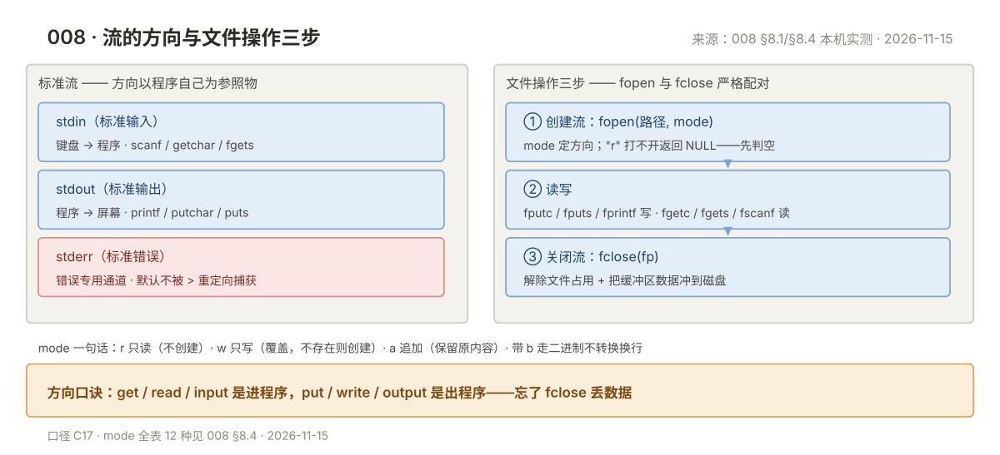

# 008 文件IO

> **解决**：数据走出内存——程序与磁盘文件、键盘、控制台之间的数据交互：流的方向判定、scanf 的输入缓冲区坑、fopen 三步操作与 mode 表、字符级/行级读写与判末尾；本册所有输出均为本机实录（GCC 16.2.0，见「C语言」001）。  
> **范围**：流概念与方向 · 输入缓冲区与 getchar · 文件类型 · fopen/mode · fputc/fputs 写 · fgetc/fgets 读 · fclose。  
> **口径**：C17；字符流（文本文件）操作，二进制文件读写（fread/fwrite）后续按需扩册。  
> **更新**：2026-11-15  
> **本册导读** ── 必会三点：① 流的方向看**参照物**（程序自己是原点），函数名带 read/get/input 是进、write/put/output 是出 ② scanf 连续录入先数字后字符会失败——`\n` 残留缓冲区，`getchar()` 吃掉（buf_bad/buf_ok 实录）③ 文件操作三步：创建流（fopen）→ 读写 → 关闭流（fclose），mode 决定读/写/追加/覆盖 ｜ 跟做时长：约 2 小时 ｜ 前置：002（占位符）、004（函数调用）。  
> **标记**：★ = 必会节；○ = 拓展节。

## 目录

| 节 | 内容 |
|---|---|
| 8.1 | 流：数据像水一样进出程序 ○ |
| 8.2 | scanf 的缓冲区坑与 getchar ★ |
| 8.3 | 文件与字符流 ○ |
| 8.4 | fopen：创建流与 mode 表 ★ |
| 8.5 | 读文件：fgetc / fgets 与判末尾 ★ |
| 8.6 | w 覆盖 / a 追加：一次实验看懂 mode ○ |
| 8.7 | 坑表 |
| 8.8 | 检查清单（自测 6 题 + 动手任务 3 件） |

---

## 8.1 流：数据像水一样进出程序 ○

**定义**：流（stream）是数据进出程序的**通道**。I = input（进程序），O = output（出程序）——**方向永远以当前 C 程序为参照物**。函数名就是路标：带 `input / read / get / pull` 的是输入（数据进程序），带 `output / write / put / push` 的是输出（数据出程序）。

| 流 | 参照物视角 | 典型函数（都在 `<stdio.h>`） |
|---|---|---|
| stdin（标准输入） | 键盘 → 程序 | `scanf`、`getchar`（返回 `int`）、`fgets(str, n, stdin)` |
| stdout（标准输出） | 程序 → 控制台 | `printf`、`putchar`（签名 `int putchar(int)`）、`puts`（自动补换行） |
| stderr（标准错误） | 程序 → 控制台（错误专用通道） | `fprintf(stderr, "...\n")` |
| 文件流 | 磁盘文件 ↔ 程序 | `fopen` 创建，`fgetc/fgets/fputc/fputs/fprintf/fscanf` 读写，`fclose` 关闭 |

**stderr 为什么单列**：错误信息走专用通道——重定向/记录日志时错误不会被"正常输出"淹没。本机实测（`stderr_demo.exe > out.txt`）：屏幕只剩 `error output (stderr)`，out.txt 里只有 stdout 行——**stderr 默认不被 `>` 重定向捕获**，这是日志工具按流分离数据的原理。

三条流的方向与文件操作三步纪律，一张图收拢：



**机制**：printf 不会立刻把每个字符送到屏幕——数据先进**缓冲区**（中转站），攒一批或遇到换行/程序结束才真正送出；输入同理，键盘敲的字符先排队在输入缓冲区里，scanf 从队首取。缓冲区是本册第一大坑（§8.2）与文件"忘 fclose 数据可能没落盘"的根源（§8.4）。

**stderr 实测**（`stderr_demo.c`——三行程序）：

```c
#include <stdio.h>

int main(void)
{
    printf("normal output (stdout)\n");
    fprintf(stderr, "error output (stderr)\n");
    return 0;
}
```

**跟做**：`gcc -Wall stderr_demo.c -o stderr_demo.exe` 后运行 `.\stderr_demo.exe > out.txt`——**屏幕只剩 `error output (stderr)` 一行**，out.txt 里只有 stdout 行（本机实录）：重定向 `>` 只抓 stdout，stderr 仍直上屏幕。

**试一试**：跑 `printf("no newline")` 不带 `\n` 的程序（001 §1.3 的 hello.c 改一行）——观察输出何时冒出来（程序结束时一起冒），体会缓冲。

## 8.2 scanf 的缓冲区坑与 getchar ★

**定义**：`scanf("%c", &ch)` 取的是输入缓冲区**队首的下一个字符**——上一轮 `%d` 吃完数字后，你敲的回车（`\n`）还留在队首，下一轮 `%c` 把它当"字符"吃掉，**真正的字符录入失败**。解法：中间放一个 `getchar()`（从缓冲区拿走一个字符）把残留的 `\n` 吃掉。

**完整示例**（`buf_bad.c`——故意不清缓冲）：

```c
#include <stdio.h>

int main(void)
{
    int num;
    char ch;

    printf("请输入一个数字: ");
    scanf("%d", &num);
    printf("你输入的数字: %d\n", num);

    /* 没有 getchar 清缓冲 */

    printf("请输入一个字符: ");
    scanf("%c", &ch);
    printf("你输入的字符: [%c]\n", ch);
    return 0;
}
```

**跟做**：编译运行，输入 `42` 回车、再输入 `x` 回车。**预期输出（本机实录）**：

```text
请输入一个数字: 你输入的数字: 42
请输入一个字符: 你输入的字符: [
]
```

**修复版**（`buf_ok.c`，只加一行）：

```c
    getchar(); /* 吃掉缓冲区残留的 \n */
```

**预期输出（本机实录，同样输入 42 + x）**：

```text
请输入一个数字: 你输入的数字: 42
请输入一个字符: 你输入的字符: [x]
```

**三处必看的机制**：① 坏版里 `[ ]` 中间那个"看不见的字符"就是 `\n`——`%c` 把残留回车当结果吃了，你敲的 `x` 还压在队列里；② `getchar()` 的返回值是 `int`（能装下字符与 EOF 标志），这里只为"抽掉一个字符"，不用接；③ 另一种写法是 `scanf(" %c", &ch)`（占位符前加空格：跳过空白字符）——两条路都通，同一个程序里选一种统一用。

**试一试**：① 把坏版的第二次录入改成 `scanf("%s", str)`（先声明 `char str[20];`）——字符串录入不会被 `\n` 卡住（`%s` 自己跳空白），体会"坑只坑 `%c`"；② 连续录两个数字 `scanf("%d", &a); scanf("%d", &b);`（先声明两个 int）验证 `%d` 之间不需要 getchar（`%d` 自动跳过空白）。

## 8.3 文件与字符流 ○

**定义**：文件 = 计算机存放**字节**的容器；文件夹不占字节、不能读写，只做分类。全部文件都是**字节文件**；其中用记事本能打开并正常阅读的那类叫**字符文件**（.txt、.c、.md）。只认字节的流能操作一切文件，但操作字符文件不方便（要自己处理编码）；只认字符的流（本册所学）只能操作字符文件。

**机制**：判断一个文件能不能用本册函数操作，就用记事本打开看一眼——能读就是字符文件。图片、音频、.exe 是字节文件，得用 `fread/fwrite`（二进制读写，后续按需扩册）。这个边界在嵌入式里同样成立：配置文件、日志是字符流；固件镜像、传感器原始帧是字节流。

## 8.4 fopen：创建流与 mode 表 ★

**定义**：`FILE *fopen(const char *filename, const char *mode)` 创建文件流：filename 是文件路径，mode 决定流的**方向与打开方式**。三步纪律：**创建流 → 读写 → fclose 关闭流**。fopen 可能失败（返回 NULL）——**拿到返回值先判空**。

**mode 表（文本 + 二进制 + 读写组合，本机常用 12 种；`b` 后缀可前可后如 `"rb"`/`"r+b"`）**：

| mode | 含义 | 文件不存在 | 文件已存在 |
|---|---|---|---|
| `"r"` | 只读 | **不创建**，返回 NULL | 从头读 |
| `"w"` | 只写 | 自动创建 | **整体覆盖**（内容先清空） |
| `"a"` | 追加写 | 自动创建 | 从尾部追加，原内容保留 |
| `"r+"` | 读 + 写 | 不创建，返回 NULL | 从头读写 |
| `"w+"` | 读 + 写 | 自动创建 | 覆盖 |
| `"a+"` | 读 + 追加写 | 自动创建 | 从尾追加 |
| `"rb"` / `"wb"` / `"ab"` | 二进制只读 / 只写 / 追加 | 同 `"r"`/`"w"`/`"a"` | 同左 |
| `"rb+"` / `"wb+"` / `"ab+"` | 二进制读写 | 同 `"r+"`/`"w+"`/`"a+"` | 同左 |

**b 的意义**：文本模式在 Windows 上会把 `\n` 转写成 `\r\n`（写出）——二进制模式不做任何转换，字节进字节出。图片/传感器帧/自定义协议数据一律用 `b` 模式，否则文件字节数对不上。

**完整示例**（`file_write.c`）：

```c
#include <stdio.h>

int main(void)
{
    /* "w"：文件不存在则创建, 存在则整体覆盖 */
    FILE *fp = fopen("note.txt", "w");
    if (fp == NULL)
    {
        printf("创建输出流失败\n");
        return 1;
    }

    fputs("hello file IO\n", fp); /* 写一个字符串 */
    fputc('C', fp);               /* 写一个字符 */
    fputs("\nsecond line\n", fp);

    fclose(fp); /* 解除文件占用 */
    printf("写完了, 看 note.txt\n");
    return 0;
}
```

**跟做**：在实验目录编译运行，然后 `cat note.txt`（或记事本打开）核对。**预期输出（本机实录）**——程序输出：

```text
写完了, 看 note.txt
```

note.txt 内容：

```text
hello file IO
C
second line
```

**三处必看的机制**：① `"w"` 模式下 note.txt **不存在就被创建**——输出流自带建文件能力；② `fputc('C', fp)`、`fputs(..., fp)` 的方向都是"程序 → 文件"（第二个参数是目的地）；③ `fclose` 不只解占用——它把缓冲区里没写完的数据**冲到磁盘**，忘 fclose 可能丢尾巴。

**试一试**：① 把 mode 改成 `"r"` 跑写程序——note.txt 内容没变（只读流写不进，写函数静默失败）；② ⚠️ 删掉判空与 `return 1`、fopen 一个不存在的路径（如 `"no_such_dir/x.txt"`），让 fputs 直接对 NULL 流写——观察崩溃，这就是"先判空"防的雷。

**格式化文件 IO：fprintf 写 + fscanf 读**（`fmt_demo.c`）——比 fputs/fgets 多了占位符能力，文本模式存"结构化记录"的标准做法：

```c
#include <stdio.h>

int main(void)
{
    /* fprintf：格式化写入文件（比 fputs 多了占位符能力） */
    FILE *fp = fopen("fmt.txt", "w");
    if (fp == NULL)
    {
        return 1;
    }
    fprintf(fp, "%s score=%d avg=%.2f\n", "tom", 92, 88.5);
    fclose(fp);

    /* fscanf：从文件按格式读出（返回成功解析项数） */
    FILE *in = fopen("fmt.txt", "r");
    if (in == NULL)
    {
        return 1;
    }
    char name[20];
    int score;
    double avg;
    int got = fscanf(in, "%s score=%d avg=%lf", name, &score, &avg);
    printf("got=%d name=%s score=%d avg=%.2f\n", got, name, score, avg);
    fclose(in);
    return 0;
}
```

**预期输出（本机实录）**——fmt.txt 内容：

```text
tom score=92 avg=88.50
```

程序输出：

```text
got=3 name=tom score=92 avg=88.50
```

**机制**：`fprintf(fp, ...)` 比 fputs 多占位符能力——"记录"按固定格式落盘；`fscanf(in, ...)` 的格式串里 `score=`、`avg=` 是逐字符匹配的字面锚（009 §9.3 的 sscanf 同一套规则），返回值 3 = 成功解析的项数，按行循环解析时用它判读停。

## 8.5 读文件：fgetc / fgets 与判末尾 ★

**定义**：`"r"` 创建输入流后两种读法：`fgetc(fp)` 一次读**一个字符**（读完返回标志 EOF，即 -1）；`fgets(str, num, fp)` 一次读**一行**（num 用数组长度，读到末尾返回 **NULL**——循环判末尾的标准写法）。

**完整示例**（`file_read.c`）：

```c
#include <stdio.h>

int main(void)
{
    /* "r"：只读。文件不存在不会创建, fopen 返回 NULL */
    FILE *fp = fopen("note.txt", "r");
    if (fp == NULL)
    {
        printf("文件不存在 (fopen 返回 NULL)\n");
        return 1;
    }

    /* fgetc 一次读一个字符: 返回 EOF (即 -1) 表示读完 */
    int c;
    printf("fgetc 逐字符: ");
    while ((c = fgetc(fp)) != EOF)
        putchar(c);

    rewind(fp); /* 回到文件开头, 再演示按行读 */

    /* fgets 一次读一行: 返回 NULL 表示读到末尾 */
    char line[100];
    printf("fgets 按行:\n");
    while (fgets(line, sizeof line, fp) != NULL)
        printf("  > %s", line);

    fclose(fp);
    return 0;
}
```

**跟做**：用 §8.4 的 note.txt 跑。**预期输出（本机实录，note.txt 为 §8.4 产生的三行）**：

```text
fgetc 逐字符: hello file IO
C
second line
fgets 按行:
  > hello file IO
  > C
  > second line
```

（想看更多行？跟完 §8.6 后用 `"a"` 往 note.txt 追加一行再重跑本程序即可。）

**三处必看的机制**：① `int c` 接 `fgetc`——**不要用 char 接**：本机 char 是有符号的，EOF(-1) 恰好能判停，但文件里出现数据字节 0xFF 时会被误判为 EOF 提前停；换到 unsigned char 的平台（部分 ARM 工具链）则永远停不下来。`int c` 是唯一同时躲开两种坑的写法；② `fgets` 返回 NULL 才是"读到文件末尾"的判断条件——`while (fgets(...) != NULL)` 是文本行处理的固定句式；`fgets` 会把行尾的 `\n` 一起读进数组（所以 `> %s` 后不用手动加换行）；③ 文件不存在时 fopen 返回 NULL 且**不会创建**——判空分支是"r" 流的必配件（本机实录第一分支）。

**试一试**：① 构造一个含 0xFF 字节的文件（如 `printf 'AB\xffCD' > bin.txt`），把 `int c` 改成 `char c` 重跑——读 A、B 后提前停，0xFF 被当成了 EOF；② 用 `fgets(line, 5, fp)`（数组故意小）读长行——一行被切成多次读，体会 num 参数的含义。

## 8.6 w 覆盖 / a 追加：一次实验看懂 mode ○

**定义**：同一个文件连续以不同 mode 打开，行为立见分晓——`"w"` 每次打开都**清空重来**，`"a"` 每次都在**尾巴上接着长**。

**完整示例**（`mode_test.c`）：

```c
#include <stdio.h>

void write_it(const char *mode, const char *text)
{
    FILE *fp = fopen("mode.txt", mode);
    if (fp == NULL)
    {
        printf("open %s failed\n", mode);
        return;
    }
    fputs(text, fp);
    fclose(fp);
}

int main(void)
{
    write_it("w", "first\n");
    write_it("w", "second\n"); /* 覆盖: 文件里只剩 second */
    write_it("a", "third\n");  /* 追加: second + third */
    printf("done\n");
    return 0;
}
```

**跟做**：编译运行后 `cat mode.txt` 核对。**预期输出（本机实录）**——mode.txt 最终内容：

```text
second
third
```

**三处必看的机制**：① 两次 `"w"` 写入后 first 没了——第二次打开瞬间清空旧内容，"first" 是被 mode 杀的，不是被 fputs 覆盖的位置杀的；② `"a"` 把 third 接在 second 尾巴上——日志文件、数据采集记录都用追加模式（清空等于删证据）；③ 每次 `write_it` 都 fopen/fclose 一轮——占用的文件要及时还回去，否则别的程序（和下一次打开）可能受影响。

**试一试**：① 把第一行改成 `"a"`（追加 first）再跑，预测最终内容并验证；② 用记事本同时打开 mode.txt，再跑程序看"文件被占用"时写入是否受影响（Windows 的占用语义）。

## 8.7 坑表

| # | 现象 | 原因 | 解法 |
|---|---|---|---|
| 1 | 连续录入时字符/字符串读不到 | 上一轮的 `\n` 残留缓冲区（§8.2 实录） | 中间 `getchar()`，或 `" %c"` 带空格占位符 |
| 2 | `scanf("%s")` 空格后的内容没了 | `%s` 遇空白即停 | 整行用 `fgets(str, sizeof str, stdin)`；gets 已从 C11 移除，不用 |
| 3 | 打开不存在的文件去读，程序乱来 | `"r"` 不创建、fopen 返回 NULL | 拿到 fp **先判空**（§8.4） |
| 4 | 老文件内容突然全没了 | `"w"` 打开即清空 | 要保留用 `"a"` 追加 |
| 5 | 程序跑完文件少了最后几行 | 忘 fclose，缓冲区数据没落盘 | fopen 与 fclose 严格配对 |
| 6 | 文件读到一半就停了 / 或永远停不下来 | 用 `char` 接 fgetc：0xFF 数据字节被误判 EOF（signed）或 EOF 判不到（unsigned） | 用 `int c` 接（§8.5） |
| 7 | 路径写的没问题却打不开 | 相对路径起点是**运行时工作目录**，不一定是 exe 所在目录 | 先确认工作目录，或临时用绝对路径验证 |

## 8.8 检查清单（自测 6 题 + 动手任务 3 件）

**自测**：

| # | 问题 | 自测标准 |
|---|---|---|
| 1 | 判断流方向的参照物 | 当前 C 程序自己；get/read 是进、put/write 是出 |
| 2 | 先录数字再录字符为何失败 | `\n` 残留被 `%c` 吃掉；getchar() 抽掉 |
| 3 | 文件操作三步 | fopen 创建流 → 读写 → fclose 关闭流 |
| 4 | "r" 打开不存在的文件 | 返回 NULL、不创建——必须判空 |
| 5 | fgets 怎么判读完 | 返回 NULL；行尾 `\n` 一起读入 |
| 6 | "w" 与 "a" 的差别 | 覆盖清空 vs 尾部追加（mode.txt 实录） |

**动手任务**：① buf_ok 改成"录整数 → 录字符串（带空格）"，字符串用 `fgets` + 必要的清缓冲——产出物：程序 + 运行输出；② 写"记账本"小程序：向 `account.txt` 追加一行 `项目 金额`，再把全文件读出打印——产出物：程序 + account.txt 内容；③ 复现 mode_test 三连写并 cat 验证最终内容——产出物：mode.txt（second + third）。

---

> 下一篇：《009 命令行参数与字符串格式化》——数据进出程序的最后一块拼图：命令行传参与字符串上的格式化读写。
