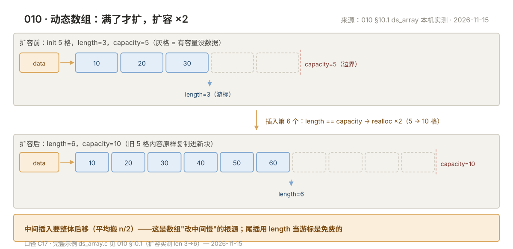
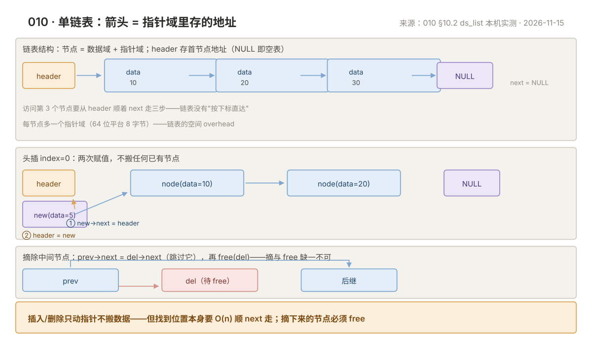

# 010 动态数组与链表

> **解决**：把"组织一批数据"从定长数组升级为可增删的容器——动态数组的完整实现（结构体/扩容/增删改查/遍历/销毁）与单链表的完整实现（节点/指针域/增删改查遍历），以及两种结构的选型对比；这是数据结构板块的地基册，后续栈/队列/散列都长在它们上面；本册所有输出均为本机实录（GCC 16.2.0，见「C语言」001）。  
> **范围**：动态数组 · 单链表 · 数组 vs 链表选型。  
> **口径**：C17；容量增长策略以讲义原码（×2）为准；边界修正处见坑表 1。  
> **更新**：2026-11-15  
> **本册导读** ── 必会三点：① 动态数组三件套 length/capacity/data 与扩容时机（满了才扩、×2）② 链表节点 = 数据域 + 指针域，插入/删除只动指针不搬数据 ③ 数组 vs 链表的选型表（访问快用数组、频繁增删中间用链表） ｜ 跟做时长：约 3 小时 ｜ 前置：003（指针与 malloc/free）、007 §7.7（动态内存四函数）、006（struct 与typedef）。  
> **标记**：★ = 必会节；○ = 拓展节。

## 目录

| 节 | 内容 |
|---|---|
| 10.1 | 动态数组：结构体、扩容与全套 API ★ |
| 10.2 | 单链表：节点、指针域与全套 API ★ |
| 10.3 | 数组 vs 链表：选型对比表 ★ |
| 10.4 | 坑表 |
| 10.5 | 检查清单（自测 6 题 + 动手任务 3 件） |

---

## 10.1 动态数组：结构体、扩容与全套 API ★

**定义**：动态数组 = 三个成员的 struct——`data` 指向 malloc 来的连续内存、`length` 记实际元素个数、`capacity` 记容量；**length == capacity 时先扩容（realloc，讲义策略 ×2）再插入**。它解决了定长数组"长度一旦确定不可变"（005 §5.1）的死结。

**完整示例**（`ds_array.c`，讲义原码全套 API，边界修正见坑表 1）：

```c
#include <stdio.h>
#include <stdlib.h>
#include <stdbool.h>

/* 动态数组：结构体 + 全套 API */
typedef struct
{
    int *data;       /* 指向连续内存的指针 */
    size_t length;   /* 数据个数 */
    size_t capacity; /* 容量 */
} DynamicArray;

void init_array(DynamicArray *array, size_t init_capacity)
{
    array->data = (int *)malloc(init_capacity * sizeof(int));
    array->length = 0;
    array->capacity = init_capacity;
}

void resize_array(DynamicArray *array, size_t new_capacity)
{
    array->data = (int *)realloc(array->data, new_capacity * sizeof(int));
    array->capacity = new_capacity;
}

void destroy_array(DynamicArray *array)
{
    free(array->data);
    array->data = NULL;
    array->capacity = 0;
    array->length = 0;
}

size_t get_length(DynamicArray *array)
{
    return array->length;
}

void insert_at(DynamicArray *array, size_t index, int element)
{
    if (index > array->length) /* 插入允许 index == length（=尾插） */
        return;
    if (array->length == array->capacity)
        resize_array(array, array->capacity * 2);
    for (size_t i = array->length; i > index; i--)
        array->data[i] = array->data[i - 1];
    array->data[index] = element;
    array->length++;
}

void insert_end(DynamicArray *array, int element)
{
    insert_at(array, array->length, element);
}

bool delete_at(DynamicArray *array, size_t index, int *del_element)
{
    if (index >= array->length) /* 修正：索引等于长度也是越界 */
        return false;
    *del_element = array->data[index];
    for (size_t i = index; i < array->length - 1; i++)
        array->data[i] = array->data[i + 1];
    array->length--;
    return true;
}

bool delete_end(DynamicArray *array, int *del_element)
{
    if (array->length == 0) /* 修正：空表直接失败 */
        return false;
    return delete_at(array, array->length - 1, del_element);
}

void printf_array(DynamicArray *array)
{
    if (array->length == 0)
        return;
    for (size_t i = 0; i < array->length; i++)
        printf("%d ", array->data[i]);
    printf("\n");
}

int main(void)
{
    DynamicArray array;
    init_array(&array, 5);
    insert_at(&array, 0, 30);
    insert_at(&array, 0, 20);
    insert_at(&array, 0, 10);
    printf("len=%zu\n", get_length(&array));
    insert_end(&array, 40);
    insert_end(&array, 50);
    insert_end(&array, 60); /* 第 6 个元素：容量 5 装不下 → 扩容 */
    printf("len=%zu\n", get_length(&array));
    printf_array(&array);
    int del_num;
    delete_at(&array, 3, &del_num);
    printf("deleted arr[3] = %d\n", del_num);
    delete_end(&array, &del_num);
    printf("deleted end = %d\n", del_num);
    printf("len=%zu\n", get_length(&array));
    printf_array(&array);
    destroy_array(&array);
    return 0;
}
```

**跟做**：`gcc -Wall ds_array.c -o ds_array.exe` → `.\ds_array.exe`。**预期输出（本机实录）**：

```text
len=3
len=6
10 20 30 40 50 60 
deleted arr[3] = 40
deleted end = 60
len=4
10 20 30 50
```

**三处必看的机制**：① **插入的搬运成本**：`insert_at(0, …)` 要把已有元素整体后移一格——插入平均移动 n/2 个、删除平均移动 (n-1)/2 个（讲义结论），这就是数组"改中间慢"的根源；② **扩容只发生在 length == capacity 那一刻**：5 个格子装第 6 个元素时 realloc 到 10 格——`len=6` 前后两次输出就是扩容前后的实证；③ **尾插 insert_end 是免费的了**——定长数组做不到"接着放"，动态数组用 length 当游标直接追加。

**配套图**：动态数组的容量/长度关系与扩容时机，画成图——灰格是有容量没数据的空位，length 是下一个写入位置的游标：



**试一试**：① 在 main 里补一行 `printf("cap=%zu\n", array.capacity);`（destroy 之前）——扩容后容量从 5 变 10；② ⚠️ 故意 `delete_at(&array, 99, &del_num)`——修正后的边界检查返回 false 不崩；把检查改回讲义原码的 `index > length` 再试 `delete_at(&array, 6, …)`（len=4 时）——越界读垃圾值，这就是坑表 1 的由来。

## 10.2 单链表：节点、指针域与全套 API ★

**定义**：链表节点 = **数据域 + 指针域**——`data` 存值、`next` 存下一个节点的地址；链表头 `header` 存首节点地址（NULL 即空表）。插入/删除只需改两个指针、不搬数据；代价是**访问必须从头顺着 next 走**。

**完整示例**（`ds_list.c`，讲义原码全套 API，查删改边界修正同坑表 1）：

```c
#include <stdio.h>
#include <stdlib.h>
#include <stdbool.h>

/* 单向链表：节点 + 链表头 + 全套 API */
typedef struct Node
{
    int data;          /* 数据域 */
    struct Node *next; /* 指针域：存下一个节点的地址 */
} Node;

typedef struct
{
    Node *header;  /* 指向第一个节点 */
    size_t length; /* 链表长度 */
} LinkedList;

void init_linked_list(LinkedList *list)
{
    list->header = NULL;
    list->length = 0;
}

void destroy_list(LinkedList *list)
{
    Node *current_node = list->header;
    while (current_node != NULL)
    {
        Node *free_node = current_node;
        current_node = current_node->next;
        free(free_node);
    }
    list->header = NULL;
    list->length = 0;
}

size_t get_length(LinkedList *list)
{
    return list->length;
}

Node *get_prev_node(LinkedList *list, size_t index)
{
    Node *prev_node = list->header;
    for (size_t i = 1; i < index; i++)
        prev_node = prev_node->next;
    return prev_node;
}

void insert_at(LinkedList *list, size_t index, int element)
{
    if (index > list->length) /* 插入允许 index == length（=尾插） */
        return;
    Node *new_node = (Node *)malloc(sizeof(Node));
    new_node->data = element;
    if (index == 0)
    {
        new_node->next = list->header;
        list->header = new_node;
    }
    else
    {
        Node *prev_node = get_prev_node(list, index);
        new_node->next = prev_node->next;
        prev_node->next = new_node;
    }
    list->length++;
}

void insert_end(LinkedList *list, int element)
{
    insert_at(list, list->length, element);
}

bool delete_at(LinkedList *list, size_t index, int *del_element)
{
    if (index >= list->length) /* 修正：删除 index==length 也是越界 */
        return false;
    Node *del_node = NULL;
    if (index == 0)
    {
        del_node = list->header;
        list->header = list->header->next;
    }
    else
    {
        Node *prev_node = get_prev_node(list, index);
        del_node = prev_node->next;
        prev_node->next = prev_node->next->next;
    }
    *del_element = del_node->data;
    free(del_node);
    list->length--;
    return true;
}

bool delete_end(LinkedList *list, int *del_element)
{
    if (list->length == 0) /* 修正：空表直接失败 */
        return false;
    return delete_at(list, list->length - 1, del_element);
}

void get_value(LinkedList *list, size_t index, int *element)
{
    if (index >= list->length) /* 修正：获取 index==length 也是越界 */
        return;
    if (index != 0)
    {
        Node *prev_node = get_prev_node(list, index);
        *element = prev_node->next->data;
        return;
    }
    *element = list->header->data;
}

void edit_value(LinkedList *list, size_t index, int element)
{
    if (index >= list->length) /* 修正：修改 index==length 也是越界 */
        return;
    if (index != 0)
    {
        Node *prev_node = get_prev_node(list, index);
        prev_node->next->data = element;
        return;
    }
    list->header->data = element;
}

void printf_list(LinkedList *list)
{
    if (list->length == 0)
        return;
    Node *current_node = list->header;
    while (current_node != NULL)
    {
        printf("%d ", current_node->data);
        current_node = current_node->next;
    }
    printf("\n");
}

int main(void)
{
    LinkedList list;
    init_linked_list(&list);
    insert_at(&list, 0, 20);
    insert_at(&list, 0, 10);
    printf("len=%zu\n", get_length(&list));
    insert_end(&list, 30);
    printf("len=%zu\n", get_length(&list));
    printf_list(&list);
    int del_num;
    delete_at(&list, 2, &del_num);
    printf("deleted idx2 = %d\n", del_num);
    delete_end(&list, &del_num);
    printf("deleted end = %d\n", del_num);
    printf("len=%zu\n", get_length(&list));
    int element;
    get_value(&list, 0, &element);
    printf("arr[0] = %d\n", element);
    edit_value(&list, 0, 100);
    printf_list(&list);
    destroy_list(&list);
    return 0;
}
```

**跟做**：编译运行。**预期输出（本机实录）**：

```text
len=2
len=3
10 20 30 
deleted idx2 = 30
deleted end = 20
len=1
arr[0] = 10
100 
```

**三处必看的机制**：① **头插 vs 中插是两条路径**——index==0 只动 header 和新节点（两个赋值）；否则先 `get_prev_node` 走到前驱，再"新节点接后继、前驱接新节点"（两个赋值）——全程没有搬运；② **删除把节点从链上摘下来后还要 free**——`prev->next = prev->next->next` 只完成了"摘"，不 free 就是内存泄漏（003 §3.5）；③ `destroy_list` 先存 next 再 free 当前——顺序反了就拿到已释放内存里的野指针（003 §3.5 全家福）。

**配套图**：单链表的节点结构与头插/删除的指针操作见本册配图 010-02。



**试一试**：① `get_prev_node(list, 0)` 会返回 header——为什么 index==0 的插入/删除要单独分支（对照 §10.2 代码两条路径）；② ⚠️ 把 destroy_list 里两行 `current_node = current_node->next;` 和 `free(free_node);` 对调顺序，编译照过——运行起来就是"使用已释放内存"（003 §3.5 表第 4 行）。

## 10.3 数组 vs 链表：选型对比表 ★

**定义**：两种结构没有谁更好，只有**场景适配**——同一操作在两者上的成本不同，选型就是"把高频操作分配给便宜的结构"。

| 操作 | 动态数组 | 单链表 | 选型含义 |
|---|---|---|---|
| 按索引访问 | O(1)（data[i] 直达） | O(n)（从头走 i 步） | 随机读多用数组 |
| 尾部插入/删除 | O(1)（length 当游标） | O(n)（走到尾；无尾指针时） | 追加日志用数组 |
| 中间插入/删除 | O(n)（平均搬 n/2） | O(1)（找到位置后只动指针，找到本身 O(n)） | 频繁中间增删用链表 |
| 内存形态 | 连续（缓存友好） | 分散（每节点额外一个指针域） | 容量敏感看 overhead |
| 扩容 | 满→realloc ×2 | 天然按节点生长 | 长度不可预估用链表 |

**机制**：搬运成本的数字见 §10.1 机制①；链表"插入删除效率高"的完整表述是"**找到位置之后**效率高"，找位置仍要 O(n)。

**试一试**：用 §10.1/§10.2 两套 API 各做"在 10000 个元素的第 0 位插入 100 次"——链表版瞬间完成（头插两次赋值），数组版每次搬 10000 个元素（总搬 100 万次），实测计时对比（013 §13.1 事后统计法）。

## 10.4 坑表

| # | 现象 | 原因 | 解法 |
|---|---|---|---|
| 1 | 删除/获取 index==length 时读到垃圾 | 讲义原码边界笔误：查删改用 `index > length`（本册已修正为 `>=`；插入保留 `>` 因 index==length 是合法尾插） | 增删改查各自核对边界语义 |
| 2 | 空表 delete_end 读到下溢索引 | `length - 1` 对 size_t 是 SIZE_MAX | 先判空再取 `length - 1`（本册已修正） |
| 3 | 链表删了节点内存还在涨 | 只摘链未 free | 摘链与 free 同函数内完成（§10.2） |
| 4 | destroy 后再打印链表崩 | use-after-free，链上全是野指针 | destroy 里 header 置 NULL（§10.2 实码） |
| 5 | 动态数组越写越慢 | 每次插入都从头搬 | 尾插用 insert_end；中间插考虑链表 |
| 6 | realloc 返回 NULL 后原数据"没了" | realloc 失败返回 NULL 且原块未释放 | 先接临时指针判空再赋回（007 §7.7） |

## 10.5 检查清单（自测 6 题 + 动手任务 3 件）

**自测**：

| # | 问题 | 自测标准 |
|---|---|---|
| 1 | 动态数组三个成员各记什么 | data 地址 / length 实数 / capacity 容量 |
| 2 | 扩容发生在何时、策略是什么 | length == capacity 时 realloc ×2（讲义策略） |
| 3 | 链表节点两域 | 数据域 data + 指针域 next |
| 4 | 链表头插与中插的差别 | 头插只动 header；中插先找前驱再两次赋值 |
| 5 | 数组插入平均搬多少 | n/2；删除 (n-1)/2 |
| 6 | 链表"删除 O(1)"的完整表述 | 找到位置后动指针 O(1)，找位置本身 O(n) |

**动手任务**：① ds_array 跑通并加容量打印（扩容 5→10 实证）——产出物：程序 + 输出；② ds_list 跑通后新增"按值查找返回索引"API（顺着 next 走）——产出物：程序 + 查找输出；③ 用两套 API 各存 1~100 并倒序打印——产出物：两个程序 + 相同的倒序输出。

> 下一篇：《011 栈与队列》——限制访问位置的两种线性结构：LIFO 与 FIFO，以及队列的假溢出。
