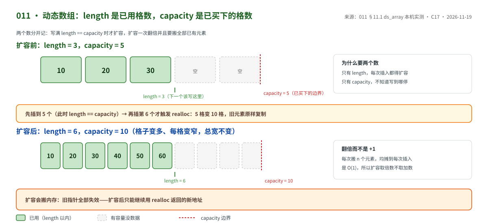
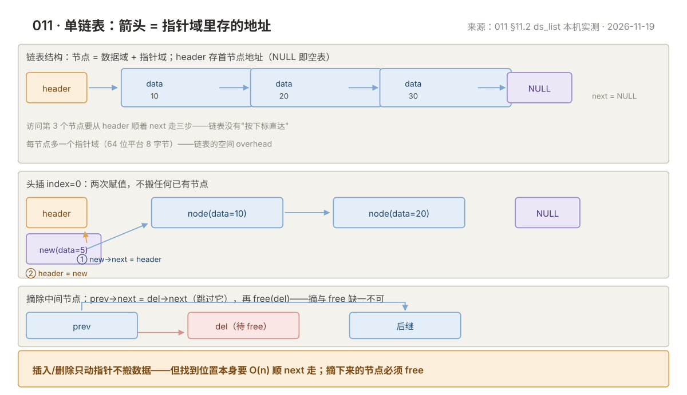
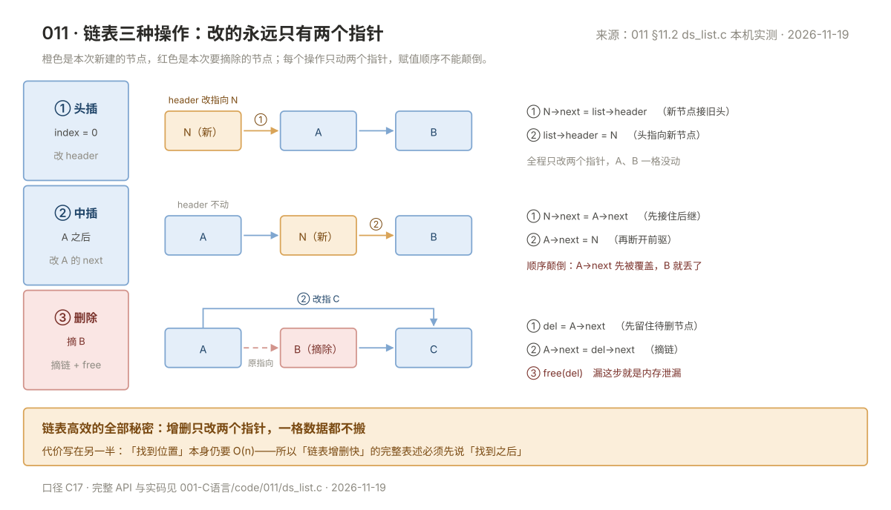

# 011 动态数组与链表

> **定位**：把"组织一批数据"从定长数组升级为可增删的容器——动态数组与单链表的完整实现与选型。  
> **前置**：007（struct 与 typedef）、006 §6.7（动态内存四函数）、005（指针与堆）｜ **示例**：[code/011/](code/011/)

## 11.1 动态数组：三个成员解开"长度不可变" ★

定长数组的死结是长度一旦确定就不可变（003 §3.1）。动态数组用三个成员绕开它：

```c
typedef struct {
    int *data;       /* 指向 malloc 来的连续内存 */
    size_t length;   /* 实际元素个数 */
    size_t capacity; /* 当前容量 */
} DynamicArray;
```



**核心就两条**：`length == capacity` 时先 `realloc` 扩容（讲义策略 ×2）再插入；插入中间元素要整体后移。

```c
if (array->length == array->capacity)
    resize_array(array, array->capacity * 2);
for (size_t i = array->length; i > index; i--)
    array->data[i] = array->data[i - 1];
array->data[index] = element;
array->length++;
```

本机实录（[ds_array.c](code/011/ds_array.c)，初始容量 5）：

```text
len=3
len=6            <- 装第 6 个元素触发扩容，容量 5→10
10 20 30 40 50 60
```

- **插入的搬运成本**：插入平均移动 n/2 个元素、删除平均移动 (n−1)/2 个——这是数组"改中间慢"的根源。
- **扩容只发生在 `length == capacity` 那一刻**，不是每次插入都扩。
- **尾插是免费的**：`insert_end` 拿 `length` 当游标直接追加，定长数组做不到。

## 11.2 单链表：数据域 + 指针域 ★

节点 = **数据域 `data`** + **指针域 `next`**；链表头 `header` 存首节点地址，`NULL` 即空表。



**插入只改两个指针，不搬数据**——头插和中插是两条路径：

```c
new_node->next = list->header;   /* 头插：新节点接旧头 */
list->header = new_node;         /*       链表头指向新节点 */

Node *prev = get_prev_node(list, index);  /* 中插：先走到前驱 */
new_node->next = prev->next;              /*       新节点接后继 */
prev->next = new_node;                    /*       前驱接新节点 */
```

本机实录（[ds_list.c](code/011/ds_list.c)）：

```text
len=2
len=3
10 20 30
deleted idx2 = 30
deleted end = 20
len=1
100
```

- **删除要先把节点从链上摘下来，再 `free`**。只做 `prev->next = prev->next->next` 是"摘"，不 free 就是内存泄漏（005 §5.5）。
- **`destroy_list` 先存 next 再 free 当前**。顺序反了就拿到已释放内存里的野指针。
- **代价是访问必须从头走**：随机访问 O(n)，与数组的 O(1) 正好相反。

三种操作各自改哪两个指针、顺序为什么不能颠倒，一图对齐：



## 11.3 数组 vs 链表：把高频操作分给便宜的结构 ★

两种结构没有谁更好，只有场景适配——**选型就是把高频操作分配给成本低的那一个**。

| 操作 | 动态数组 | 单链表 | 选型含义 |
|---|---|---|---|
| 按索引访问 | O(1)，`data[i]` 直达 | O(n)，从头走 i 步 | 随机读多用数组 |
| 尾部插入/删除 | O(1)，`length` 当游标 | O(n)，无尾指针时要走到尾 | 追加日志用数组 |
| 中间插入/删除 | O(n)，平均搬 n/2 | O(1)，找到位置后只动指针（找位置本身 O(n)） | 频繁中间增删用链表 |
| 内存形态 | 连续，缓存友好 | 分散，每节点多一个指针域 | 容量敏感看 overhead |
| 扩容 | 满则 realloc ×2 | 天然按节点生长 | 长度不可预估用链表 |

O(1)/O(n) 是复杂度记号，表示成本随规模增长的趋势，正式定义见 010。

**"链表插入删除快"的完整表述是"找到位置之后快"**，找位置仍要 O(n)。

**验证**：用两套 API 各做"在 10000 个元素的第 0 位插入 100 次"——链表版只需头插两次赋值，数组版每次搬 10000 个元素，计时对比即可看出量级差（010 §10.1 事后统计法）。

## 11.4 坑表

| # | 现象 | 原因 | 解法 |
|---|---|---|---|
| 1 | 删除或获取 index==length 时读到垃圾 | 讲义原码边界笔误：查删改用 `index > length`（本册已修正为 `>=`；插入保留 `>`，因 index==length 是合法尾插） | 增删改查各自核对边界语义 |
| 2 | 空表 `delete_end` 读到下溢索引 | `length - 1` 对 `size_t` 是 SIZE_MAX | 先判空再取 `length - 1`（本册已修正） |
| 3 | 链表删了节点内存还在涨 | 只摘链未 free | 摘链与 free 在同一函数内完成 |
| 4 | destroy 后再打印链表崩 | use-after-free，链上全是野指针 | destroy 里把 header 置 NULL |
| 5 | 动态数组越写越慢 | 每次插入都从头搬 | 尾插用 `insert_end`；中间插考虑链表 |
| 6 | realloc 返回 NULL 后原数据"没了" | realloc 失败返回 NULL 且原块未释放 | 先接临时指针判空再赋回（006 §6.7；本册实码为演示简化） |

## 11.5 自测与动手

| # | 问题 |
|---|---|
| 1 | 动态数组三个成员各记什么？ |
| 2 | 扩容在什么时刻发生，策略是什么？ |
| 3 | 链表节点由哪两个域组成？ |
| 4 | 链表头插与中插的差别在哪？ |
| 5 | 数组插入、删除平均各搬多少个元素？ |
| 6 | "链表删除 O(1)"的完整表述是什么？ |

**动手**：① 跑 [ds_array.c](code/011/ds_array.c) 并加一行容量打印，看到 5→10；② 给 [ds_list.c](code/011/ds_list.c) 加一个"按值查找返回索引"的 API；③ 用两套 API 各存 1~100 并倒序打印，对比两版输出是否一致。

**跑起来**：`cd code/011 && gcc -Wall ds_array.c -o ds_array.exe && ./ds_array.exe`

> 下一篇：《012 栈与队列》——限制访问位置的两种线性结构：LIFO 与 FIFO，以及队列的假溢出。
