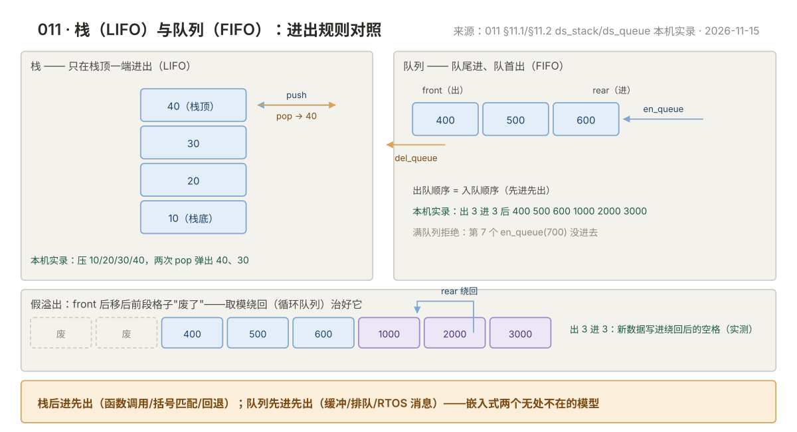

# 011 栈与队列

> **解决**：两种"限制访问位置"的线性结构——栈只从栈顶进出（LIFO）、队列一端进另一端出（FIFO），以及队列的假溢出问题与循环队列解法；函数调用栈（003 §3.4）、裸机环形缓冲、任务调度全靠这两个模型；本册所有输出均为本机实录（GCC 16.2.0，见「C语言」001）。  
> **范围**：栈（结构体/压弹栈/扩容） · 队列（队首队尾/假溢出） · 循环队列实现 · 嵌入式场景。  
> **口径**：C17；讲义原码风格（栈用 length 当栈顶计数、队列用 front/rear 取模）；栈底另两种 top 约定见 §11.1 定义。  
> **更新**：2026-11-15  
> **本册导读** ── 必会三点：① 栈 LIFO：push/pop 只在栈顶，pop 返回的是最后压入的（ds_stack 实录 40→30）② 队列 FIFO：rear 入 front 出，朴素实现有假溢出问题 ③ 循环队列取模绕回治好假溢出——出 3 进 3 空间复用实录（ds_queue） ｜ 跟做时长：约 2.5 小时 ｜ 前置：010（动态数组三件套与 realloc 纪律）。  
> **标记**：★ = 必会节；○ = 拓展节。

## 目录

| 节 | 内容 |
|---|---|
| 11.1 | 栈：LIFO 与压弹栈实现 ★ |
| 11.2 | 队列：FIFO 与假溢出问题 ★ |
| 11.3 | 循环队列：取模绕回的实现 ★ |
| 11.4 | 嵌入式场景：谁在用栈和队列 ○ |
| 11.5 | 坑表 |
| 11.6 | 检查清单（自测 6 题 + 动手任务 3 件） |

---

## 11.1 栈：LIFO 与压弹栈实现 ★

**定义**：栈（stack）= 只允许在**栈顶**一端插入（push）和删除（pop）的线性结构——**后进先出 LIFO**。概念约定：不含元素的栈叫空栈；讲义另提两种 top 约定（初始 top=-1 先加后增 / top=0 先增后用），本册实现用 `length` 计数法：栈顶永远是 `data[length-1]`，语义等价且不踩 off-by-one。

**完整示例**（`ds_stack.c`，讲义原码风格）：

```c
#include <stdio.h>
#include <stdlib.h>
#include <stdbool.h>

/* 栈：数组底座 + 栈顶计数 */
typedef struct
{
    int *data;
    size_t length;   /* 栈中数据个数（栈顶 = length-1） */
    size_t capacity;
} Stack;

void init_stack(Stack *stack, size_t init_capacity)
{
    stack->data = (int *)malloc(init_capacity * sizeof(int));
    stack->length = 0;
    stack->capacity = init_capacity;
}

void resize_stack(Stack *stack, size_t new_capacity)
{
    stack->data = (int *)realloc(stack->data, new_capacity * sizeof(int));
    stack->capacity = new_capacity;
}

void destroy_stack(Stack *stack)
{
    free(stack->data);
    stack->data = NULL;
    stack->length = 0;
    stack->capacity = 0;
}

size_t get_length(Stack *stack)
{
    return stack->length;
}

void push_stack(Stack *stack, int element)
{
    if (stack->length == stack->capacity)
        resize_stack(stack, stack->capacity * 2);
    stack->data[stack->length] = element;
    stack->length++;
}

bool pop_stack(Stack *stack, int *del_element)
{
    if (stack->length == 0)
        return false;
    *del_element = stack->data[stack->length - 1];
    stack->length--;
    return true;
}

void printf_stack(Stack *stack)
{
    if (stack->length == 0)
        return;
    for (size_t i = 0; i < stack->length; i++)
        printf("%d ", stack->data[i]);
    printf("\n");
}

int main(void)
{
    Stack st;
    init_stack(&st, 3);
    push_stack(&st, 10);
    push_stack(&st, 20);
    push_stack(&st, 30);
    printf("len=%zu\n", get_length(&st));
    printf_stack(&st);
    push_stack(&st, 40); /* 容量 3 装不下 → 扩容 */
    printf("len=%zu\n", get_length(&st));
    printf_stack(&st);
    int del_num;
    pop_stack(&st, &del_num);
    printf("pop = %d\n", del_num);
    pop_stack(&st, &del_num);
    printf("pop = %d\n", del_num);
    printf("len=%zu\n", get_length(&st));
    printf_stack(&st);
    destroy_stack(&st);
    return 0;
}
```

**跟做**：`gcc -Wall ds_stack.c -o ds_stack.exe` → `.\ds_stack.exe`。**预期输出（本机实录）**：

```text
len=3
10 20 30 
len=4
10 20 30 40 
pop = 40
pop = 30
len=2
10 20 
```

**三处必看的机制**：① **LIFO 被 pop 顺序实证**：压入 10/20/30/40，两次 pop 弹出 40、30——后进的先出（006 §6.7 的调用栈图在代码层面落地）；② **扩容时机与动态数组相同**：length == capacity 才 realloc（第 4 个元素触发 3→6）；③ **pop 空栈纪律**：空栈 pop 返回 false 而不是崩——调用方拿返回值决定后续（与 010 的边界纪律同源）。

**配套图**：栈与队列的进出规则对照见本册配图 011-01。



**试一试**：① 连续 pop 空栈三次，每次打印返回值——三次都是 false 不崩；② 用栈实现"倒序打印"：把 1~10 依次 push 再依次 pop 打印——这就是栈最经典的应用形态（006 §6.7 函数调用栈同理）。

## 11.2 队列：FIFO 与假溢出问题 ★

**定义**：队列（queue）= 只允许**队尾（rear）插入、队首（front）删除**的线性结构——**先进先出 FIFO**：出队顺序永远等于入队顺序。概念约定：不含元素的队列叫空队列。朴素实现直接用 front++/rear++ 两个下标在数组上前后移——它会遇到一个专属问题：**假溢出**。

**机制**：假溢出的成因——出队 3 次后 front 从 0 走到 3，数组**前段 3 个格子物理上还在分配区里，逻辑上却"废了"**（rear 已到尾部，再入队就越界）；明明有空格却"装不下"，所以叫**假**溢出。讲义给两种解法：① 每次出队后全体元素前移一格（像 010 数组的删除——代价 O(n) 每次出队）；② **把数组掰成环**：front/rear 对 capacity 取模绕回——这是标准答案，下一节实现它。

**试一试**：① 在纸上画"容量 6 的朴素队列，入 6 个、出 3 个、再入 3 个"——rear 会指到下标 6（越界），而 0~2 格空着；② 想一想为什么前移解法贵（对照 §11.1 机制里数组删除的搬运成本）。

## 11.3 循环队列：取模绕回的实现 ★

**定义**：循环队列 = front/rear 对 capacity **取模**前进的队列——物理下标绕回使用，前段"废格"重新可用；判断满与空用 `length` 计数（讲义实现），不用"rear 撞 front"的指针法（那要牺牲一个格子）。

**完整示例**（`ds_queue.c`，讲义原码循环队列）：

```c
#include <stdio.h>
#include <stdlib.h>
#include <stdbool.h>

/* 循环队列：front/rear 取模绕回 */
typedef struct
{
    int *data;
    size_t length;
    size_t capacity;
    size_t front; /* 队首：待删除索引 */
    size_t rear;  /* 队尾：待插入索引 */
} Queue;

void init_queue(Queue *queue, size_t init_capacity)
{
    queue->data = (int *)malloc(init_capacity * sizeof(int));
    queue->length = 0;
    queue->capacity = init_capacity;
    queue->front = 0;
    queue->rear = 0;
}

size_t get_length(Queue *queue)
{
    return queue->length;
}

void destroy_queue(Queue *queue)
{
    free(queue->data);
    queue->data = NULL;
    queue->length = 0;
    queue->capacity = 0;
    queue->front = 0;
    queue->rear = 0;
}

void en_queue(Queue *queue, int element)
{
    if (queue->length == queue->capacity) /* 满队列：拒绝入队 */
        return;
    queue->data[queue->rear] = element;
    queue->rear = (queue->rear + 1) % queue->capacity; /* 取模绕回 */
    queue->length++;
}

bool del_queue(Queue *queue, int *del_element)
{
    if (queue->length == 0)
        return false;
    *del_element = queue->data[queue->front];
    queue->front = (queue->front + 1) % queue->capacity;
    queue->length--;
    return true;
}

void printf_queue(Queue *queue)
{
    if (queue->length == 0)
        return;
    for (size_t i = 0; i < queue->length; i++)
    {
        size_t index = (queue->front + i) % queue->capacity;
        printf("%d ", queue->data[index]);
    }
    printf("\n");
}

int main(void)
{
    Queue qu;
    init_queue(&qu, 6);
    en_queue(&qu, 100);
    en_queue(&qu, 200);
    en_queue(&qu, 300);
    en_queue(&qu, 400);
    en_queue(&qu, 500);
    en_queue(&qu, 600);
    en_queue(&qu, 700); /* 第 7 个：满队列拒绝 */
    printf("len=%zu\n", get_length(&qu));
    printf_queue(&qu);
    int d;
    del_queue(&qu, &d);
    del_queue(&qu, &d);
    del_queue(&qu, &d);
    printf("len=%zu\n", get_length(&qu));
    printf_queue(&qu);
    en_queue(&qu, 1000);
    en_queue(&qu, 2000);
    en_queue(&qu, 3000); /* 出 3 进 3：front/rear 绕回，空间复用 */
    printf("len=%zu\n", get_length(&qu));
    printf_queue(&qu);
    destroy_queue(&qu);
    return 0;
}
```

**跟做**：编译运行。**预期输出（本机实录）**：

```text
len=6
100 200 300 400 500 600 
len=3
400 500 600 
len=6
400 500 600 1000 2000 3000 
```

**三处必看的机制**：① **满队列拒绝而非报错**：第 7 个 `en_queue(700)` 被 `length == capacity` 分支直接吞掉——len 停在 6，调用方靠返回长度感知（工程版应返回 bool，试一试 ①）；② **假溢出被取模治好**：出队 3 次后 front=3，循环队列再入队 3 个（1000/2000/3000）写进绕回后的 0~2 格——`400 500 600 1000 2000 3000` 这行就是空间复用的实证；③ **遍历也要取模**：`(front + i) % capacity` 从队首逻辑顺序读，物理下标是乱的——这就是"队列逻辑顺序 ≠ 物理顺序"。

**试一试**：① 给 en_queue/del_queue 加 bool 返回值（满了返回 false），用返回值感知"700 被拒"；② ⚠️ 把两处 `% queue->capacity` 删掉（朴素 front++/rear++）重跑——出 3 进 3 后 rear=9 越过 capacity=6，数据写到分配区外（003 §3.5 的越界写）。

## 11.4 嵌入式场景：谁在用栈和队列 ○

**定义**：两个模型在嵌入式里无处不在——**栈**：函数调用栈（006 §6.7，栈帧与调用栈图）、表达式求值、中断现场的保存与恢复（保存现场 = 压栈，恢复 = 弹栈）；**队列**：串口/网络收发的环形缓冲（中断里入队、主循环里出队）、消息队列（RTOS 的任务间通信原语，规划 RTOS 板块展开）、打印任务排队。

**机制**：环形缓冲就是本册的循环队列在 uint8_t 上的变体——中断服务程序只做 en_queue（快进快出），主循环做 del_queue；这是"中断短、主循环长"分工的基础设施（「操作系统原理」003 的中断机制给了为什么）。栈方向的纪律：函数栈帧是编译器管的"自动栈"（006 §6.5 ret_addr 实录过悬空风险），程序员手写的栈（本册）才是自己管生命周期的。

**试一试**：① 用本册 Stack 实现"括号匹配检查"：`"(()"` 逐字符入栈出栈——左括号 push、右括号 pop，结束时栈非空即不匹配；② 数一数你写过的代码里哪些地方"其实是个队列"（打印队列、命令队列）。

## 11.5 坑表

| # | 现象 | 原因 | 解法 |
|---|---|---|---|
| 1 | 空栈 pop 拿到垃圾值 | 没判空就取 `data[length-1]` | pop 先判空返回 false（§11.1 实码） |
| 2 | 队列"明明有空格却入不了队" | 假溢出：front 后移，前段格子废了 | front/rear 取模绕回成循环队列（§11.3） |
| 3 | 循环队列删掉 `% capacity` 后越界写 | rear/front 线性增长越过分配区 | 取模绕回是循环队列的身份（§11.3 试一试） |
| 4 | 满队列继续入队悄悄丢数据 | en_queue 满时静默 return | 加 bool 返回值让调用方感知 |
| 5 | 遍历循环队列从 data[0] 开始读错 | 逻辑顺序从 front 起、物理下标绕回 | `(front + i) % capacity` 遍历（§11.3 实码） |
| 6 | 栈扩容后旧指针失效 | realloc 返回新地址，旧副本还在用 | 与 010 坑 6 同源：realloc 先接临时指针判空 |

## 11.6 检查清单（自测 6 题 + 动手任务 3 件）

**自测**：

| # | 问题 | 自测标准 |
|---|---|---|
| 1 | 栈的进出规则与英文缩写 | 栈顶进出，LIFO（ds_stack pop 40→30 实录） |
| 2 | 队列的进出规则与两端名字 | rear 入 / front 出，FIFO |
| 3 | 假溢出是什么、怎么治 | front 后移前段废；取模绕回成循环队列 |
| 4 | 本册栈顶怎么表达 | `data[length-1]`，length 是计数不是下标 |
| 5 | 循环队列遍历为什么取模 | 逻辑顺序从 front 起，物理下标绕回 |
| 6 | 空栈 pop / 满队列 en 的纪律 | 返回 false / 拒绝——不崩但可感知 |

**动手任务**：① ds_stack 跑通后实现"括号匹配检查器"（升级自 §11.4 试一试①）——产出物：程序 + `"(()"` 与 `"()"` 两组判定输出；② ds_queue 跑通后给 en/del 加 bool 返回值并重跑 main 验证"700 被拒"——产出物：程序 + 输出；③ 用循环队列写 uint8_t 环形缓冲（存 0~255 的字节流）——产出物：程序 + 入 10 字节出 5 字节的打印。

> 下一篇：《012 散列与红黑树》——两种"查找加速"的高级结构：哈希表的桶链组合与红黑树的平衡纪律。
