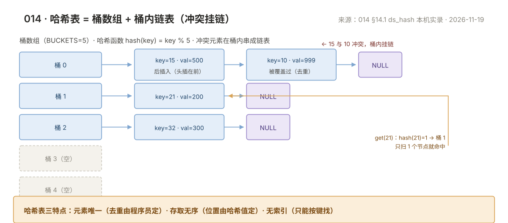

# 014 散列与红黑树

> **解决**：两种"查找加速"的高级结构——哈希表用"取模分桶 + 桶内链表"把查找做到近乎 O(1)，红黑树用"着色纪律"把有序查找稳定在 O(log n)；两者都是面试高频与工业级容器（MySQL 索引、C++ map、Java HashMap）的底座。**本册为概念册**（讲义深度即概念与结构图），哈希分桶思想配一个延伸演示程序，红黑树只立性质与规律不写实现——工程版插入/删除的旋转细节超出本库深度，见边界。  
> **范围**：哈希表结构 · 红黑树概念 · 六种结构选型表。  
> **口径**：概念与结构图以讲义为准；延伸演示程序为本机实录（GCC 16.2.0）；红黑树实现细节不在本库深度内（反幻觉边界）。  
> **更新**：2026-11-15  
> **本册导读** ── 必会三点：① 哈希表 = 数组 + 链表（+ 红黑树）的组合体：哈希函数决定元素住哪个桶、冲突元素在桶内挂链（ds_hash 实录）② 红黑树是自平衡的二叉查找树：五性质保证"没有一条路径长过其他路径两倍"，查找稳定 O(log n) ③ 六种结构选型表：随机读→数组、频繁增删→链表、受限顺序→栈/队列、按键快速找→哈希、要有序遍历→红黑树 ｜ 跟做时长：约 1.5 小时 ｜ 前置：011（链表）、005 §5.2（指针）。  
> **标记**：★ = 必会节；○ = 拓展节。

## 目录

| 节 | 内容 |
|---|---|
| 14.1 | 哈希表：取模分桶与桶内挂链 ★ |
| 14.2 | 红黑树：五性质与退化实证 ★ |
| 14.3 | 六种结构选型表 ★ |
| 14.4 | 坑表 |
| 14.5 | 检查清单（自测 6 题 + 动手任务 2 件） |

---

## 14.1 哈希表：取模分桶与桶内挂链 ★

**定义**：哈希表（hash table，散列表）= **数组 + 链表**（工业级实现再加红黑树）的组合结构：哈希函数把元素的键映射成桶数组的下标（"获取元素哈希值的逻辑由程序员决定"），同一桶内冲突的元素串成链表。讲义给的三特点：**元素唯一**（去重逻辑由程序员决定）、**存取无序**（位置由哈希值决定）、**无索引**（只能按键找，不能按下标找）。

**延伸演示**（`ds_hash.c`——讲义未给代码，本程序演示"取模分桶 + 冲突挂链 + 覆盖去重"思想，标注为延伸材料）：

```c
#include <stdio.h>
#include <stdlib.h>

/* 哈希分桶思想延伸演示（取模分桶 + 链表挂冲突） */
#define BUCKETS 5

typedef struct Node
{
    int key;
    int value;
    struct Node *next; /* 同一个桶里的冲突元素串成链表 */
} Node;

Node *buckets[BUCKETS]; /* 桶数组：每个桶是一条链表的头 */

int hash(int key) /* 哈希函数：由程序员决定 */
{
    return key % BUCKETS;
}

void put(int key, int value)
{
    int b = hash(key);
    Node *cur = buckets[b];
    while (cur != NULL) /* 桶内链表：键已存在则覆盖（去重） */
    {
        if (cur->key == key)
        {
            cur->value = value;
            return;
        }
        cur = cur->next;
    }
    Node *n = (Node *)malloc(sizeof(Node)); /* 头插进桶 */
    n->key = key;
    n->value = value;
    n->next = buckets[b];
    buckets[b] = n;
}

int *get(int key) /* 找不到返回 NULL */
{
    Node *cur = buckets[hash(key)];
    while (cur != NULL)
    {
        if (cur->key == key)
            return &cur->value;
        cur = cur->next;
    }
    return NULL;
}

void print_buckets(void)
{
    for (int b = 0; b < BUCKETS; b++)
    {
        printf("桶%d: ", b);
        for (Node *cur = buckets[b]; cur != NULL; cur = cur->next)
            printf("key=%d(val=%d) -> ", cur->key, cur->value);
        printf("NULL\n");
    }
}

int main(void)
{
    put(10, 100); /* 10 % 5 = 0 → 桶0 */
    put(21, 200); /* 21 % 5 = 1 → 桶1 */
    put(32, 300); /* 32 % 5 = 2 → 桶2 */
    put(15, 500); /* 15 % 5 = 0 → 桶0：与 10 冲突，链表挂接 */
    put(10, 999); /* 键已存在 → 覆盖（去重逻辑） */
    print_buckets();
    int *v = get(21);
    printf("get(21) = %d\n", v ? *v : -1);
    v = get(99); /* 99 % 5 = 4 → 空桶 */
    printf("get(99) = %s\n", v ? "有" : "NULL（没找到）");
    return 0;
}
```

**跟做**：`gcc -Wall ds_hash.c -o ds_hash.exe` → `.\ds_hash.exe`。**预期输出（本机实录）**：

```text
桶0: key=15(val=500) -> key=10(val=999) -> NULL
桶1: key=21(val=200) -> NULL
桶2: key=32(val=300) -> NULL
桶3: NULL
桶4: NULL
get(21) = 200
get(99) = NULL（没找到）
```

**三处必看的机制**：① **15 与 10 冲突挂链**：两个键都映射到桶 0，链表把冲突元素串起来——桶 0 的链是 `key=15 → key=10`（头插序）；② **覆盖去重**：再次 `put(10, 999)` 不新增节点而是把 val 改成 999——"去重逻辑由程序员决定"的直观版；③ **查找只走一个桶**：`get(21)` 只扫桶 1 的 1 个节点就命中——哈希表"近乎 O(1)"的来源（最坏 O(n)：全部挤进一个桶，所以工业级在桶过长时换红黑树）。

**配套图**：哈希表的桶链组合见本册配图 014-01。



**试一试**：① 把 BUCKETS 改成 3 再跑——每个桶挂更多元素，体会"桶越多冲突越少"；② `put(25, 1)`（25 % 5 = 0）再看桶 0——与 10/15 同桶，链表更长。

## 14.2 红黑树：五性质与退化实证 ★

**定义**：红黑树（red-black tree）= 一种**自平衡的二叉查找树**——每个节点带"红/黑"颜色，靠五条性质约束形态，保证任何一条从根到叶的路径都不会长过其他路径的两倍，从而把查找稳定在 O(log n)。它防的是普通二叉查找树（BST）的退化：顺序插入时 BST 长成一条链，查找从 O(log n) 恶化到 O(n)。

**五性质**（讲义原文要点）：

1. 每个节点要么红、要么黑；
2. 根节点必须是黑；
3. 每个叶子（NIL 空节点）是黑；
4. **红色节点的子节点必须是黑**（不允许连续两个红）；
5. **从任一节点到其所有叶子的路径包含相同数目的黑节点**（黑高一致）。

**添加新节点的颜色规律**（讲义结论，面试重点）：新节点**一律先染红**——红色不破坏性质 5（黑高）；染红后若破坏性质 4（父节点也是红），按"叔叔节点"的颜色分情况处理：叔叔为红 → 父叔变黑、祖父变红并向上检查；叔叔为黑 → 旋转（左旋/右旋）+ 变色。**规律口诀：新节点红色插入，父红才需要调整，看叔叔定旋转或变色。**

**退化实证**（`ds_bst.c`——普通 BST 不做平衡时，顺序插入长成链；这就是红黑树存在的理由）：

```c
#include <stdio.h>
#include <stdlib.h>

/* 二叉查找树（BST）顺序插入退化演示：均衡 vs 退化树高对照 */
typedef struct Node
{
    int key;
    struct Node *left;
    struct Node *right;
} Node;

Node *insert(Node *root, int key) /* BST 插入：小往左、大往右 */
{
    if (root == NULL)
    {
        Node *n = (Node *)malloc(sizeof(Node));
        n->key = key;
        n->left = n->right = NULL;
        return n;
    }
    if (key < root->key)
        root->left = insert(root->left, key);
    else if (key > root->key)
        root->right = insert(root->right, key);
    return root;
}

int height(Node *root, int depth, int *max_depth) /* 递归量树高（根的深度记 1） */
{
    if (root == NULL)
        return *max_depth;
    if (depth > *max_depth)
        *max_depth = depth;
    height(root->left, depth + 1, max_depth);
    height(root->right, depth + 1, max_depth);
    return *max_depth;
}

Node *build(int from, int to) /* 顺序插入 from..to */
{
    Node *root = NULL;
    for (int k = from; k <= to; k++)
        root = insert(root, k);
    return root;
}

int main(void)
{
    int mid[] = {4, 2, 6, 1, 3, 5, 7};
    Node *balanced = NULL;
    for (int i = 0; i < 7; i++)
        balanced = insert(balanced, mid[i]); /* 均衡序插入 */
    int max_depth = 0;
    height(balanced, 1, &max_depth);
    printf("均衡插入（4,2,6,1,3,5,7）: 7 个节点, 树高 = %d\n", max_depth);

    Node *degenerated = build(1, 7);
    max_depth = 0;
    height(degenerated, 1, &max_depth);
    printf("顺序插入（1,2,...,7）  : 7 个节点, 树高 = %d  <- 退化成链\n", max_depth);

    Node *big = build(1, 100);
    max_depth = 0;
    height(big, 1, &max_depth);
    printf("顺序插入（1..100）    : 100 个节点, 树高 = %d\n", max_depth);
    return 0;
}
```

**跟做**：编译运行。**预期输出（本机实录）**：

```text
均衡插入（4,2,6,1,3,5,7）: 7 个节点, 树高 = 3
顺序插入（1,2,...,7）  : 7 个节点, 树高 = 7  <- 退化成链
顺序插入（1..100）    : 100 个节点, 树高 = 100
```

**三处必看的机制**：① 同样 7 个节点，均衡序树高 **3**、顺序插入树高 **7**——树高就是查找的最坏步数，退化后 O(log n) 变 O(n)；② 100 个节点的退化树高 100——**每查一个元素要串 100 层**，这就是"为什么需要自平衡"的数字证据；③ 红黑树的五性质就是"不让树长歪"的契约——插入/删除时靠旋转与变色维持。

**机制与边界**：红黑树与哈希表的分工——哈希表"按键找"近乎 O(1) 但**无序**；红黑树查找 O(log n) 但**中序遍历有序**、且支持范围查询。MySQL 索引、C++ 的 map/set、Java 的 TreeMap 都用它。**反幻觉边界**：插入/删除时的旋转与变色细节（LL/RR/LR/RL 四种情形）超出本库深度，本册只立概念与规律——工程实现请查专业教材（讲义同样止步于概念与结构图）。

**试一试**：① 在纸上画"依次插入 10、20、30"的红黑树：10 黑 → 20 红（父 10 黑不违规）→ 30 红（父 20 红，叔叔 NIL 黑 → 左旋变色），对照规律口诀走一遍；② 思考：为什么新节点不能染黑（染黑立即破坏性质 5 的黑高）。

## 14.3 六种结构选型表 ★

**定义**：数据结构没有全能冠军——把"高频操作"分配给"对它便宜的结构"，是选型的全部（011 §11.3 数组链表对比的扩展版）：

| 结构 | 访问 | 插入/删除 | 有序性 | 典型场景 |
|---|---|---|---|---|
| 动态数组 | O(1) 按索引 | 尾 O(1) / 中 O(n) | 按下标有序 | 随机读、追加日志 |
| 链表 | O(n) | 找到后 O(1) | 按链接顺序 | 频繁中间增删 |
| 栈 | 只碰栈顶 | 栈顶 O(1) | LIFO | 函数调用、括号匹配、回退 |
| 队列 | 两端 | 尾进首出 O(1) | FIFO | 缓冲、任务排队、BFS |
| 哈希表 | 按键 O(1) | O(1) | 无序 | 按键快速查找、去重 |
| 红黑树 | O(log n) | O(log n) | 中序有序 | 有序集合、范围查询 |

**机制**：观察"访问 vs 增删"的跷跷板——数组访问快增删慢、链表相反；哈希表查找快但无序、红黑树有序但稍慢。选型三问：**最高频的操作是什么？要不要有序？容量可预估吗？**（退化实证见 §14.2——顺序 BST 的树高 100 就是选错结构的代价。）

**试一试**：① 给"串口收发缓冲"选结构并说理由（FIFO → 循环队列）；② 给"按学号查学生信息"选结构（按键找 → 哈希表）；③ 给"排序后要范围查询（如成绩段统计）"选结构（有序 → 红黑树）。

## 14.4 坑表

| # | 现象 | 原因 | 解法 |
|---|---|---|---|
| 1 | 哈希表里"明明存了却查不到" | 哈希函数不一致（存取用不同逻辑） | 存取用同一个哈希函数 |
| 2 | 全部元素挤进一个桶，查找退化 O(n) | 哈希函数分布差或桶太少 | 加桶数/换分布更均匀的哈希函数 |
| 3 | 同键重复插入出现两条记录 | 桶内没查重 | put 前先扫桶内链表覆盖（§14.1 实码） |
| 4 | 二叉查找树顺序插入后查找变 O(n) | 退化成链表（无平衡） | 换自平衡树（红黑树，性质 4/5 保证平衡） |
| 5 | 忘 free 桶内链表节点 | 销毁只 free 了桶数组 | 逐桶逐节点 free（011 §11.2 的 destroy 纪律） |
| 6 | 以为红黑树"查找总是 O(log n)" | 讲义结论的完整前提是树平衡 | 性质 4/5 由插入/删除的旋转维护——实现细节见专业教材 |

## 14.5 检查清单（自测 6 题 + 动手任务 2 件）

**自测**：

| # | 问题 | 自测标准 |
|---|---|---|
| 1 | 哈希表由哪三样组合 | 数组 + 链表（+ 红黑树） |
| 2 | 哈希表三特点 | 元素唯一 / 存取无序 / 无索引 |
| 3 | 冲突怎么处理 | 桶内挂链表（延伸演示实录） |
| 4 | 红黑树五性质里哪两条保证平衡 | 性质 4（无连续红）+ 性质 5（黑高一致） |
| 5 | 新节点先染什么颜色、为什么 | 红——不破坏黑高 |
| 6 | 哈希表与红黑树的分工 | 按键 O(1) 无序 vs O(log n) 有序 |

**动手任务**：① ds_hash 跑通并把 BUCKETS 改成 3——产出物：程序 + "桶变挤"的桶输出；② 纸上画"依次插入 10、20、30、40"的红黑树着色与旋转过程（对照 §14.2 口诀）——产出物：纸面推导图 + 每步性质核对记录。

> 下一篇：回到 [README](README.md) 总览——C 语言板块十四册收官；带着"容器与算法"的工具箱进入「计算机体系结构」。
