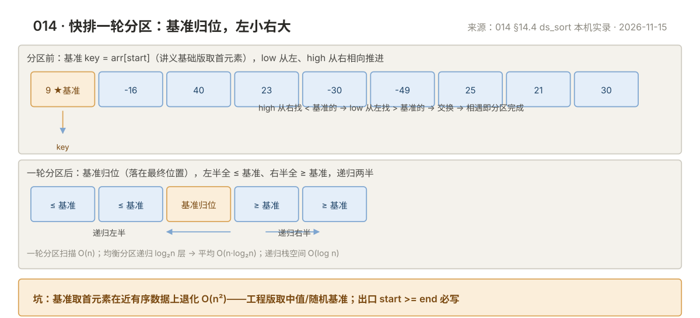

# 014 查找与排序

> **解决**：两族最常用算法——查找（从"逐个找"的顺序查找，到"每次减半"的二分查找）与排序（十大排序概览、冒泡、快速两版），并把 013 的复杂度尺子用到真实算法上；本册所有输出均为本机实录（GCC 16.2.0，见「C语言」001）。  
> **范围**：顺序查找 · 二分查找 · 十大排序概览 · 冒泡排序 · 快速排序（基础版+优化版）。  
> **口径**：C17；算法原理与代码以讲义为准（冒泡/快排含优化版全实测）；十大排序只立概览表，归并/堆排序等其余八种的实现超出本库深度（反幻觉边界）。  
> **更新**：2026-11-15  
> **本册导读** ── 必会三点：① 二分查找的前提是**有序**：每次排除一半，O(log₂n)——"找 90 返回 -1"的没找到语义 ② 冒泡 O(n²)：相邻比较大数右沉，双层循环的平方阶典型 ③ 快排 O(n·log₂n) 平均：基准（pivot）分区 + 递归两半，讲义两版（挖坑交换/预增减扫描）同结果 ｜ 跟做时长：约 2.5 小时 ｜ 前置：013（复杂度尺子）、005（数组遍历）、006 §6.7（递归——快排靠它）。  
> **标记**：★ = 必会节；○ = 拓展节。

## 目录

| 节 | 内容 |
|---|---|
| 14.1 | 查找：顺序与二分 ★ |
| 14.2 | 十大排序概览 ○ |
| 14.3 | 冒泡排序 ★ |
| 14.4 | 快速排序：基准分区与两版实现 ★ |
| 14.5 | 坑表 |
| 14.6 | 检查清单（自测 6 题 + 动手任务 3 件） |

---

## 14.1 查找：顺序与二分 ★

**定义**：顺序查找从头到尾逐个比，O(n)，**无前提**；二分查找（binary search）在**有序**数据集上从中间开始找、每次排除一半，O(log₂n)，**前提是序列有序**（要么天生有序，要么先排序——"慎重"指的是排序本身的成本要摊得回来）。

**完整示例**（`ds_search.c`，讲义原码）：

```c
#include <stdio.h>

/* 顺序查找：从头到尾逐个比 */
int sequential_search(int *arr, int len, int target)
{
    for (int i = 0; i < len; i++)
    {
        if (target == arr[i])
            return i;
    }
    return -1;
}

/* 二分查找：前提有序，每次范围减半 */
int binary_search(int *arr, int len, int target)
{
    int start = 0;
    int end = len - 1;
    while (start <= end)
    {
        int mid = (start + end) / 2;
        if (target > arr[mid])
            start = mid + 1;
        else if (target < arr[mid])
            end = mid - 1;
        else
            return mid;
    }
    return -1;
}

int main(void)
{
    int arr[] = {10, 20, 30, 40, 50, 60, 70};
    int len = sizeof(arr) / sizeof(arr[0]);
    printf("二分找 60 : 索引 %d\n", binary_search(arr, len, 60));
    printf("二分找 90 : 索引 %d（-1 = 没找到）\n", binary_search(arr, len, 90));
    printf("顺序找 30 : 索引 %d\n", sequential_search(arr, len, 30));
    printf("顺序找 35 : 索引 %d（-1 = 没找到）\n", sequential_search(arr, len, 35));
    return 0;
}
```

**跟做**：`gcc -Wall ds_search.c -o ds_search.exe` → `.\ds_search.exe`。**预期输出（本机实录）**：

```text
二分找 60 : 索引 5
二分找 90 : 索引 -1（-1 = 没找到）
顺序找 30 : 索引 2
顺序找 35 : 索引 -1（-1 = 没找到）
```

**三处必看的机制**：① **-1 是"没找到"的哨兵**：合法索引从 0 起，-1 永远不会是查找结果——调用方拿 -1 就知道目标不存在；② **二分的推进方向**：目标 60 > 中间值 40 → start = mid+1（往右半段走）——方向搞反就永远找不到；③ **`start <= end` 是出口的关键**：区间缩成一点时还要比最后一次；写成 `<` 会漏掉单元素区间的比较（试一试 ①）。

**试一试**：① 把 `while (start <= end)` 改成 `while (start < end)` 再找 70——边界元素漏判返回 -1（off-by-one 的查找版，002 §2.5）；② 找一个**乱序数组**跑二分查找——结果不可信：这就是"前提是有序"的分量。

## 14.2 十大排序概览 ○

**定义**：排序算法很多，实现方式、时间复杂度、空间复杂度、稳定性各不相同——讲义列的十大：**冒泡、选择、插入、希尔、归并、快速、堆、计数、桶、基数**。本册实测其中两个最有代表性的（冒泡=平方阶教学标本、快速=线性对数阶工业常用），其余八种的实现超出本库深度（反幻觉边界；概览表给选型坐标）。

| 排序 | 平均时间复杂度 | 一句话 |
|---|---|---|
| 冒泡 | O(n²) | 相邻比较、大数右沉（本册实测） |
| 选择 | O(n²) | 每轮选最小放到前面 |
| 插入 | O(n²) | 像整理扑克牌，新牌插进有序段 |
| 希尔 | O(n^1.3) 左右 | 分组插入的改进 |
| 归并 | O(n·log₂n) | 分半排序再合并，稳定 |
| 快速 | O(n·log₂n) 平均 | 基准分区 + 递归（本册实测） |
| 堆 | O(n·log₂n) | 堆结构选最大/最小 |
| 计数/桶/基数 | O(n+k) 类 | 非比较排序，按值域/位分桶 |

**机制**：平方阶三兄弟（冒泡/选择/插入）教学价值高但大规模数据慢；工业常用的是 O(n·log₂n) 一档（快排/归并/堆）；非比较的计数/桶/基数突破了"比较排序 O(n·log₂n) 下界"，但受值域限制。

**试一试**：① 查一查 C 标准库的 `qsort`（stdlib.h，cppreference 权威参考）——它就是把快排思路做成通用 API；② 报出你手机通讯录排序该用哪种（有序遍历 → 红黑树/有序表，012 §12.3）。

## 14.3 冒泡排序 ★

**定义**：冒泡排序 = **相邻比较、大数右沉**——从第一个元素起依次比较相邻两个，大的换到右边；每跑完一轮，最大的数"沉"到末尾；重复直到整段有序。平方阶的标本：双层循环。

**完整示例**（`ds_sort.c`，讲义原码）：

```c
#include <stdio.h>

/* 冒泡排序：相邻比较，大数右沉 */
void bubble_sort(int *arr, int len)
{
    for (int i = 0; i < len - 1; i++)       /* 外层控制轮数 */
    {
        for (int j = 0; j < len - 1 - i; j++) /* 内层控制每轮比较次数 */
        {
            if (arr[j] > arr[j + 1])
            {
                int t = arr[j];
                arr[j] = arr[j + 1];
                arr[j + 1] = t;
            }
        }
    }
}

/* 快速排序（讲义基础版：基准取首元素，相向双指针交换） */
void quick_sort(int *arr, int start, int end)
{
    if (start >= end)
        return;
    int low = start;
    int high = end;
    int key = arr[start]; /* 基准 */
    while (1)
    {
        while (low < high && arr[high] >= key)
            high--;
        while (low < high && arr[low] <= key)
            low++;
        if (low >= high)
            break;
        int t = arr[low];
        arr[low] = arr[high];
        arr[high] = t;
    }
    arr[start] = arr[high]; /* 基准归位 */
    arr[high] = key;
    quick_sort(arr, start, high - 1);
    quick_sort(arr, high + 1, end);
}

/* 快速排序（讲义优化版：预增减扫描式，high 从 end+1 起步） */
void quick_sort2(int *arr, int start, int end)
{
    if (start >= end)
        return;
    int low = start, high = end + 1;
    while (1)
    {
        while (low < end && arr[++low] <= arr[start])
            ;
        while (high > start && arr[--high] >= arr[start])
            ;
        if (low >= high)
            break;
        int t = arr[low];
        arr[low] = arr[high];
        arr[high] = t;
    }
    int t = arr[start];
    arr[start] = arr[high];
    arr[high] = t;
    quick_sort2(arr, start, high - 1);
    quick_sort2(arr, high + 1, end);
}

void print_arr(int *arr, int len)
{
    for (int i = 0; i < len; i++)
        printf("%d ", arr[i]);
    printf("\n");
}

int main(void)
{
    int a[] = {9, -16, 40, 23, -30, -49, 25, 21, 30};
    int len = sizeof(a) / sizeof(a[0]);
    bubble_sort(a, len);
    printf("冒泡: ");
    print_arr(a, len);

    int b[] = {9, -16, 40, 23, -30, -49, 25, 21, 30};
    quick_sort(b, 0, len - 1);
    printf("快排: ");
    print_arr(b, len);

    int c[] = {9, -16, 40, 23, -30, -49, 25, 21, 30};
    quick_sort2(c, 0, len - 1);
    printf("快排优化版: ");
    print_arr(c, len);
    return 0;
}
```

**跟做**：编译运行。**预期输出（本机实录）**：

```text
冒泡: -49 -30 -16 9 21 23 25 30 40 
快排: -49 -30 -16 9 21 23 25 30 40 
快排优化版: -49 -30 -16 9 21 23 25 30 40
```

**三处必看的机制**：① **内层 `len - 1 - i` 是冒泡的效率细节**：每轮结束后最大值已归位，下一轮不用再比它——轮数递减，比较次数从 (n-1)² 降到一半；② **复杂度对上尺子**：双层遍历 → O(n²)（013 §13.2 平方阶的标本），空间 O(1)（一个临时变量 t）；③ **递归版的快排也是 O(log n) 栈空间**（013 §13.3：深度 = 递归层数）。

**试一试**：① 加一个 swapped 标志：某轮没有任何交换就提前 return（数组已有序时 O(n)）——这就是"优化冒泡"；② 打印每轮结束后的数组，亲眼看"最大值逐轮右沉"。

## 14.4 快速排序：基准分区与两版实现 ★

**定义**：快速排序 = **基准（pivot）分区 + 递归两半**——挑一个基准元素，把小的挪到它左边、大的挪到右边（分区），基准归位后对左右两半递归重复。平均 O(n·log₂n)（n 层分区 × 每层扫描 n），讲义给两版实现：**基础版**（基准取首元素、相向双指针挖坑交换）与**优化版**（预增减扫描式，high 从 end+1 起步）——两版实测同结果。

**完整示例**：见 §14.3（`ds_sort.c` 三函数同文件，`quick_sort` 基础版与 `quick_sort2` 优化版）。**跟做**：同 §14.3 编译运行 `ds_sort.c`。**预期输出（本机实录，节选——全量见 §14.3）**：

```text
快排: -49 -30 -16 9 21 23 25 30 40 
快排优化版: -49 -30 -16 9 21 23 25 30 40
```

**三处必看的机制**：① **分区是快排的灵魂**：一轮下来"基准左边的都 ≤ 基准、右边的都 ≥ 基准"，基准落在它最终该在的位置（归位）——递归只是对两半重复这件事；② **两版的差别在扫描方式**：基础版 low/high 各自内层 while 推进、遇逆序对交换；优化版用 `arr[++low]`/`arr[--high]` 把"推进+比较"合并（high 从 end+1 起步使 `--high` 先落在 end）——思路同源，写法取舍；③ **递归出口 `start >= end`**：单元素/空区间天然有序，直接返回——递归深度 ≈ log₂n 层（均衡分区时）。

**配套图**：一轮分区中基准、low/high 双指针与归位的关系，见下图——



**试一试**：① 手推 `{5, 3, 8, 1, 9, 2}` 以 5 为基准的第一轮分区（low/high 各走到哪、交换几次、基准归位到哪）；② ⚠️ 把 `quick_sort` 的 `start >= end` 出口删掉——无限递归栈溢出（006 §6.7 的"递归没出口"）。

## 14.5 坑表

| # | 现象 | 原因 | 解法 |
|---|---|---|---|
| 1 | 二分查找结果不可信 | 数据未排序（前提不满足） | 先排序，或换顺序查找 |
| 2 | 二分漏判边界元素 | 出口写成 `start < end` | `start <= end`（§14.1 试一试） |
| 3 | 冒泡内层写成 `j < len-1` 多比无效轮 | 每轮最大值已归位 | 内层上界 `len - 1 - i` |
| 4 | 快排栈溢出 | 出口删了 / 基准选得极偏（近有序数据取首元素退化 O(n²)） | 出口必写；基准可取中值/随机 |
| 5 | 排序后原顺序信息丢了 | 比较排序不稳定时相同值相对位置会变 | 看业务要不要"稳定性"（§14.2 概览表） |
| 6 | `mid = (start+end)/2` 在超大数组溢出 | start+end 超出 int 范围 | `start + (end-start)/2`（工程写法） |

## 14.6 检查清单（自测 6 题 + 动手任务 3 件）

**自测**：

| # | 问题 | 自测标准 |
|---|---|---|
| 1 | 二分查找的前提与复杂度 | 有序；O(log₂n)——每次排除一半 |
| 2 | "-1" 的语义 | 没找到的哨兵（合法索引从 0 起） |
| 3 | 冒泡的双重循环各管什么 | 外层轮数、内层每轮比较次数（len-1-i） |
| 4 | 快排一轮分区结束后基准在哪 | 归位到最终位置，左 ≤ 右 |
| 5 | 快排平均复杂度与递归空间 | O(n·log₂n)；栈 O(log n) |
| 6 | 讲义两版快排的差别 | 挖坑交换 vs 预增减扫描——结果相同 |

**动手任务**：① ds_search 跑通后加"顺序查找计数版"（返回比较次数），对比找第 1 个与第 n 个元素的次数——产出物：程序 + 次数输出；② ds_sort 跑通三排序并对 1000 个随机数计时对比冒泡与快排（013 §13.1 事后统计法）——产出物：计时输出；③ 手推 §14.4 试一试 ① 的第一轮分区——产出物：纸上推导（low/high 轨迹 + 归位位置）。

> 下一篇：回到 [README](README.md) 总览——C 语言板块十四册收官；带着"容器与算法"的工具箱进入「计算机体系结构」。
