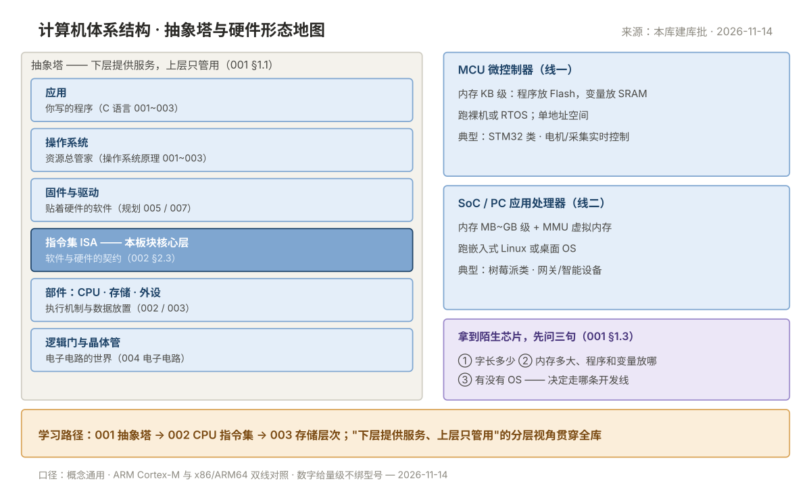

# 000 计算机体系结构全貌

> **一句话**：体系结构 = 把"计算机怎么构成、指令怎么执行、数据放哪里"铺成一张分层地图——它是 C 语言与操作系统之间缺的那块底座，也是嵌入式选型的判断依据。  
> **读者**：学过 C 语法、想弄清"代码底下发生什么"的初学者；要在 MCU 与 SoC 之间做硬件选型的工程师。  
> **阶段**：地基第二阶段——前置是「C语言」001（编译四阶段）；它的产物（执行模型与存储直觉）供「操作系统原理」全程使用。

下图是本板块的世界观：一座行走全库的抽象塔，右侧是嵌入式两条硬件载体线的对照。

## 板块地图

| 册 | 一句话 | 回答的问题 |
|---|---|---|
| [001 抽象层级与计算机组成](001-抽象层级与计算机组成.md) | 世界观层：抽象塔 + 硬件形态 + 信息表示 | 计算机由什么组成、分几层、程序存在哪 |
| [002 CPU与指令集](002-CPU与指令集.md) | 执行层：指令的一生 + 软硬件契约 | CPU 怎么跑一条指令、软件和硬件在哪交界 |
| [003 存储层次与缓存](003-存储层次与缓存.md) | 数据层：金字塔 + 局部性 + 嵌入式现实 | 数据放哪、为什么快慢差千倍、KB 世界怎么活 |

## 核心概念速览

- **抽象层级**：晶体管→逻辑门→部件→指令集→固件→OS→应用，每层只依赖下一层——看懂分层，任何新技术都能找到落点（001 §1.1）。
- **指令集是契约**：ISA 是软件与硬件的边界，同一 ISA 的程序可跑在所有实现它的芯片上（002 §2.3）。
- **存储金字塔**：寄存器→缓存→内存→Flash，越快越小越贵；程序的速度感由它决定（003 §3.1）。
- **中断**：外设不打招呼"举手"打断 CPU——嵌入式世界一切实时行为的起点（002 §2.5）。
- **两条载体线**：MCU（KB 级内存、跑裸机/RTOS）与 SoC（MB/GB 级、跑 Linux）——嵌入式所有知识都挂在这两条线上（001 §1.3）。

## 相邻板块分界

| 谁管 | 不管 | 误归属澄清 |
|---|---|---|
| 「C语言」001~003：代码怎么写怎么编 | 机器怎么执行 | `hello.o` 里的机器码长什么样归本板块 002，写源码归那边 |
| 「操作系统原理」311~332：硬件之上的总管家 | 硬件本身 | 启动链里"加电到 bootloader"的硬件一段在 001，内核装载归 OS 312 |
| 规划「600 MCU 与外设」：外设寄存器实操 | 通用机制 | GPIO/UART 怎么用归 600，中断与时钟的通用模型在本板块 002 |

## 学习路径

- **顺序读**：001 → 002 → 003——先世界观、再执行、再数据，跳层缺直觉。
- **按症状进**：见 [00 术语表](00-术语表.md) 症状反查表。
- **做完 C 语言 003 的**：带着"指针是地址"的直觉来，003 存储层次会立刻接上。

## 误解澄清

| # | 误解 | 实际 |
|---|---|---|
| 1 | 主频高就一定快 | 存储层次、缓存命中率常比主频更决定速度（003 §3.1） |
| 2 | 缓存是系统自动的、与我无关 | 代码访问模式直接决定命中率，按序遍历与跳跃遍历差数倍（003 §3.2） |
| 3 | 学嵌入式必须精通汇编 | 会"读执行流"就够入门，逐行写是专项技能（002 §2.3） |
| 4 | MCU 就是个小号 PC | 内存 KB vs GB、无 MMU、启动链不同——习惯要换（001 §1.3） |
| 5 | 位宽随便用，int 够了 | 字长影响取值范围与 ABI，跨平台代码用定宽类型（001 §1.4） |
| 6 | Flash 里的数据随便改着用 | Flash 写入有寿命与块擦除约束，变量必须放 RAM（003 §3.3） |
| 7 | 冯·诺依曼和哈佛只是考试概念 | 它解释了 MCU 为什么取指与取数同时进行、性能怎么来（001 §1.2） |
| 8 | 中断是麻烦事，能避就避 | 没有中断就没有实时嵌入式；轮询才是要避的低效形态（002 §2.5） |

---

> 下一篇：《001 抽象层级与计算机组成》——先把抽象塔立起来。
