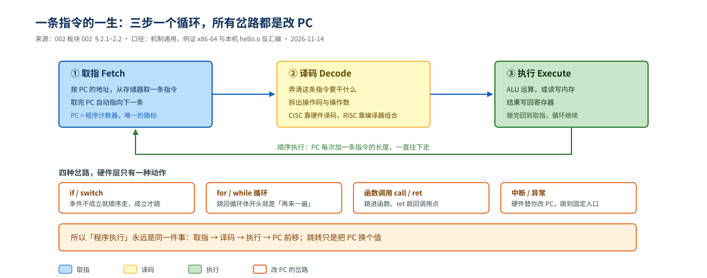
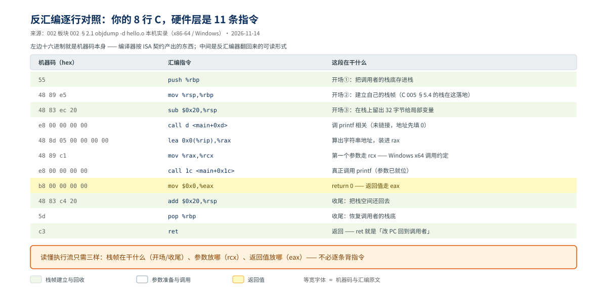
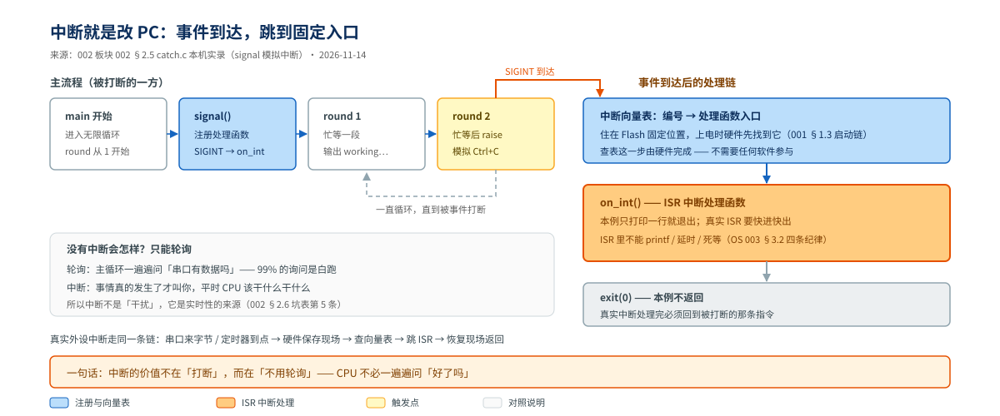

# 002 CPU与指令集

> **解决**：看懂 CPU 执行指令的最小循环、寄存器的角色、指令集作为软硬件契约——并用反汇编亲眼看到"你的 C 变成的指令"，用一个小实验体验"被中断打断"。  
> **范围**：指令周期 · 寄存器 · 指令集与 RISC/CISC · ARM 生态初见 · 反汇编实录 · 中断初见（实验 catch.c）。  
> **口径**：机制通用；例证 ARM Cortex-M（线一）与 x86-64（线二，本机实测）对照；汇编只求"读懂执行流"。  
> **更新**：2026-11-14  
> **本册导读** ── 必会三点：① 指令周期与 PC（一切跳转=改 PC）② objdump 读懂自己的 C（逐行实录）③ 中断 = 改 PC 跳固定入口（catch.c 实录） ｜ 跟做时长：约 2.5 小时 ｜ 前置：001 + C 001（有 hello.o 可反汇编）。  
> **标记**：★ = 必会节；○ = 拓展节。

## 目录

| 节 | 内容 |
|---|---|
| 2.1 | 一条指令的一生：取指→译码→执行 ★ |
| 2.2 | 寄存器：CPU 的手边便签（实验：在汇编里认寄存器） ★ |
| 2.3 | 指令集：软件与硬件的契约 ★ |
| 2.4 | ARM 生态初见：Cortex-M 与 Cortex-A ○ |
| 2.5 | 中断初见（实验：catch.c 体验被打断） ★ |
| 2.6 | 坑表 |
| 2.7 | 检查清单（自测 6 题 + 动手任务 2 件） |

---

## 2.1 一条指令的一生：取指→译码→执行 ★

**定义**：CPU 的本职是一个循环——**取指**：按程序计数器（PC）的地址取一条指令；**译码**：弄清它要干什么；**执行**：ALU 运算或读写内存。做完，PC 指向下一条，循环继续。**PC（程序计数器）**存"下一条指令地址"——所有岔路（if/循环/函数调用/中断）在硬件层都是**改 PC**。



**完整示例**：就用「C语言」001 留下的 `hello.o`——反汇编器把机器码翻回可读形式。

**跟做步骤**：① 在「C语言」001 的 hello 目录执行 `gcc -c hello.c -o hello.o`（已有则跳过）；② 执行：

```bash
objdump -d hello.o
```

**预期输出（本机实录，节选 main 部分）**：

```text
0000000000000000 <main>:
   0:	55                   	push   %rbp
   1:	48 89 e5             	mov    %rsp,%rbp
   4:	48 83 ec 20          	sub    $0x20,%rsp
   8:	e8 00 00 00 00       	call   d <main+0xd>
   d:	48 8d 05 00 00 00 00 	lea    0x0(%rip),%rax        # 14 <main+0x14>
  14:	48 89 c1             	mov    %rax,%rcx
  17:	e8 00 00 00 00       	call   1c <main+0x1c>
  1c:	b8 00 00 00 00       	mov    $0x0,%eax
  21:	48 83 c4 20          	add    $0x20,%rsp
  25:	5d                   	pop    %rbp
  26:	c3                   	ret
```

**逐行读法**（这就是你的 hello.c！）：

| 汇编 | 对应的 C 与含义 |
|---|---|
| `push %rbp` / `mov %rsp,%rbp` / `sub $0x20,%rsp` | main 开场三件套：保存上层的栈底、建立自己的栈帧（栈帧 = 一次函数调用在栈上占用的那一段）——「C语言」005 §5.4 的"栈"在这落了地 |
| `call ...` | 调用 printf 相关（细节在库函数与重定位里） |
| `lea 0x0(%rip),%rax` / `mov %rax,%rcx` | 把字符串地址装进 rcx——**Windows x64 调用约定：第一个参数走 rcx** |
| `mov $0x0,%eax` | `return 0`——返回值走 eax |
| `pop %rbp` / `ret` | 收栈返回——ret 就是"改 PC 回到调用者" |



**观察与判断**：总共 11 条指令——你的 8 行 C 在 ISA 层就这么短。左列十六进制（`55`、`48 89 e5`…）就是机器码本身。

**试一试**：在 hello.c 里多加一个 `printf` 再反汇编对比——`call` 多了一条、`lea` 多了一组（参数地址又装一次）。

## 2.2 寄存器：CPU 的手边便签（实验：在汇编里认寄存器） ★

**定义**：寄存器是 CPU 内部的超高速存储单元，运算必须先把数据搬进寄存器。通用寄存器 + 几个专用：**PC**（下条指令）、**SP/RSP**（栈顶——「C语言」005 §5.4 的栈在硬件上的锚）、**LR**（返回地址，x86 上用栈代替）。

**跟做步骤**：`gcc -S hello.c -o hello.s` 然后打开 hello.s，找这两行（本机实录，已在「C语言」001 §1.5 出现过）：

```asm
	pushq	%rbp
	movq	%rsp, %rbp
```

**读法**：`%rbp` = 栈底指针、`%rsp` = 栈顶指针——C 程序的每一次函数调用，硬件层都在这两个寄存器之间安家。x86 的通用寄存器叫 rax/rbx/rcx…（Cortex-M 叫 R0~R15，其中 R13=SP、R14=LR、R15=PC——名字不同，角色相同）。

**试一试**：在 objdump 输出里找出所有出现过的寄存器名（本机 hello 里：rbp/rsp/rax/rcx 四个）。

## 2.3 指令集：软件与硬件的契约 ★

**定义**：指令集架构（ISA）规定"CPU 认识哪些指令、寄存器怎么编址、内存怎么访问"——**软件与硬件之间的契约**。编译器按契约翻译，芯片按契约实现；契约不变，两边各自演进。

| | RISC（精简指令集） | CISC（复杂指令集） |
|---|---|---|
| 指令风格 | 少而规整、定长、单条干一件事 | 多而丰富、变长、单条干多步 |
| 代表 | ARM、RISC-V | x86 |
| 取舍 | 编译器做组合 | 硬件做解码 |

**ISA 与微架构分工**：ISA 管**对错**（同 ISA 的二进制可跑在所有实现它的芯片上），微架构（厂商内部实现：流水线/缓存大小）管**快慢**。「C语言」001 §1.8 的交叉编译就是"换契约"：`arm-none-eabi-gcc` 按 ARM 的契约产出机器码。

**跟做（读架构签名）**：`objdump -f hello.o`——本机实录：

```text
hello.o:     file format pe-x86-64
architecture: i386:x86-64, flags 0x00000039:
```

`i386:x86-64` 就是这份机器码的"契约名"——它只能在 x86-64 契约的 CPU 上跑，ARM 芯片不认。

**试一试**：对任意一个 .exe 文件执行 `objdump -f 程序名.exe`，确认它同为 x86-64——你机器上所有软件都是这个契约。

## 2.4 ARM 生态初见：Cortex-M 与 Cortex-A ○

**两条线**（001 §1.3 的硬件形态落到芯片家族）：

| | Cortex-M | Cortex-A |
|---|---|---|
| 定位 | 微控制器（线一） | 应用处理器（线二） |
| 跑什么 | 裸机 / RTOS | 嵌入式 Linux / Android |
| 内存 | KB 级 SRAM | MB~GB 级 + MMU |
| 典型 | STM32、ESP32 系列 | 树莓派、手机主控 |

**名字读法**："Cortex-M4" 的 M4 是档次（微架构），ISA 是 Thumb/ARMv7-M——别混。**选型判断**：微秒级确定性响应、电池供电 → M 线（RTOS）；协议栈/GUI/文件系统 → A 线（Linux）。OS 层面的差异在「操作系统原理」312 §312.5 展开。

## 2.5 中断初见（实验：catch.c 体验被打断） ★

**定义**：中断 = 外设主动打断 CPU 当前工作、转去处理紧急事件的机制。没有中断，CPU 只能轮询（一遍遍问"好了吗"），绝大多数询问是浪费。**最小机制**：每个中断源有编号；芯片里有一张**中断向量表**（编号→处理函数入口）；中断到达 → 硬件自动保存现场 → 查表跳到 ISR → 执行完恢复现场回来。

**完整示例**（`catch.c`）——用"信号"模拟中断：主循环被打断，控制流跳进处理函数：

```c
#include <stdio.h>
#include <stdlib.h>
#include <signal.h>

void on_int(int sig)                 /* 中断处理函数：被打断后跳到这里 */
{
    (void)sig;
    printf("\ncaught SIGINT - handler took over, exiting\n");
    exit(0);
}

int main(void)
{
    signal(SIGINT, on_int);          /* 注册：SIGINT 到来时跳 on_int */
    for (int round = 1; ; round++) {
        printf("working... round %d\n", round);
        for (volatile long i = 0; i < 20000000; i++) { }   /* 忙等一段 */
        if (round == 2) raise(SIGINT);                     /* 模拟 Ctrl+C（真实中断由 OS 递送） */
    }
    return 0;
}
```

**跟做**：`gcc -Wall catch.c -o catch.exe` → `.\catch.exe`。**预期输出（本机实录）**：

```text
working... round 1
working... round 2

caught SIGINT - handler took over, exiting
```

**机制**：round 2 时 `raise(SIGINT)` 触发事件 → 控制流**离开主循环**跳进 `on_int` → 处理完退出。这正是「C语言」002 §2.5 里 Ctrl+C 打断死循环的正式版：**事件到达 → 硬件/OS 改 PC → 跳进处理函数**。



真实外设中断（串口来字节、定时器到点）的递送机制在「操作系统原理」331 与规划「600 MCU 与外设」闭环；本册立住「**中断 = 改 PC 跳到固定入口**」。

**试一试**：把 `raise(SIGINT)` 删掉，程序变成无限循环——在终端按 **Ctrl+C** 手动触发（这就是真实 SIGINT 的递送，效果与实验一致）。

## 2.6 坑表

| # | 现象 | 原因 | 解法 |
|---|---|---|---|
| 1 | 想逐行读懂全部汇编 | 拿排障需求当学习目标 | 会看执行流与跳转即可（§2.1 十行读懂法） |
| 2 | 混淆内核名与指令集 | "M4 是 ISA"误记 | ISA 是 Thumb/ARMv7-M；M4 是档次 |
| 3 | PC 上编译的程序直接烧 MCU | 指令集契约不同（objdump -f 可证） | 交叉编译（「C语言」001 §1.8） |
| 4 | 以为寄存器和内存一样快 | 相差一个量级以上 | 热数据住寄存器（003 §3.1） |
| 5 | 中断当"坏事"想关掉 | 没理解实时性的来源 | 轮询才低效（catch.c 实验的对照面） |
| 6 | 反汇编里 call 后地址全是 0 | 未链接的目标文件重定位未填 | 用链接后的 exe 反汇编看真实地址 |

## 2.7 检查清单（自测 6 题 + 动手任务 2 件）

**自测**：

| # | 问题 | 自测标准 |
|---|---|---|
| 1 | 指令周期三步 | 取指→译码→执行 |
| 2 | PC 是什么、if 在硬件层是什么 | 下条指令地址；跳转=改 PC |
| 3 | hello.c 里 return 0 变成了哪条指令 | `mov $0x0,%eax`（objdump 实录） |
| 4 | Windows x64 第一个参数走哪个寄存器 | rcx（`mov %rax,%rcx` 实录） |
| 5 | ISA 与微架构分工 | 对错与快慢 |
| 6 | 中断的最小机制 | 向量表+保存现场+ISR+恢复现场 |

**动手任务**：① 完成 §2.1 的反汇编跟做，把逐行读法表抄进笔记；② catch.c 跑通，再删掉 raise 用 Ctrl+C 触发一次。

> 下一篇：《003 存储层次与缓存》——数据住在哪，四种访问模式在本机实测差 100 倍。
