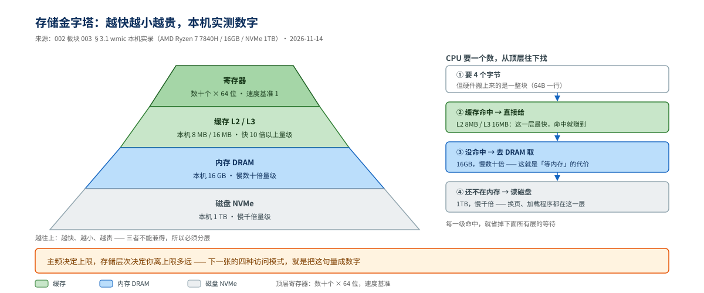
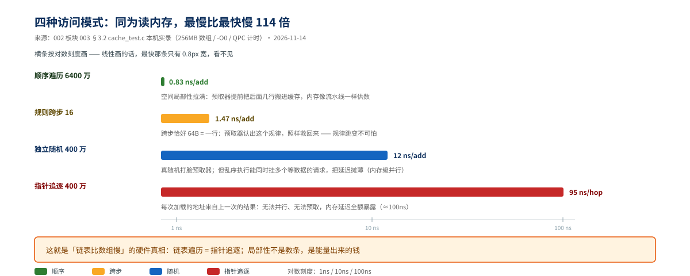
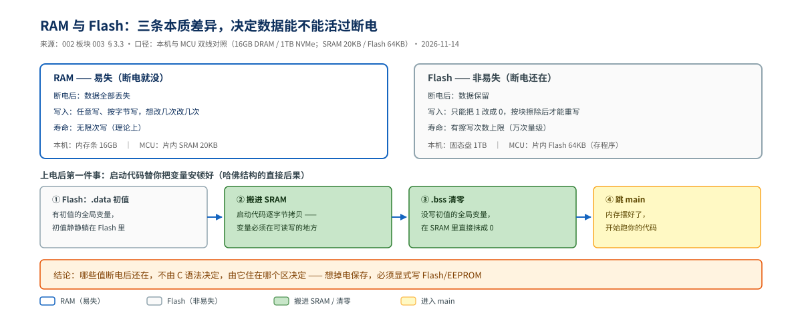

# 003 存储层次与缓存

> **解决**：看清"数据住在哪、为什么快慢差百倍"——存储金字塔用本机实数填充，缓存有效性用四相位实验（顺序/随机/跨步/指针追逐）在本机实测：同样是读内存，最慢模式比最快慢 **100 倍**。  
> **范围**：存储金字塔 · 局部性与缓存（实验 cache_test.c）· RAM vs Flash · 嵌入式存储现实 · DMA 初见。  
> **口径**：本机实测环境 = AMD Ryzen 7 7840H（L2 8MB / L3 16MB）+ 16GB 内存 + 1TB NVMe；实验用 `-O0` 编译防向量化干扰；速度数字均为本机实录。  
> **更新**：2026-11-14  
> **本册导读** ── 必会三点：① 存储金字塔（本机实数：L2 8MB/L3 16MB/RAM 16GB）② 四种访问模式实测（0.83ns vs 95ns，差 114 倍）③ RAM/Flash 分工与 KB 纪律 ｜ 跟做时长：约 2 小时 ｜ 前置：002（懂 PC 与取指）。  
> **标记**：★ = 必会节；○ = 拓展节。

## 目录

| 节 | 内容 |
|---|---|
| 3.1 | 存储金字塔：越快越小越贵（本机实数版） ★ |
| 3.2 | 缓存与局部性（实验：四种访问模式实测） ★ |
| 3.3 | RAM 与 Flash：易失与非易失 ★ |
| 3.4 | 嵌入式存储现实：KB 世界的纪律 ★ |
| 3.5 | DMA 初见：绕过 CPU 的搬运工 ○ |
| 3.6 | 坑表 |
| 3.7 | 检查清单（自测 6 题 + 动手任务 2 件） |

---

## 3.1 存储金字塔：越快越小越贵（本机实数版） ★

**定义**：存储按"速度—容量—价格"构成金字塔——越往上越快、越小、越贵；没有介质三者兼得，所以必须分层。**本机实测数字**（`wmic` 查询实录）：

| 层级（自顶向下） | 本机容量（实测） | 相对速度 | 用途 |
|---|---|---|---|
| 寄存器 | 数十个 × 64 位 | 1（基准） | CPU 当前运算 |
| 缓存 L2 / L3 | **8 MB / 16 MB** | 快 10 倍以上量级 | 自动暂存热点数据 |
| 内存（DRAM） | **16 GB** | 慢数十倍量级 | 运行中的程序与变量 |
| 磁盘（NVMe） | **1 TB** | 慢千倍量级 | 程序与数据的仓库 |



（查询方法：`wmic cpu get Name,L2CacheSize,L3CacheSize` 与 `wmic computersystem get TotalPhysicalMemory`——你的机器跑一下就能拿到自己的数字。）

**机制**：CPU 取数总是从顶层找起，找不到就向下一层取，并**顺手把周边一批搬上来**。程序的速度感由"命中在哪一层"决定——**主频决定上限，存储层次决定你离上限多远**。§3.2 的实验将让这句话变成实测数字。

## 3.2 缓存与局部性（实验：四种访问模式实测） ★

**定义**：缓存能生效靠**局部性**——刚用过的还会用（时间局部性）、用过的旁边也快被用（空间局部性）。但"访问模式不同速度差多少"？四相位实验直接量给你。

**完整示例**（`cache_test.c`，重点段——四种模式）：

```c
/* 256MB 数组；QPC 计时；gcc -O0 编译（防向量化干扰） */
/* 模式一：顺序遍历 6400 万个元素 */
for (size_t i = 0; i < N; i++) sum += arr[i];

/* 模式二：随机顺序访问 400 万个位置（洗牌过的下标数组） */
for (size_t i = 0; i < M; i++) sum += arr[idx[i]];

/* 模式三：规则跨步 16（每 16 个元素取一个，行间隔恰好 64B） */
for (size_t i = 0; i < M; i++) sum += arr[i * 16];

/* 模式四：指针追逐——每次加载的地址来自上一次加载（随机单环链表） */
for (size_t k = 0, cur = 0; k < M; k++) { cur = nxt[cur]; sum += arr[cur]; }
```

**跟做步骤**：① 源码完整文件在配套实验目录（结构如上：初始化 256MB 数组 → 洗牌下标 → Sattolo 单环链表 → 四段计时，计时用 Windows `QueryPerformanceCounter`，精度纳秒级）；② `gcc -O0 cache_test.c -o cache_test.exe`（**必须 -O0**：开优化后编译器会把顺序循环向量化，掩盖访存差异——实测 -O2 下顺序遍历只剩 0.008s）；③ `.\cache_test.exe`。

**预期输出（本机实录，两次运行数字稳定）**：

```text
sequential 64M adds  :  0.056 s  ( 0.83 ns/add)  <- prefetch + streaming
indep-random 4M adds :  0.052 s  (  12 ns/add)   <- MLP hides part of latency
stride-16    4M adds :  0.006 s  ( 1.47 ns/add)  <- regular stride fully prefetched
pointer-chase 4M hops:  0.396 s  (  95 ns/hop)   <- dependent loads: latency fully exposed
sum = 79691776
```

**逐行读法**（这是本册的心脏，四行四个机制）：

| 模式 | 实测 | 为什么 |
|---|---|---|
| 顺序 | **0.83 ns/add** | 空间局部性拉满：硬件预取器提前把后面的行搬进缓存，内存像流水线一样供数 |
| 规则跨步 16 | **1.47 ns/add** | 跨步恰好 64B=一行，预取器认出规律照样救回来——**规律跳变不可怕** |
| 独立随机 | **12 ns/add** | 真随机打脸预取器；但乱序执行 CPU 能同时挂着多个等数据的请求（内存级并行），把延迟摊薄 |
| 指针追逐 | **95 ns/hop** | 每次加载的**地址来自上一次的结果**——无法并行、无法预取，内存延迟（约 100ns）全额暴露 |



**结论三条**：① 最快与最慢差 **114 倍**（0.83 vs 95）——同为"读内存"，访问模式决定生死；② 这就是**链表比数组慢**的硬件真相（指针追逐=链表遍历）；③ 局部性不是教条，是能量出来的钱。

**试一试**：① 把跨步从 16 改成 4096 再跑（跨页更远，看数字变化）；② 用 `-O2` 重编译——顺序那行掉到 0.008s（向量化），体会"编译器优化会掩盖访存差异"，这也是实验用 -O0 的原因。

## 3.3 RAM 与 Flash：易失与非易失 ★

**根本分界**：

| | RAM（易失） | Flash（非易失） |
|---|---|---|
| 断电后 | 数据全丢 | 数据保留 |
| 写入 | 任意写、按字节 | ⚠️ 只能把 1 改 0，**按块擦除**后才能重写 |
| 寿命 | 无限次写 | 有擦写次数上限（万次量级） |
| 本机对应 | 内存条 16GB（DRAM） | 固态盘 1TB（NVMe NAND） |
| MCU 对应 | 片内 SRAM（KB 级） | 片内 Flash（存程序） |

**MCU 的启动现实**：上电后程序在 Flash、变量在 SRAM——启动代码把"有初值的全局变量"从 Flash 搬到 SRAM、把零初值清零（.data 搬运与 .bss 清零），然后才跳 main。这是哈佛结构（001 §1.2）的直接后果。**结论**：哪些值断电后还在，不由 C 语法决定，由它住在哪个区决定；想掉电保存必须显式写 Flash/EEPROM（有寿命，别当变量用）。



## 3.4 嵌入式存储现实：KB 世界的纪律 ★

**量级冲击**：本机内存 16GB vs MCU 的 **KB 级 SRAM**（如 STM32F103 的 20KB）——差一百万倍。「C 语言」141 §141.1 的堆在 MCU 上是个浅水池：

| 纪律 | PC 习惯 | MCU 纪律 |
|---|---|---|
| 动态分配 | malloc 随手用 | 能静态就静态（碎片会耗尽小池子） |
| 递归 | 常用 | 慎用——每层吃栈，栈通常 KB 级 |
| 大局部数组 | 无所谓 | 直接撑爆栈 |
| 缓冲区 | 开大方 | 精确 sizing，看余量 |

**观察工具**：编译产物有"内存账单"（map 文件按 code/RO/RW/ZI 分栏）——固件超了哪块一目了然，实操归规划「600 MCU 与外设」。

## 3.5 DMA 初见：绕过 CPU 的搬运工 ○

**定义**：DMA（直接存储器访问）= 独立于 CPU 的搬运通道——外设与内存直接成批交换数据，CPU 只发一次"搬多少、从哪到哪"。没有 DMA：串口收 1KB 数据，CPU 被中断上千次、每次搬几字节；有 DMA：中断只在"全部搬完"时响一次（002 §2.5 的中断机制在搬运场景的直接应用）。**边界**：DMA 与 CPU 共用内存总线，大搬运会挤占带宽；外设实操归规划 600。

## 3.6 坑表

| # | 现象 | 原因 | 解法 |
|---|---|---|---|
| 1 | 大数组放函数里栈溢出 | KB 级栈装不下 | 改静态/全局或缩小尺寸 |
| 2 | 掉电后变量值全丢 | 住在易失存储（RAM） | 要保存的写 Flash/EEPROM |
| 3 | 频繁写 Flash 把芯片写坏 | Flash 有擦写寿命 | 数据转 RAM，低频落 Flash |
| 4 | MCU 上 malloc 几次就失败 | 堆浅 + 碎片 | 静态分配优先 |
| 5 | 遍历链表比数组慢百倍 | 指针追逐暴露内存延迟（§3.2 实测 95ns vs 0.83ns） | 数组连续存储；链表按需用 |
| 6 | 固件烧不进去/超容量 | code+RO 超出 Flash | 看 map 账单精简 |

## 3.7 检查清单（自测 6 题 + 动手任务 2 件）

**自测**：

| # | 问题 | 自测标准 |
|---|---|---|
| 1 | 本机 L2/L3/RAM 容量 | 8MB / 16MB / 16GB（wmic 实测） |
| 2 | 四种访问模式的最快与最慢 | 顺序 0.83ns vs 指针追逐 95ns，114 倍 |
| 3 | 为什么规则跨步不慢 | 预取器识别规律提前搬 |
| 4 | 为什么指针追逐最慢 | 地址依赖链，延迟无法并行隐藏 |
| 5 | RAM 与 Flash 三条本质差异 | 易失性、按块擦、擦写寿命 |
| 6 | MCU 启动时 Flash/SRAM 各干什么 | .data 搬运、.bss 清零后进 main |

**动手任务**：① cache_test.c 跑通并记录四个数字；② 跑一次 `-O2` 版本对比顺序行，把"向量化掩盖访存差异"写进笔记。

> 下一篇：回到 [README](README.md) 总览——本板块收官；下一站「操作系统原理」，看管着这一切的总管家。
