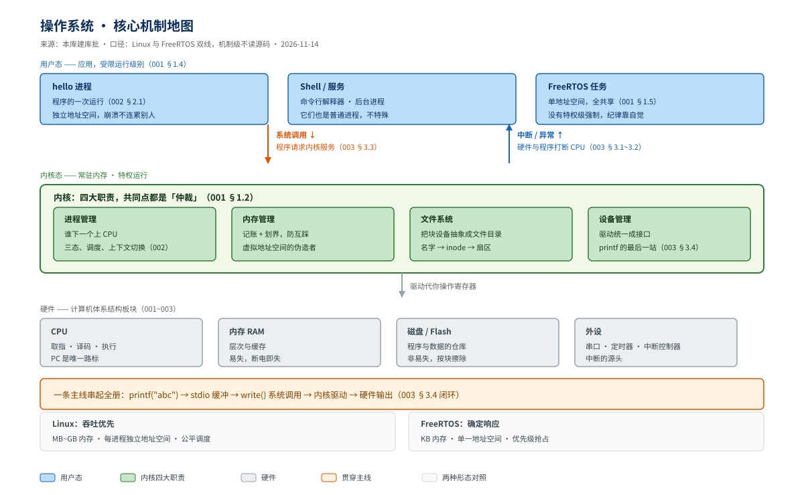

# 000 操作系统原理全貌

> **一句话**：操作系统 = 硬件与应用之间的总管家——把 CPU 时间、内存、外设、文件抽象成可调度的服务；嵌入式世界无论裸机、RTOS 还是 Linux，都是"管理权交给谁"的不同答案。  
> **读者**：学过 C 与体系结构、想知道"我的程序到底被谁管着"的初学者；要在 RTOS 与嵌入式 Linux 之间做技术选型的工程师。  
> **阶段**：地基第三阶段——前置是「C语言」003（内存模型）与「计算机体系结构」001/002（抽象塔与中断概念）。

下图是本板块的机制地图：中间是内核四格，上方用户态、下方硬件，系统调用与中断是两条穿越通道——记住这张图，三册各打通一段。

## 板块地图

| 册 | 一句话 | 回答的问题 |
|---|---|---|
| [001 操作系统的职责与启动](001-操作系统的职责与启动.md) | 世界观层：四大职责 + 启动链 + 两态 | OS 管什么、从加电到第一个进程发生什么 |
| [002 进程与线程](002-进程与线程.md) | 执行层：程序怎么变成被调度的实体 | 进程线程是什么、怎么切换、怎么打架 |
| [003 中断与系统调用](003-中断与系统调用.md) | 穿越层：两条进入内核的通道 | 中断怎么驱动软件、程序怎么请求内核服务 |

## 核心概念速览

- **内核**：常驻内存的"总管家本体"，四大职责都在它身上；应用永远不直接操作硬件，一切经它（001 §1.1）。
- **进程 = 程序的一次运行**：文件是死的，进程是活的——内核给每个进程记账（PCB）并隔离它们的内存（002 §2.1）。
- **系统调用是门**：用户态程序请求内核服务的唯一正式通道，穿过它就完成一次用户态→内核态的穿越（003 §3.3）。
- **中断是引擎**：硬件不等人——外设"举手"，CPU 放下手头工作先服务它；实时的本质就是响应快（003 §3.2）。
- **两种形态**：Linux（宏内核、功能全、非严格实时）与 RTOS（轻、确定、微秒级响应）——嵌入式选型绕不开这对（001 §1.5）。

## 相邻板块分界

| 谁管 | 不管 | 误归属澄清 |
|---|---|---|
| 「计算机体系结构」001~003：硬件本身与执行模型 | 硬件上的管理软件 | 中断的"硬件怎么举手"在体系结构 002，"到达后内核怎么处理"在本板块 003 |
| 「C语言」001~003：库函数怎么调用 | 调用之后落到哪 | printf 从库到 write 系统调用的一段在本板块 003 闭环 |
| 规划「006 RTOS / 007 嵌入式 Linux」：两种形态的实操 | 通用机制 | 任务 API 与驱动开发归那边，机制原理在这里立 |

## 学习路径

- **顺序读**：001 → 002 → 003——先总管家的职责，再它的管理对象，再两条穿越通道。
- **按症状进**：见 [00 术语表](00-术语表.md) 症状反查表。
- **面向嵌入式的读法**：001 §1.3 与 003 §3.5 是"裸机→RTOS→Linux"三种形态的对照枢纽，值得反复看。

## 误解澄清

| # | 误解 | 实际 |
|---|---|---|
| 1 | 操作系统 = 桌面和窗口 | 图形界面只是外壳；内核的调度/内存/文件/驱动才是本体 |
| 2 | 程序就是进程 | 程序是文件，进程是它的一次运行实例（002 §2.1） |
| 3 | 线程开得越多越快 | 切换有开销，任务多于核数反而互相拖累（002 §2.2） |
| 4 | RTOS 就是精简版 Linux | 形态根本不同：单地址空间+确定响应 vs 完整 OS+吞吐优先（001 §1.5） |
| 5 | 系统调用就是普通函数调用 | 它要穿越用户态→内核态，开销高一个量级（003 §3.3） |
| 6 | 裸机开发不需要懂 OS | 前后台系统就是"没有进程的 OS 思维"（003 §3.5） |
| 7 | 中断处理函数想干啥干啥 | ISR 必须快进快出，重活留给下半部（003 §3.2） |
| 8 | 崩溃都是一样的崩 | 用户态崩溃进程死掉，内核态出错整个系统瘫——严重性差一个维度（001 §1.4） |

---

> 下一篇：《001 操作系统的职责与启动》——先认识总管家。
