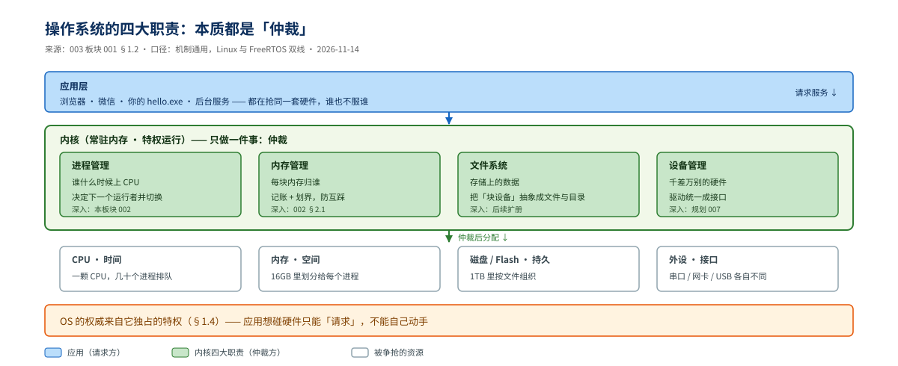
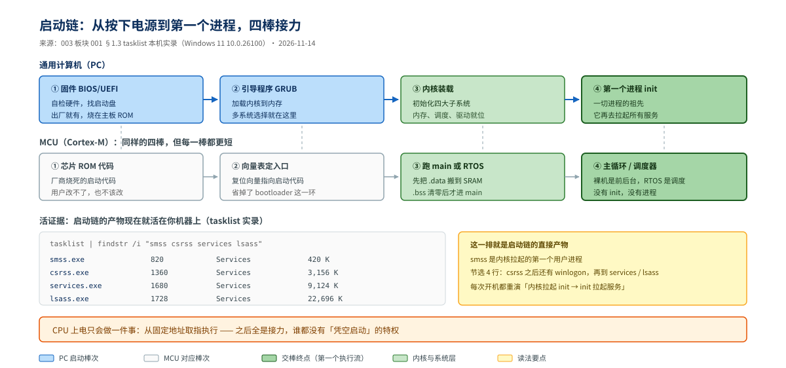

# 001 操作系统的职责与启动

> **解决**：立住世界观——OS 到底管什么、从按下电源到程序运行之间发生了什么；启动链在本机任务列表里就能看到"活证据"（smss/services/lsass 全是启动链的产物）。  
> **范围**：OS 的定义与四大职责 · 启动链（PC vs MCU 对照，本机实验）· 用户态与内核态 · 内核形态与 RTOS 定位。  
> **口径**：机制通用；例证 Linux + FreeRTOS 双线；本机 = Windows 11（10.0.26100），观察类实验均可照做。  
> **更新**：2026-11-14  
> **本册导读** ── 必会三点：① OS = 复用 + 隔离 ② 四大职责（进程/内存/文件/设备）③ 启动链四步（tasklist 活证据实录） ｜ 跟做时长：约 2 小时 ｜ 前置：体系结构 001/002。  
> **标记**：★ = 必会节；○ = 拓展节。

## 目录

| 节 | 内容 |
|---|---|
| 1.1 | 操作系统是什么：隔离与复用 ★ |
| 1.2 | 四大职责：CPU 时间、内存、文件、设备 ★ |
| 1.3 | 从加电到第一个进程：启动链（实验：活证据） ★ |
| 1.4 | 用户态与内核态：为什么应用不能直接碰硬件 ★ |
| 1.5 | 内核形态与 RTOS：嵌入式怎么选 ○ |
| 1.6 | 坑表 |
| 1.7 | 检查清单（自测 6 题 + 动手任务 2 件） |

---

## 1.1 操作系统是什么：隔离与复用 ★

**定义**：操作系统是跑在硬件上的**第一个大软件**，干两件根本的事：**复用**（多程序分享同一套硬件：CPU 轮着跑、内存分着用）与**隔离**（一个程序的错误不连累别人）。它把千差万别的硬件抽象成统一接口——应用只管调接口。

**内核**是 OS 的核心本体：调度、内存、文件、驱动全在里面，常驻内存、特权运行；窗口、命令行只是外壳。桌面 Ubuntu 与服务器 Ubuntu 是不同**发行版**（内核+工具+应用的打包），内核是同一个 Linux。

**裸机也逃不开这套思维**：没有 OS 的 MCU 固件，也要自己回答"谁什么时候用 CPU、变量放哪"——只是答案从"内核决定"变成"你写死"（003 §3.5 对照）。

## 1.2 四大职责：CPU 时间、内存、文件、设备 ★

| 职责 | 管什么 | 一句话机制 | 深入去哪 |
|---|---|---|---|
| 进程管理 | 谁什么时候上 CPU | 决定下一个运行者并切换 | 本板块 002 |
| 内存管理 | 每块内存归谁 | 记账 + 划界，防互踩 | 002 §2.1 + 体系结构 003 |
| 文件系统 | 存储上的数据 | 把"块设备"抽象成文件目录 | 后续扩册 |
| 设备管理 | 千差万别的硬件 | 驱动统一成接口 | 规划「008 嵌入式 Linux」 |



四件事的共同点：**仲裁**——硬件只有一份、请求者众多，必须有人立规矩；OS 的权威来自它独占的特权（§1.4）。**观察与判断**：任何"系统级"现象（卡顿、内存不足、文件丢了、设备认不出）都能映射到四职责之一——这是系统排障的第一层定位表。

## 1.3 从加电到第一个进程：启动链（实验：活证据） ★

**机制**：CPU 上电只会做一件事——从固定地址取指执行，之后是接力：

| 阶段 | PC（通用计算机） | MCU（Cortex-M） |
|---|---|---|
| ① 固件 | BIOS/UEFI：自检、找启动盘 | 芯片 ROM 里厂商代码 |
| ② 引导程序 | GRUB：加载内核 | 向量表直接定启动代码 |
| ③ 内核装载 | Linux 内核初始化 | 直接跑 main 或 RTOS 初始化 |
| ④ 第一个进程 | init（一切进程的祖先） | 裸机主循环 / 调度器开跑 |



**完整示例（跟做）**：启动链的产物**现在就活在你机器上**。终端执行（PowerShell）：

```powershell
tasklist | findstr /i "smss csrss services lsass"
```

**预期输出（本机实录）**：

```text
smss.exe                       820 Services                   0        420 K
csrss.exe                     1360 Services                   0        3,156 K
csrss.exe                     1580 Console                    1        4,500 K
winlogon.exe                  1668 Console                    1        3,552 K
services.exe                  1680 Services                   0        9,124 K
lsass.exe                     1728 Services                   0        22,696 K
```

**读法**：这一排就是启动链第③④阶段的直接产物——`smss`（会话管理器，内核拉起的第一个用户进程）、`csrss`（客户端/服务运行时）、`winlogon`（登录）、`services`（服务管理）、`lsass`（安全认证）。**你的每次开机都重演一遍"内核拉起 init → init 拉起服务"**。

**试一试**：`tasklist | find /c ".exe"` 数一数当前进程总数（本机数十个）——这几十个进程全是那一条启动链的子孙。

## 1.4 用户态与内核态：为什么应用不能直接碰硬件 ★

**定义**：CPU 提供至少两个运行级别——**用户态**（应用：不能碰硬件、不能访问内核内存）与**内核态**（内核：特权指令随便用）。硬件强制执行这个划分——「计算机体系结构」001 §1.1 抽象塔的"法律"在此立下。

**为什么要隔离**：没有它，一个程序的野指针（「C语言」005 §5.5）能踩碎任何别的程序乃至内核。有了它：应用想干特权的事（读磁盘、发网络包），只能**请求**内核代办——正式通道叫系统调用，003 §3.3 专讲。**严重性差异**：用户态出错→进程被终止（损失一个程序）；内核态出错→系统宕机（损失一切）。

## 1.5 内核形态与 RTOS：嵌入式怎么选 ○

**宏内核 vs 微内核**：宏内核（Linux）把调度/文件/驱动全放进大内核——调用是函数调用，快；微内核（QNX 类）内核只留最小机制、服务放用户态——隔离好但消息有开销。

**RTOS 与 Linux 不是"大小"差异，是目标差异**：

| | Linux | FreeRTOS 类 RTOS |
|---|---|---|
| 目标 | 吞吐与功能全 | 响应时间**确定** |
| 内存 | MB~GB | KB 级 |
| 地址空间 | 每进程独立（靠 MMU） | 单一地址空间，全共享 |
| 调度 | 吞吐优先、公平 | 优先级抢占、可预期 |
| 适合 | 协议栈、GUI、文件系统 | 电机控制、传感采集、硬实时 |

**判断句**：要"功能多"选 Linux，要"永远按时"选 RTOS；两者常在同一设备并存（A 核跑 Linux、M 核跑 RTOS）。API 实操归规划「007 RTOS」「008 嵌入式 Linux」。

## 1.6 坑表

| # | 现象 | 原因 | 解法 |
|---|---|---|---|
| 1 | 把 GUI 当 OS 本体 | 只看到外壳 | 内核四职责才是本体（§1.2） |
| 2 | 混淆 bootloader 与固件 | 都是"启动相关" | 固件是出厂件，bootloader 引导内核 |
| 3 | 拿 Linux 直觉评估 MCU 实时性 | 吞吐思维 ≠ 确定响应 | 看 §1.5 表格分线 |
| 4 | 以为应用可以直读硬件寄存器 | 忽略特权级保护 | 一切经系统调用（003 §3.3） |
| 5 | 用户态崩溃与内核崩溃混谈 | 严重性差一个维度 | 进程死 vs 系统瘫（§1.4） |
| 6 | 找不到"启动链的活证据" | 系统进程默认被工具隐藏 | tasklist 直接可见（§1.3 实录） |

## 1.7 检查清单（自测 6 题 + 动手任务 2 件）

**自测**：

| # | 问题 | 自测标准 |
|---|---|---|
| 1 | OS 的两个根本目标 | 复用与隔离 |
| 2 | 四大职责各管什么 | 进程/内存/文件/设备 |
| 3 | 启动链四步（PC 版） | 固件→引导→内核→init |
| 4 | smss/services 是什么 | 启动链拉起的系统进程（§1.3 实录） |
| 5 | Linux 与 RTOS 的分野 | 吞吐 vs 确定响应；地址空间差异 |
| 6 | 为什么内核 bug 更致命 | 内核态错误 = 系统级宕机 |

**动手任务**：① 完成 §1.3 的 tasklist 实验，把"哪一行是内核拉起的第一个用户进程"标出来（smss）；② 在你手机/开发板的参数页找出"跑什么 OS、内存多大"，对照 §1.5 表格归线。

> 下一篇：《002 进程与线程》——程序怎么变成被调度的运行实体，竞态条件当场复现。
