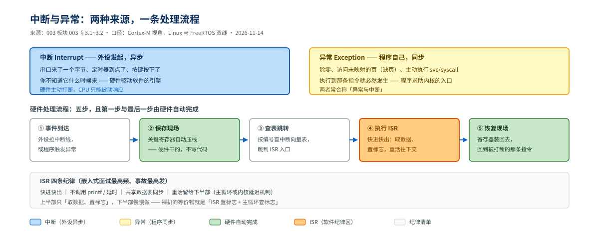
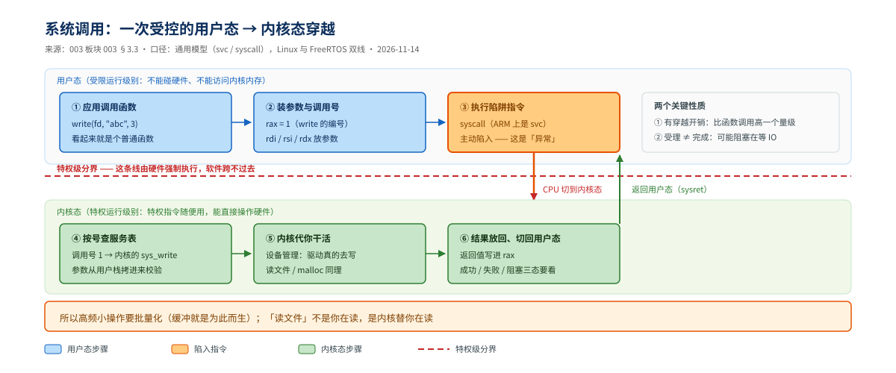
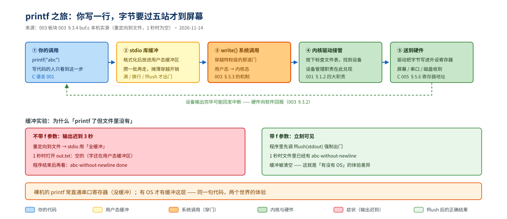

# 003 中断与系统调用

> **解决**：打通"程序怎么进入内核、硬件怎么驱动软件"——ISR 纪律、系统调用穿越机制，并用缓冲实验（输出"迟到"3 秒的实录）把 printf 的旅程走到底。  
> **范围**：中断 vs 异常 · 中断向量表与 ISR 纪律 · 系统调用机制 · printf 之旅（实验 buf.c）· 裸机 vs OS 中断对照。  
> **口径**：机制通用；例证 Linux + FreeRTOS 双线；实验在本机 Windows 实录。  
> **更新**：2026-11-14  
> **本册导读** ── 必会三点：① ISR 四条纪律（快进快出）② 系统调用 = 穿越内核的门（开销高一个量级）③ printf 全链五站与缓冲实验（迟到 3 秒实录） ｜ 跟做时长：约 2.5 小时 ｜ 前置：002（懂竞态与进程状态）。  
> **标记**：★ = 必会节；○ = 拓展节。

## 目录

| 节 | 内容 |
|---|---|
| 3.1 | 两种打断：中断与异常 ○ |
| 3.2 | 中断处理：向量表、现场与 ISR 纪律 ★ |
| 3.3 | 系统调用：进入内核的门 ★ |
| 3.4 | printf 之旅（实验：缓冲让输出迟到 3 秒） ★ |
| 3.5 | 裸机中断与 OS 中断：两个世界的对照 ★ |
| 3.6 | 坑表 |
| 3.7 | 检查清单（自测 6 题 + 动手任务 2 件） |

---

## 3.1 两种打断：中断与异常 ○

**定义**：CPU 的正常执行流被"打断"转向处理函数，只有两种来源——

| | 中断（Interrupt） | 异常（Exception） |
|---|---|---|
| 来源 | **外设**：串口来字节、定时器到点 | **程序自己**：除零、缺页、主动陷入 |
| 同步性 | 异步：随时可能来 | 同步：执行到那条指令必然发生 |
| 意义 | 硬件驱动软件的引擎 | 程序求助内核的入口 |



两者的硬件处理流程几乎一样（保存现场→查表→跳转→恢复），常合称"异常与中断"。硬件最小机制（向量表+自动保存现场）在「计算机体系结构」002 §2.5 立过，软件体验实验（catch.c）也跑过——本册补**软件纪律**这半个。

## 3.2 中断处理：向量表、现场与 ISR 纪律 ★

**机制**（Cortex-M 视角）：中断到达 → 硬件自动把关键寄存器压入当前栈（保存现场）→ 从**中断向量表**按编号取 ISR 入口并跳转 → ISR 执行 → 退出时自动恢复现场回到被打断处。向量表住在 Flash 固定位置，启动时硬件先找到它（001 §1.3 启动链第一环）。

**ISR 纪律**（嵌入式面试最高频、事故最高发）：

| 纪律 | 原因 |
|---|---|
| 快进快出，只做必要的 | 中断优先级高于主流程——ISR 拖着，一切都被拖 |
| 不调用 printf/延时等慢函数 | 可能阻塞、可能重入 |
| 与主流程共享的数据要同步 | 主流程随时被打断——002 §2.4 的竞态在 ISR 维度重现 |
| 重活留给主流程/下半部 | 上半部只"取数据、置标志"，处理放后面 |

**上下半部**：把处理拆两半——上半部（ISR）快进快出，下半部（主循环或内核延迟机制）慢慢做。裸机的等价物："ISR 置标志 + 主循环查标志"（§3.5）。

## 3.3 系统调用：进入内核的门 ★

**定义**：系统调用是用户程序请求内核服务的**正式通道**——不是普通函数调用，而是一次受控的用户态→内核态穿越（001 §1.4 特权级在此兑现）。

**机制**（通用模型）：应用把调用号与参数放进约定位置 → 执行特殊指令（`svc`/`syscall`）触发**主动陷入**（§3.1 异常）→ CPU 切内核态，按向量进内核 → 按调用号执行服务 → 结果放回、切回用户态。

**两个关键性质**：① **有穿越开销**——比函数调用高一个量级，高频小事别逐次走门（缓冲/批量都是为此而生，§3.4 实证）；② **内核代你干活**——"读文件"是内核在读磁盘（设备管理）、"malloc 大内存"是内核在记账划界（内存管理）——001 §1.2 四大职责全部通过这扇门对外服务。**受理 ≠ 完成**：调用可能阻塞（进程转阻塞态，002 §2.2），返回值三态（成功/失败/阻塞）要看。



## 3.4 printf 之旅（实验：缓冲让输出迟到 3 秒） ★

**旅程全图**（把「C语言」001 的 printf 追到底，全板块知识串成一线）：

```text
printf("abc")                        ← 你写的调用（C语言 001）
  → stdio 库：格式化后放进用户态缓冲区   ← 攒一批再走，摊薄穿越开销
  → 刷新时：write() 系统调用            ← 穿越的门（本册 §3.3）
  → 内核 write 驱动接管                 ← 001 §1.2 设备管理
  → 驱动把字节送到硬件                  ← 「C语言」005 §5.6 寄存器地址
  → 设备输出完毕可能回发中断            ← §3.2 中断：硬件回报
```



**完整示例**（`buf.c`）——证明"缓冲"真实存在：先打印一串**不带换行**的字，然后忙等 3 秒；带 `f` 参数则先 `fflush` 强制送出：

```c
#include <stdio.h>
#include <time.h>

int main(int argc, char **argv)
{
    printf("abc-without-newline");
    if (argc > 1 && argv[1][0] == 'f')
        fflush(stdout);            /* force it out now */
    clock_t start = clock();
    while ((clock() - start) < 3 * CLOCKS_PER_SEC) { }  /* busy wait 3s */
    printf(" done\n");
    return 0;
}
```

**跟做步骤**：① `gcc -Wall buf.c -o buf.exe`；② 把输出**重定向到文件**再运行（不带参数）：

```powershell
Start-Process .\buf.exe -RedirectStandardOutput out.txt
Get-Content out.txt        # 1 秒后立刻查看
```

**预期输出（本机实录）**：1 秒时 `out.txt` 是**空的**——字还躺在用户态缓冲区没送出；等程序结束后再看：

```text
abc-without-newline done
```

③ 带 `f` 参数重跑（先 fflush）：1 秒时文件里**已经有** `abc-without-newline`——缓冲被强制清空了。

**机制解释**：重定向到文件时 stdio 使用**全缓冲**——不到缓冲满/程序结束/显式 fflush 不出门。这就是"printf 没输出但程序没死"的病根（00-术语表症状反查收录）。无 OS 的裸机上 printf 常直通串口寄存器——有没有缓冲是"有没有 OS"在体验上的差别之一。

**试一试**：把 buf.c 第一句改成 `printf("abc\n")` 再不带参数重定向重跑——1 秒后文件里有内容了吗？行缓冲遇到 `\n` 就走（终端场景）；文件场景仍是全缓冲——两种缓冲策略的行为差异值得亲手记下。

## 3.5 裸机中断与 OS 中断：两个世界的对照 ★

同一个中断机制（硬件层相同），软件组织分两个世界——全库主线三（裸机→OS）的枢纽：

| | 裸机（前后台系统） | 有 OS（RTOS/Linux） |
|---|---|---|
| 结构 | 主循环（后台）+ ISR（前台） | 内核统一管理中断，驱动注册回调 |
| 中断里干什么 | 置标志、存数据，快进快出 | ISR 只唤醒任务，处理交给任务 |
| 谁保证不丢事件 | 自己写"标志+主循环查" | 队列/信号量机制内建 |
| 竞态防护 | 关中断/原子访问（自己做） | 内核提供锁与调度原语 |
| 心智 | "我是唯一的管家" | "内核是管家，我只提需求" |

**结论**：裸机前后台是"没有进程的 OS 思维"——ISR 纪律、竞态防护在裸机里手工实现，在 OS 里由内核代管；RTOS（FreeRTOS）介于两者之间：有调度器但没有硬件特权级强制（001 §1.5），纪律靠自觉。

**观察与判断**：裸机"偶发丢事件"= 标志没处理全或关中断太久；RTOS"任务不响应中断"= ISR 没用 FromISR 版 API——现象各异，机制同一个。

## 3.6 坑表

| # | 现象 | 原因 | 解法 |
|---|---|---|---|
| 1 | 一进 ISR 程序就卡死 | ISR 里 printf/延时/死等 | 快进快出，重活放下半部 |
| 2 | ISR 与主流程数据偶发错乱 | 共享数据没同步 | 关中断窗口/原子访问/队列 |
| 3 | printf 没输出但程序没死 | 缓冲没刷新（buf.c 实录） | fflush 或 `\n`；理解两种缓冲 |
| 4 | 把系统调用当普通函数连发 | 忽略穿越开销与阻塞 | 批量化；看返回值三态 |
| 5 | 裸机偶发丢串口数据 | 关中断过久，硬件缓冲溢出 | 缩短关中断窗口；上 DMA |
| 6 | RTOS 里 ISR 调非 FromISR API | 内核 API 有上下文限制 | ISR 上下文一律用 FromISR 版 |

## 3.7 检查清单（自测 6 题 + 动手任务 2 件）

**自测**：

| # | 问题 | 自测标准 |
|---|---|---|
| 1 | 中断与异常各来自谁 | 外设异步 vs 程序同步 |
| 2 | ISR 四条纪律 | 快进快出/禁慢调用/同步共享/重活下放 |
| 3 | 系统调用穿越了什么 | 用户态→内核态，特权指令陷入 |
| 4 | printf 全链至少五站 | 库→缓冲→write→内核驱动→硬件 |
| 5 | 缓冲实验说明了什么 | 全缓冲下输出迟到；fflush 强制出门（实录） |
| 6 | 裸机与 OS 中断的本质差别 | 自己管 vs 内核代管，机制相同 |

**动手任务**：① 复现 buf.c 的重定向实验，两种模式各跑一遍并把 1 秒时与结束后的文件内容记下来；② 把 §3.4 的旅程全图默画一遍（五站）。

> 下一篇：回到 [README](README.md) 总览——地基三板块（C/体系结构/OS）收官；下一站「004 电子电路」，从软件世界下到电的世界。
