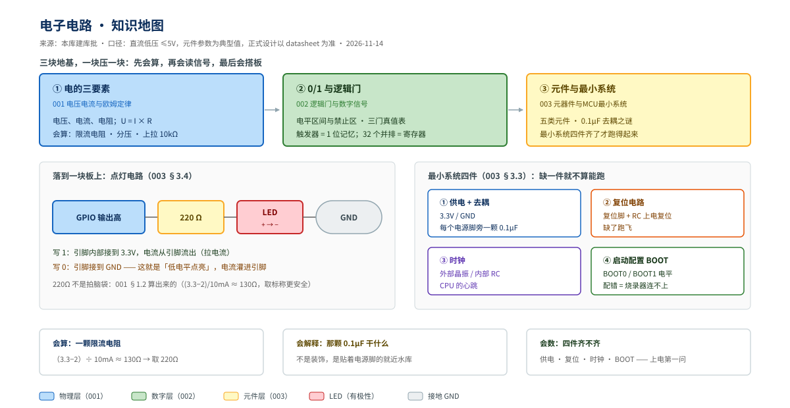

# 000 电子电路全貌

> **一句话**：电子电路 = 用电压与电流"搬运信息与能量"的物理底座——模拟元件搭出供电骨架，逻辑门搭出数字世界，最小系统把 MCU 顶起来跑。  
> **读者**：纯软件背景、第一次面对面包板与万用表的初学者；想看懂开发板原理图的工程师。  
> **阶段**：硬件地基——前置是地基三板块（用 C 与体系结构的"地址/位"直觉来看电）；产物供「005 MCU 与外设」实操全程使用。

下图是本板块的地图：左侧从电的物理层爬到芯片层，右侧用"点灯电路"把三册串成一条线。

## 板块地图

| 册 | 一句话 | 回答的问题 |
|---|---|---|
| [001 电压电流与欧姆定律](001-电压电流与欧姆定律.md) | 元素层：三要素 + 基本定律 + 上拉下拉 | 电怎么走、限流电阻怎么算、悬空脚为什么乱跳 |
| [002 逻辑门与数字信号](002-逻辑门与数字信号.md) | 表示层：0/1 的电压区间 + 门与真值表 | 数字信号怎么表示、CPU 的"原子"长什么样 |
| [003 元器件与MCU最小系统](003-元器件与MCU最小系统.md) | 系统层：元件图谱 + 最小系统四件 | 一块开发板上那些元件各干什么、点灯电路长什么样 |

## 核心概念速览

- **三要素**：电压是推力、电流是流量、电阻是阻碍——欧姆定律 U=IR 把三者锁死，一切电路计算的总钥匙（001 §1.1~1.2）。
- **电平区间**：数字 0/1 不是"没电和有电"，而是两段判定电压区间 + 中间禁止区——抗干扰能力由此而来（002 §2.1）。
- **门是原子**：与/或/非三门可拼出一切逻辑；触发器给门装上"记忆"，寄存器就是触发器堆（002 §2.3~2.4）。
- **去耦电容**：芯片电源脚旁那颗 0.1μF 小电容，是"就近水库"——芯片瞬间抽电流时稳住电压（003 §3.2）。
- **最小系统四件**：供电+去耦、复位、时钟、启动配置——少一件 MCU 就跑不起来（003 §3.3）。

## 相邻板块分界

| 谁管 | 不管 | 误归属澄清 |
|---|---|---|
| 「计算机体系结构」001/002：门之上怎么组成 CPU、ISA 契约 | 门的物理实现 | "门怎么工作"在本板块 002，"门怎么组成机器"归那边 |
| 规划「005 MCU 与外设」：寄存器与外设驱动实操 | 电路打底 | 点灯的硬件在 003 §3.4，点灯的软件在 005 |
| 「操作系统原理」：软件世界的管理 | 电的世界 | 两线在 005/007 汇合，板块间无直接交叠 |

## 学习路径

- **顺序读**：001 → 002 → 003——先电、再数字、再系统，跳层缺直觉。
- **按症状进**：见 [00 术语表](00-术语表.md) 症状反查表——板子不行为先查表。
- **动手纪律**：三册各配可上手的观察点（万用表两档、真值表画一遍、数清开发板四件）。

## 误解澄清

| # | 误解 | 实际 |
|---|---|---|
| 1 | 电压和电流是一回事 | 推力与流量的关系，U=I×R（001 §1.1） |
| 2 | 数字 0 就是"没电" | 0 是一段低电压区间，不是 0V 也不是断电（002 §2.1） |
| 3 | LED 接上 3.3V 就能亮 | 必须串限流电阻，否则过流烧毁（001 §1.2） |
| 4 | 悬空的输入脚默认是 0 | 是高阻随机态，读数乱跳，必须上拉/下拉（001 §1.4） |
| 5 | 电阻值随便选 | 差一个量级电流就差十倍，欧姆定律算出来（001 §1.2） |
| 6 | 短路顶多冒烟 | 大电流瞬间发热，电池与导线都可能损坏（001 §1.5） |
| 7 | CMOS 芯片不怕摸 | 人体静电足以击穿，拿板子先摸金属放电（002 §2.5） |
| 8 | 元件知识到 003 就够了 | 它是 005 的地基：寄存器操作的对象就是这些引脚与电路 |

---

> 下一篇：《001 电压电流与欧姆定律》——先认识电的三要素。
