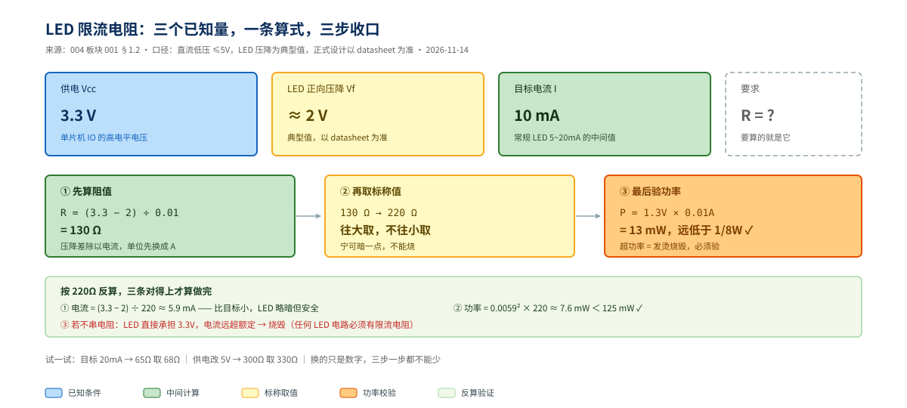
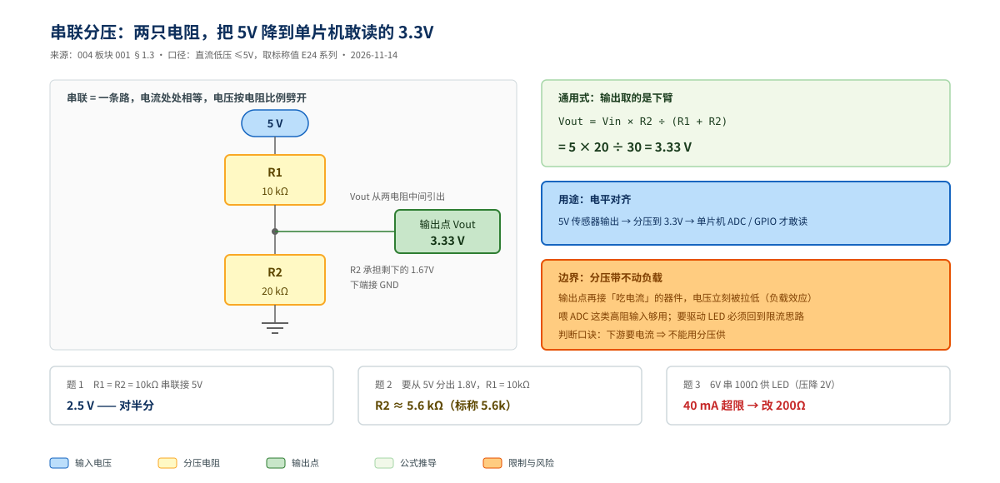
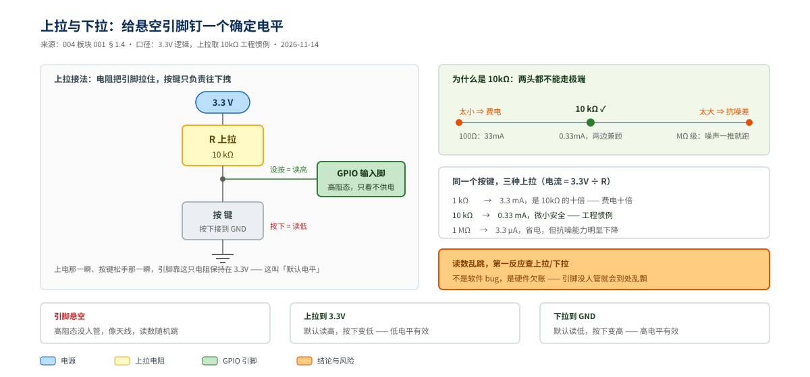

# 001 电压电流与欧姆定律

> **解决**：立住电的三要素直觉与欧姆定律——会算限流电阻、看得懂分压电路、知道悬空引脚为什么要上拉；计算题全部带答案可自行复核，本板块是纯纸面即可完成的板块（实物实验在「005 MCU 与外设」配套）。  
> **范围**：三要素 · 欧姆定律与功率 · 串并联与分压 · 上拉下拉 · 安全与万用表。  
> **口径**：直流低压（≤5V）实验为主；元件参数给典型值，正式设计以 datasheet 为准。  
> **更新**：2026-11-14  
> **本册导读** ── 必会三点：① 三要素与欧姆定律（U=IR）② 限流电阻计算（220Ω 题）③ 上拉下拉（10kΩ 取舍） ｜ 跟做时长：约 1.5 小时（纸面计算为主） ｜ 前置：无。  
> **标记**：★ = 必会节；○ = 拓展节。

## 目录

| 节 | 内容 |
|---|---|
| 1.1 | 三要素：电压、电流、电阻 ★ |
| 1.2 | 欧姆定律与功率（实验：算出限流电阻） ★ |
| 1.3 | 串联与并联：分压电路（实验：三道计算题） ★ |
| 1.4 | 上拉与下拉：悬空引脚的救星 ★ |
| 1.5 | 安全与万用表：低压实验纪律 ○ |
| 1.6 | 坑表 |
| 1.7 | 检查清单（自测 6 题 + 动手任务 3 件） |

---

## 1.1 三要素：电压、电流、电阻 ★

**类比模型**：把电想成水——**电压**（V，伏特）是水压（推力），**电流**（A，安培）是水流（流量），**电阻**（Ω，欧姆）是水管的粗细（阻碍）。三者共生：有推力才有流量，管子越细流量越小。

| 量 | 单位 | 电子世界的常用刻度 |
|---|---|---|
| 电压 U | V | USB 5V、单片机 3.3V；传感器信号 mV 级 |
| 电流 I | A | 整机几十 mA、LED 5~20 mA、待机 μA 级 |
| 电阻 R | Ω | 上拉 10kΩ、限流 220Ω、导线近似 0Ω |

**测量锚点**：电压是"两点之间"的差（说 3.3V 隐含"相对地 GND"）；电流是"流过某一点"的量。**软件衔接**：GPIO 输出高电平 = 内部把引脚接到 3.3V，输出低 = 接到 GND——"写 1 写 0"在硬件层就是**切换连接**（003 §3.4 点灯电路）。


## 1.2 欧姆定律与功率（实验：算出限流电阻） ★

**欧姆定律**：U = I × R——知道任意两个量，第三个必然确定，这是电路计算的总钥匙。**功率**：P = U × I（= I²R）——元件发热的速率，**超功率 = 发烫烧毁**。

**跟做（纸面计算，答案例）**——LED 限流电阻，嵌入式"点灯"的第一道计算：

```text
已知：供电 3.3V，LED 正向压降约 2V（典型值，以 datasheet 为准），目标电流 10mA
求：限流电阻 R
R = (3.3 − 2) / 0.01 = 130Ω  → 取标称值 220Ω（宁可偏小电流，更安全）
电阻上的功率 P = 1.3V × 0.01A = 13mW  → 远低于常规电阻 1/8W 上限，安全 ✓
```

**验证你的答案**（三条判据，可自查）：① 电流 = (3.3−2)/220 ≈ 5.9mA（比目标小，LED 略暗但安全）；② 电阻功率 ≈ 7.6mW < 125mW ✓；③ 若不串电阻：LED 直接承担 3.3V，电流远超额定 → 烧毁。⚠️ **任何 LED 电路必须有限流电阻**。



**试一试**：把目标电流改成 20mA 重算（R = 65Ω → 取 68Ω 标称）；再算供电 5V 时的 R（(5−2)/0.01 = 300Ω → 取 330Ω）。

## 1.3 串联与并联：分压电路（实验：三道计算题） ★

**串联**（一条路）：电流处处相等，电压按电阻比例分配——**串联分压**：

```text
5V ──[ R1 10kΩ ]──┬──[ R2 20kΩ ]── GND
                  └── 输出点 Vout = 5 × 20/(10+20) = 3.33V
```



**用途**：5V 传感器输出降到 3.3V 单片机可读（ADC 采样前置）。**并联**（两条路）：电压相同、电流按电阻反比分流，等效电阻比任一支路都小。

**跟做（三道计算题，先自己算再看答案）**：

| # | 题目 | 答案（自行复核） |
|---|---|---|
| 1 | R1=R2=10kΩ 串联接 5V，输出点电压？ | 2.5V（对半分） |
| 2 | 要从 5V 分出 1.8V，R1=10kΩ，R2 取多少？ | Vout=5·R2/(R1+R2)=1.8 → R2≈5.6kΩ（标称 5.6k） |
| 3 | 6V 电源串 R=100Ω 供 LED（压降 2V），电流多大？ | I=(6−2)/100=40mA —— 超过常规 LED 20mA 上限，⚠️ 应加大电阻到 200Ω |

**边界**：分压电路带负载能力有限——输出点再接"吃电流"的器件会拉低电压（负载效应）；喂 ADC 这类高阻输入够用，驱动 LED 不行（那要 §1.2 的限流思路）。

## 1.4 上拉与下拉：悬空引脚的救星 ★

**问题**：MCU 输入引脚是**高阻态**——"只看不摸"，自己不提供电平。悬空引脚像天线，读数随环境噪声乱跳。

**解法**：用一只大电阻把引脚"钉"在确定电平：

```text
3.3V ──[ R 10kΩ ]──┬── GPIO 输入脚
                    └──[ 按键 ]── GND      （没按=高，按下=低）
```

**为什么 10kΩ**：太小费电（100Ω 时按下瞬间 33mA）；太大抗噪差（MΩ 级）；10kΩ 是两边兼顾的工程惯例。按下时电流 = 3.3V/10kΩ = 0.33mA，微小安全。**结论**：GPIO 读数乱跳，第一反应查上拉/下拉——不是软件 bug，是硬件欠账（症状反查表收录）。



**试一试（计算）**：上拉改 1kΩ，按键按下时电流多大？→ 3.3mA（是 10kΩ 的十倍——费电十倍）；改 1MΩ？→ 3.3μA，但抗噪能力下降。

## 1.5 安全与万用表：低压实验纪律 ○

**安全三条**：① 本库实验一律 ≤5V 直流（USB 供电即合规）；② ⚠️ **短路是大敌**——电源正负直连，电流只受内阻限制，瞬间发热可能损坏电池与导线；接完电路**先查再上电**；③ 市电（220V）一概不碰，不在本库范围。

**万用表两档入门**：

| 档位 | 接法 | 读什么 |
|---|---|---|
| 电压档（V） | 表笔**并联**在被测两点（红正黑负） | 两点电压差 |
| 通断档（蜂鸣） | 两表笔接同一导线两端 | 响=通，不响=断——查线神器 |

电流档要**串联**进电路（断开一点串进去），新手易接错烧保险——入门先熟练电压档与通断档。**跟做（若有万用表）**：拿一节 USB 线量 VBUS 与 GND 间电压——预期 ~5V；没有表就跳过，§1.2/§1.3 的纸面计算已可完成本册。

## 1.6 坑表

| # | 现象 | 原因 | 解法 |
|---|---|---|---|
| 1 | LED 一接就烫/烧 | 没串限流电阻 | 先算后接（§1.2 模板） |
| 2 | 分压输出一接负载就掉 | 负载效应 | 只喂高阻输入 |
| 3 | 输入脚读数乱跳 | 引脚悬空 | 加 10kΩ 上拉/下拉（§1.4） |
| 4 | 3.3V 芯片接 5V 信号 | 电平不匹配 | 分压或电平转换 |
| 5 | 电池/线材发烫 | 短路 | 断电检查，先查再上电 |
| 6 | 万用表读数怪异 | 档位/接法错 | 电压档并联；先档位后表笔 |

## 1.7 检查清单（自测 6 题 + 动手任务 3 件）

**自测**：

| # | 问题 | 自测标准 |
|---|---|---|
| 1 | 三要素类比与单位 | 推力/流量/阻碍；V/A/Ω |
| 2 | LED 限流电阻公式 | (供电−压降)/目标电流；会算 220Ω 题 |
| 3 | 串联分压公式 | Vout = Vin × R2/(R1+R2) |
| 4 | 悬空引脚为什么乱跳 | 高阻态，需上拉/下拉 |
| 5 | 上拉典型值与取舍 | 10kΩ；小=费电、大=抗噪差 |
| 6 | 万用表电压档怎么接 | 并联在被测两点 |

**动手任务**：① 完成 §1.2 的限流计算（5V 版重算一遍）；② 完成 §1.3 三道计算题并复核答案；③ 算出"10kΩ / 1kΩ / 1MΩ 三种上拉在按下时的电流"，写成一行的对比表。

> 下一篇：《002 逻辑门与数字信号》——0/1 在电路上长什么样，用 C 仿真三门真值表。
