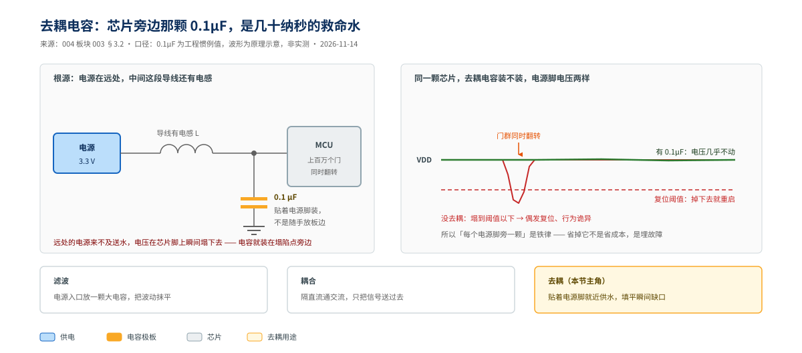
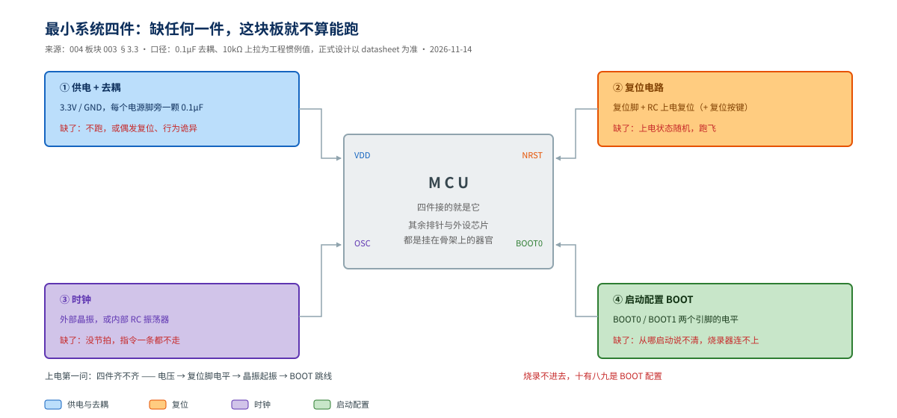
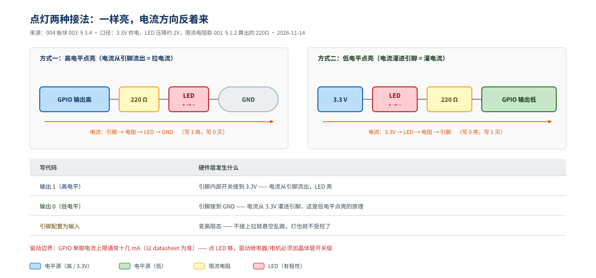

# 003 元器件与MCU最小系统

> **解决**：认全常用元件、看懂"芯片旁边为什么总有颗小电容"、把一块 MCU 板拆成最小系统四件——本册的跟做走"纸上看图 + 实物观察"双路：有开发板照做，没有的开发板到手后再做（「005 MCU 与外设」配套）。  
> **范围**：元件图谱 · 电容三用途与去耦 · 最小系统四件 · 点灯电路全解 · 看板方法。  
> **口径**：典型参数（0.1μF 去耦、10kΩ 上拉）为工程惯例值，正式设计以 datasheet 为准。  
> **更新**：2026-11-14  
> **本册导读** ── 必会三点：① 五类元件各干什么 ② 去耦电容之谜（0.1μF 铁律）③ 最小系统四件（纸上画骨架） ｜ 跟做时长：约 1.5 小时 ｜ 前置：001/002。  
> **标记**：★ = 必会节；○ = 拓展节。

## 目录

| 节 | 内容 |
|---|---|
| 3.1 | 元器件图谱：五类常客 ★ |
| 3.2 | 电容三用途与去耦之谜 ★ |
| 3.3 | MCU 最小系统四件（跟做：纸上画出骨架） ★ |
| 3.4 | 点灯电路全解：软硬件对账表 ★ |
| 3.5 | 看板方法：拿到开发板先数四件 ○ |
| 3.6 | 坑表 |
| 3.7 | 检查清单（自测 6 题 + 动手任务 2 件） |

---

## 3.1 元器件图谱：五类常客 ★

| 元件 | 符号直觉 | 在嵌入式里的角色 |
|---|---|---|
| 电阻器 R | 阻碍电流的"阀门" | 限流（LED）、分压（ADC 前置）、上拉/下拉（001 §1.4） |
| 电容器 C | 储电荷的"小水库" | 滤波/耦合/**去耦**（§3.2 专讲） |
| 发光二极管 LED | 有极性的灯 | 状态指示；⚠️ 必须串限流电阻（001 §1.2） |
| 二极管 D | 单向阀门 | 防反接、整流；LED 是它的发光亲戚 |
| 晶体管（三极管/MOS） | 小信号控制大电流的"电子开关" | GPIO 推不动的外设（继电器/电机）前置级；数字芯片的内部原子（002 §2.2） |

**极性纪律**：LED 与二极管**有方向**——电流只能从正极流向负极，接反不工作（LED 不亮第一查极性）；常见电阻电容无极性。

## 3.2 电容三用途与去耦之谜 ★

**电容本体**：两片极板夹绝缘层——充电储能、放电流通交流。三个用途：**滤波**（电源入口大电容，把波动抹平）、**耦合**（隔直流通交流）、**去耦**（本节主角）。

**去耦之谜**（初学者最常问的"旁边那颗小电容"）：芯片内百万级门同时翻转的瞬间，从电源抽走一大股电流——导线有电感，远处的电源"来不及送水"，电压瞬间塌陷，芯片出错甚至复位。**0.1μF 去耦电容贴着电源脚，就近供水**填平瞬间缺口。所以：每颗芯片的每个电源脚旁一颗，是铁律不是装饰；省掉它的症状 = "偶发复位、行为诡异"（症状反查表收录）。



## 3.3 MCU 最小系统四件（跟做：纸上画出骨架） ★

**最小系统** = 让 MCU 跑起来的最少电路，骨架恒为四件：

| 件 | 构成 | 缺了会怎样 |
|---|---|---|
| ① 供电 + 去耦 | 3.3V/GND + 每脚 0.1μF | 不跑或偶发复位（§3.2） |
| ② 复位电路 | 复位脚 + RC 上电复位（+复位按键） | 上电状态随机，跑飞 |
| ③ 时钟 | 外部晶振或内部 RC 振荡器 | 没节拍，指令不走——CPU 的心跳（002 §2.4） |
| ④ 启动配置（BOOT） | BOOT0/BOOT1 引脚电平 | 决定从 Flash 还是烧录模式启动；配错 = 烧录器连不上 |



**跟做（纸上作业）**：不看本表，画一个 MCU 的方框图，把四件各自接到芯片哪个引脚标注出来——画完对照本表自查。**判定标准**：四件齐、每件标了"缺了会怎样"即完成。上电第一问永远是"四件齐不齐"：供电电压对不对（万用表，001 §1.5）、复位脚电平、晶振有没有起振、BOOT 跳线在哪个位置——**烧录不进去十有八九是 BOOT 配置**（症状反查表收录）。

## 3.4 点灯电路全解：软硬件对账表 ★

**电路**（规划「005 MCU 与外设」第一个实操的硬件底稿）：

```text
方式一（高电平点亮）：GPIO 输出高 ──[ 220Ω ]──[ LED 正极→负极 ]── GND
方式二（低电平点亮）：3.3V ──[ LED ]──[ 220Ω ]── GPIO 输出低（灌电流）
```



**软硬件对账表**（每写一行代码，硬件层发生什么——这是"软硬结合"的第一张对照表）：

| 写代码 | 硬件层发生什么 |
|---|---|
| 输出 1（高电平） | 引脚内部开关接到 3.3V（001 §1.1 的"切换连接"） |
| 输出 0（低电平） | 接到 GND，电流从 3.3V 灌进引脚（低电平点亮方式） |
| 引脚配置为输入 | 变高阻态——不接上拉就悬空乱跳（001 §1.4） |

**驱动能力边界**：GPIO 单脚电流上限通常十几 mA（以 datasheet 为准）——点亮 LED 够用；驱动继电器/电机必须加晶体管开关（§3.1）。"引脚推不动外设"是初学者第二个硬件欠账。**电阻值来源**：220Ω 不是拍脑袋——001 §1.2 算出来的（(3.3−2)/10mA≈130Ω，取标称 220Ω 更安全）。

## 3.5 看板方法：拿到开发板先数四件 ○

**跟做（实物，有板才做；无板待 005 配套）**：拿到任何一块开发板，按固定顺序扫一遍：① 找电源（USB 口/稳压芯片，输出几 V？每颗主芯片旁有没有 0.1μF？）；② 找复位（RESET 按键/RC）；③ 找时钟（金属壳晶振）；④ 找 BOOT（跳线帽/拨码开关位置）。数完四件，"能不能跑、为什么烧不进"就有了判断底稿；剩下排针与外设芯片都是"挂在骨架上的器官"——外设怎么用归规划 005。

**无板的替代跟做**：网上搜任意 STM32 最小系统板的产品图（不依赖特定商家），把四件逐一指认出来，写在纸上——指认不出看 §3.3 表格回炉。

## 3.6 坑表

| # | 现象 | 原因 | 解法 |
|---|---|---|---|
| 1 | LED 不亮还怪代码 | 极性接反/没串电阻 | 先查硬件再查软件（§3.4 对账表） |
| 2 | 偶发复位、跑飞 | 去耦电容省了 | 每个电源脚补 0.1μF（§3.2） |
| 3 | 烧录器连不上 | BOOT 配置错 | 查跳线，进烧录模式（§3.3） |
| 4 | 晶振不起振光查软件 | 焊接/负载电容问题 | 硬件排查四件先行 |
| 5 | 驱动继电器把脚烧了 | 超 GPIO 驱动能力 | 加晶体管/MOS 开关级（§3.1） |
| 6 | 排针虚焊当固件 bug | 接触不良 | 通断档逐点查（001 §1.5） |

## 3.7 检查清单（自测 6 题 + 动手任务 2 件）

**自测**：

| # | 问题 | 自测标准 |
|---|---|---|
| 1 | 五类常客各自角色 | R/C/LED/D/晶体管各一句 |
| 2 | 去耦电容为什么必须 | 芯片瞬间抽电流，就近水库 |
| 3 | 最小系统四件 | 供电+去耦/复位/时钟/BOOT |
| 4 | 点灯两种接法区别 | 高电平点亮 vs 低电平灌电流 |
| 5 | GPIO 驱动能力边界 | 单脚十几 mA 量级，大功率加开关级 |
| 6 | 220Ω 从哪来 | 001 §1.2 的计算取标称值 |

**动手任务**：① 完成 §3.3 的纸上骨架图并自查四件齐；② 完成 §3.5 的看板指认（实物或产品图任一路）。

> 下一篇：回到 [README](README.md) 总览——本板块收官；下一站「005 MCU 与外设」（规划中），在这套底稿上点亮第一颗灯。
