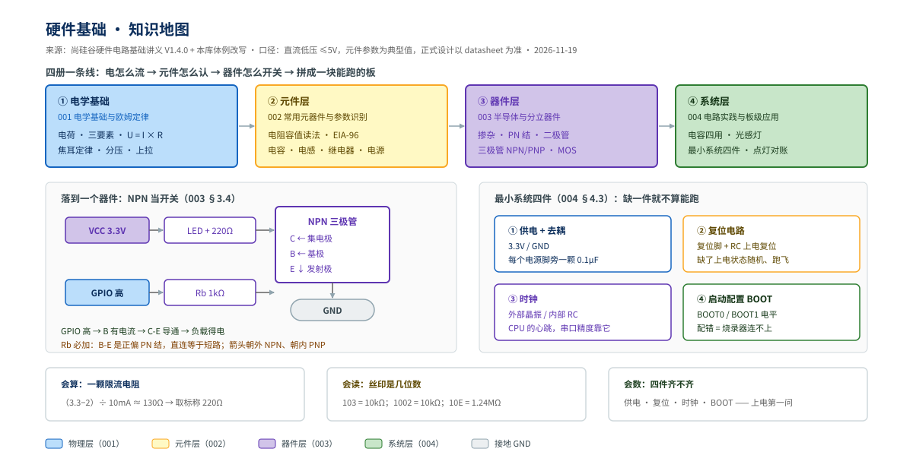

# 000 硬件基础全貌

> **一句话**：硬件基础 = 从"电是什么"到"一块板子能跑"的物理层——电荷流动、元件读写、半导体开关、板级电路，四层逐级搭起来。  
> **读者**：纯软件背景、第一次面对面包板与万用表的初学者；想看懂开发板原理图的工程师。  
> **阶段**：硬件地基第一层——前置是 C 与体系结构给的"地址/位"直觉；产物供「005 数字电路」与「006 MCU 与外设」全程使用。

下图是本板块的地图：左侧从电荷爬到板级，右侧标出四册各自的落点。

## 板块地图

| 册 | 一句话 | 回答的问题 |
|---|---|---|
| [001 电学基础与欧姆定律](001-电学基础与欧姆定律.md) | 物理层：电荷、三要素与基本定律 | 电怎么流、限流电阻怎么算、悬空脚为什么乱跳 |
| [002 常用元器件与参数识别](002-常用元器件与参数识别.md) | 元件层：认全元件、读对丝印 | `103` 是多大、`104` 为什么是 100nF、买之前看哪几个参数 |
| [003 半导体与分立器件](003-半导体与分立器件.md) | 器件层：会开关会放大的元件 | 一块硅为什么能当开关、三极管和 MOS 差在哪 |
| [004 电路实践与板级应用](004-电路实践与板级应用.md) | 系统层：连成电路、拼成板子 | 去耦电容为什么贴电源脚、最小系统四件是什么、点灯怎么接 |

## 核心概念速览

- **电流的本质是电荷定向移动**：规定正电荷方向为电流方向，金属里跑的电子方向相反——按定义分析，不要中途换向（001 §1.1）。
- **三要素与欧姆定律**：电压是推力、电流是流量、电阻是阻碍，U=IR 把三者锁死；一切电路计算从这儿出发（001 §1.2~1.3）。
- **丝印有三套规则**：`103` 是三位法（10kΩ）、`1002` 是四位法（10kΩ）、`10E` 是 EIA-96（1.24MΩ）——先数位数，再决定查不查表（002 §2.3）。
- **PN 结的单向导电来自耗尽层**：正偏变窄导通、反偏变宽截止，不是"阀门"的比喻（003 §3.2）。
- **三极管靠电流控制、MOS 靠电压控制**：前者 B 极持续耗流，后者栅极绝缘几乎不耗；芯片里的"原子"是 MOS（003 §3.4~3.5）。

## 相邻板块分界

| 谁管 | 不管 | 误归属澄清 |
|---|---|---|
| 「005 数字电路」：门怎么组合、触发器等记忆、真值表 | 门和晶体管的物理实现 | "MOS 怎么开关"在本板块 003，"MOS 怎么组成门"归 005 |
| 「002 计算机体系结构」001/002：器件之上怎么组机器、ISA 契约 | 元件与器件的物理层 | "晶体管是什么"在本板块，"用晶体管搭出的 CPU"归那边 |
| 规划「006 MCU 与外设」：寄存器操作与外设驱动 | 电路打底 | 点灯的硬件在 004 §4.4，点灯的软件在 006 |
| 「001 C语言」/「003 操作系统原理」：软件世界 | 电的世界 | 两线在 006/008 汇合，板块间无直接交叠 |

## 学习路径

- **顺序读**：001 → 002 → 003 → 004——先电、再元件、再器件、最后成板，跳层会缺直觉（尤其跳过 003 直接看 MOS 电路图会完全读不懂）。
- **按任务找册**：算阻值 → 001；读丝印、列采购参数 → 002；看不懂三极管/MOS 电路 → 003；板子不跑、要上手测量 → 004。
- **按症状进**：见 [00 术语表](00-术语表.md) 症状反查表——板子不行为先查表，不要盲拆。
- **动手纪律**：四册各配可上手的动作——算一道题、读五个丝印、画一张 PN 结、数清开发板四件。

## 误解澄清

| # | 误解 | 实际 |
|---|---|---|
| 1 | 电压和电流是一回事 | 推力与流量，U=I×R 锁死（001 §1.2） |
| 2 | 电子的流动方向就是电流方向 | 定义相反：规定正电荷方向为正（001 §1.1） |
| 3 | 电阻会"跟着电压变" | 阻值由材料与几何决定，不随电压电流变（001 §1.3） |
| 4 | 电阻值随便选，反正都能用 | 功率不核算会烧，差一个量级电流差十倍（001 §1.4） |
| 5 | 电容 `104` 是 104pF | 是 `10×10⁴ pF = 100nF`（002 §2.4） |
| 6 | `10E` 和 `103` 差不多 | 差 124 倍：`10E`=1.24MΩ，`103`=10kΩ（002 §2.3） |
| 7 | 三极管和 MOS 可以随便替换 | 一个电流控制、一个电压控制，驱动电路完全不同（003 §3.5） |
| 8 | PNP 和 NPN 只是画法不同 | 导通电平相反、电流方向相反（003 §3.4） |
| 9 | 去耦电容是装饰，省了没事 | 省了会偶发复位，且故障极难查（004 §4.1） |
| 10 | LED 接上 3.3V 就能亮 | 必须串限流电阻，否则瞬间过流烧毁（001 §1.3） |

---

> 下一篇：《001 电学基础与欧姆定律》——先从电荷是怎么流的讲起。
