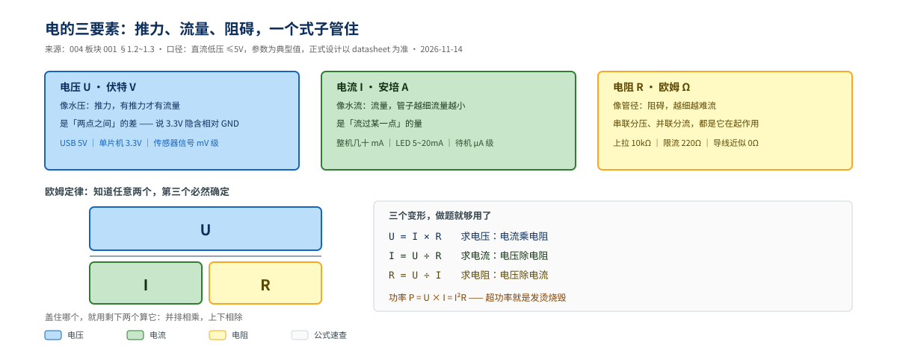
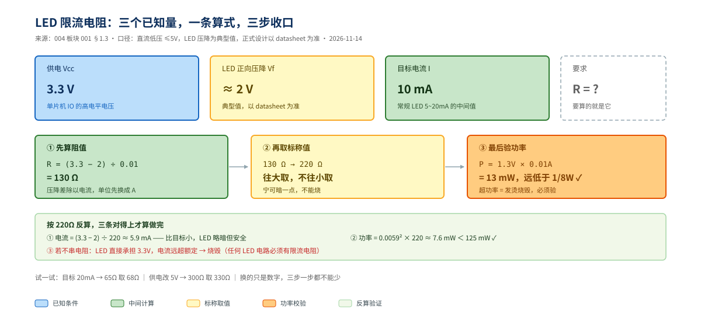
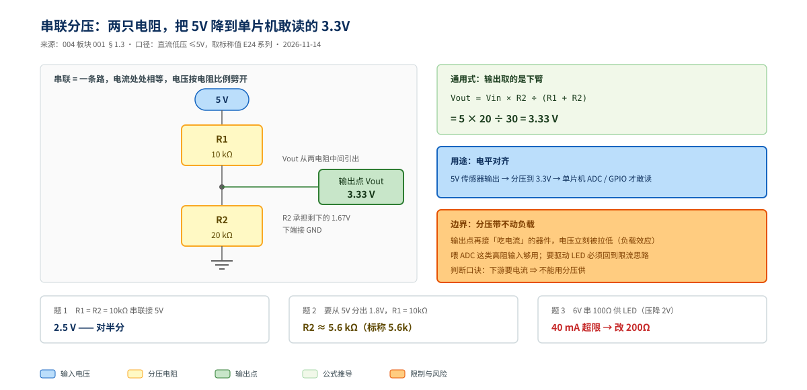
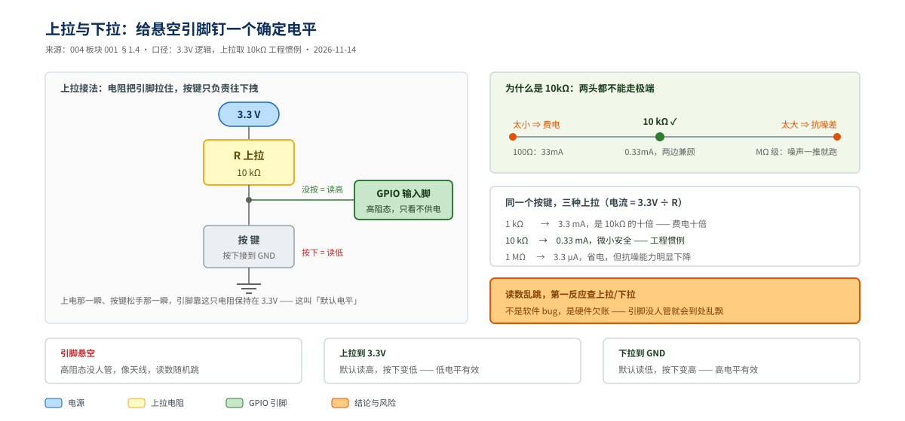

# 001 电学基础与欧姆定律

> **解决**：从"电到底是什么"讲到"能算出一个电阻值"——电荷怎么流、三要素怎么换算、欧姆定律与焦耳定律怎么用、串并联怎么分压分流、悬空脚为什么要上拉；全部计算题带答案，纯纸面即可完成本册。  
> **范围**：电荷与电流方向 · 三要素与单位换算 · 欧姆定律与功率 · 焦耳定律 · 串并联与分压 · 上拉下拉 · 直流交流与强弱电 · 安全边界。  
> **口径**：直流低压（≤5V）为主；元件参数给典型值，正式设计以 datasheet 为准；电荷模型用中学原子模型，不涉及量子层面。  
> **更新**：2026-11-19  
> **本册导读** ── 必会三点：① 三要素与欧姆定律（U=IR）② 限流电阻计算（220Ω 那道题）③ 上拉下拉（10kΩ 的取舍） ｜ 跟做时长：约 2 小时（纸面计算为主） ｜ 前置：无。  
> **标记**：★ = 必会节；○ = 拓展节。

## 目录

| 节 | 内容 |
|---|---|
| 1.1 | 电从哪里来：电荷、电流与它的方向 ★ |
| 1.2 | 三要素与单位换算：V / A / Ω ★ |
| 1.3 | 欧姆定律与功率（跟做：算出限流电阻） ★ |
| 1.4 | 焦耳定律：元件为什么会发烫 ○ |
| 1.5 | 串联与并联：分压与分流（跟做：三道计算题） ★ |
| 1.6 | 上拉与下拉：悬空引脚的救星 ★ |
| 1.7 | 直流与交流、强电与弱电：安全边界 ○ |
| 1.8 | 坑表 |
| 1.9 | 检查清单（自测 6 题 + 动手任务 3 件） |

---

## 1.1 电从哪里来：电荷、电流与它的方向 ★

**原子模型**（够用版）：原子核由质子和中子组成，核外电子分层绕行。质子带一份正电荷，电子带一份负电荷，数量相等时呈电中性。

| 层 | 电子数上限 | 与导电的关系 |
|---|---|---|
| 第一层 | 2 | 靠近原子核，能量最低、最稳定 |
| 第二层 | 8 | 能量较高 |
| 最外层（价电子层） | 8 | **少于 4 个容易失去 → 显正电；多于 4 个容易夺取 → 显负电** |

金属的外层电子容易脱离原子、在晶格里自由游荡，这批"自由电子"就是电流的载体。**所以：电流的本质是电荷的定向移动。**

**电流方向是个历史遗留问题**。1752 年富兰克林规定"正电荷移动的方向为电流方向"，后人才发现金属里真正跑的是带负电的电子、方向恰好相反。这个规定沿用至今：

> **电学上定义的电流方向 = 正电荷定向移动的方向；金属导体中电子的实际移动方向与之相反。** 做电路分析时一律按前者（标着箭头的那条），不要中途换向。

**电流的定义与单位**：

```text
I = Q / t          一秒内通过导体横截面的电荷量
1 A = 1 C/s        1 库仑 ≈ 6.24 × 10¹⁸ 个电子
```

**电子世界的电流刻度**（建立数量级直觉，比记数字更有用）：

| 场景 | 电流量级 |
|---|---|
| 计算器待机 | 约 100 μA |
| 手电筒 LED | 5 ~ 20 mA |
| 半导体收音机 | 约 50 mA |
| 家用电冰箱 | 约 1 A |
| 家用空调 | 约 5 A |
| 雷电 | 可达 10⁵ A 量级 |

**边界**：本节只讲经典导电模型。半导体里的载流子有电子和空穴两种，机制不同，见 003 §3.1。

## 1.2 三要素与单位换算：V / A / Ω ★

**类比模型**：把电想成水——**电压**是水压（推力），**电流**是水流（流量），**电阻**是水管的粗细（阻碍）。三者共生：有推力才有流量，管子越细流量越小。

| 量 | 字母 | 单位 | 换算阶梯 |
|---|---|---|---|
| 电压 | U | 伏特 V | 1 MV = 10³ kV = 10⁶ V；1 V = 10³ mV = 10⁶ μV |
| 电流 | I | 安培 A | 1 MA = 10³ kA = 10⁶ A；1 A = 10³ mA = 10⁶ μA = 10⁹ nA |
| 电阻 | R | 欧姆 Ω | 1 MΩ = 10³ kΩ = 10⁶ Ω；1 Ω = 10³ mΩ = 10⁶ μΩ |

**常用刻度锚点**：USB 供电 5V、单片机 3.3V、传感器信号 mV 级；整机几十 mA、LED 5~20 mA、待机 μA 级；上拉 10kΩ、限流 220Ω、导线近似 0Ω。

**两个容易含糊的测量口径**：

- **电压是"两点之间"的差**——说"这里 3.3V"隐含"相对 GND"。表笔只碰一个点读不出电压。
- **电流是"流过某一点"的量**——必须让电流穿过表笔（串联），这也是新手最容易烧保险的动作。

**软件衔接**：GPIO 输出高电平 = 芯片内部把引脚接到 3.3V，输出低 = 接到 GND。"写 1 写 0"在硬件层就是**切换连接**（004 §4.4 点灯电路）。



## 1.3 欧姆定律与功率（跟做：算出限流电阻） ★

**欧姆定律**：在电阻值不变的前提下，流过电阻的电流与两端电压成正比。

```text
U = I × R      I = U / R      R = U / I
```

知道任意两个量，第三个必然确定——这是电路计算的总钥匙。**注意**：电阻值由材料与几何形状决定，不随电压电流变化（这句话反过来常被误解成"电阻会跟着电压变"）。

**功率**：电流在单位时间内做的功，表示消耗电能的快慢。

```text
P = U × I      P = I² × R      P = U² / R      单位：瓦特 W
1 kW = 10³ W；1 W = 10³ mW = 10⁶ μW
```

**跟做（纸面计算，这是嵌入式"点灯"的第一道题）**——LED 限流电阻：

```text
已知：供电 3.3V，LED 正向压降约 2V（典型值，以 datasheet 为准），目标电流 10mA
求：限流电阻 R
R = (3.3 − 2) / 0.01 = 130Ω  → 取标称值 220Ω（宁可电流偏小，更安全）
电阻上的功率 P = 1.3V × 0.01A = 13mW  → 远低于常规电阻 1/8W（125mW）上限，安全 ✓
```

**验证你的答案**（三条判据，可自查）：① 实际电流 = (3.3−2)/220 ≈ 5.9mA，比目标小、LED 略暗但安全；② 电阻功率 ≈ 7.6mW < 125mW ✓；③ 若不串电阻，LED 直接承担 3.3V，电流远超额定 → 烧毁。⚠️ **任何 LED 电路必须有限流电阻**。



**试一试**：把目标电流改成 20mA 重算（R = 65Ω → 取 68Ω 标称）；再算供电 5V 时的 R（(5−2)/0.01 = 300Ω → 取 330Ω）。

## 1.4 焦耳定律：元件为什么会发烫 ○

**焦耳定律**：电流通过导体产生的热量，与电流的平方成正比、与电阻成正比、与通电时间成正比。

```text
Q = I² × R × t      Q = U × I × t      Q = P × t      单位：焦耳 J
1 kJ = 10³ J；1 MJ = 10³ kJ
```

**这条定律解释了 1.3 节末尾那句"电阻功率要留余量"**：功率就是发热速率，Q = P×t 说明同样的功率、时间越久积热越多。所以选电阻不是只看阻值，还要看**额定功率**——1/4W 的电阻长时间通 15mA（在 1kΩ 上就是 0.225W），已经贴着上限跑，会烫到变色。

**日常换算**：1 度电 = 1 kWh。一颗 18650 电池标称 3.7V / 2000mAh：

```text
能量 = 2A × 3.7V × 1h = 7.4Wh = 0.0074 kWh  →  约 0.0074 度电
```

**嵌入式为什么要管这件事**：稳压芯片（如 AMS1117）把 5V 降到 3.3V，压差 1.7V 全部变成热；电流 500mA 时 P = 1.7 × 0.5 = 0.85W，SOT-223 封装已经明显发烫，这就是板上要给稳压芯片铺铜、加散热片的原因（002 §2.8）。

**边界**：本节只算稳态直流发热，不涉及交流有效值与瞬态热阻。

## 1.5 串联与并联：分压与分流（跟做：三道计算题） ★

**串联**（一条路，电流处处相等）：

```text
I总 = I1 = I2            U总 = U1 + U2            R总 = R1 + R2
```

**并联**（两条路，电压处处相等）：

```text
U总 = U1 = U2            I总 = I1 + I2            1/R总 = 1/R1 + 1/R2
两只并联：R总 = (R1 × R2) / (R1 + R2)   ←  总电阻小于其中最小的那只
```

**串联分压**是嵌入式最常用的一个派生式：

```text
Vout = Vin × R2 / (R1 + R2)      （R2 是接地的下臂）

5V ──[ R1 10kΩ ]──┬──[ R2 20kΩ ]── GND
                  └── Vout = 5 × 20/(10+20) = 3.33V
```



**用途**：5V 传感器输出降到 3.3V 单片机可读（ADC 采样前置）。**边界**：分压电路带负载能力极差——输出点再接"吃电流"的器件会立刻把电压拉下来（负载效应）。喂 ADC 这类高阻输入够用，驱动 LED 不行。

**跟做（三道计算题，先自己算再看答案）**：

| # | 题目 | 答案（自行复核） |
|---|---|---|
| 1 | R1 = R2 = 10kΩ 串联接 5V，输出点电压？ | 2.5V（对半分） |
| 2 | 要从 5V 分出 1.8V，R1 = 10kΩ，R2 取多少？ | Vout = 5·R2/(R1+R2) = 1.8 → R2 ≈ 5.6kΩ（取标称 5.6k） |
| 3 | 6V 电源串 R = 100Ω 供 LED（压降 2V），电流多大？ | I = (6−2)/100 = 40mA —— 超过常规 LED 20mA 上限，⚠️ 应加大到 200Ω |

**试一试**：把第 3 题改成两只 100Ω 并联再串进电路，等效电阻多少、电流多少？（50Ω → 80mA，更危险——并联不是"减小危害"的通用手段。）

## 1.6 上拉与下拉：悬空引脚的救星 ★

**问题**：MCU 输入引脚是**高阻态**——"只看不摸"，自己不提供电平。悬空引脚像一根天线，读数随环境噪声乱跳。

**解法**：用一只大电阻把引脚"钉"在确定电平。

```text
上拉：3.3V ──[ R 10kΩ ]──┬── GPIO 输入脚
                          └──[ 按键 ]── GND      （没按 = 读高，按下 = 读低）

下拉：GND ──[ R 10kΩ ]──┬── GPIO 输入脚
                         └──[ 按键 ]── 3.3V      （没按 = 读低，按下 = 读高）
```

**注意一个概念**：上拉电阻、下拉电阻都不是特殊的元件，就是普通电阻——叫法来自它的用法。

**为什么是 10kΩ**（这是一个取舍题，不是定值）：

| 取值 | 后果 |
|---|---|
| 100Ω | 按下瞬间 33mA，费电且可能超 GPIO 灌电流上限 |
| **10kΩ** | 按下 0.33mA，兼顾省电与抗噪（工程惯例） |
| 1MΩ | 只耗 3.3μA，但抗噪能力差，长线容易误触发 |

**结论**：GPIO 读数乱跳，第一反应查上拉/下拉——这不是软件 bug，是硬件欠账（症状反查表收录）。



**试一试**：把上拉改 1kΩ，按下时电流多大？（3.3mA，是 10kΩ 的十倍）改 1MΩ 呢？（3.3μA，但抗噪下降）

## 1.7 直流与交流、强电与弱电：安全边界 ○

**直流与交流**：

| | 直流 DC（Direct Current） | 交流 AC（Alternating Current） |
|---|---|---|
| 特征 | 大小与方向不随时间周期性变化 | 大小与方向随时间周期性变化 |
| 长处 | 稳定、无电磁辐射，适合敏感设备与储能 | 可用变压器升降压，适合远距离输电 |
| 本库场景 | 全部（电池、USB、3.3V/5V 供电） | 只在"入户 220V"这一句里出现 |

嵌入式板子上的一切都是直流。有意思的是，**高低电平切换本身也是一次"交流"**——信号在 0 与 1 之间跳变，所以数字信号线同样适用"电容通交隔直"那一套（004 §4.1）。

**强电与弱电**——分界看国标安全电压：

```text
安全电压：交流 36V 以下，直流 24V 以下
强电：直流 24V 以上 / 交流 36V 以上  → 传能量（220V 家电、1000V 以上高压）
弱电：直流 24V 以下 / 交流 36V 以下  → 传信号（3.3V、5V、12V、音视频、网络、电话）
```

**一句话记法：弱电传信号，强电传能量。**

**安全红线**（本库所有实验的边界）：

1. 一律 ≤5V 直流（USB 供电即合规）。
2. ⚠️ **短路是大敌**——电源正负直连，电流只受内阻限制，瞬间发热可能损坏电池与导线。接完电路**先查再上电**。
3. **市电 220V 一概不碰**。弱电平台用手摸最多静电击穿元件，强电平台碰一下有生命危险。
4. 人体安全电流约 10mA 量级（工频），但**别用身体去验证任何一条**。

**家庭电路顺带认识**（知道有这回事即可）：进户线 → 电能表 → 总开关 → 保险装置（熔丝或空气开关）→ 用电器。空气开关在电流过大时自动跳闸，替代了老式的熔丝。

## 1.8 坑表

| # | 现象 | 原因 | 解法 |
|---|---|---|---|
| 1 | LED 一接就烫/烧 | 没串限流电阻 | 先算后接（§1.3 模板） |
| 2 | 分压输出一接负载就掉 | 负载效应 | 只喂高阻输入 |
| 3 | 输入脚读数乱跳 | 引脚悬空 | 加 10kΩ 上拉/下拉（§1.6） |
| 4 | 3.3V 芯片接 5V 信号 | 电平不匹配 | 分压或电平转换 |
| 5 | 电池/线材发烫 | 短路 | 断电检查，先查再上电 |
| 6 | 电阻用久了变色 | 功率没留余量 | 用 P = I²R 核一遍额定功率（§1.4） |
| 7 | 用万用表量电压读数为 0 | 只碰了一个点 | 电压是两点之差，表笔并联跨接 |

## 1.9 检查清单（自测 6 题 + 动手任务 3 件）

**自测**：

| # | 问题 | 自测标准 |
|---|---|---|
| 1 | 电流方向怎么定，实际电子往哪走 | 定义为正电荷移动方向；金属中电子反向 |
| 2 | 三要素类比与单位换算 | 推力/流量/阻碍；1A=10³mA=10⁶μA |
| 3 | LED 限流电阻公式 | (供电−压降)/目标电流；会算 220Ω 那道 |
| 4 | 串联分压公式 | Vout = Vin × R2/(R1+R2) |
| 5 | 悬空引脚为什么乱跳、上拉为什么 10kΩ | 高阻态；小费电、大抗噪差 |
| 6 | 安全电压是多少 | 交流 36V、直流 24V 以下 |

**动手任务**：① 完成 §1.3 的限流计算（5V 版重算一遍）；② 完成 §1.5 三道计算题并复核答案；③ 算出 10kΩ / 1kΩ / 1MΩ 三种上拉在按下时的电流，写成一行对比表。

> 下一篇：《002 常用元器件与参数识别》——认识了电，再认识搬电的元件：电阻、电容、电感各自怎么读数、怎么选型。
