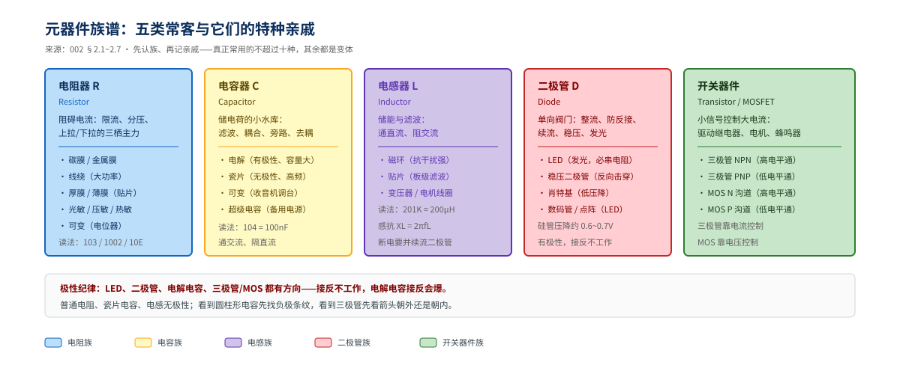
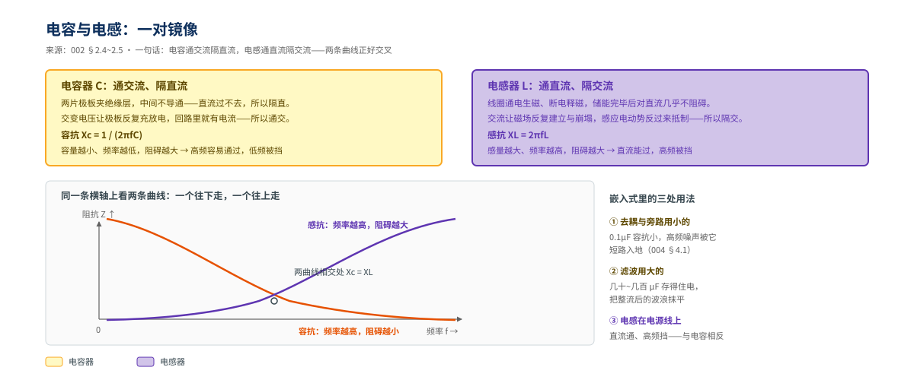

# 002 常用元器件与参数识别

> **解决**：把开发板上真会遇到的十来种元件认全、把丝印读对——电阻怎么从 `103` 读出 10kΩ、电容 `104` 为什么是 100nF、电感 `201K` 是多少、继电器和保险丝选什么参数；每种元件都给出"买之前要看哪几个数"。  
> **范围**：元器件分类 · 电阻器（参数/材料/特种/五种阻值读法）· 电容器（参数/类型/容量读法）· 电感器 · 继电器 · 保险丝 · 接插件 · 蜂鸣器 · 电池与稳压芯片。  
> **口径**：以贴片件与常见直插件为主；丝印读法以 EIA 标准与厂商通用标注为准；元件参数以 datasheet 为最终依据。  
> **更新**：2026-11-19  
> **本册导读** ── 必会三点：① 电阻三种数字读法（三位/四位/EIA-96）② 电容三位乘方与字母法 ③ 每种元件买之前看哪几个参数 ｜ 跟做时长：约 2 小时（读丝印 + 列采购参数表） ｜ 前置：001（三要素与欧姆定律）。  
> **标记**：★ = 必会节；○ = 拓展节。

## 目录

| 节 | 内容 |
|---|---|
| 2.1 | 元器件全景：插件式、贴片式与五类常客 ★ |
| 2.2 | 电阻器：四个必看参数与五种材料 ★ |
| 2.3 | 电阻阻值怎么读：三种数字法 + EIA-96 对照表 ★ |
| 2.4 | 电容器：容量、耐压、容差与三种读法 ★ |
| 2.5 | 电感器：储能与通直隔交 ○ |
| 2.6 | 继电器与保险丝：开关与保险 ○ |
| 2.7 | 接插件、蜂鸣器、电池与稳压芯片 ○ |
| 2.8 | 坑表 |
| 2.9 | 检查清单（自测 6 题 + 动手任务 2 件） |

---

## 2.1 元器件全景：插件式、贴片式与五类常客 ★

**两大封装阵营**：

| 阵营 | 特征 | 场景 |
|---|---|---|
| 插件式（直插） | 有引脚穿过 PCB 焊接，体积大、好手工焊 | 面包板实验、电源板、大功率 |
| 贴片式（SMD） | 直接贴焊在板面，小、适合机器贴装 | 现代产品板、开发板 |

**五类常客**（其余都是它们的变体或延伸）：

| 元件 | 符号直觉 | 在嵌入式里的角色 |
|---|---|---|
| 电阻器 R | 阻碍电流的"阀门" | 限流（LED）、分压（ADC 前置）、上拉/下拉（001 §1.6） |
| 电容器 C | 储电荷的"小水库" | 滤波、耦合、去耦（004 §4.1） |
| 电感器 L | 储磁能的"飞轮" | 电源滤波、开关电源储能 |
| 二极管 D | 单向阀门 | 防反接、整流；LED 是它的发光亲戚（003 §3.3） |
| 晶体管（三极管/MOS） | 小信号控制大电流的开关 | 驱动继电器/电机；数字芯片的内部原子（003 §3.4~3.5） |

**极性纪律**：LED、二极管、电解电容**有方向**，接反不工作甚至爆；普通电阻、瓷片电容、电感无极性。**看到圆柱形电容先找负极标记**——这是新手烧电容最常见的原因。



## 2.2 电阻器：四个必看参数与五种材料 ★

**买之前看四个参数**：

| 参数 | 含义 | 常见取值 |
|---|---|---|
| 阻值 | 阻碍电流的能力 | 1Ω ~ 10MΩ |
| **额定功率** | 长期连续安全工作可耗散的最大功率 | 1/8W、1/4W、1/2W、1W、2W… |
| 精度（容差） | 实际值与标称值的允许偏差 | ±5%（J）、±1%（F）、±0.1%（B） |
| 价格 | 精度越高越贵 | 0.1% 约为 1% 的十倍，1% 约为 5% 的 1.3 倍 |

**额定功率怎么算**（这条最容易忽略）：一只 1/4W、1kΩ 的电阻，能长期流过多大电流？

```text
P = I²R  →  0.25 = I² × 1000  →  I = 0.0158A ≈ 15mA
超过 15mA 长期跑，电阻会烫到变色、阻值漂移
```

**五种常见材料**（按工艺分，选型时看这张表）：

| 材料 | 特点 | 场景 |
|---|---|---|
| 碳膜 | 成本低、阻值范围宽、稳定性好 | 民用家电，最常用 |
| 金属膜 | 精度高、噪声小、温度系数小 | 仪器仪表、通信设备 |
| 线绕 | 耐大功率（5~20W）、精度高、**高频性能差** | 大功率、过载保护 |
| 厚膜（贴片） | 成本低、精度一般 | 主流电子产品 |
| 薄膜（贴片） | 精度高、成本高 | 精密仪器、军工航空 |

**特种电阻**（靠"环境量"改变阻值）：

| 类型 | 特性 | 用途 |
|---|---|---|
| 光敏电阻 | 光照越强，阻值越低 | 光控灯、报警器（004 §4.2 光感灯） |
| 压敏电阻 | 两端电压超阈值时阻值骤降 | 吸收浪涌、雷击保护（并联在电路两端） |
| 热敏电阻 | 温度变化引起阻值变化 | 温度检测、过流保护 |

**压敏电阻丝印怎么读**（`10D180K` 这类）：

```text
10  = 直径 10mm
D   = 圆形（S 表示方形）
180 = 前两位 18 是有效数字，末位 0 表示加 0 个零 → 压敏电压 18V
K   = 误差 ±10%（J=±5%、K=±10%、M=±20%）
```

## 2.3 电阻阻值怎么读：三种数字法 + EIA-96 对照表 ★

贴片电阻的丝印有三套规则，**先数位数再决定用哪套**——这是读错丝印的根本原因。

### 三位数字法（±5% 精度，最常见）

前两位是有效数字，第三位是"补几个零"，单位 Ω。**R 表示小数点。**

```text
472  → 47 × 10² = 4700Ω = 4.7kΩ
151  → 15 × 10¹ = 150Ω
2R4  → 2.4Ω        （R 占一位，表示小数点）
R15  → 0.15Ω
```

### 四位数字法（±1% 精度）

前三位有效数字，第四位补零的个数。

```text
1002 → 100 × 10² = 10000Ω = 10kΩ
1001 → 100 × 10¹ = 1000Ω = 1kΩ
R500 → 0.5Ω（500mΩ）
```

### EIA-96 精密法（±0.1%~±1%，两位数字 + 一位字母）

这是最容易读错的一套：**前两位数字不是有效数字，要去对照表查**；第三位字母是乘数。

```text
乘数：Y=10⁻²  X=10⁻¹  A=10⁰  B=10¹  C=10²  D=10³  E=10⁴  F=10⁵

01B → 查表 01=100，B=10¹  → 100 × 10 = 1000Ω = 1kΩ
10E → 查表 10=124，E=10⁴  → 124 × 10⁴ = 1.24MΩ   ⚠️ 不是 10kΩ！
```

> **一个真实易错点**：`10E` 和 `103` 长得像，但含义天差地别——`103` = 10kΩ（三位数字法），`10E` = 1.24MΩ（EIA-96）。**看到字母结尾，一定去查表，不要拿前两位当数字用。**

**EIA-96 代号对照表**（01~96 对应三位有效数字）：

| 代号 | 值 | 代号 | 值 | 代号 | 值 | 代号 | 值 |
|---|---|---|---|---|---|---|---|
| 01 | 100 | 25 | 178 | 49 | 316 | 73 | 562 |
| 02 | 102 | 26 | 182 | 50 | 324 | 74 | 576 |
| 03 | 105 | 27 | 187 | 51 | 332 | 75 | 590 |
| 04 | 107 | 28 | 191 | 52 | 340 | 76 | 604 |
| 05 | 110 | 29 | 196 | 53 | 348 | 77 | 619 |
| 06 | 113 | 30 | 200 | 54 | 357 | 78 | 634 |
| 07 | 115 | 31 | 205 | 55 | 365 | 79 | 649 |
| 08 | 118 | 32 | 210 | 56 | 374 | 80 | 665 |
| 09 | 121 | 33 | 215 | 57 | 383 | 81 | 681 |
| 10 | 124 | 34 | 221 | 58 | 392 | 82 | 698 |
| 11 | 127 | 35 | 226 | 59 | 402 | 83 | 715 |
| 12 | 130 | 36 | 232 | 60 | 412 | 84 | 732 |
| 13 | 133 | 37 | 237 | 61 | 422 | 85 | 750 |
| 14 | 137 | 38 | 243 | 62 | 432 | 86 | 768 |
| 15 | 140 | 39 | 249 | 63 | 442 | 87 | 787 |
| 16 | 143 | 40 | 255 | 64 | 453 | 88 | 806 |
| 17 | 147 | 41 | 261 | 65 | 464 | 89 | 825 |
| 18 | 150 | 42 | 267 | 66 | 475 | 90 | 845 |
| 19 | 154 | 43 | 274 | 67 | 487 | 91 | 866 |
| 20 | 158 | 44 | 280 | 68 | 499 | 92 | 887 |
| 21 | 162 | 45 | 287 | 69 | 511 | 93 | 909 |
| 22 | 165 | 46 | 294 | 70 | 523 | 94 | 931 |
| 23 | 169 | 47 | 301 | 71 | 536 | 95 | 953 |
| 24 | 174 | 48 | 309 | 72 | 549 | 96 | 976 |

### 色环法与直标法

- **色环**：4 环或 5 环表示阻值与精度，靠颜色顺序记忆。**实战建议：直接用万用表量，别读色环**——色环受光照、褪色影响大，读错率高。
- **直标法**：元件表面直接印"4Ω J"这类，J 是误差代号（A=±0.05%、B=±0.1%、C=±0.25%、D=±0.5%、F=±1%、G=±2%、J=±5%、K=±10%、M=±20%）。

**跟做（读丝印）**：下面四个实物丝印，先自己读，再看答案。

| 丝印 | 用哪套规则 | 阻值 |
|---|---|---|
| `1002` | 四位数字法 | 100 × 10² = **10kΩ** |
| `R10` | 三位数字法（R 为小数点） | **0.10Ω** |
| `3R40` | 四位数字法（R 为小数点） | **3.40Ω** |
| `103` | 三位数字法 | 10 × 10³ = **10kΩ** |

**试一试**：`4701` 是多少？（4.7kΩ）`01C` 是多少？（100 × 10² = 10kΩ）两者同为 10kΩ，但前者是 ±1% 的普通件、后者是 EIA-96 精密件——**精度不同，价钱不同**。

## 2.4 电容器：容量、耐压、容差与三种读法 ★

**电容是什么**：两片靠得很近的平行极板夹一层绝缘介质。通电时极板聚集电荷（充电），撤电后短接则中和（放电）。**因为中间不导通，所以直流过不去；因为交变电压会反复充放电，所以交流过得去**——这就是"通高频、阻低频、隔直流"。

**三个必看参数**：

| 参数 | 说明 | 常见取值 |
|---|---|---|
| 容量 | 能储存多少电荷 | 1F = 10³mF = 10⁶μF = 10⁹nF = 10¹²pF |
| **耐压值** | 能承受的最大电压，超了会击穿甚至爆 | 6.3V、10V、16V、25V、50V、100V…（常用到 600V） |
| 容差 | 实际容量与标称的偏差 | B=±0.1pF、C=±0.25pF、D=±0.5pF、J=±5%、K=±10% |

**耐压与体积的关系**（选型时很实用）：标称耐压越高，电容体积越大；有极性（电解）的耐压偏低、容量大且便宜，无极性（瓷片）耐压高、容量小。

**三种容量读法**：

```text
① 直接标注法（电解电容）：表面印多少就是多少，如 470μF、1500μF
② 三位乘方表示法（瓷片电容）：前两位有效数字 + 第三位补零个数，单位 pF
     100 → 10 × 10⁰ = 10pF
     102 → 10 × 10² = 1000pF = 1nF
     103 → 10 × 10³ = 10000pF = 10nF
     104 → 10 × 10⁴ = 100000pF = 100nF
     105 → 10 × 10⁵ = 1000nF = 1μF
③ 字母表示法（IEC 推荐）：p/n/u/m 表示单位，字母前是整数、字母后是小数
     1p5 → 1.5pF     4u7 → 4.7μF     3n9 → 3.9nF
```

**贴片电解电容**是例外：丝印数字直接读，单位 μF（如 `470` = 470μF）。

**按结构与用途分类**：

| 类型 | 极性 | 特点 | 用途 |
|---|---|---|---|
| 电解电容 | **有极性**，接反会爆 | 容量大、便宜，只能用于直流 | 电源储能、滤波 |
| 瓷片电容 | 无极性 | 容量小、高频特性好 | 高频旁路、振荡回路、去耦 |
| 可变电容 | 无极性 | 可调，收音机调台用 | 调谐（很少用） |
| 超级电容 | 有极性 | 容量极大、充放电快，介于电容与电池之间 | 备用电源、瞬间供电 |

**容抗：电容对交流的阻碍有多大**——这条与电感的感抗正好对称（§2.5）：

```text
Xc = 1 / (2πfC)     容量越小、频率越低，阻碍越大
```

所以 0.1μF 这种小电容专管高频（高频容抗小、容易被它旁路入地），几 μF~几十 μF 的管低频。

**一句话选型**：要**大容量储能**选电解（注意极性），要**高频与去耦**选瓷片。



## 2.5 电感器：储能与通直隔交 ○

**电感是什么**：导线绕成线圈，电流通过时把电能转成磁能存起来。单位亨利 H，常用 mH / μH（1H = 10³mH，1mH = 10³μH）。

**与电容恰好相反**：电容通交隔直，电感**通直隔交**——对直流几乎不阻碍（储能完毕后），对交流阻碍大。这个阻碍叫**感抗 XL**：

```text
XL = 2πfL       频率越高、感量越大，阻碍越强
```

**三个参数**：

| 参数 | 说明 |
|---|---|
| 电感量 | 与线圈面积、圈数、有无磁芯有关 |
| 直流电阻 DCR | 线圈本身的电阻，等效于串联一只小电阻，越小越好 |
| 允许误差 | J=±5%、K=±10%、L=±15%、M=±20%、P=±25%、N=±30% |

**丝印读法**（三位数字 + 一位字母，末位数字是补零个数）：

```text
201K → 20 × 10¹ = 200μH，K = ±10%
4R7J → 4.7μH，J = ±5%       （R 表示小数点，单位 μH）
4N7J → 4.7nH                （N 表示小数点，单位 nH）
```

**嵌入式要看的两点**（其余归硬件工程师）：① **储能**——开关电源靠它续流；② **通直隔交**——电源线上串一颗，把高频噪声挡在外面。

**常见类型**：磁环电感（绕在环形磁芯上，抗干扰强）、贴片电感（体积小，用于板级滤波）。

## 2.6 继电器与保险丝：开关与保险 ○

**继电器**：用小电流控制大电流的"自动开关"——线圈通电产生磁力吸合触点。**为什么需要它**：GPIO 只能给十几 mA，驱动 220V 的负载必须靠继电器这种"隔空操作"的机械开关。

| 参数 | 含义 |
|---|---|
| 额定电压 | 线圈正常工作能承受的电压（常见 5V、12V） |
| 最大切换电流 | 触点能通过的最大负载电流 |
| 最大切换电压 | 触点能正常开合的最高电压 |
| 触点形式 | 常开（NO）、常闭（NC）、转换（COM+NO+NC） |

**单刀单掷 vs 单刀双掷**：单刀单掷只有"通/断"两态；单刀双掷有一把刀在两个触点间切换（像岔道），可做"二选一"。

**驱动纪律**：线圈是电感性负载，断电瞬间会产生反电动势，必须并一只**续流二极管**保护驱动管（003 §3.4 的开关级同理）。

**保险丝**：本质是一只"故意做脆弱"的电阻，电流超额定值时熔断，切断电路保护后级。

| 参数 | 说明 |
|---|---|
| 额定电压 | 安全使用所允许的电路最高工作电压 |
| 额定电流 | 常见 100mA、200mA、315mA、500mA、1A、2A、3A、5A… |
| 熔断速度 | TT（特慢）、T（慢）、M（中）、F（快）、FF（特快） |

**一次性 vs 自恢复**：一次性熔断后必须更换；自恢复（PPTC）熔断后冷却可复位，适合反复过流的场合（USB 口）。

**配合使用**：压敏电阻吸收浪涌电压 + 保险丝切断持续过流，是电源入口的经典组合。

## 2.7 接插件、蜂鸣器、电池与稳压芯片 ○

**接插件**——把不同设备连起来。**唯一要记的参数是脚间距**：

```text
1.25 / 1.5 / 2.0 / 2.54 / 3.5 / 3.81 / 3.96 / 5.08 / 7.62 mm
其中 2.54mm（= 0.1 英寸）是面包板与排针的事实标准
```

常见类型：排针/排母（连接核心板与扩展板）、杜邦线、跳线帽、轻触按键、拨码开关、DC 插座。

**蜂鸣器**：按驱动方式分两类，**这个区分是新手第一个坑**：

| 类型 | 内部 | 怎么响 |
|---|---|---|
| 有源（自激式） | 含振荡电路 | 通电就响，给高低电平即可 |
| 无源（他激式） | 只有发声元件 | 必须给**方波信号**才响，给直流不响 |

**判别方法**（不用通电）：万用表拨到欧姆档量两端——**有读数（几 Ω~几十 Ω）= 无源；无读数（开路）= 有源**。

**驱动纪律**：蜂鸣器工作电流常超过 GPIO 能力，一般用三极管或 MOS 管做开关级（003 §3.4）。

**电池**：

| 参数 | 说明 |
|---|---|
| 额定电压 | 标称工作电压（锂电 3.7V、干电池 1.5V） |
| 容量 | mAh：200mAh 表示以 200mA 恒流可放电 1 小时 |

**型号命名**：`18650` = 直径 18mm、长 65mm、圆柱形；`14500` = 直径 14mm、长 50mm、圆柱形。

**稳压芯片**（电源管理芯片）：把不稳定的输入变成稳定输出。三个参数：输入电压范围、输出电压、最大输出电流。

| 型号 | 输出 | 特点 |
|---|---|---|
| 7805 | 5V | 老牌线性稳压，压差大时发热明显 |
| AMS1117-3.3 | 3.3V | 低压差（LDO），开发板常客 |

**发热是它的主要矛盾**：线性稳压把多余电压全变成热（001 §1.4 焦耳定律），压差大、电流大时必须铺铜或加散热片。**这也是为什么开发板多用 5V 输入 + LDO 出 3.3V，而不是从 12V 直接降。**

## 2.8 坑表

| # | 现象 | 原因 | 解法 |
|---|---|---|---|
| 1 | 电阻丝印读出来差 1000 倍 | 把 EIA-96 的 `10E` 当成 `103` | 见字母就查表（§2.3） |
| 2 | 电解电容装反爆浆 | 有极性，接反 | 认负极条纹，装配前再核一遍 |
| 3 | 电容标 104 却不清楚多大 | 单位是 pF，不是 μF | 104 = 100nF（§2.4） |
| 4 | 电阻用久了变色 | 额定功率没留余量 | 用 P=I²R 核一遍（§2.2） |
| 5 | 蜂鸣器给电平不响 | 买的是无源蜂鸣器 | 改给方波，或换有源件（§2.7） |
| 6 | 稳压芯片烫手 | 压差 × 电流全变热 | 降输入电压或加散热（§2.7） |
| 7 | 排针插不上 | 脚间距不是 2.54mm | 买前量间距（§2.7） |
| 8 | 继电器一断电就烧驱动管 | 线圈反电动势 | 并续流二极管（§2.6） |

## 2.9 检查清单（自测 6 题 + 动手任务 2 件）

**自测**：

| # | 问题 | 自测标准 |
|---|---|---|
| 1 | `103`、`1002`、`10E` 各是多少 | 10kΩ / 10kΩ / 1.24MΩ |
| 2 | `104` 电容是多少 | 100nF（= 0.1μF） |
| 3 | 电阻四个必看参数 | 阻值/功率/精度/价格 |
| 4 | 电解与瓷片怎么选 | 大容量储能选电解（注意极性），高频去耦选瓷片 |
| 5 | 有源与无源蜂鸣器怎么区分 | 欧姆档有读数=无源；无读数=有源 |
| 6 | 电感与电容的作用为何相反 | 电感通直隔交，电容通交隔直 |

**动手任务**：① 找任意一块开发板或元件盒，挑 5 个电阻读出阻值并与万用表实测对照，记录读错的；② 给下面这份采购单补齐参数——"LED 限流电阻 ×10、MCU 电源脚去耦电容 ×10、3.3V 稳压芯片 ×1"，每种写出阻值/容量、耐压或功率、封装。

> 下一篇：《003 半导体与分立器件》——电阻电容都是被动的，真正会"开关"和"放大"的是半导体做的二极管、三极管与 MOS 管。
