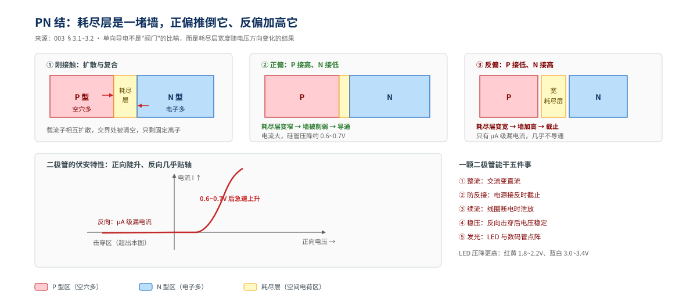
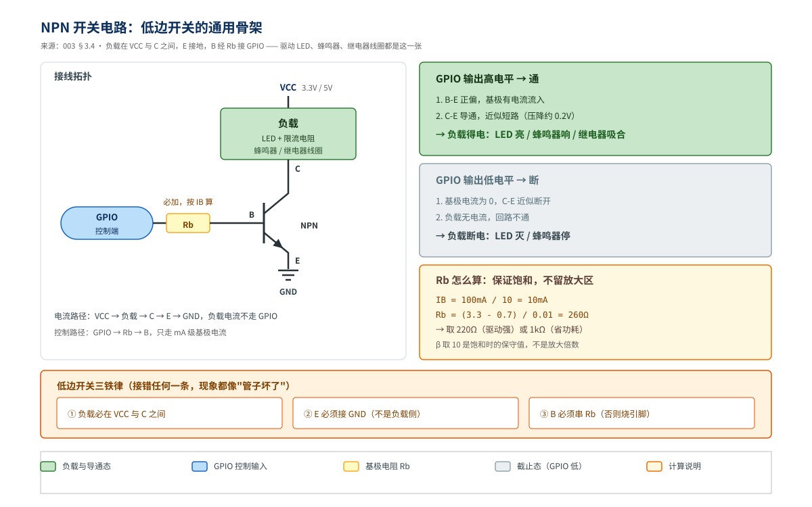
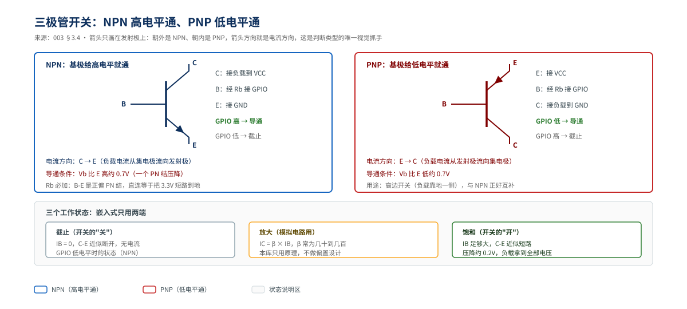

# 003 半导体与分立器件

> **解决**：讲清"为什么一块硅片能当开关"——从硅原子怎么掺出 P 型和 N 型，到 PN 结为什么只让电流单向过，再到三极管与 MOS 管怎么用一个小信号控制大电流；这三种器件是开发板上所有驱动电路的共同骨架。  
> **范围**：本征/掺杂半导体 · PN 结与耗尽层 · 二极管（整流、LED、数码管）· 三极管 NPN/PNP 三态与开关电路 · MOS 管 N/P 沟道 · 选型对比。  
> **口径**：以增强型 MOS 与硅管为主；放大电路只讲原理与 β 概念，不做偏置设计与频率分析（归硬件工程师）；开关用法是本册重点。  
> **更新**：2026-11-21  
> **本册导读** ── 必会三点：① PN 结单向导电 ② 三极管 NPN/PNP 的导通条件与电流方向 ③ MOS 管是电压控制、芯片的最小单位 ｜ 跟做时长：约 2 小时（画 PN 结 + 两种开关电路） ｜ 前置：001（电压电流）、002（元器件）。  
> **标记**：★ = 必会节；○ = 拓展节。

## 目录

| 节 | 内容 |
|---|---|
| 3.1 | 从硅原子到载流子：本征、P 型与 N 型 ★ |
| 3.2 | PN 结：耗尽层与单向导电 ★ |
| 3.3 | 二极管：整流、防反接与发光 ○ |
| 3.4 | 三极管：NPN 与 PNP 的开关用法 ★ |
| 3.5 | MOS 管：电压控制，芯片的最小单位 ★ |
| 3.6 | 三种器件怎么选 ○ |
| 3.7 | 坑表 |
| 3.8 | 检查清单（自测 6 题 + 动手任务 2 件） |

---

## 3.1 从硅原子到载流子：本征、P 型与 N 型 ★

**硅为什么是半导体**：硅原子最外层 4 个价电子，刚好能和 4 个邻居各拉一只手，形成稳定的共价键——此时既没有多余电子，也没有空位，**几乎不导电**。这就是**本征半导体**（纯净、无缺陷的半导体）。

**但纯硅有两个天生的"载流子"**：

| 载流子 | 来源 | 电荷 |
|---|---|---|
| 自由电子 | 热激发让个别价电子挣脱共价键 | 负 |
| **空穴** | 电子跑掉后，共价键上留下的空位 | 视为正 |

本征状态下电子与空穴成对产生、数量相等，导电能力很弱且随温度升高而增强（这就是半导体怕热的原因之一）。

**掺杂：往硅里加"杂质"，可控地制造载流子**——这是整个半导体工业的起点。

| 掺什么 | 价电子数 | 结果 | 载流子 | 类型 |
|---|---|---|---|---|
| **磷（P）**、砷（As） | 5 个 | 4 个成键，多出 1 个自由电子 | 电子多（多子） | **N 型**（Negative） |
| **硼（B）**、铝（Al） | 3 个 | 只能成 3 个键，留 1 个空位 | 空穴多（多子） | **P 型**（Positive） |

**记忆抓手**：掺五价元素给电子 → N 型（Negative，负）；掺三价元素留空位 → P 型（Positive，正）。**"多子"是由掺杂决定的，温度只影响"少子"**，所以掺了杂质的半导体导电能力稳定、可控——这才是能拿来做器件的原因。

## 3.2 PN 结：耗尽层与单向导电 ★

**把 P 型和 N 型贴在一起会发生什么**：

```text
① 扩散：P 区空穴浓度高，往 N 区跑；N 区电子浓度高，往 P 区跑
② 复合：跑到对面的载流子与本地多子相遇湮灭
③ 留下离子：P 区侧留下带负电的受主离子，N 区侧留下带正电的施主离子
④ 形成耗尽层（空间电荷区）：交界处载流子被清空，只剩固定离子
⑤ 内建电场：方向从 N 指向 P，阻止后续扩散 → 达到动态平衡
```

**关键：耗尽层里有一道"内建电场"，它是一堵墙。**

| 外加电压 | 耗尽层 | 结果 |
|---|---|---|
| **正向偏置**（P 接高、N 接低） | 变窄，墙被削弱 | 载流子能穿过 → **导通**，电流大 |
| **反向偏置**（P 接低、N 接高） | 变宽，墙加高 | 只有极小的漏电流 → **截止** |

**这就是单向导电**：不是一个"阀门"的比喻，而是耗尽层宽度随电压方向变化的结果。硅二极管正向导通压降约 **0.6~0.7V**——这个数字来自"越过内建电场需要的最小电压"，不是随便给的。

**两个衍生特性**（知道有这回事即可）：

- **电容效应**：反偏时耗尽层两侧的离子构成一个小电容，容量随反偏电压变化——变容二极管与 MOS 管的栅极电容都源于此。
- **击穿**：反向电压加到一定程度，载流子被强电场"撞"出更多载流子（雪崩击穿）或直接隧穿（齐纳击穿），反向电流骤增。稳压二极管正是利用击穿后的电压稳定特性工作。

**跟做（画一遍，比读十遍有用）**：在纸上画 P | N 两块，标出扩散箭头（空穴→右、电子→左）、耗尽层范围、内建电场方向（N→P）。画完自检三点：耗尽层在哪、电场朝哪、正偏时它变宽还是变窄。



## 3.3 二极管：整流、防反接与发光 ○

**二极管 = 一个 PN 结 + 两个引脚**。阳极（A，接 P 区）、阴极（K，接 N 区，壳体上有色环的一端）。

| 用法 | 原理 | 典型电路 |
|---|---|---|
| 整流 | 只允许单向导通，把交流变直流 | 电源适配器、桥式整流 |
| 防反接 | 电源接反时截止，保护后级 | 电池仓入口串一只 |
| 续流 | 电感性负载断电时提供泄放回路 | 继电器/电机线圈并联（002 §2.6） |
| 稳压 | 反向击穿后电压稳定 | 稳压二极管 + 限流电阻 |
| 发光 | 正向导通时电子与空穴复合释放光子 | LED 指示、数码管、点阵 |

**LED 与普通二极管的两点不同**：① 正向压降高（红/黄约 1.8~2.2V，蓝/白约 3.0~3.4V）；② **必须串限流电阻**——LED 的内阻极小，直接接电压源会瞬间过流烧毁（001 §1.3 那道计算题就是为它准备的）。

**极性怎么认**：直插 LED 长脚为正（阳极）、短脚为负；贴片件看底部标记或封装缺口；万用表二极管档量——正向导通显示 0.5~0.8V（硅 PN 结正常值），反向显示 `OL`（开路）。

**数码管与点阵**：本质是多个 LED 的组合。数码管 8 段（7 段 + 小数点），分**共阴**（所有 LED 阴极接在一起拉低）与**共阳**（阳极接在一起拉高）两种；点阵是 LED 排成矩阵，靠行列扫描逐点亮。选型时必须先确认共阴还是共阳——选错则显示全反。

## 3.4 三极管：NPN 与 PNP 的开关用法 ★

**三极管 = 两个 PN 结背靠背拼在一起**，三个引脚：**基极 B**（Base）、**集电极 C**（Collector）、**发射极 E**（Emitter）。

```text
NPN：N 型 - P 型 - N 型      电流从 C、B 流入，从 E 流出
PNP：P 型 - N 型 - P 型      电流从 E 流出，分给 C、B
```

**"箭头朝外是 NPN，箭头朝内是 PNP"**——符号里发射极那只箭头，方向就是**电流方向**，也是判断类型的唯一视觉抓手。

**两种类型对照**（这是本册最该背下来的一张表）：

| | NPN | PNP |
|---|---|---|
| 导通条件 | 基极**高电平**（B 比 E 高约 0.7V） | 基极**低电平**（B 比 E 低约 0.7V） |
| 电流方向 | C → E（B 也流入） | E → C（B 也流出） |
| 常见接法 | E 接地，负载接在 VCC 与 C 之间 | E 接 VCC，负载接在 C 与 GND 之间 |
| 一句话 | 给高就通 | 给低就通 |

**三个工作状态**：

| 状态 | 条件 | 表现 | 嵌入式用途 |
|---|---|---|---|
| 截止 | 基极电流为 0 | C-E 间近似断开 | 开关的"关" |
| 放大 | 基极电流适中 | IC = β × IB（β 常为几十到几百） | 模拟放大（本库不深入） |
| 饱和 | 基极电流足够大 | C-E 间近似短路，压降约 0.2V | 开关的"开" |

**嵌入式只用两端：截止与饱和**。中间那个放大区是给模拟电路用的——我们要的是"要么通、要么断"，所以驱动时故意把基极电流给足，让它一头扎进饱和区。

**NPN 开关电路**（驱动 LED、蜂鸣器、继电器线圈的通用骨架）：



**基极电阻 Rb 怎么算**：保证饱和。设负载电流 100mA、β 取 10（饱和时的保守值）、B-E 压降 0.7V：

```text
IB = 100mA / 10 = 10mA
Rb = (3.3 − 0.7) / 0.01 = 260Ω  →  取 220Ω 或 1kΩ（视驱动强度与功耗权衡）
```

**为什么必须加 Rb**：B-E 之间就是一个正向 PN 结，直接接 GPIO 等于把 3.3V 短路到 GND（只剩 0.7V 压降），瞬间烧掉引脚或管子。



## 3.5 MOS 管：电压控制，芯片的最小单位 ★

**三极管靠电流控制，MOS 管靠电压控制**——这是两者最根本的区别。

| | 三极管（BJT） | MOS 管（FET） |
|---|---|---|
| 控制量 | 基极**电流** | 栅极**电压** |
| 控制端是否耗流 | 要，持续消耗 | **几乎不耗**（栅极是绝缘的） |
| 载流子 | 电子与空穴都参与（双极型） | 只有多子参与（单极型） |
| 开关速度 | 较慢 | 快，适合高频 |
| 成本 | 便宜 | 芯片内极便宜（数字电路的原子） |

**三个引脚**：**栅极 G**（Gate）、**漏极 D**（Drain）、**源极 S**（Source）。对应三极管的 B、C、E。

**N 沟道与 P 沟道**（本库只用增强型）：

| | N 沟道（NMOS） | P 沟道（PMOS） |
|---|---|---|
| 导通条件 | Vgs > 阈值电压 Vth（栅极给**高**） | Vgs < Vth（栅极给**低**） |
| 电流方向 | D → S | S → D |
| 典型位置 | **低边开关**（负载接 VCC，MOS 接 GND） | **高边开关**（MOS 接 VCC，负载接 GND） |

**增强型与耗尽型的区别**：增强型"默认关断，加电压才开通"（Vth 是开启门槛）；耗尽型"默认就通，加电压才关断"。开发板上做开关用的几乎都是增强型——默认关断更安全。

**为什么说 MOS 是芯片的最小单位**：一颗 MCU 里集成的是百万级到亿级的 MOS 管，每一只就是一个受电压控制的开关。逻辑门（005 §1.x）本质上是几只 MOS 管的组合。**理解 MOS 的"栅极电压控制沟道通断"，就理解了数字芯片的物理底座。**

**驱动纪律**：MOS 的栅极是绝缘的，等效一个小电容——开关瞬间要给它充放电，所以① 栅极串一只小电阻（几十 Ω）抑制振铃；② 栅极不能悬空（悬空会因感应电压误导通）；③ 大功率 MOS 需要专门的栅极驱动芯片。

**与三极管的选择**：小电流、低成本、简单开关选三极管；大电流、高频、低损耗选 MOS 管。开发板上驱动电机、加热片这类大负载，基本都用 MOS。


## 3.6 三种器件怎么选 ○

| 需求 | 首选 | 理由 |
|---|---|---|
| LED 指示、小继电器（<100mA） | 三极管（S8050 / S8550） | 便宜、驱动简单、基极电阻一颗搞定 |
| 电机、加热片、大电流（>1A） | MOS 管（如 AO3400、IRF 系列） | 导通电阻小、发热少、电流能力强 |
| 电源防反接 | 二极管（肖特基更佳） | 压降小、一颗搞定 |
| 高频开关（开关电源） | MOS 管 | 开关速度快 |
| 需要"双向导通" | 两只 MOS 背靠背 | 单只 MOS 有体二极管，方向受限 |

**一个容易被忽略的点**：MOS 管内部天生带一只**体二极管**（D 与 S 之间），所以它并不是完全"双向截止"的——做双向开关或防反接时要注意这个寄生通路。

## 3.7 坑表

| # | 现象 | 原因 | 解法 |
|---|---|---|---|
| 1 | 三极管接上就烧 | 基极没串电阻，B-E 结直接短路 | 必加 Rb，按 IB 算（§3.4） |
| 2 | NPN 电路给高电平不导通 | E 没接地 / 负载接错位置 | E 接 GND，负载接 VCC 与 C 之间（§3.4） |
| 3 | PNP 电路逻辑反了 | PNP 是低电平导通 | 换 NPN 或反转软件逻辑（§3.4） |
| 4 | 三极管发烫、负载却不工作 | 工作在放大区而非饱和区 | 加大基极电流，让它饱和（§3.4） |
| 5 | MOS 管一上电就导通 | 栅极悬空被感应电压打开 | 栅极加下拉电阻（§3.5） |
| 6 | 继电器断电瞬间烧驱动管 | 线圈反电动势 | 并续流二极管（§3.3） |
| 7 | LED 接反不亮 | 有极性 | 长脚为正，或用二极管档量（§3.3） |
| 8 | 数码管显示全乱 | 共阴/共阳选错 | 先确认型号再写驱动（§3.3） |

## 3.8 检查清单（自测 6 题 + 动手任务 2 件）

**自测**：

| # | 问题 | 自测标准 |
|---|---|---|
| 1 | 掺磷和掺硼分别得到什么 | 磷→N 型（多电子）；硼→P 型（多空穴） |
| 2 | PN 结为什么单向导电 | 正偏耗尽层变窄导通，反偏变宽截止 |
| 3 | 硅二极管正向压降 | 约 0.6~0.7V |
| 4 | NPN 与 PNP 的导通条件 | NPN 高电平通（C→E），PNP 低电平通（E→C） |
| 5 | 三极管三个状态与嵌入式用法 | 截止/放大/饱和；只用截止与饱和 |
| 6 | MOS 与三极管的根本区别 | 电压控制 vs 电流控制；栅极几乎不耗流 |

**动手任务**：① 在纸上画一个 NPN 驱动 LED 的电路（VCC、LED、限流电阻、C、B、Rb、GPIO、E、GND 全部标出），并算出 Rb；② 把同一个电路改成 PNP 版本，说明 GPIO 电平要反过来。

> 下一篇：《004 电路实践与板级应用》——元件和器件都认识了，最后一步是把它们连成能工作的电路，再拼成一块能跑的板子。
