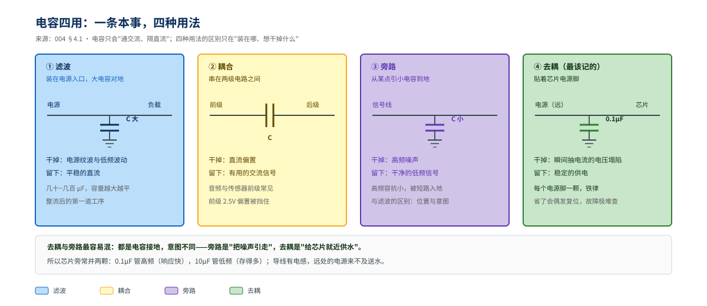
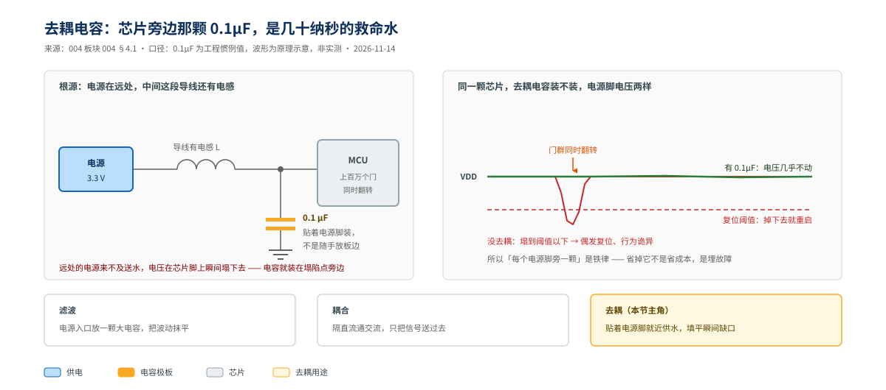
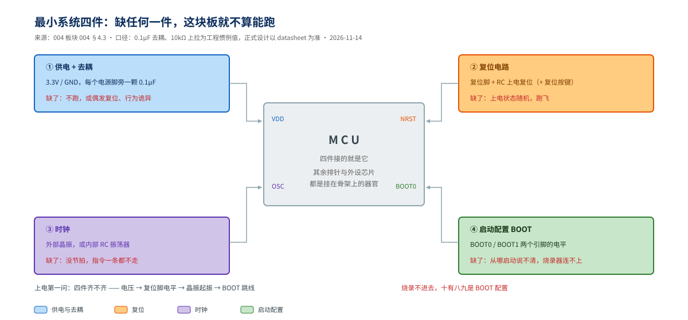
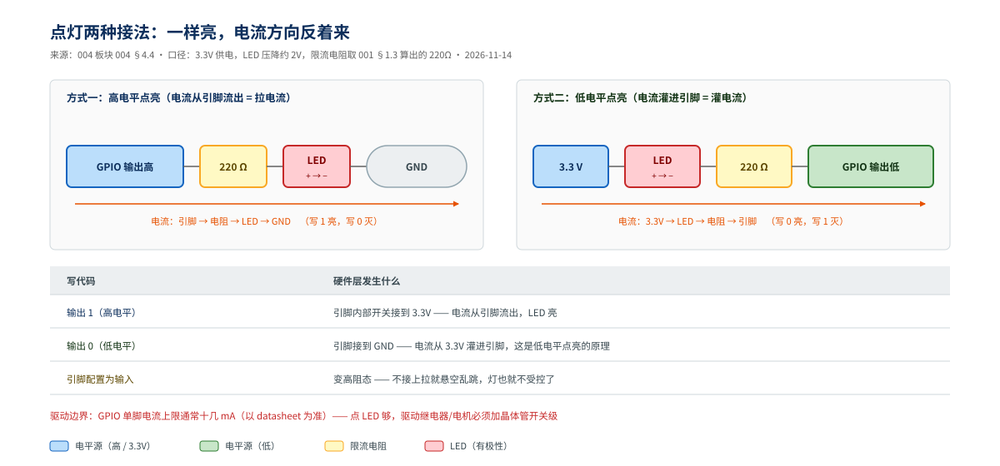

# 004 电路实践与板级应用

> **解决**：把前面积累的元件与器件连成真正会工作的电路——电容的三种用法（滤波/耦合/旁路/去耦）、一个完整的模拟案例（光感灯）、一块 MCU 板的最小系统骨架、点灯电路的软硬件对账，以及上手要用的仪器与仿真工具。  
> **范围**：电容四用 · 光感灯案例 · 最小系统四件 · 点灯两种接法与对账表 · 看板方法 · 万用表五档 · CircuitJS 仿真 · 稳压电源。  
> **口径**：全部低压直流（≤5V）；仪器部分讲"怎么用对"不讲校准；实物跟做有器材才做，无器材以纸面作业替代。  
> **更新**：2026-11-19  
> **本册导读** ── 必会三点：① 去耦电容为什么贴着电源脚 ② 最小系统四件 ③ 点灯两种接法与软硬件对账 ｜ 跟做时长：约 2 小时 ｜ 前置：001~003。  
> **标记**：★ = 必会节；○ = 拓展节。

## 目录

| 节 | 内容 |
|---|---|
| 4.1 | 电容四用：滤波、耦合、旁路与去耦 ★ |
| 4.2 | 光感灯：一个完整的模拟电路案例 ○ |
| 4.3 | MCU 最小系统四件（跟做：纸上画出骨架） ★ |
| 4.4 | 点灯电路全解：软硬件对账表 ★ |
| 4.5 | 看板方法：拿到开发板先数四件 ○ |
| 4.6 | 仪器与工具：万用表五档、仿真与稳压电源 ○ |
| 4.7 | 坑表 |
| 4.8 | 检查清单（自测 6 题 + 动手任务 3 件） |

---

## 4.1 电容四用：滤波、耦合、旁路与去耦 ★

电容的本事只有一条：**通交流、隔直流**（002 §2.4）。四种用法都是这条本事的四种用法，区别在"装在哪儿、想干掉什么"。

| 用法 | 装在哪 | 干掉什么 | 留下什么 |
|---|---|---|---|
| **滤波** | 电源入口，大电容对地 | 电源纹波与低频波动 | 平稳的直流 |
| **耦合** | 两级电路之间串接 | 直流偏置 | 有用的交流信号 |
| **旁路** | 某点到地，小电容 | 高频噪声 | 低频与直流 |
| **去耦** | 芯片电源脚旁，紧贴 | 芯片瞬间抽电流造成的电压塌陷 | 稳定的供电 |



**滤波**：整流后的电压是"波浪形"的，并联一只大电容（几十~几百 μF）把波峰的电存起来、波谷时放出来，输出就平了。容量越大越平，但体积和成本也上去了。

**耦合**：前一级输出带 2.5V 直流偏置，后一级只想放大交流成分——串一只电容，直流被挡住，交流照过。音频电路里到处都是。

**旁路**：某条线上混着高频噪声，从该点接一只小电容到地，高频短路入地，剩下的干净信号继续走。

**去耦——这是嵌入式最该记住的一个**：

芯片内百万级门同时翻转的瞬间，要从电源抽走一大股电流。导线有电感，远处的电源"来不及送水"，电源脚上的电压会瞬间塌陷——轻则逻辑出错，重则复位。

```text
        电源 (远端)
           │
           │  ← 导线有电感，来不及供
           │
     ┌─────┴─────┐
     │  0.1μF    │   ← 去耦电容：就近的小水库
     └─────┬─────┘
           │
        [ 芯片 VDD ]
```

**0.1μF（104）贴着电源脚，就近供水**，填平那几十纳秒的缺口。所以：**每颗芯片的每个电源脚旁一颗 0.1μF，是铁律不是装饰**。省掉它的症状是"偶发复位、行为诡异"——这类故障最难查，因为一切看起来都正常。

**去耦与旁路的分界**：旁路是"把噪声引走"，去耦是"给芯片就近供电"。物理上都是电容接地，但意图不同——这也是为什么芯片旁常并两颗：0.1μF 管高频、10μF 管低频。



## 4.2 光感灯：一个完整的模拟电路案例 ○

这是把 001~003 全部串起来的一个小电路：**天黑了自动亮灯**。

**电路结构**：

```plain
        VCC 3.3V
          │
      [ 电位器 R1 ]        ← 上臂：可调分压比例
          │
          ├──────┬── B（基极）
          │      │
   [ 光敏电阻 R2 ]   [ NPN 三极管 ]
          │      │
          │      C ──[ LED + 限流电阻 ]── VCC
          │      │
         GND     E ── GND
```

**工作原理**（一条因果链，顺着读）：

```text
光照减弱 → 光敏电阻阻值增大 → 分压点电压升高（R2 变大，分到的电压变多）
        → 基极电压升高 → NPN 导通 → LED 点亮

光照增强 → 光敏电阻阻值减小 → 分压点电压降低
        → 基极电压降到 0.7V 以下 → NPN 截止 → LED 熄灭
```

**这个电路为什么能成立**，全在 001 的分压公式和 003 的导通条件上：

- 分压点电压 `Vb = VCC × R2 / (R1 + R2)`——光敏在下臂，阻值增大则 Vb 升高。
- NPN 的导通门槛是 `Vb ≈ 0.7V`——这个 0.7V 就是 003 §3.4 那个 PN 结压降。
- 电位器 R1 的作用是**调阈值**：调到刚好在想要的光照下翻转。

**调试思路**（这是一个可迁移的排障范式）：灯不亮 → 先量 Vb（够不够 0.7V）→ 再量 C-E 是否导通 → 再看 LED 与限流电阻。**从信号源头往后逐级量**，比盲目换件快得多。

**边界**：这是开环的开关控制，没有迟滞——临界光照下会闪烁。工程上要加正反馈或改用比较器，属硬件设计范畴。

**跟做**：在 CircuitJS 里搭这个电路（4.6 节讲操作），把光敏电阻的阻值从 1kΩ 拖到 100kΩ，观察 LED 什么时候亮。

## 4.3 MCU 最小系统四件（跟做：纸上画出骨架） ★

**最小系统** = 让 MCU 跑起来的最少电路。骨架恒为四件，缺一件就不算能跑：

| 件 | 构成 | 缺了会怎样 |
|---|---|---|
| ① 供电 + 去耦 | 3.3V/GND + 每个电源脚 0.1μF | 不跑或偶发复位（§4.1） |
| ② 复位电路 | 复位脚 + RC 上电复位（+ 复位按键） | 上电状态随机，跑飞 |
| ③ 时钟 | 外部晶振 或 内部 RC 振荡器 | 没节拍，指令不走——CPU 的心跳 |
| ④ 启动配置（BOOT） | BOOT0/BOOT1 引脚电平 | 决定从 Flash 还是烧录模式启动；配错 = 烧录器连不上 |

**逐件说清**：

- **供电**：MCU 的 VDD 接 3.3V（不是 5V——看手册的绝对最大额定值），每个 VDD 脚旁一颗 0.1μF。
- **复位**：多数 MCU 复位脚是低电平有效。上电瞬间电容未充电 → 复位脚为低 → 芯片保持复位；电容充到高电平后芯片开始跑。这个 RC 的时间常数决定了"复位保持多久"。
- **时钟**：外部晶振精度高（±20ppm 量级），内部 RC 便宜但精度差（±1%）。串口通信对时钟敏感，波特率误差大了会乱码——这就是"内部 RC 能用但串口偶尔抽风"的根源。
- **BOOT**：STM32 上 BOOT0 拉高进系统存储器（串口烧录），拉低从 Flash 启动。**烧录不进去十有八九是这里**。



**跟做（纸上作业）**：不看上表，画一个 MCU 方框图，把四件各自接到芯片哪个引脚标注出来。**判定标准**：四件齐、每件标了"缺了会怎样"即完成。

**上电第一问永远是"四件齐不齐"**：供电电压对不对（万用表，§4.6）、复位脚电平、晶振有没有起振、BOOT 跳线在哪个位置。

## 4.4 点灯电路全解：软硬件对账表 ★

**两种接法**（差别只在 LED 与电阻的位置）：

```text
方式一（拉电流，高电平点亮）：
  GPIO 输出高 ──[ 220Ω ]──[ LED 正极 → 负极 ]── GND

方式二（灌电流，低电平点亮）：
  3.3V ──[ LED 正极 → 负极 ]──[ 220Ω ]── GPIO 输出低
```



**为什么两种都能用**：MCU 的引脚既能"往外推电流"（拉），也能"往里吸电流"（灌）。灌电流能力通常比拉电流强，所以开发板上更常见方式二。

**软硬件对账表**（每写一行代码，硬件层发生什么——这是"软硬结合"的第一张对照表）：

| 写代码 | 硬件层发生什么 |
|---|---|
| 输出 1（高电平） | 引脚内部开关接到 3.3V（001 §1.2 的"切换连接"） |
| 输出 0（低电平） | 接到 GND，电流从 3.3V 灌进引脚（方式二） |
| 引脚配置为输入 | 变高阻态——不接上拉就悬空乱跳（001 §1.6） |
| 引脚配置为复用功能 | 内部接到某个外设（串口/定时器），不再受 GPIO 寄存器控制 |

**驱动能力边界**：GPIO 单脚电流上限通常十几 mA（以 datasheet 为准）——点 LED 够用；驱动继电器/电机必须加晶体管或 MOS 开关级（003 §3.4~3.5）。"引脚推不动外设"是初学者第二个硬件欠账。

**220Ω 从哪来**：不是拍脑袋——(3.3−2)/10mA ≈ 130Ω，取标称 220Ω 更安全（001 §1.3）。

**试一试**：把两种接法的 GPIO 电平逻辑写在纸上（方式一高电平亮、方式二低电平亮），再想一个问题——如果代码里忘了初始化引脚方向，默认是高阻输入，LED 会怎样？（不亮，且引脚读数乱跳）

## 4.5 看板方法：拿到开发板先数四件 ○

**跟做（实物，有板才做）**：拿到任何一块开发板，按固定顺序扫一遍：

```text
① 找电源：USB 口 / 稳压芯片，输出几 V？每颗主芯片旁有没有 0.1μF？
② 找复位：RESET 按键 / RC 网络
③ 找时钟：金属壳晶振（或确认用内部 RC）
④ 找 BOOT：跳线帽 / 拨码开关位置
```

数完四件，"能不能跑、为什么烧不进"就有了判断底稿；剩下排针与外设芯片都是"挂在骨架上的器官"。

**无板的替代跟做**：网上搜任意 STM32 最小系统板的产品图，把四件逐一指认出来写在纸上——指认不出就回 §4.3 的表格回炉。

## 4.6 仪器与工具：万用表五档、仿真与稳压电源 ○

### 万用表五档（安全先看）

⚠️ **安全三条**：① 后盖没盖好别用；② 测直流 >60V 或交流 >30Vrms 要格外小心；③ **测量过程中严禁拨动量程开关**（会打火损坏仪表）。

| 档位 | 接法 | 读什么 | 判定 |
|---|---|---|---|
| 直流电压 V⎓ | 表笔**并联**在被测两点 | 电压差 | 红笔接高电位 |
| 交流电压 V~ | 同上 | 交流有效值 | 本库基本不用 |
| 电阻 Ω | 并联在电阻两端（**断电测**） | 阻值 | 读数前先短接表笔校零 |
| 通断（蜂鸣） | 两表笔接导线两端 | 通/断 | **≤10Ω 蜂鸣=通；>51Ω 不响=断** |
| 二极管 | 红笔接阳极、黑笔接阴极 | 正向压降 | 硅管 0.5~0.8V 正常，反接显示 `OL` |
| 电流 A | **串联**进电路（断开一点串进去） | 电流 | 新手最易接错烧保险 |

**插孔**：红笔插 `VΩmA`（大电流插 `10A`），黑笔永远插 `COM`。

### CircuitJS 仿真（不用买元件就能试电路）

绿色免安装的网页版电路仿真器（`github.com/SEVA77/circuitjs1`）。常用操作：

| 操作 | 方式 |
|---|---|
| 放置元件 | 菜单"绘制"，或快捷键：R 电阻、C 电容、L 电感、S 开关、G 地、v 直流源、w 导线、t 文字 |
| 改参数 | 双击元件或右键编辑 |
| 移动 | 按住元件拖动（或先按空格） |
| **布线** | 按 `w` 拖拽；⚠️ **每个连接点都要分段，不能一笔连到底**，否则软件判定没导通 |
| 跑/停 | 工具栏运行与重置；可调仿真速度与电流动画速度 |
| 调可变电阻 | 运行状态下鼠标悬停变蓝，滚轮调节 |

**跟做**：搭一个 3.3V + 220Ω + LED + 地的回路，观察电流动画方向；再把 LED 反接，看它是否还亮（这就是 003 §3.3 的单向导电）。

### 稳压电源（实验室可调电源）

以 HY3005B 为例：输出 0~30V / 0~5A 连续可调，粗调步进 1V、细调 10mV。**两灯状态是关键**：`CV` 恒压、`CC` 恒流——如果接上负载后 CC 灯亮，说明进入了限流模式（负载吃电流超过设定值），此时电压会被拉低，读数不是你设定的那个值。

**示波器**：本库不展开（属于"看波形"的进阶工具，等做到串口/I2C 时序调试时再用）。

## 4.7 坑表

| # | 现象 | 原因 | 解法 |
|---|---|---|---|
| 1 | LED 不亮还怪代码 | 极性接反/没串电阻/引脚没初始化 | 先查硬件再查软件（§4.4 对账表） |
| 2 | 偶发复位、跑飞 | 去耦电容省了 | 每个电源脚补 0.1μF（§4.1） |
| 3 | 烧录器连不上 | BOOT 配置错 | 查跳线，进烧录模式（§4.3） |
| 4 | 晶振不起振光查软件 | 焊接/负载电容问题 | 硬件排查四件先行 |
| 5 | 驱动继电器把脚烧了 | 超 GPIO 驱动能力 | 加三极管/MOS 开关级（§4.4） |
| 6 | 串口偶尔乱码 | 用内部 RC，时钟精度不够 | 换外部晶振或降波特率（§4.3） |
| 7 | 光感灯临界光照下闪 | 无迟滞 | 加正反馈或改比较器（§4.2） |
| 8 | CircuitJS 电路不导通 | 连线没分段 | 每个节点重画一次（§4.6） |
| 9 | 稳压电源电压被拉低 | 进了 CC 恒流模式 | 调大限流或减小负载（§4.6） |

## 4.8 检查清单（自测 6 题 + 动手任务 3 件）

**自测**：

| # | 问题 | 自测标准 |
|---|---|---|
| 1 | 去耦与旁路的区别 | 就近供电 vs 把噪声引走 |
| 2 | 最小系统四件 | 供电+去耦 / 复位 / 时钟 / BOOT |
| 3 | 点灯两种接法的区别 | 拉电流（高电平亮）vs 灌电流（低电平亮） |
| 4 | GPIO 驱动能力边界 | 单脚十几 mA，大功率加开关级 |
| 5 | 万用表通断档判定值 | ≤10Ω 通、>51Ω 断 |
| 6 | 光感灯的因果链 | 光照弱→阻值大→Vb 高→NPN 通→灯亮 |

**动手任务**：① 完成 §4.3 的纸上骨架图并自查四件齐；② 完成 §4.5 的看板指认（实物或产品图任一路）；③ 在 CircuitJS 里搭出 §4.2 的光感灯电路并调节光敏阻值，记录 LED 翻转时的阻值。

> 下一篇：回到 [README](README.md) 总览——本板块收官，电的世界到此为止；下一站「005 数字电路」，看 0 和 1 怎么在电路上表示、怎么组合成运算。
