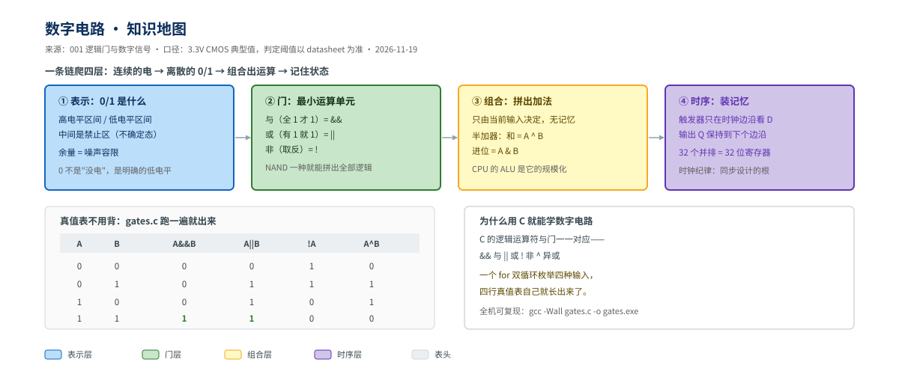

# 000 数字电路全貌

> **一句话**：数字电路 = 把连续的电变成离散的 0/1，再用门把 0/1 组合成运算、用时序单元把它们记住——这是 CPU 与寄存器在物理层的样子。  
> **读者**：已经认识二极管三极管 MOS、想弄懂"位运算硬件层做了什么"的初学者。  
> **阶段**：硬件地基第二层——前置是「004 硬件基础」的器件层（尤其 003），产物供「002 计算机体系结构」与「006 MCU 与外设」使用。

下图是本板块的地图：从电压区间出发，经门与组合逻辑，落到能记住一位的触发器。

## 板块地图

| 册 | 一句话 | 回答的问题 |
|---|---|---|
| [001 逻辑门与数字信号](001-逻辑门与数字信号.md) | 表示法 + 组合 + 时序的最小闭环 | 0/1 用什么电压表示、三门怎么拼出加法、触发器怎么记住一位 |

> 后续扩充方向（编号已预留）：002 组合逻辑与运算器 → 003 时序逻辑与状态机 → 004 数字接口与时序。

## 核心概念速览

- **0/1 是两段电压区间**：高电平一段、低电平一段、中间是禁止区；噪声只要不把电平推出区间，值就不变——数字电路抗干扰的本钱（001 §1.1）。
- **噪声容限**：电平区间与判定阈值之间的余量，余量越大越抗造；不同芯片家族阈值不同，跨电平必查 datasheet（001 §1.1）。
- **三门可拼出一切逻辑**：与、或、非是基础，但单靠与非门（NAND）就能实现全部逻辑——这是芯片只造一种晶体管结构却什么都能做的原因（001 §1.2）。
- **组合 vs 时序**：输出只看当前输入 = 组合逻辑（加法器）；输出还看历史 = 时序逻辑（触发器）。差别就在"有没有记忆"（001 §1.3~1.4）。
- **寄存器 = 触发器并排**：32 个触发器共用一根时钟就是 32 位寄存器，CPU 手边那张"便签"物理上就是这一排（001 §1.4）。

## 相邻板块分界

| 谁管 | 不管 | 误归属澄清 |
|---|---|---|
| 「004 硬件基础」003：PN 结、三极管、MOS 管的物理 | 门的组合与运算 | "MOS 怎么开关"在 004 003，"MOS 怎么组成门"在本板块 |
| 「002 计算机体系结构」001/002：功能块怎么组成 CPU、ISA 契约 | 门级实现 | "半加器怎么用门搭"在本板块 001，"ALU 怎么组织"归体系结构 002 |
| 规划「006 MCU 与外设」：寄存器操作与外设驱动 | 位与寄存器的硬件直觉 | 寄存器的物理形态在本板块 001 §1.4，怎么读写归 006 |
| 数字 IC 设计：门级电路、版图、时序收敛 | 入门直觉 | 本板块只讲到"能读懂门与触发器"，不做设计 |

## 学习路径

- **顺序读**：先「004 硬件基础」003 认完器件，再进本板块 001——跳过器件直接看 MOS 组成的门，会变成背符号。
- **按任务找**：想懂"为什么 0 不是没电"→ 001 §1.1；想懂"位运算硬件层做了什么"→ 001 §1.2~1.3；想懂"寄存器是什么"→ 001 §1.4。
- **按症状进**：见 [00 术语表](00-术语表.md) 症状反查表。
- **动手纪律**：真值表与半加器都能用 C 跑出来（`gates.c`），**不用买芯片也能完成**——这是本板块最友好的一点。

## 误解澄清

| # | 误解 | 实际 |
|---|---|---|
| 1 | 数字 0 就是"没电" | 0 是一段低电压区间，不是 0V 也不是断电（001 §1.1） |
| 2 | 电平判定标准全宇宙统一 | TTL 与 CMOS 阈值不同，跨电平必须查 datasheet（001 §1.1） |
| 3 | 悬空的输入脚默认是 0 | 落在禁止区，是高阻随机态（001 §1.1，004 §1.6） |
| 4 | 真值表只能背 | 四行跑一遍程序就出来，还能自己补 NAND 列（001 §1.2） |
| 5 | 加法器很神秘 | 一位半加器只需要一个异或 + 一个与门（001 §1.3） |
| 6 | 触发器就是"存一个数" | 它只在时钟边沿采样，其余时间保持——边沿是关键（001 §1.4） |
| 7 | 组合逻辑和时序逻辑差在复杂度 | 差在有没有记忆，这是本质分界（001 §1.3~1.4） |
| 8 | CMOS 芯片不怕摸 | 人体静电足以击穿栅极绝缘层（001 §1.5） |

---

> 下一篇：《001 逻辑门与数字信号》——先从"0 和 1 到底长什么样"讲起。
