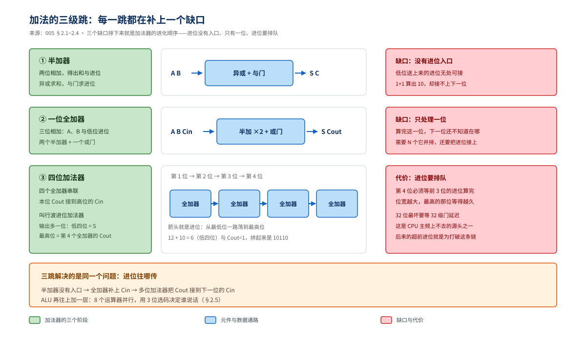
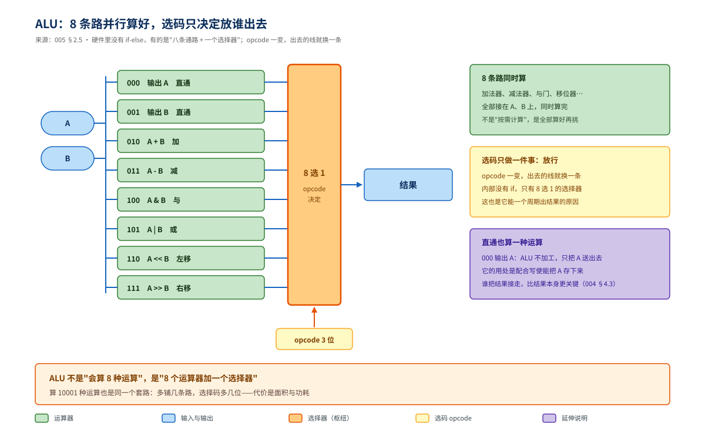

# 002 加法器与运算器

> **解决**：把 001 学过的那几个门接成一台真的会算数的机器——从只算一位的半加器，到把进位一级级传下去的四位加法器，再到用 3 位选码切换 8 种运算的 ALU；每一级的门组成都用 C 程序当场跑出来（`adder.c`、`alu.c`）。  
> **范围**：半加器 · 一位全加器 · 四位行波进位加法器 · 3 位选码的 8 种运算 ALU · 8 位运算的溢出与截断 · 进位链的延迟代价。  
> **口径**：以 4 位与 8 位无符号数为例；减法按"补码加法"理解，不展开有符号数细节（归「C语言」002）。门运算一律用 C 位运算符表达，与 001 册 `gates.c` 同一手法。  
> **更新**：2026-11-21  
> **本册导读** ── 必会三点：① 半加器 = 异或求本位 + 与门求进位 ② 全加器 = 两个半加器 + 一个或门 ③ ALU 就是"8 个运算器 + 一个选择器" ｜ 跟做时长：约 2 小时（写 `adder.c` 与 `alu.c`） ｜ 前置：001（三门与真值表、组合逻辑）。  
> **标记**：★ = 必会节；○ = 拓展节。

## 目录

| 节 | 内容 |
|---|---|
| 2.1 | 加法的三级跳：半加 → 全加 → 多位 ★ |
| 2.2 | 半加器：一个异或 + 一个与门 ★ |
| 2.3 | 一位全加器：两个半加器 + 一个或门 ★ |
| 2.4 | 四位加法器：把进位串起来 ★ |
| 2.5 | ALU：3 位选码挑 8 种运算 ★ |
| 2.6 | 8 位的边界：溢出、截断与进位链 ○ |
| 2.7 | 坑表 |
| 2.8 | 检查清单（自测 6 题 + 动手任务 2 件） |

---

## 2.1 加法的三级跳：半加 → 全加 → 多位 ★

**加法器不是一次造出来的，是三级跳。** 每一跳都在解决上一跳留下的缺口：

| 级 | 元件 | 能算什么 | 缺口 |
|---|---|---|---|
| 第一跳 | 半加器（Half Adder） | 两位相加，得出本位和与进位 | 不接受低位送上来的进位 |
| 第二跳 | 一位全加器（Full Adder） | 三位相加：A、B、低位进位 | 只处理一位 |
| 第三跳 | 多位加法器 | 把 N 个全加器串起来算 N 位 | 进位要一级一级传，慢 |

**这个缺口顺序值得记住**：半加器"只算了一半"（1+1 时给了进位却没处接），全加器补上了进位入口，多位加法器又把"进位出口"接到下一位的"进位入口"。**整条链的本质是同一个动作——进位往下传。**



## 2.2 半加器：一个异或 + 一个与门 ★

**半加器 = 1 个异或门 + 1 个与门**，两个输出分别是"本位和"与"进位"。

| A | B | 和 S | 进位 C |
|---|---|---|---|
| 0 | 0 | 0 | 0 |
| 0 | 1 | 1 | 0 |
| 1 | 0 | 1 | 0 |
| 1 | 1 | 0 | 1 |

**怎么从真值表读出这两个门**：看 S 列——0,1,1,0，两位不同才出 1，这是**异或**；看 C 列——0,0,0,1，两位都是 1 才出 1，这是**与**。000—101 的真值表不会骗人，四行看下来门就定了。

**为什么它叫"半"**：1+1 本该得 2（二进制 10），半加器给出 S=0、C=1，两个输出拼起来才是完整的 10。它算出了结果，但没有地方接收那个进位——**下一位在哪儿，它不知道**。

**完整示例**（文件名 `adder.c`，本册所有加法器都在这一个文件里；源码见本节末）：

```c
/* 半加器：只算本位，不管低位进位 */
static void half_adder(int a, int b, int *sum, int *carry)
{
    *sum   = a ^ b;   /* 异或：两位不同才有 1（不进位的和） */
    *carry = a & b;   /* 与：两位都是 1 才进位 */
}
```

**跟做步骤**：

1. 新建目录，建文件 `adder.c`，把本节末的完整源码抄进去
2. 编译：`gcc -Wall adder.c -o adder.exe`
3. 运行：`./adder.exe`（Windows 的 Git Bash 用 `./adder.exe`，cmd 用 `adder.exe`）

**预期输出**（本机实测）：

```text
== 半加器真值表 ==
 A B | S C
-----+----
 0 0 | 0 0
 0 1 | 1 0
 1 0 | 1 0
 1 1 | 0 1
```

**判定标准**：四行与上表逐格对齐即通过。**试一试**：把 `*sum = a ^ b` 改成 `a | b`（或门），再跑一遍——会看到 1 1 那一行变成 S=1、C=1，而 1+1 应该是 10（S=0 进位 1）。**错在"1+1 不进位"时用或门会多出一个 1**，这就是为什么加法器必须用异或而不是或。

## 2.3 一位全加器：两个半加器 + 一个或门 ★

**一位全加器 = 两个半加器 + 一个或门**。它多了一个输入 Cin（低位来的进位），三个输入两两相加两次：

```text
第一步：A + B        → 中间和 s1、中间进位 c1
第二步：s1 + Cin     → 本位和 S、中间进位 c2
第三步：c1 OR c2     → 进位输出 Cout（两级任一出进位都要往上报）
```

**为什么进位要用"或"合起来**：两次半加各自可能产生进位，只要有一次产生，本位就装不下、必须往高位报。**"任一出进位就算出进位"**——或门的语义正好对上。

| A | B | Cin | S | Cout |
|---|---|---|---|---|
| 0 | 0 | 0 | 0 | 0 |
| 0 | 0 | 1 | 1 | 0 |
| 0 | 1 | 0 | 1 | 0 |
| 0 | 1 | 1 | 0 | 1 |
| 1 | 0 | 0 | 1 | 0 |
| 1 | 0 | 1 | 0 | 1 |
| 1 | 1 | 0 | 0 | 1 |
| 1 | 1 | 1 | 1 | 1 |

**八行按 A、B、Cin 三个输入的二进制顺序排**（000→111）。自己数一遍 `1 1 1` 那行：1+1=0 进 1，再 +1 得 1，总进位 1、本位 1——即 1+1+1=11（十进制 3），两个输出拼起来正好。

**实测输出**（同一份 `adder.c`，本机实录）：

```text
== 一位全加器真值表 ==
 A B Cin | S Cout
---------+-------
 0 0  0  | 0  0
 0 0  1  | 1  0
 0 1  0  | 1  0
 0 1  1  | 0  1
 1 0  0  | 1  0
 1 0  1  | 0  1
 1 1  0  | 0  1
 1 1  1  | 1  1
```

**试一试**：把 `*cout = c1 | c2` 改成 `c1 ^ c2`，再跑。八行里前三行结果不变，但 `1 1 1` 那行会变成 Cout=0——因为两个进位同时为 1 时异或把它们消掉了。**"同时进两次位还是要进一次位"**，这个差别只有或门能表达。

## 2.4 四位加法器：把进位串起来 ★

**四位加法器 = 四个一位全加器串联**，本位的进位输出直接接到高一位的进位输入。这种接法叫**行波进位加法器**（ripple carry adder）——进位像水波一样从最低位一路荡到最高位。

```c
/* 四位行波进位加法器：四个全加器串起来，本位进位喂给下一位 */
static int ripple_add4(int a, int b, int *cout4)
{
    int sum = 0, carry = 0;
    for (int i = 0; i < 4; i++) {
        int s, c;
        full_adder((a >> i) & 1, (b >> i) & 1, carry, &s, &c);
        sum |= s << i;
        carry = c;
    }
    *cout4 = carry;
    return sum & 0x0F;
}
```

**代码里的三个动作对应三条硬件连线**：`(a >> i) & 1` 是"把第 i 位取出来"（硬件里是直接连到那一位的导线）；`sum |= s << i` 是"把这一位的结果放回第 i 位"；`carry = c` 是**把进位交给下一轮循环**——这一行就是那根级联导线。

**实测输出**（本机实录，最后一列是用十进制核对）：

```text
== 四位加法器 ==
  A +   B =   S  Cout | 十进制核对
----------------------+-----------
  3 +   4 =   7   0   | 7
  7 +   1 =   8   0   | 8
  9 +   6 =  15   0   | 15
 15 +   0 =  15   0   | 15
 12 +  10 =   6   1   | 22
```

**最后一行是全部要点**：12+10=22，而 22 写成 5 位二进制是 `10110`。四位加法器给出 `S=6（0110）、Cout=1`，把 Cout 放到最左边拼起来正是 `1 0110` = 22。**这证明"多位加法器"的输出是一个"多一位的数"**——四个全加器不够装，必须留一根 Cout 线。

**试一试**：把 `pairs` 里的 `{12, 10}` 改成 `{15, 15}`，跑一遍。预期 `S=14（1110）、Cout=1`，十进制 30 = `1 1110` ✓。然后改成 `{15, 16}`——B 已经超出 4 位范围，`(b >> i) & 1` 只会取低四位，16 的低四位是 0，于是算成 15+0=15。**这就是硬件位宽的硬边界：超出位宽的部分不是"算错"，是根本进不来。**

## 2.5 ALU：3 位选码挑 8 种运算 ★

**ALU（算术逻辑单元）= 一堆运算器 + 一个选择器**。所有运算同时算好，由 3 位选码（opcode）决定"放哪一个出去"。这是嵌入式的 ALU 与"写个 if-else 判断运算"最本质的区别：**硬件没有 if，它是把八条路都铺好、再选一条通**。



| opcode | 运算 | 含义 | A=13, B=6 结果 |
|---|---|---|---|
| 000 | 输出 A | 直通，常用于"把 A 存下来" | 13 |
| 001 | 输出 B | 直通，常用于"装载 B" | 6 |
| 010 | A + B | 加 | 19 |
| 011 | A − B | 减（补码加法） | 7 |
| 100 | A & B | 按位与 | 4 |
| 101 | A \| B | 按位或 | 15 |
| 110 | A << B | A 左移 B 位 | 832 |
| 111 | A >> B | A 右移 B 位 | 0 |

**完整示例**（文件名 `alu.c`，核心就是一个 switch）：

```c
/* op 的 3 个二进制位直接决定做哪种运算 —— 这就是"运算选择码" */
static int alu(int op, int a, int b)
{
    switch (op & 0x7) {
    case 0: return a;         /* 000 输出 A */
    case 1: return b;         /* 001 输出 B */
    case 2: return a + b;     /* 010 加 */
    case 3: return a - b;     /* 011 减 */
    case 4: return a & b;     /* 100 与 */
    case 5: return a | b;     /* 101 或 */
    case 6: return a << b;    /* 110 A 左移 B 位 */
    default: return a >> b;   /* 111 A 右移 B 位 */
    }
}
```

**跟做步骤**：新建 `alu.c` 抄入完整源码 → `gcc -Wall alu.c -o alu.exe` → `./alu.exe`。

**预期输出**（本机实测）：

```text
== 同一对输入 A=13 B=6，8 种 opcode 各算什么 ==
opcode  运算     结果   二进制(低8位)
---------------------------------------
 000    输出A     13    00001101
 001    输出B      6    00000110
 010    A+B       19    00010011
 011    A-B        7    00000111
 100    A&B        4    00000100
 101    A|B       15    00001111
 110    A<<B     832    01000000
 111    A>>B       0    00000000

== 换个输入验证 减法与位移 ==
 A   B | A-B  A<<1  A>>1
-------+-----------------
 5   3 |   2    10     2
 3   5 |  -2     6     1
 8   1 |   7    16     4
10   2 |   8    20     5
```

**两处值得停下来看**：

- `110 A<<B` 结果 832，但二进制列只显示 `01000000`（=64）。**832 的低 8 位是 64，高位被截掉了**——8 位 ALU 装不下这个结果，这就是下一节的边界问题。
- 第二张表里 `3-5 = -2` 出现负数。C 的 `int` 是有符号的，而硬件里 `3-5` 得到的是补码 `1110`（无符号 14）。**同一个位模式，解释方式不同**：当作无符号是 14，当作补码是 −2（「C语言」002 的补码一节是这件事的软件视角）。

**试一试**：把 `int a = 13, b = 6;` 改成 `a = 0, b = 0`，再看 `000` 与 `001` 两行——两个都输出 0，看不出区别。**说明"直通"这类运算单独看没意义，它的价值在于配合下一册的"写使能"：ALU 输出什么不重要，重要的是谁把它接走。**

## 2.6 8 位的边界：溢出、截断与进位链 ○

**三个边界，写法不同、后果也不同**：

| 现象 | 成因 | 表现 |
|---|---|---|
| **截断** | 结果位宽超出寄存器位宽，高位直接丢弃 | 200+100 在 8 位里得 44，不报错 |
| **溢出标志** | 有符号数运算时"符号位被结果推翻" | 127+1 得 −128，需要 OF 标志报警 |
| **进位标志** | 无符号数运算时最高位向外进位 | 255+1 得 0，需要 CF 标志报警 |

**硬件不会替你判断哪个更重要**：它只把 CF（进位）和 OF（溢出）两个标志位摆在那里，**由软件决定要不要看**。C 语言里无符号溢出是定义良好的回绕、有符号溢出是未定义行为——这条规则的硬件根源就在这里。

**进位链的代价**：行波进位加法器的第 4 位必须等第 3 位的进位算完，第 3 位又要等第 2 位……**位宽越大，最高的那一位等得越久**。32 位加法器最坏要等 32 级门的延迟，这是 CPU 主频上不去的原因之一；后来的超前进位（carry lookahead）就是为了打破这条链——本库不展开，知道"串行进位是速度瓶颈"即可。

## 2.7 坑表

| # | 现象 | 原因 | 解法 |
|---|---|---|---|
| 1 | 1+1 得 S=1 而不是 0 | 本位和用了或门而非异或 | 和用异或，进位用与（§2.2） |
| 2 | 多位加法高位全错 | 进位没接到下一位的 Cin | 本位的 Cout 必须连高位的 Cin（§2.4） |
| 3 | 两个数一加就变成小数 | 超出位宽被截断 | 加宽位宽或先判断是否会溢出（§2.6） |
| 4 | 有符号加法结果符号翻了 | 溢出，但没看 OF 标志 | 运算后查溢出标志（§2.6） |
| 5 | ALU 输出对但结果没保存 | 只看 ALU，没看写使能 | ALU 只是"算出"，存不存由使能决定（§2.5） |
| 6 | 以为 ALU 是"按需计算" | 硬件是全部并行算好再选 | 8 条路同时存在，选码只决定放谁出去（§2.5） |

## 2.8 检查清单（自测 6 题 + 动手任务 2 件）

**自测**：

| # | 问题 | 自测标准 |
|---|---|---|
| 1 | 半加器由哪两个门组成 | 和=异或、进位=与 |
| 2 | 全加器怎么用两个半加器搭 | A+B 得中间和与进位，再加 Cin，两级进位或起来 |
| 3 | 四位加法器怎么接 | 四个全加器串联，本位 Cout → 高位 Cin |
| 4 | 12+10 为什么输出 6 和 1 | 22=`10110`，低四位 6、最高位就是 Cout |
| 5 | ALU 的 8 种运算怎么选 | 3 位 opcode 做选择，8 条路并行算好选一条 |
| 6 | 截断与溢出差在哪 | 截断是无符号回绕，溢出是有符号符号位被推翻，各有标志位 |

**动手任务**：

1. **跑通 `adder.c`**，产出：半加器 4 行、全加器 8 行、四位加法器 5 行输出的终端截图或粘贴文本；并把 `{12,10}` 改成 `{15,15}` 再跑一次，确认 S=14、Cout=1。
2. **跑通 `alu.c`**，产出：8 行运算表；然后回答一个问题并写下来——`A<<B` 当 B=6 时结果 832，为什么二进制列显示的是 64？

## 附：`adder.c` 完整源码

```c
#include <stdio.h>

/* 半加器：只算本位，不管低位进位 */
static void half_adder(int a, int b, int *sum, int *carry)
{
    *sum   = a ^ b;   /* 异或：两位不同才有 1（不进位的和） */
    *carry = a & b;   /* 与：两位都是 1 才进位 */
}

/* 一位全加器：两个半加器 + 一个或门 */
static void full_adder(int a, int b, int cin, int *sum, int *cout)
{
    int s1, c1, s2, c2;
    half_adder(a, b, &s1, &c1);        /* 第一步：A + B */
    half_adder(s1, cin, &s2, &c2);     /* 第二步：上一步的和再加低位进位 */
    *sum  = s2;
    *cout = c1 | c2;                   /* 两级任一出进位，都要往上报 */
}

/* 四位行波进位加法器：四个全加器串起来，本位进位喂给下一位 */
static int ripple_add4(int a, int b, int *cout4)
{
    int sum = 0, carry = 0;
    for (int i = 0; i < 4; i++) {
        int s, c;
        full_adder((a >> i) & 1, (b >> i) & 1, carry, &s, &c);
        sum |= s << i;
        carry = c;
    }
    *cout4 = carry;
    return sum & 0x0F;
}

int main(void)
{
    printf("== 半加器真值表 ==\n");
    printf(" A B | S C\n");
    printf("-----+----\n");
    for (int a = 0; a <= 1; a++)
        for (int b = 0; b <= 1; b++) {
            int s, c;
            half_adder(a, b, &s, &c);
            printf(" %d %d | %d %d\n", a, b, s, c);
        }

    printf("\n== 一位全加器真值表 ==\n");
    printf(" A B Cin | S Cout\n");
    printf("---------+-------\n");
    for (int a = 0; a <= 1; a++)
        for (int b = 0; b <= 1; b++)
            for (int cin = 0; cin <= 1; cin++) {
                int s, c;
                full_adder(a, b, cin, &s, &c);
                printf(" %d %d  %d  | %d  %d\n", a, b, cin, s, c);
            }

    printf("\n== 四位加法器 ==\n");
    printf("  A +   B =   S  Cout | 十进制核对\n");
    printf("----------------------+-----------\n");
    int pairs[][2] = {{3, 4}, {7, 1}, {9, 6}, {15, 0}, {12, 10}};
    for (int i = 0; i < 5; i++) {
        int a = pairs[i][0], b = pairs[i][1], co;
        int s = ripple_add4(a, b, &co);
        printf("%3d + %3d = %3d   %d   | %d\n", a, b, s, co, a + b);
    }
    return 0;
}
```

> 下一篇：《003 锁存器、触发器与寄存器》——加法器只会算、不会记；下一册给电路装上"记忆"。
