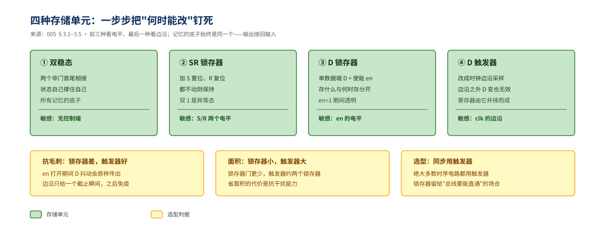
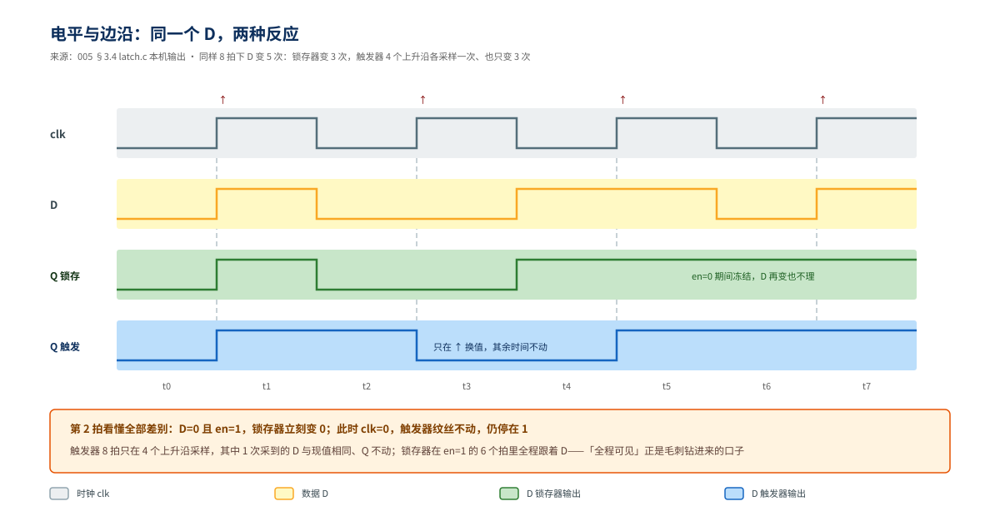

# 003 锁存器、触发器与寄存器

> **解决**：给电路装上"记忆"——从 SR 锁存器的双稳态开始，到带使能的 D 锁存器、只在时钟边沿采样的 D 触发器，最后并排成寄存器；三种单元对同一组输入的反应差异，用一个 C 程序逐拍打出来（`latch.c`）。  
> **范围**：反馈与双稳态 · SR 锁存器六种状态 · 带 en 的 D 锁存器 · 边沿触发 D 触发器 · 时钟与节拍 · 四位寄存器 · 锁存器与触发器的取舍。  
> **口径**：以高电平有效的 SR 与上升沿触发的 D 触发器为例；SR 的双 1 异常态只标出、不展开（实际芯片要么禁止、要么定义为特定优先级）。时序用"拍"描述，不涉及建立/保持时间的具体数值（归 004 册的接口时序）。  
> **更新**：2026-11-21  
> **本册导读** ── 必会三点：① 记忆来自"输出接回输入"的正反馈 ② 锁存器看电平、触发器看边沿 ③ 寄存器 = 共用时钟的触发器并排 ｜ 跟做时长：约 1.5 小时（写 `latch.c` 并逐拍对照） ｜ 前置：001（门与真值表）、002（运算器）。  
> **标记**：★ = 必会节；○ = 拓展节。

## 目录

| 节 | 内容 |
|---|---|
| 3.1 | 记忆从哪来：把输出接回输入 ★ |
| 3.2 | SR 锁存器：第一块真正的记忆 ★ |
| 3.3 | 带 en 的 D 锁存器：把"何时写"独立出来 ★ |
| 3.4 | 边沿触发的 D 触发器：时钟为什么要边沿 ★ |
| 3.5 | 寄存器：触发器并排就是一位宽的抽屉 ★ |
| 3.6 | 锁存器还是触发器：一条选择规则 ○ |
| 3.7 | 坑表 |
| 3.8 | 检查清单（自测 6 题 + 动手任务 2 件） |

---

## 3.1 记忆从哪来：把输出接回输入 ★

**静态的组合逻辑记不住任何东西**：门一断电、输入一撤，输出立刻回到由当前输入决定的值。**记忆的物理前提是"反馈"**——把输出接到自己的输入上，让电路维持住一个状态，不靠外部一直喂。

**双稳态**：两个首尾相接的非门（或两个交叉耦合的与非门），会稳定在两种状态之一——Q=1/Q̅=0，或 Q=0/Q̅=1。**两种都稳，所以叫"双稳"**，这是它能"记住一位"的根本原因。

**为什么必须靠反馈，而不是靠"保持输入不变"**：如果记忆要靠外部持续输入维持，那它就只是一个延迟线，输入一撤就丢——**算不上一块记忆**。反馈让状态自己撑住自己，这是所有存储单元的同一套底子。

## 3.2 SR 锁存器：第一块真正的记忆 ★

**SR 锁存器 = 双稳态 + 两个控制端**：S（Set，置位）拉高把 Q 置 1，R（Reset，复位）拉高把 Q 清 0，两个都不动则**保持**。

| 状态 | S | R | Q | 说明 |
|---|---|---|---|---|
| 初始 | 0 | 0 | 0 | 上电后靠外部手动拉到 0 |
| 置位 | 1 | 0 | 1 | S 有效，Q 被拉到 1 |
| 锁存（存 1） | 任意 | 0 | 1 | S 撤了，Q 仍是 1——记忆生效 |
| 复位 | 0 | 1 | 0 | R 有效，Q 被拉到 0 |
| 锁存（存 0） | 0 | 任意 | 0 | R 撤了，Q 仍是 0 |
| **异常** | 1 | 1 | 不需要看 | 两个都拉高，Q 与 Q̅ 同时为 1 或震荡 |

**"任意"这两个字就是记忆**：S 撤掉后 R 仍是 0，此时 S/R 都是 0（等于初始行），但 Q 停在 1 而不是回到 0——**同样的输入，不同的历史，不同的输出**。这正是时序逻辑的定义。

**异常态为什么"不需要看"**：S=R=1 会让 Q 与 Q̅ 同时为 1，违反"它们必须互补"的前提；两个信号同时撤掉时，结果取决于两个门的延迟谁快——**不确定**。工程上的做法是加约束（禁止同 1）或用时钟把它变成 D 触发器（§3.3）。

**跟做（纸面推演，不写代码也要做一遍）**：从初始态 0 出发，按"置位→锁存→复位→锁存"四步走，每一步只改 S 或 R 一个，用上表印证 Q 的去向。**判定标准**：能说清"第 3 步 S 已经撤回 0，Q 为什么还是 1"。

## 3.3 带 en 的 D 锁存器：把"何时写"独立出来 ★

**D 锁存器 = 一个数据端 D + 一个使能端 en**。en=1 时 Q 跟随 D（像一扇打开的门，D 怎么变 Q 就怎么变）；en=0 时 Q 冻住。

| 状态 | D | en | Q | 说明 |
|---|---|---|---|---|
| 初始 | 0 | 0 | 0 | 上电初值，同样靠外部拉定 |
| 关机 | 任意 | 0 | 0 | en=0 且初值为 0，Q 不动 |
| 写入 1 | 1 | 1 | 1 | en 打开，Q 跟着 D |
| 锁存 1 | 任意 | 0 | 1 | en 关掉，D 再怎么变都进不来 |
| 写入 0 | 0 | 1 | 0 | en 打开，Q 跟到 0 |
| 锁存 0 | 任意 | 0 | 0 | en 关掉，D 被挡在门外 |

**它比 SR 多解决了两件事**：① 只有一个数据端，"要存什么"直接给，不需要先想"S 还是 R"；② **"存什么"（D）与"什么时候存"（en）彻底分开**——这是所有存储器的共同接口形态（004 册的写使能就是 en 的另一种说法）。

**代价**：en=1 期间 D 变一次、Q 就跟着变一次。**如果 D 在 en 打开期间抖动，抖动会原样传进 Q**——这正是 §3.4 要解决的问题。

## 3.4 边沿触发的 D 触发器：时钟为什么要边沿 ★

**D 触发器（D Flip-flop）只在时钟边沿那一瞬间看 D**，其余时间纹丝不动。上升沿触发是"上一个拍 clk=0、这一拍 clk=1"的那一刻。

**为什么必须限定成"边沿"**：电路里不同的路径延迟不同，D 可能要在 en 打开的那段时间里经历好几次中间跳变（冒险与毛刺）。**只在一个瞬间采样，等于给所有信号定了一个统一的截止时刻**——这一刻之前必须稳，之后随便变。这就是同步设计的根。

**时钟是什么**：让全芯片所有时序单元同时动作的节拍器（晶振提供，400 硬件基础 451 §451.1 最小系统四件里的时钟件）。**时钟频率就是"每秒采样多少次"**，也是主频的字面含义。



**完整示例**（文件名 `latch.c`，完整源码见册末附录）：

```c
/* SR 锁存器：S 置 1、R 清 0，都不动则保持 */
static int sr_latch(int s, int r, int q)
{
    if (s && r) return -1;   /* 双 1 是异常态，本库不讨论 */
    if (s) return 1;
    if (r) return 0;
    return q;                /* 保持：这就是"记忆" */
}

/* 带 en 的 D 锁存器：en=1 期间 Q 一直跟着 D 变（透明的门） */
static int d_latch(int d, int en, int q)
{
    return en ? d : q;
}

/* 上升沿触发的 D 触发器：只在上一个拍 clk=0、这一拍 clk=1 时采样 */
static int d_ff(int d, int clk, int clk_prev, int q)
{
    if (!clk_prev && clk) return d;   /* 0→1 上升沿，只此一瞬间 */
    return q;
}
```

**跟做步骤**：新建 `latch.c` 抄入附录源码 → `gcc -Wall latch.c -o latch.exe` → `./latch.exe`。

**预期输出**（本机实测，8 拍输入序列，三种单元同时吃同一组 D/S/R/en/clk）：

```text
== 同一组输入，三种单元的 Q 各是多少 ==
拍  D S R en clk | SR锁存 D锁存 D触发器  说明
-----------------+------------------------------
 0  0 0 0 1  0  |   0     0      0    保持
 1  1 1 0 1  1  |   1     1      1    clk 上升沿，触发器采样
 2  0 0 0 1  0  |   1     0      1    锁存器跟随 D，触发器不动
 3  0 0 0 1  1  |   1     0      0    clk 上升沿，触发器采样
 4  1 0 1 1  0  |   0     1      0    锁存器跟随 D，触发器不动
 5  1 0 0 0  1  |   0     1      1    clk 上升沿，触发器采样
 6  0 0 0 0  0  |   0     1      1    保持
 7  1 0 0 1  1  |   0     1      1    clk 上升沿，触发器采样
```

**第 2 拍是整册的重点**：D 变成 0、en=1，锁存器立刻跟到 0；而触发器 clk=0，纹丝不动，Q 仍停在 1。**同一组输入、同一个时刻，两种单元给出不同答案**——差别不在输入，在"何时允许改变"。



**试一试**：把第 2 拍的 `clk` 从 0 改成 1（`{ 2, 0, 0, 0, 1, 0 }` 改成 `{ 2, 0, 0, 0, 1, 1 }`），再跑。触发器会在这一拍采样 D=0，Q 变 0；而第 3 拍本来要采样的那次上升沿就不存在了（clk 连续为 1），于是第 3 拍的 Q 不再变化。**改一个 clk 值，后面所有拍的触发器状态都跟着变**——这就是"边沿是唯一入口"的直接后果。

## 3.5 寄存器：触发器并排就是一位宽的抽屉 ★

**寄存器 = N 个触发器共用一根时钟**。4 个触发器并排就是 4 位寄存器，能同时存住一个 4 位二进制数；32 个并排就是 32 位。

**关键在"共用时钟"**：四个触发器如果在不同时刻采样，存下来的四位就是四个不同时刻的快照，数值毫无意义。**同一根时钟线保证了"这四位是同一瞬间的"**——这叫同步。

**工程上的坑（素材里明确记下的）**：四位寄存器做完之后发现"**需要自己手动调节到初始状态**"——上电瞬间每个触发器的 Q 是随机的，四个拼起来就是四个随机位。真实芯片用**复位信号**（RESET）解决：上电后先统一拉一次复位，把所有寄存器清零，程序才开始跑。**没有复位信号的寄存器组，开机值是不可复现的**。

**这就解释了 001 §1.4 那句话**：寄存器是"CPU 手边的便签"，物理上就是这一排触发器。便签能写能擦、断电就丢，与触发器靠反馈维持状态、掉电即失是同一件事。

## 3.6 锁存器还是触发器：一条选择规则 ○

| 维度 | 锁存器（Latch） | 触发器（Flip-flop） |
|---|---|---|
| 敏感对象 | 电平（en=1 期间一直跟随） | 边沿（跳变那一瞬间） |
| 抗毛刺 | 差：en 期间 D 抖动会原样传出 | 好：只在边沿看，其余时间免疫 |
| 面积 | 小（门更少） | 大（内部约两个锁存器） |
| 常见场合 | 低速寄存器、总线暂存、"透明锁存" | 绝大多数同步时序电路、寄存器堆 |

**规则一句话**：**要抗干扰、要同步，用触发器；要省面积、要透明直通，用锁存器。**现代芯片里触发器是绝对主力，锁存器多出现在"总线必须能直通"的场合。

## 3.7 坑表

| # | 现象 | 原因 | 解法 |
|---|---|---|---|
| 1 | 撤掉输入后状态就丢 | 用了纯组合逻辑，没有反馈 | 记忆必须有输出接回输入的环（§3.1） |
| 2 | SR 同时给 1 后行为诡异 | 异常态，结果取决于门延迟 | 禁止双 1 或改 D 触发器（§3.2） |
| 3 | 数据在 en 期间莫名跳变 | 锁存器在 en=1 期间是"透明"的 | 换边沿触发器，或缩短 en 窗口（§3.4） |
| 4 | 寄存器开机值每次都不一样 | 触发器上电态随机，没有复位 | 加复位信号统一清零（§3.5） |
| 5 | 多位寄存器存进去的数对不上 | 各触发器时钟不同步 | 共用同一根时钟线（§3.5） |
| 6 | 以为触发器"一直盯着 D" | 它只在边沿采样 | 边沿之外 D 怎么变都无效（§3.4） |

## 3.8 检查清单（自测 6 题 + 动手任务 2 件）

**自测**：

| # | 问题 | 自测标准 |
|---|---|---|
| 1 | 记忆的物理前提是什么 | 输出接回输入的反馈，形成双稳态 |
| 2 | SR 锁存器"锁存"指的是哪两行 | S 撤后 Q 仍为 1、R 撤后 Q 仍为 0 |
| 3 | D 锁存器比 SR 好在哪 | 单数据端 + 把"存什么"与"何时存"分开 |
| 4 | 为什么必须边沿触发 | 电平期间 D 会抖动，边沿给出统一截止时刻 |
| 5 | 寄存器靠什么保证"同一瞬间" | 所有触发器共用同一根时钟 |
| 6 | 开机值随机怎么办 | 加复位信号，先清零再运行 |

**动手任务**：

1. **跑通 `latch.c`**，产出：8 拍对照表；并解释第 2 拍为什么锁存器变 0、触发器仍是 1（写两句话）。
2. **做一次"试一试"**：把第 2 拍的 clk 改成 1 再跑，产出改动后的 8 拍表，说明"为什么第 3 拍触发器不再变化"。

## 附：`latch.c` 完整源码

```c
#include <stdio.h>

/* SR 锁存器：S 置 1、R 清 0，都不动则保持 */
static int sr_latch(int s, int r, int q)
{
    if (s && r) return -1;   /* 双 1 是异常态，本库不讨论 */
    if (s) return 1;
    if (r) return 0;
    return q;                /* 保持：这就是"记忆" */
}

/* 带 en 的 D 锁存器：en=1 期间 Q 一直跟着 D 变（透明的门） */
static int d_latch(int d, int en, int q)
{
    return en ? d : q;
}

/* 上升沿触发的 D 触发器：只在上一个拍 clk=0、这一拍 clk=1 时采样 */
static int d_ff(int d, int clk, int clk_prev, int q)
{
    if (!clk_prev && clk) return d;   /* 0→1 上升沿，只此一瞬间 */
    return q;
}

int main(void)
{
    /* 8 拍输入序列：同一组 S/R/D/en/clk 喂给三种单元 */
    int seq[8][6] = {
        /* t   D  S  R  en clk */
        { 0,   0, 0, 0, 1, 0 },
        { 1,   1, 1, 0, 1, 1 },
        { 2,   0, 0, 0, 1, 0 },
        { 3,   0, 0, 0, 1, 1 },
        { 4,   1, 0, 1, 1, 0 },
        { 5,   1, 0, 0, 0, 1 },
        { 6,   0, 0, 0, 0, 0 },
        { 7,   1, 0, 0, 1, 1 },
    };

    int q_sr = 0, q_lat = 0, q_ff = 0, clk_prev = 0;

    printf("== 同一组输入，三种单元的 Q 各是多少 ==\n");
    printf("拍  D S R en clk | SR锁存 D锁存 D触发器  说明\n");
    printf("-----------------+------------------------------\n");
    for (int t = 0; t < 8; t++) {
        int d = seq[t][1], s = seq[t][2], r = seq[t][3];
        int en = seq[t][4], clk = seq[t][5];

        q_sr  = sr_latch(s, r, q_sr);
        int q_lat_before = q_lat;
        q_lat = d_latch(d, en, q_lat);
        q_ff  = d_ff(d, clk, clk_prev, q_ff);

        printf(" %d  %d %d %d %d  %d  |   %d     %d      %d    ",
               t, d, s, r, en, clk, q_sr, q_lat, q_ff);

        if (!clk_prev && clk)           printf("clk 上升沿，触发器采样\n");
        else if (q_lat != q_lat_before) printf("锁存器跟随 D，触发器不动\n");
        else                            printf("保持\n");

        clk_prev = clk;
    }

    printf("\n== 差异一句话 ==\n");
    printf("锁存器：en=1 就一直跟着 D 走（电平敏感，像一扇开着的门）\n");
    printf("触发器：只有时钟边沿那一瞬间看 D，其余时间纹丝不动（像快门）\n");
    return 0;
}
```

> 下一篇：《004 译码器与存储器》——一位记不住一支队伍，下一册把 N 位按地址排好，再决定"这一拍谁被写"。
