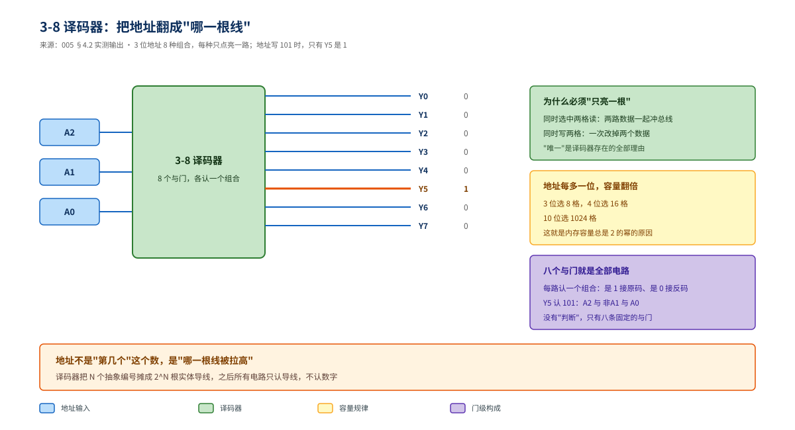
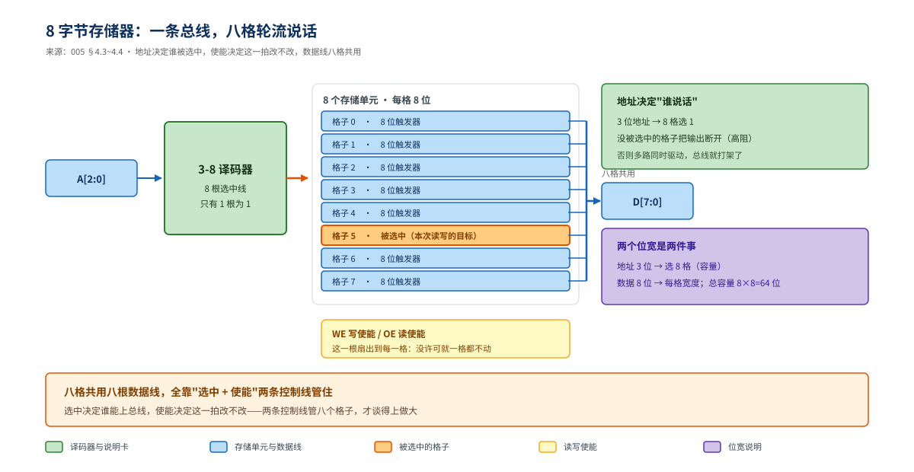

# 004 译码器与存储器

> **解决**：一位触发器只记得住一个数，怎么存一支队伍——把 N 个存储单元按地址排好，用译码器把"第几个"翻译成"选中哪一根线"，再用写使能决定"这一拍谁被改"；译码器真值表与 8 字节存储器的读写用一个 C 程序打出来（`mem.c`）。  
> **范围**：地址与选中的关系 · 3-8 译码器的真值表与实现 · 存储器的三个接口（地址/数据/读写使能）· 8 字节存储器怎么搭 · 读写不对称的原因 · 总线冲突。  
> **口径**：以 3 位地址、8 位数据的 8 字节存储器为例；素材里的组件是 EEPROM 模型（掉电不丢），本册只讲结构与读写时序，不展开 EEPROM 的擦写工艺（归 006 外设）。  
> **更新**：2026-11-21  
> **本册导读** ── 必会三点：① 译码器把"地址"变成"一根被选中的线" ② 存储器三接口：地址选谁、数据读写什么、使能决定改不改 ③ 写入必须过使能这道门，否则总线一抖就写坏 ｜ 跟做时长：约 1 小时（写 `mem.c`） ｜ 前置：003（触发器与寄存器）。  
> **标记**：★ = 必会节；○ = 拓展节。

## 目录

| 节 | 内容 |
|---|---|
| 4.1 | 地址：把"第几个"翻译成"哪一根线" ★ |
| 4.2 | 3-8 译码器：8 路里只亮 1 路 ★ |
| 4.3 | 存储器的三个接口 ★ |
| 4.4 | 8 字节存储器怎么搭起来 ★ |
| 4.5 | 读与写为什么不对称 ○ |
| 4.6 | 坑表 |
| 4.7 | 检查清单（自测 6 题 + 动手任务 2 件） |

---

## 4.1 地址：把"第几个"翻译成"哪一根线" ★

**存储器的本质是"一排并排的格子"，每个格子有一个编号，这个编号就是地址。** 但硬件不认"编号"这种抽象概念——它只认**哪一根线被拉高了**。

**所以地址必须经过一次翻译**：3 位地址 `101` 不是"第五个"这个数，而是"把第 5 根线拉高、其余 7 根压低的那个组合"。完成这次翻译的电路就是**译码器（Decoder）**。

**为什么必须"只选一根"**：如果同时选中两个格子，读的时候两路数据会一起冲上数据总线、互相打架（总线冲突）；写的时候一次改两格，数据就毁了。**"译码"这个词的分量就在"唯一"上**——N 位输入，2^N 路输出，任何时刻只有一路为 1。

**位宽的含义**：3 位地址 → 8 个格子（2³），4 位 → 16 个，10 位 → 1024 个。**地址每多一位，容量翻一倍**——这是"为什么内存条容量总是 2 的幂"的硬件根源。

## 4.2 3-8 译码器：8 路里只亮 1 路 ★

**3 位地址进，8 根线出，只有第 `addr` 根是 1。**

| 地址 | Y0 | Y1 | Y2 | Y3 | Y4 | Y5 | Y6 | Y7 |
|---|---|---|---|---|---|---|---|---|
| 000 | **1** | 0 | 0 | 0 | 0 | 0 | 0 | 0 |
| 001 | 0 | **1** | 0 | 0 | 0 | 0 | 0 | 0 |
| 010 | 0 | 0 | **1** | 0 | 0 | 0 | 0 | 0 |
| 011 | 0 | 0 | 0 | **1** | 0 | 0 | 0 | 0 |
| 100 | 0 | 0 | 0 | 0 | **1** | 0 | 0 | 0 |
| 101 | 0 | 0 | 0 | 0 | 0 | **1** | 0 | 0 |
| 110 | 0 | 0 | 0 | 0 | 0 | 0 | **1** | 0 |
| 111 | 0 | 0 | 0 | 0 | 0 | 0 | 0 | **1** |

**这张表读一眼就能看出结构**：第 `i` 行的 1 落在第 `i` 列，整张表是一条从左上到右下的对角线。**八个格子各自独占一列、互不重叠**——这就是"唯一选中"的表格形态。



**怎么用门搭出来**：8 路输出各对应一个**与门**，每个与门接三根地址线——地址是 1 接原码、是 0 接反码。以 Y5（地址 101）为例：`Y5 = A2 · A1̅ · A0`（A2 为 1、A1 为 0、A0 为 1 时才输出 1）。**八个与门，每个认一个组合**——这就是译码器的全部门电路。

**完整示例**（文件名 `mem.c`，本册的译码器与存储器都在这个文件里）：

```c
/* 3-8 译码器：3 位地址进，8 路选出 1 路（其余全 0） */
static void decode38(int addr, int out[8])
{
    for (int i = 0; i < 8; i++)
        out[i] = (i == (addr & 0x7)) ? 1 : 0;
}
```

**跟做步骤**：新建 `mem.c` 抄入册末附录源码 → `gcc -Wall mem.c -o mem.exe` → `./mem.exe`。

**预期输出**（本机实测）：

```text
== 3-8 译码器：地址 → 哪一路被选中 ==
地址  Y0 Y1 Y2 Y3 Y4 Y5 Y6 Y7
-----------------------------
 0    1  0  0  0  0  0  0  0
 1    0  1  0  0  0  0  0  0
 2    0  0  1  0  0  0  0  0
 3    0  0  0  1  0  0  0  0
 4    0  0  0  0  1  0  0  0
 5    0  0  0  0  0  1  0  0
 6    0  0  0  0  0  0  1  0
 7    0  0  0  0  0  0  0  1
```

**试一试**：把 `out[i] = (i == (addr & 0x7)) ? 1 : 0;` 里的 `==` 改成 `<=`，再跑。会看到地址 3 时前四路全是 1——**同时选中四格**。这就是"总线冲突"的代码形态：读的时候四格的数据会一起冲上总线。

## 4.3 存储器的三个接口 ★

**任何存储器对外只有三组线**，一位都不多：

| 接口 | 位宽 | 回答什么 |
|---|---|---|
| **地址 A** | N 位 | 这一次要动**哪一个**格子 |
| **数据 D** | M 位 | 读出来 / 写进去的是**什么值** |
| **读写使能** | 读使能 + 写使能（或一根 R/W） | 这一次是**读**还是**写** |

**使能是"许可"，不是"数据"**：它只表达"允不允许发生"。写使能=0 时，哪怕数据线上是 0xFF、地址线指着格子 3，格子 3 的内容也**一格不动**——这是硬件层面的保护，不是软件约定。

**为什么写必须过使能，读也常常要**：写会**改变**内容，改错了不可逆，所以必须有明确的许可信号；读虽然不改内容，但多个格子共用一条数据总线，**不读的格子必须把输出"断开"（高阻）**，否则多个输出同时驱动一根线会短路——所以读也要一个"输出使能"（OE）。素材里的八字节存储器就是读写各一根使能线。

**"共用"是省线的关键**：8 个格子共用同一组数据线（8 根），只有被选中的那一个才允许驱动它。**地址决定"谁说话"，使能决定"准不准说"**——两条控制线管住 8 个格子，这是存储器能做大的原因。

## 4.4 8 字节存储器怎么搭起来 ★

**结构 = 译码器 + 8 个格子 + 写使能门 + 共用数据总线**。



**每一格内部就是一个 8 位寄存器**（003 §3.5：8 个触发器并排）。译码器给出的那根选中线，就是这一格的"en"——**被选中的格子 en=1 才可能被写，没被选中的 en=0 一律冻结**。

**"8 字节"的准确说法**：8 个存储单元 × 每单元 8 位 = 8 × 8 = 64 位总容量。**地址位数由"格子数"决定（3 位选 8 格），数据位数由"每格多宽"决定（8 位）**——两个位宽是两件独立的事，很容易混。

**完整示例**（同一份 `mem.c`，写与读两个函数）：

```c
/* 8 字节存储器：地址 3 位、数据 8 位、写使能 WE 1 位 */
static unsigned char mem[8];

static void mem_write(int addr, unsigned char data, int we)
{
    if (we)
        mem[addr & 0x7] = data;   /* WE=0 时这次写入被挡在门外 */
}

static unsigned char mem_read(int addr)
{
    return mem[addr & 0x7];
}
```

**预期输出**（本机实测，注意第二段的 WE=0）：

```text
== 写使能是硬门：WE=0 的写入不生效 ==
写 地址0=13 WE=1 → 读回 13
写 地址1=99 WE=0 → 读回 0  (0 说明这次写被拒绝)

== 存入四个数，再整片读出 ==
地址: 0   1   2   3   4   5   6   7
数据:  13   6  27  40   0   0   0   0
```

**第二段是本册的重点**：写地址 1、值 99、WE=0，读回来还是 0。**地址对、数据对、就是没写进去**——因为许可没给。这个现象在调试存储器时最常见的误判是"芯片坏了"，实际是自己把 WE 忘了拉高。

**试一试**：把 `mem_write(1, 99, 0)` 改成 `mem_write(1, 99, 1)`，再跑。会看到地址 1 读回 99。**再改回去，同时把 `mem_write(0, 13, 1)` 的 we 改成 0**——第一段会变成"读回 0"，因为两次写都被拒绝了。**这就是"使能决定一切"的手感。**

## 4.5 读与写为什么不对称 ○

| 维度 | 读 | 写 |
|---|---|---|
| 是否改变内容 | 不改 | **改**，且改错不可逆 |
| 需要哪根使能 | 输出使能 OE（把数据放上总线） | 写使能 WE（允许改动） |
| 不使能时的行为 | 输出高阻（断开总线） | 内容保持不动 |
| 出错后果 | 读到旧值或总线冲突 | 数据被覆盖，可能永久丢失 |

**一条设计原则**：**"会改变状态的操作"必须显式许可，"只观察的操作"可以默认允许但要防冲突。** 这句话不只适用于存储器——GPIO 的方向寄存器、外设的使能位、DMA 的启动位，全是同一套逻辑。

**EEPROM 的特殊之处**：素材里的八字节存储器用的是 EEPROM 模型，**掉电不丢**，代价是写入慢（毫秒级，而 RAM 是纳秒级）、寿命有限（可擦写次数）。**读写不对称在这里更极端**：读随便读，写要等、要限次。具体工艺归 006 外设，本册知道"它和 RAM 不是一回事"即可。

## 4.6 坑表

| # | 现象 | 原因 | 解法 |
|---|---|---|---|
| 1 | 写入没生效，读回还是旧值 | WE 没拉高，或时序上 WE 早撤了 | 确认写入期间 WE 有效（§4.4） |
| 2 | 读出的数据是别的格子的 | 地址线接错位，或译码器非唯一选中 | 核对地址位序，确认只有一路为 1（§4.2） |
| 3 | 两个格子同时输出，数据乱跳 | 多个 OE 同时有效，总线冲突 | 任何时刻只允许一个单元驱动总线（§4.3） |
| 4 | 容量算错 | 把"格子数"与"每格位宽"混为一谈 | 3 位地址→8 格；每格 8 位→总容量 64 位（§4.4） |
| 5 | 上电读出来的值不确定 | 存储器初值随机（RAM），没初始化 | 用前先写一遍，或依赖 EEPROM 的固化值（§4.5） |
| 6 | 以为写比读"更简单" | 写要过使能还要等建立时间 | 写的约束永远比读多（§4.5） |

## 4.7 检查清单（自测 6 题 + 动手任务 2 件）

**自测**：

| # | 问题 | 自测标准 |
|---|---|---|
| 1 | 地址在硬件里到底表示什么 | 哪一根线被拉高，不是"第几个"这个数 |
| 2 | 译码器为什么必须只选中一路 | 多路同时选中会总线冲突 / 一次改多格 |
| 3 | 3 位地址能选几格，每格 8 位共多少 | 8 格；8×8=64 位 |
| 4 | 存储器三个接口是什么 | 地址、数据、读写使能 |
| 5 | WE=0 时写入会怎样 | 内容保持不动，等于这次写被拒绝 |
| 6 | 读为什么也要使能 | 多个单元共用数据总线，不读的必须断开（高阻） |

**动手任务**：

1. **跑通 `mem.c`**，产出：译码器 8 行表 + WE=0 被拒的两次读回值 + 整片读出的 8 个字节。
2. **做一次"试一试"**：把 `mem_write(1, 99, 0)` 的 we 改成 1，产出改动后的输出，并说明"为什么地址和数据都对，写还是不生效"。

## 附：`mem.c` 完整源码

```c
#include <stdio.h>

/* 3-8 译码器：3 位地址进，8 路选出 1 路（其余全 0） */
static void decode38(int addr, int out[8])
{
    for (int i = 0; i < 8; i++)
        out[i] = (i == (addr & 0x7)) ? 1 : 0;
}

/* 8 字节存储器：地址 3 位、数据 8 位、写使能 WE 1 位 */
static unsigned char mem[8];

static void mem_write(int addr, unsigned char data, int we)
{
    if (we)
        mem[addr & 0x7] = data;   /* WE=0 时这次写入被挡在门外 */
}

static unsigned char mem_read(int addr)
{
    return mem[addr & 0x7];
}

int main(void)
{
    printf("== 3-8 译码器：地址 → 哪一路被选中 ==\n");
    printf("地址  Y0 Y1 Y2 Y3 Y4 Y5 Y6 Y7\n");
    printf("-----------------------------\n");
    for (int a = 0; a < 8; a++) {
        int out[8];
        decode38(a, out);
        printf(" %d   ", a);
        for (int i = 0; i < 8; i++) printf(" %d ", out[i]);
        printf("\n");
    }

    printf("\n== 写使能是硬门：WE=0 的写入不生效 ==\n");
    mem_write(0, 13, 1);
    printf("写 地址0=13 WE=1 → 读回 %d\n", mem_read(0));
    mem_write(1, 99, 0);
    printf("写 地址1=99 WE=0 → 读回 %d  (0 说明这次写被拒绝)\n", mem_read(1));

    printf("\n== 存入四个数，再整片读出 ==\n");
    mem_write(0, 13, 1);
    mem_write(1, 6, 1);
    mem_write(2, 27, 1);
    mem_write(3, 40, 1);
    printf("地址: 0   1   2   3   4   5   6   7\n");
    printf("数据:");
    for (int a = 0; a < 8; a++) printf("%4d", mem_read(a));
    printf("\n");
    return 0;
}
```

> 下一篇：《005 从 ALU 到 MCU》——运算器、寄存器、存储器都齐了；最后一册把它们接起来，让一条指令自己往下走。
