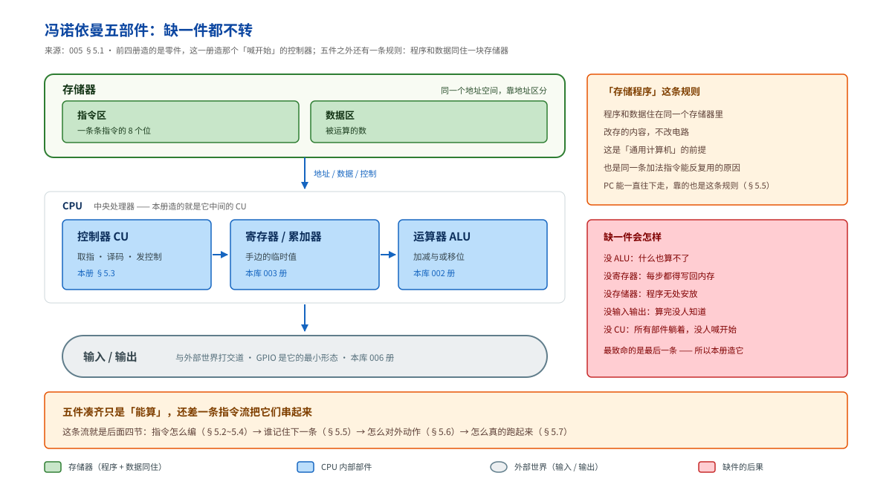
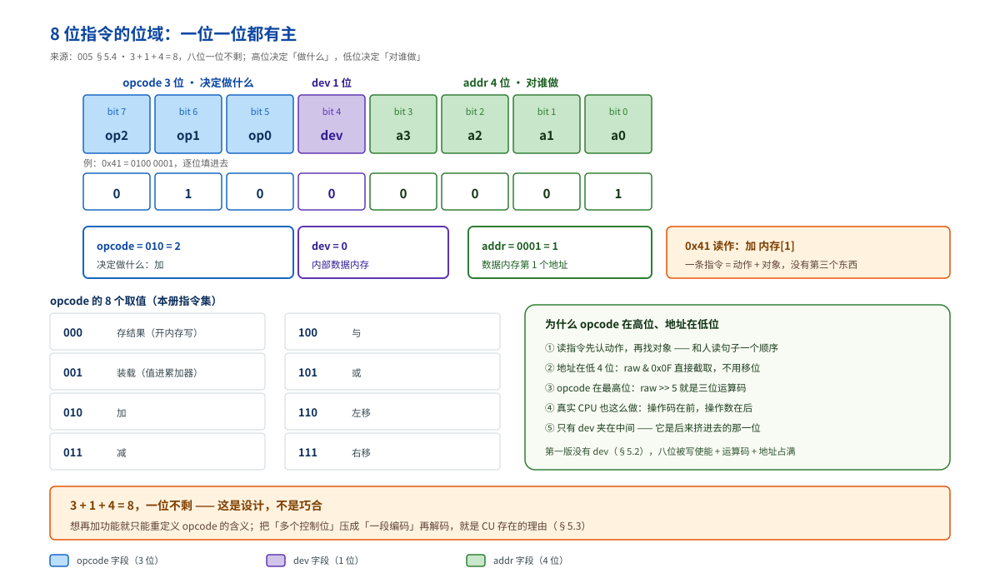
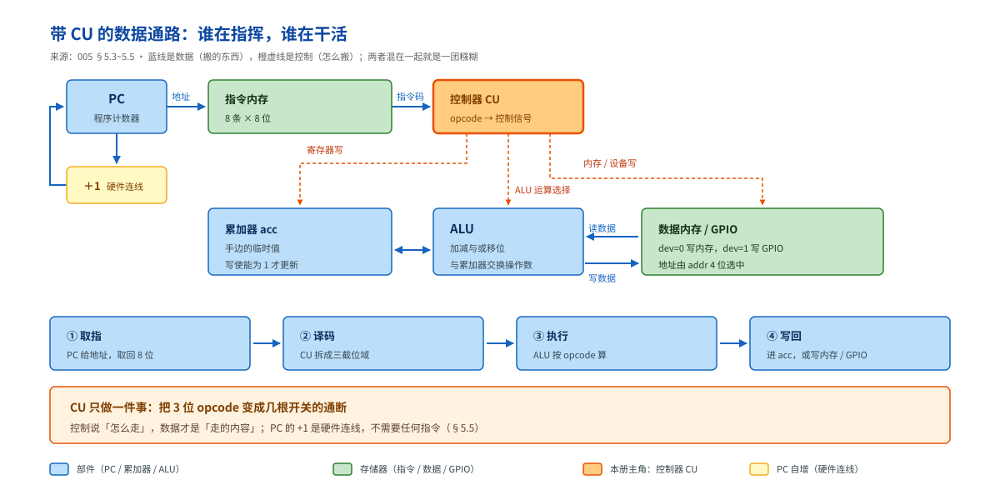

# 005 从 ALU 到 MCU

> **解决**：把前三册的零件接成一台能跑程序的机器——运算器、寄存器、存储器都齐了，缺的是"谁来指挥"和"指令怎么编"；本册用 8 位指令、一条 PC、一块 CU，把 `13+6+27-6` 真的算出来并存回内存（`cpu.c` 逐拍打印）。  
> **范围**：冯诺依曼五部件 · 第一版指令（控制位摊开）· 为什么需要 CU · 8 位指令的位域设计 · PC 与逐条执行 · dev 位切换数据内存与外部 GPIO · 流水灯程序的骨架。  
> **口径**：以 8 位指令、8 位数据、8 字节数据内存、3 位指令地址为例；`cpu.c` 是对硬件的**功能等价模拟**（不是门级还原），打印的"寄存器写/内存写"是 CU 应当解出的控制信号。  
> **更新**：2026-11-21  
> **本册导读** ── 必会三点：① 指令就是一组位，每条指令 = 做什么 + 对谁做 ② CU 把 3 位 opcode 解成多路控制信号 ③ PC 让指令自己往下走，人不用改地址 ｜ 跟做时长：约 2.5 小时（写 `cpu.c` 并改指令） ｜ 前置：002（ALU）、003（寄存器）、004（译码器与存储器）。  
> **标记**：★ = 必会节；○ = 拓展节。

## 目录

| 节 | 内容 |
|---|---|
| 5.1 | 冯诺依曼五部件：一台机器缺哪件都不转 ★ |
| 5.2 | 第一版指令：把控制位摊在明面上 ★ |
| 5.3 | 为什么要 CU：位数不够时把控制压缩成编码 ★ |
| 5.4 | 8 位指令的位域设计 ★ |
| 5.5 | PC：让指令自己往下走 ★ |
| 5.6 | dev 位：一次切换数据内存与外部 GPIO ○ |
| 5.7 | 流水灯：第一段真正跑起来的程序 ○ |
| 5.8 | 坑表 |
| 5.9 | 检查清单（自测 6 题 + 动手任务 2 件） |

---

## 5.1 冯诺依曼五部件：一台机器缺哪件都不转 ★

**冯诺依曼模型把计算机拆成五件东西**，并且规定了一条核心规则：**程序和数据存在同一个存储器里**（存储程序）。这条规则是"通用计算机"的前提——不用改电路，只改存储的内容，机器就干别的事。

| # | 部件 | 干什么 | 本库对应 |
|---|---|---|---|
| 1 | 运算器（ALU） | 加减与或移位 | 002 册 |
| 2 | 寄存器 / 累加器 | 手边的临时值 | 003 册 |
| 3 | 存储器 | 存指令、也存数据 | 004 册 |
| 4 | 控制器（CU） | 取指、译码、发控制信号 | 本册 §5.3 |
| 5 | 输入 / 输出 | 与外部打交道 | 006 册（GPIO 是它的最小形态） |

**缺一件会怎样**：没有 ALU，什么都算不了；没有寄存器，每一步的结果都得写回内存，慢到不可用；没有存储器，程序无处安放；**没有 CU，所有部件都躺着，没人喊开始**。前四册造的是零件，这一册造的是那个"喊开始"的。



## 5.2 第一版指令：把控制位摊在明面上 ★

**最直白的指令形态是把每一个控制位都摊开**：一位管"要不要写内存"，三位管"ALU 做哪种运算"，四位管"地址是多少"。

```text
第一版：8 位 = [ 写使能 1 位 ][ ALU 运算 3 位 ][ 地址 4 位 ]
```

按这个格式，`13+6+27-6` 存回地址 3 的五条指令是：

| 动作 | 二进制 | 拆解 |
|---|---|---|
| +13 | `00100000` | 0 关写使能 · 010 加法 · 0000 地址 0 |
| +6 | `00100001` | 0 关写使能 · 010 加法 · 0001 地址 1 |
| +27 | `00100010` | 0 关写使能 · 010 加法 · 0010 地址 2 |
| −6 | `00110001` | 0 关写使能 · 011 减法 · 0001 地址 1 |
| 存结果 | `10000011` | 1 **开**写使能 · 000 输出A · 0011 地址 3 |

**这套编码的三个特点**：① 写使能是一位"裸"的控制线，一眼能看出来；② ALU 的运算码直接搬进指令，CU 几乎不用做翻译；③ **八位全用满了，一位不剩**——这不是巧合，是后面所有麻烦的根源。

**为什么它短命**：想加"这次操作的对象是外部 GPIO 而不是内部内存"，就要再加一位"设备选择"——**没有位可加了**。要么把地址从 4 位砍到 3 位（容量减半），要么想别的办法。

## 5.3 为什么要 CU：位数不够时把控制压缩成编码 ★

**解法是把"多个控制信号的组合"压缩成一段编码，再用一块专门电路解码**——这块电路就是 CU（Control Unit，控制单元）。

**压缩的思路**：原本"寄存器写使能、内存写使能、ALU 运算"是三个独立的位，但它们在真实指令里**并不会任意组合**——你几乎不会同时"写寄存器 + 写内存 + 左移"。既然有效组合远少于 2³=8 种，就可以**用 3 位编码表示 8 种有效组合**，而不是用 3 根独立线各管一件事。

```text
第二版：8 位 = [ opcode 3 位 ][ dev 1 位 ][ 地址 4 位 ]
```

**代价与收益**：

| | 第一版 | 第二版（带 CU） |
|---|---|---|
| 控制信号怎么来 | 直接从指令位拉出来 | CU 解码 3 位 opcode 得到 |
| 多出的位数 | 没有 | **腾出 1 位给 dev** |
| 灵活性 | 加功能就要加位 | 改 CU 的译码表就能重定义指令 |
| 电路代价 | 小 | 多一块译码电路 |

**这一换很值**：用一块固定的译码电路，换来"指令含义可以重新定义"的自由度。**现代 CPU 的指令译码器就是这块 CU 的放大版**——它把定长的指令字拆成几十路控制信号，喂给流水线的各个部件。

**CU 到底输出什么**（本册 `cpu.c` 打印的就是这组信号）：

| 控制信号 | 什么时候有效 |
|---|---|
| 寄存器写使能 | 运算结果要落进累加器（装载、加、减、与、或、移位） |
| 内存 / 设备写使能 | opcode 为"存结果"时（000） |
| ALU 运算选择 | 由 opcode 决定走哪条运算路 |
| 设备选择 dev | 0 = 内部数据内存，1 = 外部 GPIO |

## 5.4 8 位指令的位域设计 ★

**位域就是"哪几位管什么"的划分**。本册的划分：



| 位 | 字段 | 取值 | 含义 |
|---|---|---|---|
| 7..5 | opcode | 000 | 存结果（开内存写使能，ALU 输出 A） |
| | | 001 | 装载（ALU 输出 B → 累加器） |
| | | 010 | 加 |
| | | 011 | 减 |
| | | 100 | 与 |
| | | 101 | 或 |
| | | 110 | 左移 |
| | | 111 | 右移 |
| 4 | dev | 0 / 1 | 0 = 内部数据内存；1 = 外部 GPIO |
| 3..0 | addr | 0000~1111 | 数据内存地址 / 第几组 GPIO |

**为什么 opcode 放高位、地址放低位**：这是通行做法——**高位决定"做什么"，低位决定"对谁做"**。好处是读指令时"先认动作"，而且地址在低位便于直接截取（`raw & 0x0F`）当作地址线用，不需要移位。

**同一个案例，第二版的编码变了**：

| 动作 | 二进制 | 拆解 |
|---|---|---|
| 装载 13 | `00100000` | 001 装载 · dev 0 · 地址 0 |
| +6 | `01000001` | 010 加 · dev 0 · 地址 1 |
| +27 | `01000010` | 010 加 · dev 0 · 地址 2 |
| −6 | `01100001` | 011 减 · dev 0 · 地址 1 |
| 存结果 | `00000011` | 000 存结果 · dev 0 · 地址 3 |

**注意第一行的变化**：第一版用"加法 + 地址 0"表示 +13（假设累加器初值为 0），第二版改用"装载"。**"从 0 加起"是技巧，"装载"才是语义**——这也是 CU 带来的好处：能定义出更贴切的指令。

**完整示例**（文件名 `cpu.c`，位域拆解与执行都在这个文件里）：

```c
/* CU（控制单元）的职责：把 3 位 opcode 拆成具体的控制信号 */
static void cu_decode(unsigned char raw, Insn *in)
{
    in->raw  = raw;
    in->op   = (raw >> 5) & 0x7;   /* 高 3 位：做什么 */
    in->dev  = (raw >> 4) & 0x1;   /* 第 5 位：对哪类设备 */
    in->addr = raw & 0xF;          /* 低 4 位：地址 */
}

/* 执行一条指令，回填 CU 解出的两个写使能 */
static void execute(const Insn *in, int *reg_we, int *mem_we)
{
    int src = src_value(in);
    *reg_we = 1;
    *mem_we = 0;

    switch (in->op) {
    case 0: *reg_we = 0; *mem_we = 1; break;  /* 存结果：写内存，不动寄存器 */
    case 1: acc = src;              break;    /* 装载 */
    case 2: acc += src;             break;    /* 加 */
    case 3: acc -= src;             break;    /* 减 */
    case 4: acc &= src;             break;    /* 与 */
    case 5: acc |= src;             break;    /* 或 */
    case 6: acc <<= src;            break;    /* 左移 */
    default: acc >>= src;           break;    /* 右移 */
    }

    if (*mem_we) {                            /* 写使能开着才真写 */
        if (in->dev) gpio[in->addr & 0x7] = acc;
        else         dmem[in->addr & 0x7] = acc;
    }
}
```

**跟做步骤**：新建 `cpu.c` 抄入册末附录源码 → `gcc -Wall cpu.c -o cpu.exe` → `./cpu.exe`。

**预期输出**（本机实测，逐拍打印 CU 解出的两个写使能）：

```text
== 程序一：13 + 6 + 27 - 6，结果存回地址 3 ==
PC 指令码   op dev addr | 寄存器写 内存写 | acc  观察值  动作
-----------------------------------------------------------
 0  00100000   1   0    0  |    1      0    |  13     0    装载
 1  01000001   2   0    1  |    1      0    |  19     0    加
 2  01000010   2   0    2  |    1      0    |  46     0    加
 3  01100001   3   0    1  |    1      0    |  40     0    减
 4  00000011   0   0    3  |    0      1    |  40    40    存结果
```

**看前三列就够了**：`寄存器写` 与 `内存写` 在五条指令里从不冲突——前四条只写寄存器，最后一条只写内存。**这不是巧合，是 CU 的编码规则保证的**：同一个 opcode 不可能既"装载"又"存结果"。

**试一试**：把第 3 条 `0x61`（减）改成 `0x41`（加），再跑。结果会变成 `13+6+27+6 = 52`。**改一个字节的中间三位，运算就换了**——指令的"可编程"，物理上就是"这几个位接在不同的开关上"。

## 5.5 PC：让指令自己往下走 ★

**没有 PC 时怎么跑程序**：每执行一条，人手动把指令地址改到下一个——素材里明确记下了这个痛点：**"指令内存中的指令是逐条执行的，每次自己去修改 Order_addr 很麻烦"**。

**PC（Program Counter，程序计数器）解决的就是这件事**：它记住"下一条指令在哪"，每取一条就自动加一。**素材里那句判断很准：程序计数器的本质其实就是一个累加器**——它就是一个寄存器，每次加一个固定的 1。

**PC 与指令内存的配合**：

```text
      ┌──────────┐   地址   ┌──────────┐   指令   ┌──────────┐
      │    PC    │ ───────→ │  指令内存 │ ───────→ │    CU    │
      └──────────┘          └──────────┘          └──────────┘
           ↑                                            │
           └──────────── 执行完 +1（下一条）─────────────┘
```

**"逐条执行"为什么必须由硬件保证**：如果靠软件改地址，就得有一条"改 PC"的指令，而这条指令自己也需要地址——会无限倒退。**PC 的 +1 是硬件连线**，不需要指令。

**跳转怎么办**：PC 的 +1 是默认路径，条件跳转就是"把 PC 直接改成目标地址"而不是加一。**"顺序"是常态、"跳转"是例外**，这个默认设定让指令可以连续排布，代码才紧凑。



**本册 `cpu.c` 的模拟里，PC 就是那个 `for (int pc = 0; pc < n; pc++)` 的循环变量**——每跑一轮加一，不写代码也自动递增。真实硬件里它是寄存器 + 加法器（002 §2.2 那个加法器的最小用途）。

## 5.6 dev 位：一次切换数据内存与外部 GPIO ○

**dev 位解决的问题**：同一条指令，这次想写内部数据内存，下次想写外部 GPIO。**加一位"设备选择"就能复用同一套 opcode 和地址位**，不必为 GPIO 另造一套指令。

```text
dev = 0 → 选内部数据内存，addr 是"第几个字节"
dev = 1 → 选外部 GPIO，   addr 是"第几组引脚"
```

**实测输出**（同一份 `cpu.c` 的第二段，dev 换成 1）：

```text
== 程序二：把内存[3] 的值送到外部 GPIO 第 0 组（dev 位换成 1） ==
PC 指令码   op dev addr | 寄存器写 内存写 | acc  观察值  动作
-----------------------------------------------------------
 0  00100011   1   0    3  |    1      0    |  40     0    装载
 1  00010000   0   1    0  |    0      1    |  40    40    存结果

最终：内存[3] = 40，gpio[0] = 40（都等于 13+6+27-6）
```

**两行的差别只有 dev 那一位**：`0010 0011` 与 `0001 0000` 看似完全不同，但拆开看，第一条是"装载、dev=0、地址 3"，第二条是"存结果、dev=1、地址 0"。**地址空间与设备空间，被一位 dev 分成了两半**——这就是"统一编址"的最简形态，真实 MCU 里叫内存映射（memory-mapped I/O）：GPIO 寄存器被编进了地址空间，用读写内存的指令就能驱动引脚。

**这一位的分量**：它把"运算"和"对外动作"统一到了同一套指令里。**写 GPIO 和写内存，在指令层面是同一件事**——这是 006 册"用寄存器操作外设"的硬件前提。

## 5.7 流水灯：第一段真正跑起来的程序 ○

**流水灯 = 一条值在几组 GPIO 之间轮流点亮**。素材里给了它在数字电路层的实现：一组指令，把值依次写到不同的 GPIO 组。

**用本册的指令集写出来**（dev=1 选 GPIO，addr 就是第几组）：

| 步骤 | 指令 | 含义 |
|---|---|---|
| 1 | 装载 `0x01` | 让累加器 = 0000 0001（第 0 位亮） |
| 2 | 存结果 dev=1 addr=0 | 写到 GPIO 第 0 组 |
| 3 | 左移 1 位 | 累加器变 0000 0010 |
| 4 | 存结果 dev=1 addr=1 | 写到 GPIO 第 1 组 |
| … | 左移 + 存结果 | 依次点亮后面几组 |

**"延时"在哪**：真实流水灯之所以看起来"流"，靠的是两组灯之间停一会儿。**数字电路里没有"时间"这个概念，只有拍**——所以延时要么靠一堆空指令（占拍数），要么靠定时器。**这也是 006 册要讲定时器的原因：把"等一会儿"变成硬件能力，而不是烧 CPU 空转。**

**为什么这个案例值得做**：它把前面所有零件都用上了——ALU 做左移（002）、累加器存值（003）、GPIO 地址靠 dev + addr 选中（004）、CU 译码（§5.3）、PC 逐条执行（§5.5）。**能跑通流水灯，说明这条链全通了。**

## 5.8 坑表

| # | 现象 | 原因 | 解法 |
|---|---|---|---|
| 1 | 指令执行了但结果不对 | 位域拆错：opcode 与 addr 的位移算反 | 按 `raw>>5`/`raw>>4`/`raw&0xF` 逐位核对（§5.4） |
| 2 | 程序跑飞，第二条指令乱执行 | PC 没递增，或指令内存地址接错 | PC 每条 +1，地址线位序核对（§5.5） |
| 3 | 结果写进了内存却读不到 | dev 位与预期相反 | dev=0 是内部内存、1 是 GPIO（§5.6） |
| 4 | 存结果把累加器也改了 | opcode 000 同时开了寄存器写使能 | 存结果只开内存写，寄存器写必须关（§5.4） |
| 5 | 加了新功能就没位数可用 | 控制位摊开占满 8 位 | 学 CU：压缩成编码再解码（§5.3） |
| 6 | 流水灯只是"全亮"不"流" | 没有延时，几组 GPIO 在同一拍被写完 | 加延时或用定时器（§5.7） |

## 5.9 检查清单（自测 6 题 + 动手任务 2 件）

**自测**：

| # | 问题 | 自测标准 |
|---|---|---|
| 1 | 冯诺依曼五部件是哪五个 | 运算器、寄存器、存储器、控制器、输入输出 |
| 2 | "存储程序"意味着什么 | 程序和数据同住一个存储器，改内容不改电路 |
| 3 | 为什么第一版指令会短命 | 控制位摊开占满 8 位，加功能没位可用 |
| 4 | CU 输出哪几组控制信号 | 寄存器写、内存/设备写、ALU 运算选择、设备选择 |
| 5 | PC 的本质是什么 | 一个每次加 1 的累加器，硬件保证顺序执行 |
| 6 | dev 位解决什么 | 用同一套指令与地址位，切换内部内存与外部 GPIO |

**动手任务**：

1. **跑通 `cpu.c`**，产出：程序一的 5 行表与程序二的 2 行表；并说明"为什么存结果那一行寄存器写是 0"。
2. **改指令做实验**：把程序一第 3 条 `0x61` 改成 `0x41`，产出改动后的输出，算出新的结果并验证等于 `13+6+27+6`。

## 附：`cpu.c` 完整源码

```c
#include <stdio.h>

static int acc;                       /* 累加器：MCU 内部的寄存器 */
static unsigned char dmem[8] = {13, 6, 27, 0, 0, 0, 0, 0};
static int gpio[8];                   /* 外部 GPIO 的几组输出 */

typedef struct {
    unsigned char raw;
    int op, dev, addr;
} Insn;

/* CU（控制单元）的职责：把 3 位 opcode 拆成具体的控制信号 */
static void cu_decode(unsigned char raw, Insn *in)
{
    in->raw  = raw;
    in->op   = (raw >> 5) & 0x7;
    in->dev  = (raw >> 4) & 0x1;
    in->addr = raw & 0xF;
}

static const char *op_name(int op)
{
    static const char *n[8] = {
        "存结果", "装载", "加", "减", "与", "或", "左移", "右移"
    };
    return n[op & 0x7];
}

static int src_value(const Insn *in)
{
    return in->dev ? gpio[in->addr & 0x7] : dmem[in->addr & 0x7];
}

/* 执行一条指令，回填 CU 解出的两个写使能 */
static void execute(const Insn *in, int *reg_we, int *mem_we)
{
    int src = src_value(in);
    *reg_we = 1;
    *mem_we = 0;

    switch (in->op) {
    case 0: *reg_we = 0; *mem_we = 1; break;  /* 存结果：写内存，不动寄存器 */
    case 1: acc = src;              break;    /* 装载 */
    case 2: acc += src;             break;    /* 加 */
    case 3: acc -= src;             break;    /* 减 */
    case 4: acc &= src;             break;    /* 与 */
    case 5: acc |= src;             break;    /* 或 */
    case 6: acc <<= src;            break;    /* 左移 */
    default: acc >>= src;           break;    /* 右移 */
    }

    if (*mem_we) {                            /* 写使能开着才真写 */
        if (in->dev) gpio[in->addr & 0x7] = acc;
        else         dmem[in->addr & 0x7] = acc;
    }
}

static void bits8(unsigned char v, char *buf)
{
    for (int i = 7; i >= 0; i--) buf[7 - i] = ((v >> i) & 1) ? '1' : '0';
    buf[8] = '\0';
}

static void run(const char *title, unsigned char *prog, int n, int watch_gpio)
{
    char b[9];
    printf("== %s ==\n", title);
    printf("PC 指令码   op dev addr | 寄存器写 内存写 | acc  观察值  动作\n");
    printf("-----------------------------------------------------------\n");
    for (int pc = 0; pc < n; pc++) {
        Insn in;
        int reg_we, mem_we;
        cu_decode(prog[pc], &in);
        bits8(in.raw, b);
        execute(&in, &reg_we, &mem_we);
        printf(" %d  %s   %d   %d  %3d  |    %d      %d    | %3d   %3d    %s\n",
               pc, b, in.op, in.dev, in.addr, reg_we, mem_we,
               acc, watch_gpio ? gpio[0] : dmem[3], op_name(in.op));
    }
    printf("\n");
}

int main(void)
{
    /* 13 + 6 + 27 - 6，把结果存回数据内存第 4 个地址（地址 3） */
    unsigned char prog1[] = {
        0x20,   /* 001 0 0000  装载 acc = 内存[0] = 13 */
        0x41,   /* 010 0 0001  加   acc += 内存[1] = 6  */
        0x42,   /* 010 0 0010  加   acc += 内存[2] = 27 */
        0x61,   /* 011 0 0001  减   acc -= 内存[1] = 6  */
        0x03    /* 000 0 0011  存结果 → 内存[3]         */
    };
    run("程序一：13 + 6 + 27 - 6，结果存回地址 3", prog1, 5, 0);

    /* 同一份结果，换成 dev=1 送到外部 GPIO 第 0 组 */
    unsigned char prog2[] = {
        0x23,   /* 001 0 0011  装载 acc = 内存[3] = 40 */
        0x10    /* 000 1 0000  存结果 → gpio[0]       */
    };
    run("程序二：把内存[3] 的值送到外部 GPIO 第 0 组（dev 位换成 1）",
        prog2, 2, 1);

    printf("最终：内存[3] = %d，gpio[0] = %d（都等于 13+6+27-6）\n",
           dmem[3], gpio[0]);
    return 0;
}
```

> 下一篇：回到 [README](README.md) 总览——数字电路这条线到此闭合：从门 → 加法器 → 寄存器 → 存储器 → 一台能跑程序的机器。下一站「006 MCU 与外设」（规划中），把这台机器接到真实的引脚与定时器上。
