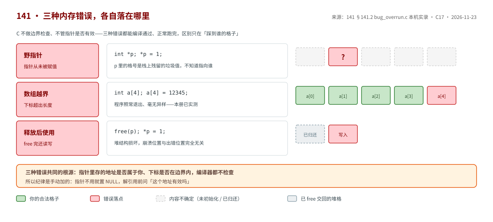

# 141 内存四区与对象生命周期

> **解决**：指针指向的东西到底住在哪——进程内存分成代码段、数据段、栈、堆四块，每一块的**释放责任**归谁，以及"越界写不报错"这类事故为什么在 C 里是常态。  
> **范围**：四区划分与地址实测 · 谁负责释放 · 内存错误的三种落点与六种成因 · 段错误的成因链 · 排查工具与替代纪律 · 寄存器也是地址。  
> **口径**：C17；地址为本机实录（Windows x64 + GCC 16.2.0），每次运行会变，**看"同区相邻、跨区远隔"的形态**；w64devkit 不含 AddressSanitizer 运行库（实测链接失败），替代手段见 112 §112.6。  
> **更新**：2026-11-23  
> **本册导读** ── 必会三点：① 四区各自的**释放责任**：数据段与栈自动、堆必须自己 `free` ② 内存错误只有**三种落点**（别人的格子/地址 0/已归还的堆），成因有六种 ③ malloc 三纪律：判 NULL、必 free、free 后置 NULL ｜ 跟做时长：约 2.5 小时 ｜ 前置：133（指针与地址）。  
> **标记**：★ = 必会节（啃透必会三点就能过）；○ = 拓展节（时间多再扫）。

## 目录

| 节 | 内容 |
|---|---|
| 141.1 | 栈、堆与内存四区 ★ |
| 141.2 | 内存错误：三种落点、六种成因 ★ |
| 141.3 | 嵌入式视角：寄存器也是地址 ○ |
| 141.4 | 坑表 |
| 141.5 | 检查清单（自测 6 题 + 动手任务 3 件） |

---

## 141.1 栈、堆与内存四区 ★

**定义**：进程内存分四区——**代码段**（机器码，只读可执行）、**数据段**（全局变量与 static，出生即零、随程序生死）、**栈**（局部变量与函数调用帧，自动回收）、**堆**（malloc/free，手动管理）。

**完整示例**（[code/141/memzones.c](../code/141/memzones.c)）——四个区各取一个样本，地址一打就分家：

```c
#include <stdio.h>
#include <stdlib.h>

int g = 1;                          /* data segment */
static int s = 2;                   /* data segment */

int main(void)
{
    int l = 3;                      /* stack */
    static int sl = 4;              /* data segment */
    int *h = malloc(sizeof(int));   /* heap */
    if (h == NULL) { return 1; }    /* malloc 三纪律之一：判 NULL */
    *h = 5;

    printf("global  g  = %d at %p\n", g,  (void*)&g);
    printf("static  s  = %d at %p\n", s,  (void*)&s);
    printf("static sl  = %d at %p\n", sl, (void*)&sl);
    printf("local   l  = %d at %p   <- stack\n", l, (void*)&l);
    printf("heap   *h   = %d at %p   <- heap\n", *h, (void*)h);
    free(h);
    h = NULL;
    return 0;
}
```

**跟做**：`cd code/141` → `gcc -Wall memzones.c -o memzones.exe` → `.\memzones.exe`。**预期输出（本机实录）**：

```text
global  g  = 1 at 00007ff7c2019000
static  s  = 2 at 00007ff7c2019004
static sl  = 4 at 00007ff7c2019008
local   l  = 3 at 000000298bbffa14   <- stack
heap   *h   = 5 at 000001e4ce348f50   <- heap
```

**三处必看的机制**：① **同区相邻、跨区远隔**：三个全局/static 彼此只差 4 字节（同一段），栈地址（`...bffa14`）与堆地址（`...ce348f50`）差着好几个数量级——**四个区在地址空间里根本不是邻居**；② **`static int sl` 虽然写在函数里，却和全局住一起**——`static` 把局部变量搬进数据段，这就是 123 §123.5"延寿"的物理原因；③ **谁管释放**：代码段与数据段随程序生死、栈随函数返回自动回收、**只有堆必须自己 `free`**——四区里唯一需要你操心的就是堆。

四区的位置与释放责任，一图看清：


**malloc 三纪律**（堆的三条命）：

| # | 纪律 | 不守的后果 |
|---|---|---|
| 1 | **用完必 `free`** | 内存泄漏：程序越跑越胖，长时间运行的固件最终 malloc 返回 NULL |
| 2 | **`free` 后立刻置 NULL** | 悬空指针：p 还指着已归还的格子，再解引用就是 UB |
| 3 | **用前判 NULL** | malloc 失败返回 NULL，直接解引用必崩 |

四函数的完整用法（malloc/calloc/realloc/free 的差别、realloc 保不保留内容）在 142 §142.7 展开，本节只立"谁管释放"这个责任观。

**试一试**：① 把 `int l = 3;` 移到 `main` 外（变成全局），重跑看它的地址从栈段跳到数据段——**作用域换个位置，住所就换了区**；② 连续 `malloc` 两次（各 `sizeof(int)`）并打印两个地址，看它们是不是相邻（堆是连续向上分配的，差值通常就是 4 的倍数）。

## 141.2 内存错误：三种落点、六种成因 ★

**定义**：内存错误按"**踩到谁的格子**"分类，落点只有三种；按**成因**列，一共六种。先把最反直觉的一个现象看清——**越界写不报错**。

**完整示例**（[code/141/bug_overrun.c](../code/141/bug_overrun.c)）：

```c
#include <stdio.h>

int main(void)
{
    int a[4] = {0};
    a[4] = 12345;              /* out of bounds! compiles fine, runs wild */
    printf("wrote a[4]=12345, a[3]=%d (neighbor may be hit)\n", a[3]);
    return 0;
}
```

**跟做**：`gcc -Wall bug_overrun.c -o bug_overrun.exe` → `.\bug_overrun.exe`。**预期输出（本机实录）**：

```text
wrote a[4]=12345, a[3]=0 (neighbor may be hit)
```

**读法**：`a[4]` 对 `int a[4]` 是越界写，**编译通过、运行正常退出、`-Wall` 一声不吭**。`a[3]` 仍是 0 说明这次侥幸没踩到有用的格子——**编译器不管、运行时也不管，除非踩到要害**。

**踩到要害的报错叫段错误**：操作系统给每个进程划界，访问无权地址时硬件异常、内核终止进程（「300 操作系统原理」313）。它的退出码是 139（112 §112.4 有完整定位方法）。

**三种落点**（按"踩到谁的格子"分）：

| 落点 | 典型成因 | 表现 |
|---|---|---|
| ① **踩到别人的格子**（本进程内） | 数组越界、野指针指到相邻变量 | 常常**不报错**，静默改坏别的数据 |
| ② **踩到地址 0** | 空指针解引用 | 必崩、可定位（地址 0 附近无映射） |
| ③ **踩到已归还的堆** | free 后继续用、重复 free | 堆结构损坏，崩在 malloc/free 内部，栈回溯看不出你的代码 |

落点图（空指针解引用必崩在地址 0，不会"落到别人的格子"上，所以只进下表、不进图）：



**六种成因**（这张表值得抄进笔记）：

| 错误 | 典型写法 | 后果 | 预防 |
|---|---|---|---|
| 野指针 | 未初始化就 `*p` | 崩溃或改坏随机内存 | 声明即置 NULL 或有效值 |
| 空指针解引用 | `int *p = NULL; *p = 1;` | 必崩，可定位 | 解引用前判 NULL |
| 数组越界 | `a[4]` 对 `int a[4]` | 常常不报错 | 边界用 `i < len` |
| 使用已释放内存 | `free(p); *p = 1;` | 不可预期 | free 后立刻置 NULL |
| 重复释放 | `free(p); free(p);` | 堆结构损坏 | free 后置 NULL |
| 内存泄漏 | malloc 不 free | 越跑越耗尽 | 每个出口都 free |

**三处必看的机制**：① **落点与成因是两个维度**：一个"野指针"可能落到落点①（碰巧指向本进程某块内存）也可能落到落点②（正好是 NULL）；② **越界的危害不在"崩"而在"不崩"**——崩了你能定位，静默改坏一个变量可能几小时后才在别处表现（112 §112.5 的优化等级对照就是查这种 bug 的利器）；③ **`free` 之后内存没消失**，只是被堆管理器收回备用，你手里的指针还指着它——这就是"悬空"。

**排查工具**：越界类问题的正规武器是 **AddressSanitizer**（`gcc -fsanitize=address`）和 **valgrind**。本库的 w64devkit **不含 ASan 运行库**（实测 `gcc -fsanitize=address` 报 `cannot find -lasan`），需要时换 MSYS2 完整版或 Linux 环境。**没工具时靠纪律**（112 §112.6 给了金丝雀哨兵等四种替代手段）：逐个查数组边界、free 全配对、指针声明即赋值。

**试一试**：① 在 `a` 后面再声明一个 `int victim = 7;`，把 `a[4] = 12345;` 改成 `a[5] = 12345;`（多越一位），再打印 `victim` 看它有没有被改——**越界写的第二个受害者**；② 写 `int *p = NULL; *p = 1;`，用 `echo $?` 看退出码是不是 139。

## 141.3 嵌入式视角：寄存器也是地址 ○

**定义**：外设寄存器被"摆"在地址空间的固定编号上（这叫**内存映射 IO**），读写那个地址就是读写硬件——所以指针在嵌入式不是"高级技巧"，是操作硬件的基本语法。

```c
unsigned int *reg = (unsigned int *)0x40020000;  /* 示意：某外设寄存器的映射地址 */
*reg |= (1u << 3);
```

**三条纪律**（比代码本身重要）：

- **具体地址查芯片手册**，正式工程用芯片库定义的常量，不要在代码里裸写十六进制。
- **必须加 `volatile`**：硬件可能在程序背后改内存，`volatile` 告诉编译器"每次都真读真写，别缓存到寄存器里"。完整用法归规划「600 MCU 与外设」。
- **位操作模板见 121 §121.3**：`|=` 置位、`&=~` 清位、`^=` 翻转、`&` 测试——这四句是驱动代码的日常。

**为什么嵌入式面试必考指针**：驱动与固件的日常就是"顺着地址操作内存"。而访问模式不同，同一地址的读取速度能差 100 倍——这是「200 计算机体系结构」003 讲缓存与局部性时的主题，反过来解释了为什么数据结构要讲究内存布局（143 接这一棒）。

**试一试**：把上面两行改写成"清位第 3 位"，再改写"测试第 3 位并打印 0/1"——用 121 §121.3 的四模板，不查资料自己写出来。

## 141.4 坑表

| # | 现象 | 原因 | 解法 |
|---|---|---|---|
| 1 | 段错误且位置随机 | 野指针（声明未初始化） | 声明即置值；free 后置 NULL（§141.2） |
| 2 | 越界却无任何报错 | C 不做边界检查，踩到本进程内别的格子照常运行 | 边界纪律；金丝雀或 GDB（112 §112.6） |
| 3 | 程序越跑内存越大 | malloc 无 free | 配对检查，每个出口都 free（§141.1） |
| 4 | `free` 后 use 崩在 malloc 内部 | 堆结构被破坏，栈回溯看不到自己代码 | free 后立刻置 NULL（§141.2 落点③） |
| 5 | 同一变量在函数里 `static` 后行为变了 | static 把它搬进数据段，跨调用保状态 | 要这段"记忆"才用 static（123 §123.5） |
| 6 | 长时间运行后 malloc 返回 NULL | 泄漏累积到堆耗尽 | 排查未释放路径，看 142 §142.7 |
| 7 | 读寄存器永远是第一次的值 | 没加 `volatile`，编译器把它缓存了 | 外设指针声明加 `volatile`（§141.3） |
| 8 | `-fsanitize=address` 链接失败 | 工具链没有 ASan 运行库 | 换 MSYS2/Linux；或用 112 §112.6 四道纪律 |

## 141.5 检查清单（自测 6 题 + 动手任务 3 件）

**自测**：

| # | 问题 | 自测标准 |
|---|---|---|
| 1 | 四区各自的释放责任归谁 | 代码段/数据段随程序、栈自动、堆手动 free |
| 2 | 函数里的 `static` 局部变量住在哪个区 | 数据段（和全局住一起） |
| 3 | 内存错误的三种落点 | 别人的格子 / 地址 0 / 已归还的堆 |
| 4 | 越界写为什么危险 | 多数时候不报错，静默改坏别的数据 |
| 5 | malloc 三纪律是哪三条 | 判 NULL、必 free、free 后置 NULL |
| 6 | 外设指针为什么要 `volatile` | 硬件会在背后改内存，禁止编译器缓存 |

**动手任务**：① 跑 [code/141/memzones.c](../code/141/memzones.c)，把五个地址按区归类写进笔记（哪三个同段、哪两个各自独立）；② 复现 [code/141/bug_overrun.c](../code/141/bug_overrun.c)，再按"试一试 ①"造一个被越界写坏的 `victim` 变量，留下被改前后的数值；③ 用 121 §121.3 的四模板写一个"置位 + 清位 + 测试"的寄存器操作小函数，参数是地址与位号，产出程序与运行输出。

> 下一篇：《142 指针进阶与动态内存》——指针家族九类声明、函数指针与回调，以及 malloc/calloc/realloc/free 四函数的完整用法。
