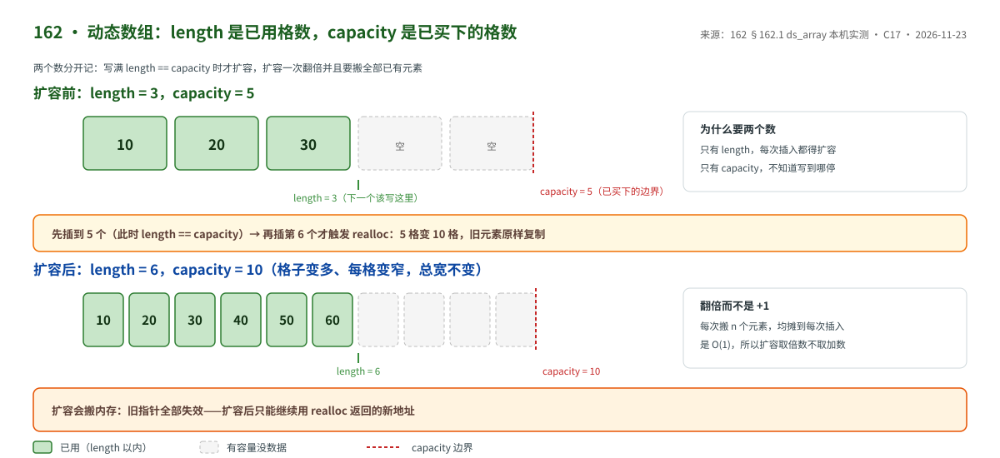
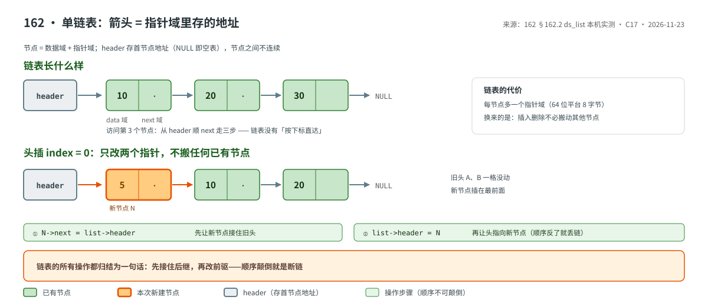
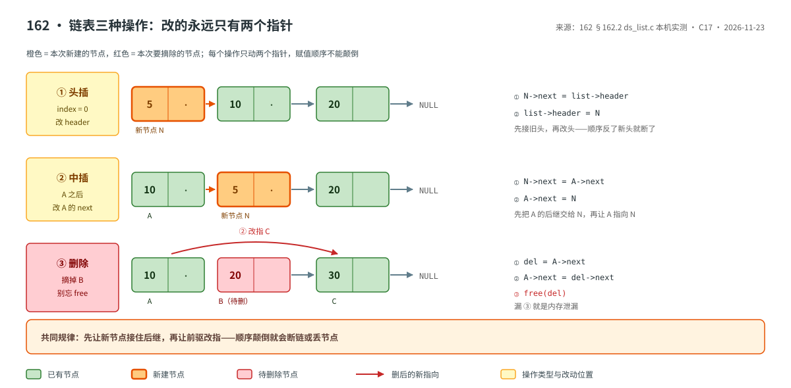

# 162 动态数组与链表

> **解决**：把"组织一批数据"从定长数组升级为可增删的容器——动态数组用"容量 + 长度 + 指针"三个成员绕开长度不可变，单链表用"数据域 + 指针域"绕开插入搬移；两者是后面栈、队列、哈希桶链的地基。  
> **范围**：动态数组的三成员与扩容策略 · 单链表节点与头插/中插/删除 · 数组 vs 链表的操作成本对照与选型。  
> **口径**：C17；示例为教学简化版（未做内存池与错误码统一），完整工程实现以实际项目为准；扩容倍数与初始容量是策略选择，不是标准规定。  
> **更新**：2026-11-23  
> **本册导读** ── 必会三点：① 动态数组三成员 `data/capacity/length`，扩容在 `length == capacity` 时翻倍并**搬旧数据** ② 链表插入只改指针、不搬数据，但**要先接后断**，否则链断 ③ "链表删除 O(1)"的完整表述是"**已知前驱**时 O(1)"，找前驱仍是 O(n) ｜ 跟做时长：约 2.5 小时 ｜ 前置：132（struct 与 typedef）、142 §142.7（malloc/free）、133（指针）。  
> **标记**：★ = 必会节（啃透必会三点就能过）；○ = 拓展节（时间多再扫）。

## 目录

| 节 | 内容 |
|---|---|
| 162.1 | 动态数组：三个成员解开"长度不可变" ★ |
| 162.2 | 单链表：数据域 + 指针域 ★ |
| 162.3 | 数组 vs 链表：把高频操作分给便宜的结构 ★ |
| 162.4 | 坑表 |
| 162.5 | 检查清单（自测 6 题 + 动手任务 3 件） |

---

## 162.1 动态数组：三个成员解开"长度不可变" ★

定长数组的死结是长度一旦确定就不可变（131 §131.1）。动态数组用三个成员绕开它——**完整示例**（[code/162/ds_array.c](../code/162/ds_array.c)，本册 `code/` 目录）：

```c
typedef struct {
    int *data;       /* 指向 malloc 来的连续内存 */
    size_t length;   /* 实际元素个数 */
    size_t capacity; /* 当前容量 */
} DynamicArray;
```



**核心就两条**：`length == capacity` 时先 `realloc` 扩容（倍增 ×2 策略）再插入；插入中间元素要整体后移。

```c
if (array->length == array->capacity)
    resize_array(array, array->capacity * 2);
for (size_t i = array->length; i > index; i--)
    array->data[i] = array->data[i - 1];
array->data[index] = element;
array->length++;
```

**跟做步骤**：`cd code/162` → `gcc -Wall ds_array.c -o ds_array.exe` → `.\ds_array.exe`。**预期输出（本机实录）**：

```text
len=3
len=6
10 20 30 40 50 60 
deleted arr[3] = 40
deleted end = 60
len=4
10 20 30 50 
```

第 2 行 `len=6` 就是扩容那一刻：容量 5 装不下第 6 个元素，`resize_array` 把容量翻到 10（前后差 3 行是删除演示）。行尾的空格是 `printf("%d ")` 打出来的，原样保留——对照时别当成自己抄错。

**试一试**：① 把 `init_array(&array, 5)` 的 5 改成 3 再跑——扩容提前到第 4 个元素，`len=6` 前会多一次 3→6→12 的翻倍；② 把三行 `insert_at(&array, 0, …)` 改成 `insert_end`——结果数组顺序反过来，体会"头插要整体后移、尾插不用"。

- **插入的搬运成本**：插入平均移动 n/2 个元素、删除平均移动 (n−1)/2 个——这是数组"改中间慢"的根源。
- **扩容只发生在 `length == capacity` 那一刻**，不是每次插入都扩。
- **尾插是免费的**：`insert_end` 拿 `length` 当游标直接追加，定长数组做不到。

## 162.2 单链表：数据域 + 指针域 ★

节点 = **数据域 `data`** + **指针域 `next`**；链表头 `header` 存首节点地址，`NULL` 即空表。**完整示例**（[code/162/ds_list.c](../code/162/ds_list.c)）：



**插入只改两个指针，不搬数据**——头插和中插是两条路径：

```c
new_node->next = list->header;   /* 头插：新节点接旧头 */
list->header = new_node;         /*       链表头指向新节点 */

Node *prev = get_prev_node(list, index);  /* 中插：先走到前驱 */
new_node->next = prev->next;              /*       新节点接后继 */
prev->next = new_node;                    /*       前驱接新节点 */
```

**跟做步骤**：`cd code/162` → `gcc -Wall ds_list.c -o ds_list.exe` → `.\ds_list.exe`。**预期输出（本机实录）**：

```text
len=2
len=3
10 20 30 
deleted idx2 = 30
deleted end = 20
len=1
arr[0] = 10
100 
```

`len=2 → len=3` 是两次头插：每次只改 `new_node->next` 与 `header` 两个指针，一个元素都没搬。最后两行 `arr[0] = 10` 与 `100` 是"删到只剩 1 个"后的取值演示——链表随时能回到空表，不需要像数组那样重建。

**试一试**：① 把第三次头插换成"插到 index 1"（用 `get_prev_node` 走一步）——观察指针改的是 `prev->next` 而不是 `header`；② 故意把 `destroy_list` 里两行的顺序颠倒（先 `free(cur)` 再读 `cur->next`）——`-Wall` 未必报错，跑起来才见野指针。

- **删除要先把节点从链上摘下来，再 `free`**。只做 `prev->next = prev->next->next` 是"摘"，不 free 就是内存泄漏（141 §141.2）。
- **`destroy_list` 先存 next 再 free 当前**。顺序反了就拿到已释放内存里的野指针。
- **代价是访问必须从头走**：随机访问 O(n)，与数组的 O(1) 正好相反。

三种操作各自改哪两个指针、顺序为什么不能颠倒，一图对齐：



## 162.3 数组 vs 链表：把高频操作分给便宜的结构 ★

两种结构没有谁更好，只有场景适配——**选型就是把高频操作分配给成本低的那一个**。

| 操作 | 动态数组 | 单链表 | 选型含义 |
|---|---|---|---|
| 按索引访问 | O(1)，`data[i]` 直达 | O(n)，从头走 i 步 | 随机读多用数组 |
| 尾部插入/删除 | O(1)，`length` 当游标 | O(n)，无尾指针时要走到尾 | 追加日志用数组 |
| 中间插入/删除 | O(n)，平均搬 n/2 | O(1)，找到位置后只动指针（找位置本身 O(n)） | 频繁中间增删用链表 |
| 内存形态 | 连续，缓存友好 | 分散，每节点多一个指针域 | 容量敏感看 overhead |
| 扩容 | 满则 realloc ×2 | 天然按节点生长 | 长度不可预估用链表 |

O(1)/O(n) 是复杂度记号，表示成本随规模增长的趋势，正式定义见 010。

**"链表插入删除快"的完整表述是"找到位置之后快"**，找位置仍要 O(n)。

**验证**：用两套 API 各做"在 10000 个元素的第 0 位插入 100 次"——链表版只需头插两次赋值，数组版每次搬 10000 个元素，计时对比即可看出量级差（161 §161.1 事后统计法）。

## 162.4 坑表

| # | 现象 | 原因 | 解法 |
|---|---|---|---|
| 1 | 删除或获取 index==length 时读到垃圾 | 参考实现的边界笔误：查删改用 `index > length`（本册已修正为 `>=`；插入保留 `>`，因 index==length 是合法尾插） | 增删改查各自核对边界语义 |
| 2 | 空表 `delete_end` 读到下溢索引 | `length - 1` 对 `size_t` 是 SIZE_MAX | 先判空再取 `length - 1`（本册已修正） |
| 3 | 链表删了节点内存还在涨 | 只摘链未 free | 摘链与 free 在同一函数内完成 |
| 4 | destroy 后再打印链表崩 | use-after-free，链上全是野指针 | destroy 里把 header 置 NULL |
| 5 | 动态数组越写越慢 | 每次插入都从头搬 | 尾插用 `insert_end`；中间插考虑链表 |
| 6 | realloc 返回 NULL 后原数据"没了" | realloc 失败返回 NULL 且原块未释放 | 先接临时指针判空再赋回（142 §142.7；本册实码为演示简化） |

## 162.5 检查清单（自测 6 题 + 动手任务 3 件）

**自测**：

| # | 问题 | 自测标准 |
|---|---|---|
| 1 | 动态数组三个成员各记什么 | 数据指针 / 容量 / 当前长度（§162.1） |
| 2 | 扩容在什么时刻发生，策略是什么 | `length == capacity` 时翻倍，`realloc` 搬旧数据 |
| 3 | 链表节点由哪两个域组成 | 数据域 + 指针域（下一个节点的地址） |
| 4 | 链表头插与中插的差别在哪 | 头插改 head 一个指针；中插要先找到前驱并"先接后断" |
| 5 | 数组插入、删除平均各搬多少个元素 | 各约 n/2 个（§162.3 成本表） |
| 6 | "链表删除 O(1)"的完整表述是什么 | 已知**前驱**时才是 O(1)；找前驱是 O(n) |

**动手任务**：① 跑 [code/162/ds_array.c](../code/162/ds_array.c) 并加一行容量打印，看到扩容前后容量从 5 跳到 10；② 给 [code/162/ds_list.c](../code/162/ds_list.c) 加一个"按值查找返回下标"的 API，跑通并留下输出；③ 用两套 API 各存 1~100 并倒序打印，对比两版输出是否一致（这是"同一逻辑换存储"的等价性检查）。

**跑起来**：`cd code/162 && gcc -Wall ds_array.c -o ds_array.exe && ./ds_array.exe`

> 下一篇：《163 栈与队列》——限制访问位置的两种线性结构：LIFO 与 FIFO，以及队列的假溢出。
