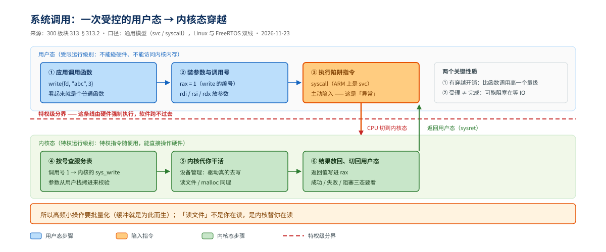
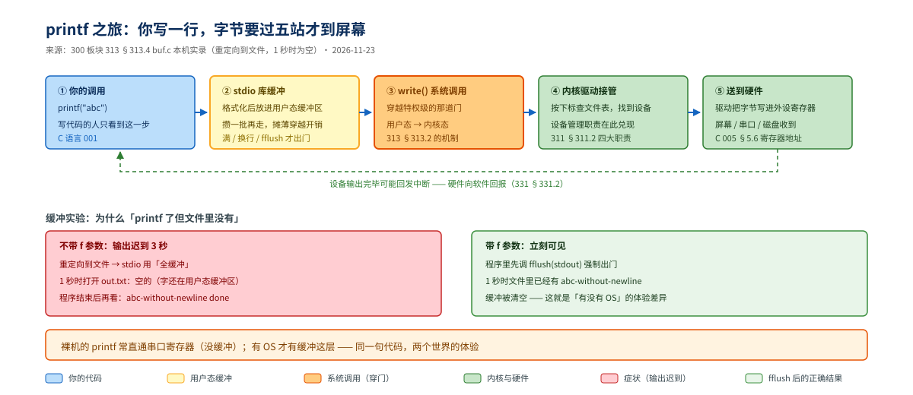

# 313 系统调用与用户态内核态

> **解决**：回答"应用想读文件、发网络包、申请内存，为什么不能自己动手，必须先敲一扇门"。这扇门叫系统调用，它同时也是"printf 为什么慢""为什么会有缓冲区"这些日常疑问的根。  
> **范围**：两个特权级 · 系统调用的穿越机制 · 穿越的代价与返回值三态 · printf 五站全链 · 缓冲实验（输出迟到 3 秒实录）。  
> **口径**：机制通用；实验在本机 Windows（MinGW-w64）实录；中断（硬件主动打断）归 331，本册只讲程序**主动**进内核。  
> **更新**：2026-11-23  
> **本册导读** ── 必会三点：① 用户态/内核态是硬件强制的两个运行级别 ② 系统调用 = 主动陷入的受控穿越，比函数调用贵一个量级 ③ printf 走五站才到硬件，缓冲区让输出"迟到" ｜ 跟做时长：约 2 小时 ｜ 前置：311（四大职责）、312（第一个进程）。  
> **标记**：★ = 必会节；○ = 拓展节。

## 目录

| 节 | 内容 |
|---|---|
| 313.1 | 两个特权级：应用为什么不能碰硬件 ★ |
| 313.2 | 系统调用：一次受控的穿越 ★ |
| 313.3 | 穿越的代价：比函数调用贵一个量级 ★ |
| 313.4 | printf 之旅：从库到硬件的五站 ★ |
| 313.5 | 实验：缓冲让输出迟到 3 秒 ★ |
| 313.6 | 坑表 |
| 313.7 | 检查清单（自测 6 题 + 动手任务 2 件） |

---

## 313.1 两个特权级：应用为什么不能碰硬件 ★

**定义**：CPU 提供至少两个运行级别——**用户态**（应用：不能执行特权指令、不能访问内核内存）与**内核态**（内核：特权指令随便用）。切换由硬件强制，应用无法自行提权。

**这条边界不是约定，是电路**：CPU 里有一个模式位，特权指令（改页表、关中断、直接访问设备寄存器）在该位为用户态时执行会触发异常，控制权被强制交给内核的异常处理程序。所以应用"想越权"这件事在硬件层面就失败了——这是「计算机体系结构」001 §1.1 那座抽象塔底下的"法律"。

**没有它会怎样**：一个程序的野指针（「C语言」005 §5.5）能踩碎任何别的程序乃至内核；一个程序死循环关掉中断，整机失去响应。有了它，越界的写操作被硬件拦住，越界行为变成一个异常，损失被限制在一个进程内。

**严重性差一个维度**：

| 出错位置 | 后果 | 损失范围 |
|---|---|---|
| 用户态 | 进程被内核终止（非法访问、除零） | 一个程序 |
| 内核态 | 系统崩溃 / 蓝屏 / panic | 一切进程与未保存的数据 |

**判据**：看到"非法访问内存"提示，先分清是**你的程序踩了别人的地址**（用户态，进程被杀），还是**你的驱动踩了内核地址**（内核态，整机挂）。两者现象相似，处理成本差一个数量级。

## 313.2 系统调用：一次受控的穿越 ★

**定义**：系统调用是用户程序请求内核服务的**正式通道**。它不是普通函数调用，而是一次**受控的**用户态 → 内核态穿越，完成后再回到用户态。

**机制（通用五步）**：

| 步 | 做什么 | 谁在做 |
|---|---|---|
| ① 备货 | 调用号与参数放进约定位置（寄存器 / 栈） | 应用（库函数代劳） |
| ② 敲门 | 执行陷入指令（x86 `syscall`/`int 0x80`、ARM `svc`） | 应用 |
| ③ 换台 | CPU 切内核态，按中断向量进内核入口，保存现场 | 硬件 + 内核 |
| ④ 办事 | 内核按调用号查表，执行对应服务；必要时阻塞等待 | 内核 |
| ⑤ 回程 | 结果放回寄存器，切回用户态，恢复现场 | 内核 + 硬件 |



**两个关键性质**：

1. **内核代你干活**——"读文件"是内核在读磁盘（设备管理），"`malloc` 要更多内存"是内核在记账划界（内存管理）——311 §311.2 的四条职责全部通过这扇门对外服务。**应用永远只是提需求，不直接动手**。
2. **受理 ≠ 完成**——调用可能阻塞（进程转阻塞态，321 §321.4），也可能失败。返回值通常有三态：成功（返回结果）、失败（返回 −1 并置 `errno`）、阻塞（挂起直到条件满足）。**只看"没崩"，等于没看返回值**。

**为什么必须"受控"**：如果允许应用自己切到内核态，隔离立刻失效（313.1）。所以入口只有一个、入口处的参数必须被内核检查（指针是否指向用户空间、长度是否合法）。这条检查是内核安全的第一道闸门——也是最容易被写错的地方。

## 313.3 穿越的代价：比函数调用贵一个量级 ★

**量级对照**（数量级概念，具体数值随 CPU 与内核版本变化）：

| 操作 | 大致开销 | 为什么 |
|---|---|---|
| 普通函数调用 | 几纳秒 | 只是压栈跳转，不换特权级 |
| 系统调用 | 数百纳秒 ~ 微秒 | 换特权级、保存/恢复现场、可能刷 TLB、内核入口检查 |
| 一次磁盘读 | 数十微秒 ~ 毫秒 | 真正的机械/闪存延迟，系统调用的开销在它面前可忽略 |

**结论一：小事别逐次走门**。逐字节调用 `write` 写文件，开销全在"过门"上；一次写 4 KB，过门次数少一千倍。**缓冲区就是为这个而生的**（313.4）——它不是"库函数偷懒"，是把多次过门合成一次。

**结论二：开销要看跟谁比**。系统调用比函数调用贵一个量级，但比一次磁盘 IO 便宜两个量级。所以优化顺序永远是：先减少 IO 次数，再谈减少系统调用次数，最后才谈函数级优化。

**观察与判断**：程序"CPU 不高但很慢"，常见两种——在等 IO（阻塞在系统调用里），或系统调用次数异常多（比如 trace 里同一调用刷屏）。**用 `strace`（Linux）/ ETW 或 Process Monitor（Windows）看调用序列，比猜快得多**。

## 313.4 printf 之旅：从库到硬件的五站 ★

**命题**：`printf` 看起来是一行代码，实际要经过五站才把字符送到屏幕或文件——每一站都可能成为"没输出"的原因。



| 站 | 在哪 | 做什么 | 出错/卡住的现象 |
|---|---|---|---|
| ① 格式化 | 用户态，`printf` 内部 | 把格式串与参数拼成字节流 | 格式符与参数类型不匹配 → 乱码或崩溃 |
| ② 缓冲 | 用户态，`FILE` 结构里的缓冲区 | 攒够再送（全缓冲/行缓冲） | 没刷新的字躺在缓冲区 → "没输出但程序没死"（313.5） |
| ③ `write` | 用户态 → 内核态，系统调用 | 把字节交给内核 | 返回值没看 → 部分写入被忽略 |
| ④ 内核驱动 | 内核态 | 字符设备驱动把字节送进设备队列 | 设备忙/队列满 → 阻塞 |
| ⑤ 硬件 | 设备 | 串口移位寄存器 / 显示子系统真正送出 | 波特率不对 → 乱码或丢字符 |

**读法**：排查"输出不对"时**从第⑤站倒着往上查**——先确认硬件真的收到了（示波器/串口助手），再看内核有没有报错，再看缓冲区刷没刷，最后才怀疑格式化。**从①往下查是最慢的路径**。

**裸机对照**：没有 OS 的 MCU 上，`printf` 常被重定向成"直接写串口数据寄存器"——没有②缓冲、没有③系统调用，**两站就到硬件**。这就是"有没有 OS"在体验上的最直接差别：同样的 `printf`，一边要多走三站。

## 313.5 实验：缓冲让输出迟到 3 秒 ★

**命题**：`printf` 的字符可能已经在缓冲区里，但还没到硬件。用"打印后忙等 3 秒"就能把它抓住。

**完整示例（`buf.c`）**——先打印一串**不带换行**的字，然后忙等 3 秒；带 `f` 参数则先 `fflush` 强制送出：

```c
#include <stdio.h>
#include <time.h>

int main(int argc, char **argv)
{
    printf("abc-without-newline");
    if (argc > 1 && argv[1][0] == 'f')
        fflush(stdout);            /* force it out now */
    clock_t start = clock();
    while ((clock() - start) < 3 * CLOCKS_PER_SEC) { }  /* busy wait 3s */
    printf(" done\n");
    return 0;
}
```

**跟做步骤**：

1. 编译：`gcc -Wall buf.c -o buf.exe`
2. 把输出**重定向到文件**再运行（PowerShell）：

```powershell
Start-Process .\buf.exe -RedirectStandardOutput out.txt
Get-Content out.txt        # 1 秒后立刻查看
```

**预期输出（本机实录）**：1 秒时 `out.txt` 是**空的**——字还在用户态缓冲区；等程序结束后再看：

```text
abc-without-newline done
```

3. 带 `f` 参数重跑（先 `fflush`）：1 秒时文件里**已经有** `abc-without-newline`——缓冲被强制清空了。

**机制解释**：输出到文件时 stdio 使用**全缓冲**——不到缓冲满、程序正常结束、或显式 `fflush` 就不送出门（第②站）。这就是"`printf` 没输出但程序没死"的病根。

**试一试**：把第一句改成 `printf("abc\n")`，不带参数重定向重跑——1 秒后有内容吗？**文件场景仍是全缓冲**（`\n` 只在终端场景触发行缓冲）。把两次观察记下来：同一个 `\n`，在终端和文件里的行为不同，这是"缓冲策略依赖输出目标"的直接证据。

## 313.6 坑表

| # | 现象 | 原因 | 解法 |
|---|---|---|---|
| 1 | printf 没输出但程序没死 | 全缓冲未刷新（313.5 实录） | `fflush` 或改终端输出；别用"等一会儿"解释 |
| 2 | 只看"没崩"不看返回值 | 系统调用失败返回 −1 并置 errno | 逐个检查返回值，尤其是 IO（313.3） |
| 3 | 以为系统调用就是普通函数 | 忽略特权级切换 | 它是唯一合法入口，开销高一个量级（313.2） |
| 4 | 逐字节写文件，程序极慢 | 过门次数太多 | 缓冲/批量，一次写一大块（313.3） |
| 5 | 用户态崩溃与内核崩溃混谈 | 严重性差一个维度 | 进程死 vs 整机挂（313.1） |
| 6 | 用非法指针调系统调用 | 内核要校验用户指针 | 参数必须在用户空间且合法（313.2） |

## 313.7 检查清单（自测 6 题 + 动手任务 2 件）

**自测**：

| # | 问题 | 自测标准 |
|---|---|---|
| 1 | 两个特权级差在哪 | 能不能执行特权指令、访问内核内存 |
| 2 | 系统调用五步 | 备货 → 敲门 → 换台 → 办事 → 回程 |
| 3 | 系统调用比函数调用贵多少 | 一个量级；原因是换特权级与现场保存 |
| 4 | printf 五站 | 格式化 → 缓冲 → write → 驱动 → 硬件 |
| 5 | 缓冲实验说明了什么 | 全缓冲下输出迟到；fflush 强制出门 |
| 6 | 为什么缓冲区不是"偷懒" | 把多次过门合成一次，省的是切换开销 |

**动手任务**：① 复现 `buf.c` 的两种模式（不带 `f` / 带 `f`），把 1 秒时与结束后的文件内容各记一行；② 把第一句改成 `printf("abc\n")` 再重定向跑一次，写下"终端 vs 文件"两次行为的差异，并解释为什么。

> 下一篇：《321 进程模型与三态》——穿越这件事发生在谁身上？先弄清"进程"这个被内核管理的单位。
