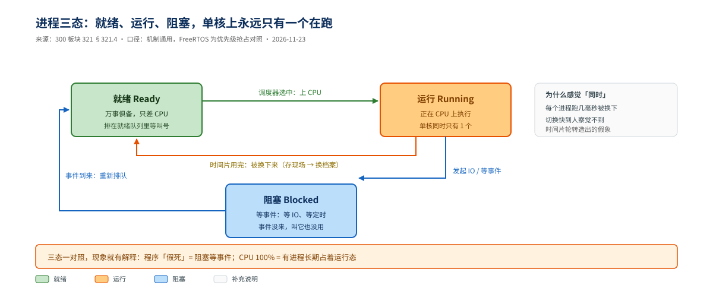

# 321 进程模型与三态

> **解决**：回答"程序怎么变成被调度、被隔离的运行实体"。进程隔离在本机当场可见（两个记事本两个 PID），三态模型与时间片解释了"单核为什么看起来同时在跑"。  
> **范围**：程序 vs 进程 · PCB 记什么 · 虚拟地址空间 · 三态与时间片 · 常见现象的归因表。线程与竞态不在本册，分别归 322 / 323。  
> **口径**：概念通用；观察实验在本机 Windows 实录，Linux 侧给等价命令。  
> **更新**：2026-11-23  
> **本册导读** ── 必会三点：① 程序是文件、进程是一次运行（两记事本两 PID 实录）② PCB 是内核给进程记的档案，"切换"就是换档案 ③ 三态之外没有第四种状态 ｜ 跟做时长：约 1.5 小时 ｜ 前置：311（四大职责）、313（系统调用）。  
> **标记**：★ = 必会节；○ = 拓展节。

## 目录

| 节 | 内容 |
|---|---|
| 321.1 | 程序是文件，进程是一次运行 ★ |
| 321.2 | PCB：内核给每个进程记的档案 ★ |
| 321.3 | 虚拟地址空间：每个进程独占的假象 ★ |
| 321.4 | 三态与时间片：谁下一个上 CPU ★ |
| 321.5 | 观察与判断：假死、满载、卡一下 ★ |
| 321.6 | 坑表 |
| 321.7 | 检查清单（自测 6 题 + 动手任务 2 件） |

---

## 321.1 程序是文件，进程是一次运行 ★

**定义**：**程序**是磁盘上的文件（代码 + 数据的静态组合，`.exe`/ELF）；**进程是程序的一次运行**——代码被加载进内存、占着资源、处在某个执行状态。同一个程序可以同时开多个进程，互不干扰。

**三处差异**（这张表能解决大部分"程序/进程"混淆）：

| 维度 | 程序 | 进程 |
|---|---|---|
| 存在形式 | 磁盘上的文件 | 内存里的运行实体 |
| 数量关系 | 一个文件一份 | 一个程序可以同时有多个进程 |
| 有生命周期吗 | 没有，放着就在 | 有，创建到退出 |
| 占有资源吗 | 只占磁盘空间 | 占内存、CPU 时间、文件句柄、设备 |

**完整示例（跟做）**：① 从开始菜单连开两个记事本；② 终端执行：

```powershell
tasklist | findstr /i notepad
```

**预期输出（本机实录）**：

```text
Notepad.exe                  76292 Console                    1     15,108 K
Notepad.exe                  77296 Console                    1    100,364 K
```

**读法**：同一个程序（`notepad.exe`）出现**两次**、两个不同 PID（76292 / 77296）、各自独立的内存占用——"程序是文件、进程是运行"的实证。内存一栏还不一样（15 MB vs 100 MB），因为一个空文档、一个开着大文件。

**试一试**：`taskkill /IM notepad.exe /F` 杀掉全部；再只关掉其中一个窗口，`tasklist` 里对应 PID 的行消失、另一个安然无恙——这就是"进程隔离"的直观体验。

## 321.2 PCB：内核给每个进程记的档案 ★

**定义**：内核为每个进程维护一份**进程控制块**（PCB，Process Control Block）。它是进程在内核里的"户口本"——进程本身是内存里跑着的代码和数据，PCB 是内核用来**管理它**的那份记录。

**档案里记什么**：

| 字段 | 存的是什么 | 有什么用 |
|---|---|---|
| PID / PPID | 进程号 / 父进程号 | 唯一标识；倒着画启动链就靠 PPID（312 §312.3） |
| 状态 | 就绪 / 运行 / 阻塞 | 调度器据此选谁上 CPU（321.4） |
| 寄存器现场 | PC、SP、通用寄存器快照 | 切走时存、切回时恢复——"切换"的实质 |
| 地址空间表 | 页表基址、内存区域划分 | 决定这个进程能看见哪些地址（321.3） |
| 打开的文件表 | 文件描述符 → 文件的映射 | `close` 忘写会泄漏的根源（「C语言」006） |
| 优先级与记账 | 优先级、已用 CPU 时间 | 调度与统计（332） |

**切换进程 = 存现场 → 换档案 → 恢复现场**。三句话里最贵的是第一和第三步：寄存器要一个个存、页表要换（可能刷 TLB）。这就是"上下文切换开销"的来源，也是 321.4 里"任务不是越多越好"的原因。

**为什么进程会"卡死而不能被强杀"**：如果进程阻塞在内核态（比如等一个坏掉的设备返回），它可能不响应普通信号——因为信号要等它回到用户态才能被处理。这类现象常被误以为是"系统坏了"，实际是"进程卡在系统调用里"（313 §313.2）。

## 321.3 虚拟地址空间：每个进程独占的假象 ★

**定义**：**虚拟地址空间**是内核与 MMU（内存管理单元）联手为每个进程伪造的一套"整块内存都归我"的假象。进程里的地址都是虚拟地址，由硬件在每次访问时翻译成物理地址。

**它同时解决三个问题**：

| 问题 | 没有虚拟地址会怎样 | 有了虚拟地址 |
|---|---|---|
| 隔离 | 一个进程能直接读写别人的内存 | 每个进程的地址空间互不可见 |
| 装载 | 程序必须被放到固定物理地址 | 可以放到任意物理位置，地址在页表里映射 |
| 超额使用 | 物理内存装不下就开不了 | 不常用的页换到磁盘（交换），按需调入 |

**与内存四区的关系**：「C语言」005 §5.4 讲的栈、堆、全局区、代码区，在进程视角下就是**同一个虚拟地址空间里的四段**。地址连续是虚拟地址的连续性，物理上可能东一块西一块——这正是"地址是假的"那句直觉的落点。

**两个可观察的推论**：

1. 同一程序两次运行，某个变量的地址可能相同（虚拟地址一样），但物理位置不同——**打印地址看到的是虚拟地址**，不能据此判断"是否同一块物理内存"。
2. 进程间"共享内存"（322 §322.4）必须由内核把同一块物理页映射到两个地址空间里，**否则永远看不到对方**。

## 321.4 三态与时间片：谁下一个上 CPU ★

**三态模型**（一个进程在任意时刻只处在其中一种状态）：

| 状态 | 含义 | 怎么离开 |
|---|---|---|
| 就绪 | 万事俱备，只差 CPU | 被调度器选中 → 运行 |
| 运行 | 正在 CPU 上执行 | 时间片用完 → 就绪；等事件 → 阻塞；结束 → 退出 |
| 阻塞 | 在等某个事件（IO 完成、锁、定时） | 事件发生 → 就绪 |



**两条最容易错的转移**：**阻塞不能直接变运行**（事件来了要先回就绪排队，等调度器选中），**就绪也不能直接变阻塞**（还没跑起来，怎么会等事件）。

**时间片与"同时感"**：单核上任意时刻只有一个进程在运行。"同时开着十个程序"的观感来自**时间片轮转**——每个进程跑几毫秒被换下，切换足够快，人眼分辨不出。**上下文切换**（321.2 的存现场/换档案/恢复）本身是纯开销：切换期间没有任何有用工作在进行。

**由此推出一条实操纪律**：**任务数明显多于核数时，切换开销会吃掉收益**。这条纪律在 332 会用调度算法展开，在 323 会以"锁竞争"的形态再出现一次。

## 321.5 观察与判断：假死、满载、卡一下 ★

三个最常见的现象，各有唯一的归因方向：

| 现象 | 机制解释 | 怎么确认 |
|---|---|---|
| 程序"假死"但没退出 | 阻塞在等某个事件（IO / 锁 / 网络） | 任务管理器里 CPU 占用接近 0，内存不动 |
| 某核 100% 长期不降 | 有进程长期处在运行态（死循环、忙等） | 看是哪个进程，再看它在等什么 |
| 系统"卡一下"又恢复 | 上下文切换或调度延迟：某个高优先级任务插队，或页被换出后重新调入 | 卡顿时看磁盘活动；频繁卡顿查内存压力 |

**判据（三条一句话）**：

- **CPU 高 + 内存稳** → 计算问题，看算法与循环。
- **CPU 低 + 内存涨** → 泄漏或缓存无上限（「C语言」006）。
- **CPU 低 + 内存稳 + 不响应** → 阻塞在 IO 或锁上，查系统调用与锁持有者（313 §313.3）。

**Linux 侧等价观察**：`ps aux`（看状态列 `R/S/D`，`D` 是不可中断的阻塞，最像"假死"）、`top`（按 1 看每核）、`vmstat 1`（看 `r` 运行队列长度与 `si/so` 换页）。

## 321.6 坑表

| # | 现象 | 原因 | 解法 |
|---|---|---|---|
| 1 | 说"程序在跑"但不区分文件与进程 | 概念没分开 | 两记事本两 PID 实验（321.1） |
| 2 | 以为进程切换不花钱 | 忽略存现场与换页表 | 任务数 ≈ 核数附近（321.4） |
| 3 | 打印地址相同就认为物理内存相同 | 看到的是虚拟地址 | 虚拟地址可复用，物理页不同（321.3） |
| 4 | 阻塞态画成能直接回运行 | 三态转移没记清 | 阻塞 → 就绪 → 运行（321.4） |
| 5 | 进程卡死就断定系统坏了 | 可能阻塞在内核态 | 看状态列（`D`）与系统调用（321.2） |
| 6 | 用 `kill -9` 解决一切 | 强杀不释放已占的内核资源 | 先查它在等什么，再决定 |

## 321.7 检查清单（自测 6 题 + 动手任务 2 件）

**自测**：

| # | 问题 | 自测标准 |
|---|---|---|
| 1 | 程序与进程的差别 | 文件 vs 一次运行（两记事本两 PID） |
| 2 | PCB 记哪几类信息 | 标识、状态、现场、地址空间、文件表、优先级 |
| 3 | 切换的三步 | 存现场 → 换档案 → 恢复现场 |
| 4 | 虚拟地址空间解决什么 | 隔离、装载位置自由、按需换入 |
| 5 | 三态之间哪些转移不合法 | 阻塞→运行、就绪→阻塞 |
| 6 | CPU 低内存稳但不响应，往哪查 | 阻塞在 IO 或锁（321.5） |

**动手任务**：① 复现两记事本两 PID 实验，记下两个 PID 与内存占用，再只关掉一个，验证另一个不受影响；② 用 `wmic process get name,processid,parentprocessid,workingsetsize` 导出前 20 行，找出父进程为 0 或系统进程的那个，写出你的判断。

> 下一篇：《322 线程与共享地址空间》——进程内部还能再分执行流，好处与风险都来自"共享"。
