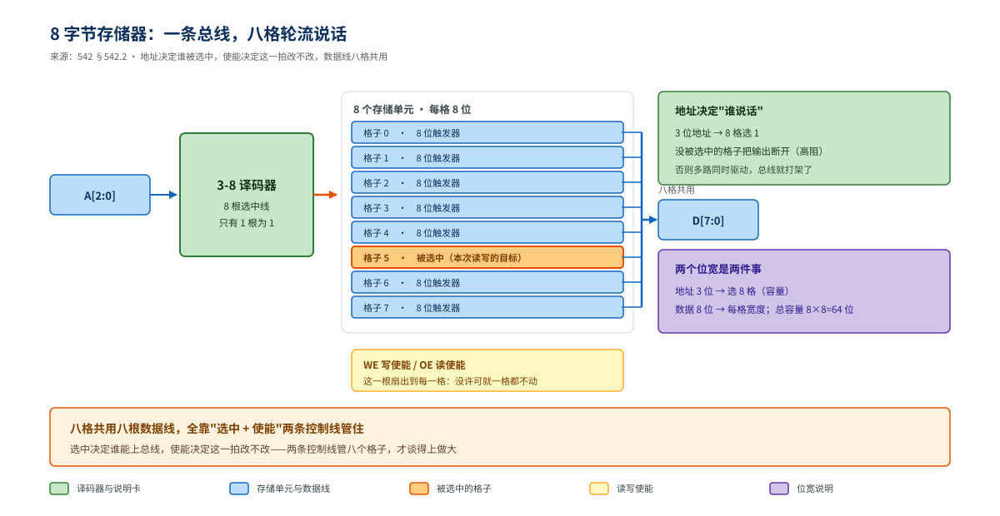

# 542 存储器阵列与读写不对称

> **解决**：541 讲清了"地址怎么选中一块芯片、选中之后按什么顺序打卡"，但没讲格子在芯片内部怎么排。这一册把 8 个格子排成阵列，看清字线与位线的分工，再回答一个反复被问的问题：**读和写明明是同一个格子，为什么待遇差这么多**。  
> **范围**：一排格子 → 行列阵列 · 字线与位线 · 8 字节存储器的完整搭法 · 读与写的不对称 · 容量怎么算（地址位 × 数据位）· RAM 与 EEPROM 的差别。  
> **口径**：以 3 位地址、8 位数据的 8 字节存储器为例；素材里的器件是 EEPROM 模型，本册只讲结构与读写差异，不展开擦写工艺（归 600 外设）。程序沿用 `mem.c`。  
> **更新**：2026-11-23  
> **本册导读** ── 必会三点：① 阵列用"行选 + 列传"把 N 个格子压成 √N + N 根线 ② 8 字节存储器 = 译码器 + 8 个寄存器 + 使能门 + 共用总线 ③ 读是"看"，写是"改"，改要许可、要等、还可能限次 ｜ 跟做时长：约 40 分钟（跑 `mem.c` 第三段 + 算一次容量） ｜ 前置：541（地址片选与读写时序）、533（寄存器）。  
> **标记**：★ = 必会节；○ = 拓展节。

## 目录

| 节 | 内容 |
|---|---|
| 542.1 | 从一排格子到行列阵列 ★ |
| 542.2 | 8 字节存储器怎么搭起来 ★ |
| 542.3 | 读与写为什么不对称 ★ |
| 542.4 | 容量怎么算：地址位 × 数据位 ○ |
| 542.5 | RAM 与 EEPROM：同样是存储器，差别在哪 ○ |
| 542.6 | 坑表 |
| 542.7 | 检查清单（自测 6 题 + 动手任务 2 件） |

---

## 542.1 从一排格子到行列阵列 ★

**最朴素的做法是一排格子配一根选中线**：8 个格子，8 根线，译码器选中哪根，哪个格子就被激活。8 个格子没问题，8192 个格子就是 8192 根线——**芯片的引脚和面积都不可能承受**。

**解法是把一维排成二维**：格子摆成 `行 × 列` 的阵列，用**行号选一行、列号选一列**，交点就是目标格子。

```text
            列 0    列 1    列 2    列 3
          ┌───────┬───────┬───────┬───────┐
   行 0   │  格   │  格   │  格   │  格   │
          ├───────┼───────┼───────┼───────┤
   行 1   │  格   │  格   │  格   │  格   │
          ├───────┼───────┼───────┼───────┤
   行 2   │  格   │  格   │  格   │  格   │
          └───────┴───────┴───────┴───────┘
```

**线数从 N 降到 √N + √N**：64 个格子，一行排需要 64 根选中线；排成 8×8 只需要 8 根行线 + 8 根列线 = 16 根。**这就是"为什么存储器都是二维阵列"的全部理由**，不是审美偏好。

**两根线的分工完全不同**：

| 线 | 名字 | 作用 | 特性 |
|---|---|---|---|
| 行线 | 字线（Word Line） | 选中一整行，把这行的格子全部"打开" | 每行一根，由行译码器驱动 |
| 列线 | 位线（Bit Line） | 把被选中格子的数据传进传出 | 每列一根，**所有行共用** |

**"整行被打开、只有一列被读"是理解阵列的关键**：字线一拉高，那一行所有的格子都连到位线上了；但只有被列选择器接通的那一根位线，数据才会被送到输出。**所以阵列的读出本质是"先整行打开，再按列筛一个"**。

**这也解释了一个常见结构**：真实存储器的"一行"往往对应一个**字**（比如 8 位、16 位），不是一位。一行存 8 位，就是一个字宽 8 位、共若干字的存储器——**"行"的宽度就是数据位宽**，这是 542.2 要用的对应关系。

## 542.2 8 字节存储器怎么搭起来 ★

**结构 = 行译码器 + 8 个存储单元 + 写使能门 + 共用数据总线**。



**每一格内部就是一个 8 位寄存器**（533 §533.1：8 个触发器并排）。行译码器给出的那根选中线，就是这一格的写使能——**被选中的格子才可能被写，没被选中的一律冻结**。

**"8 字节"的准确说法**：8 个存储单元 × 每单元 8 位 = 64 位总容量。**地址位数由"格子数"决定（3 位选 8 格），数据位数由"每格多宽"决定（8 位）**——这两个位宽是独立的两件事，混起来就会算错容量。

**完整示例**（`mem.c` 段三：往 8 个格子里写一组数，再整片读出）：

```c
for (int a = 0; a < 8; a++)
    if (a > 1) mem_write(a, (unsigned char)(a * 3), 1);

printf("地址:");
for (int a = 0; a < 8; a++) printf("%4d", a);
printf("\n数据:");
for (int a = 0; a < 8; a++) printf("%4u", mem_read(a, 1));
printf("\n");
```

**预期输出**（本机实测，段三）：

```text
== 段三：整片读出 ==
地址:   0   1   2   3   4   5   6   7
数据:  13  99   6   9  12  15  18  21
```

**逐格核对一遍就能看出阵列的行为**：地址 0 是 13、地址 1 是 99（前两段写进去的），地址 2~7 是 `a × 3` 得到的 6、9、12、15、18、21。**地址 0 和 1 的值没被覆盖**，因为这次循环从 `a > 1` 开始——**没被选中写的格子，内容一律保留**。

**"共用数据总线"是省线的另一半**：8 个格子共用同一组 8 根数据线，**只有被选中的那一格才允许驱动它**。地址决定"谁说话"，使能决定"准不准说"——两条控制线管住 8 个格子，这是存储器能做大的原因。

**跟做步骤**：若已按 541 建好 `mem.c`，直接跑第三段；否则新建 `mem.c` 抄入册末附录 → `gcc -Wall mem.c -o memdemo.exe` → `./memdemo.exe`。

**试一试**：把 `if (a > 1)` 改成 `if (a != 4)`，再跑。地址 4 的 12 会消失（变回占位的 0），其余不变。**"跳过一个地址"在阵列里就是"那一行的字线没被拉高"**——现象不同，机制相同。

## 542.3 读与写为什么不对称 ★

**同一个格子，读和写的待遇差得很远**。这不是设计者偷懒，是物理决定的：

| 维度 | 读 | 写 |
|---|---|---|
| 是否改变内容 | 不改 | **改**，且改错不可逆 |
| 需要哪根使能 | 输出使能 OE（把数据放上总线） | 写使能 WE（允许改动） |
| 不使能时的行为 | 输出高阻（让开总线） | 内容保持不动 |
| 出错后果 | 读到旧值或高阻假值 | 数据被覆盖，可能永久丢失 |
| 速度 | 快（纳秒级） | 慢（RAM 纳秒级，EEPROM 毫秒级） |
| 次数限制 | 无 | EEPROM / Flash 有擦写寿命 |

**一句话原则**：**"会改变状态的操作"必须显式许可，"只观察的操作"可以默认允许但要防冲突。** 这句话不只适用于存储器——GPIO 的方向寄存器、外设的使能位、DMA 的启动位，全是同一套逻辑（600 板块会反复见到）。

**为什么写一定更慢**：读是把已有的电平"看出来"，几乎不消耗什么；写要把一个单元从当前状态**翻转**成另一个状态，涉及电荷的注入或抽走。**翻转需要能量，注入需要时间**——所以写的物理成本天生高于读。

**EEPROM 为什么慢得离谱而且是有限次**：它的写入靠**在氧化层里"打进/抽出"电荷**，这个过程要高压（芯片内部升压）、要时间（毫秒级），而且每次穿越都会轻微损伤氧化层，**所以寿命以万次计**。RAM 靠触发器锁存电荷，速度快、无磨损，但掉电就丢。**"掉电不丢"和"写得快、能无限写"这两个优点，在物理上是互斥的。**

**读的坑反而更隐蔽**：写错了立刻能发现（读回来不对），读错了却常常被当成"数据本来就是坏的"。**541 §541.4 那个"oe=0 读回 255"** 就是典型——高阻被当成有效值用下去，一路错到很后面才暴露。

## 542.4 容量怎么算：地址位 × 数据位 ○

**容量的两个乘数，各自由不同东西决定**：

```text
总容量（位） = 2^(地址位数) × 数据位宽
```

| 地址位 | 数据位 | 格子数 | 总容量 | 常见叫法 |
|---|---|---|---|---|
| 3 | 8 | 8 | 64 位 = 8 字节 | 8×8 小阵列（本册例题） |
| 10 | 8 | 1024 | 8192 位 = 1 KB | 1K×8 |
| 13 | 8 | 8192 | 64 Kb = 8 KB | 8K×8 |
| 20 | 8 | 1048576 | 8 Mb = 1 MB | 1M×8 |

**"1K×8"这种写法要会读**：斜杠前是格子数，斜杠后是每格位宽。**两个数字相乘才是总容量**，只看其中一个必然算错。

**为什么容量总是 2 的幂**：地址位数每多一位，可寻址的格子数就翻一倍——**这是地址线是二进制信号直接导致的**，不是厂商定的规格。所以"内存条 8GB 而不是 10GB"的根源在地址线，不在市场策略。

**地址位与数据位的独立性的实际意义**：同样 64 Kb 的芯片，可以做成 `8K×8`（地址多、数据窄），也可以做成 `4K×16`（地址少、数据宽）。**选型时要看系统总线宽度**——8 位 CPU 配 `8K×8` 更顺，16 位 CPU 用 `4K×16` 可以一次读完一个字。

## 542.5 RAM 与 EEPROM：同样是存储器，差别在哪 ○

| 维度 | RAM（SRAM / DRAM） | EEPROM / Flash |
|---|---|---|
| 掉电后 | 内容丢失 | **保留** |
| 写入速度 | 纳秒级 | 毫秒级（要擦除 + 编程） |
| 擦写次数 | 无限 | 有限（万~十万次量级） |
| 单元结构 | 触发器（SRAM）或电容（DRAM） | 浮栅晶体管 |
| 典型用途 | 运行时的变量、栈、堆 | 参数、标定值、固件 |

**素材里的八字节存储器是 EEPROM 模型**，所以它"掉电不丢"——这也是为什么它可以放心地当作"参数区"来用。**代价在写入侧**：真实 EEPROM 的写不是一次就完，要按页擦、按时序等，写完还要轮询"忙"标志。

**一个必须知道的工程结论**：**不要把频繁变化的数据放进 EEPROM**。计数器、日志这类每秒钟写很多次的东西，放在 EEPROM 里会很快把寿命写穿。**分区存放**——常变的放 RAM，偶变的放 EEPROM，这是嵌入式存储设计的第一条纪律。

**具体工艺（浮栅怎么存电荷、页擦除怎么组织）归 600 外设**，本册只需建立"两类存储器不是一回事"的认知，以及"选型先看掉电要不要保留"这个判断顺序。

## 542.6 坑表

| # | 现象 | 原因 | 解法 |
|---|---|---|---|
| 1 | 容量算错，少了一半或多了 8 倍 | 把"格子数"与"每格位宽"混为一谈 | 总容量 = 2^地址位 × 数据位（§542.4） |
| 2 | 写一个格子，别的格子也变了 | 行选没做唯一，多行同时被打开 | 行译码器必须只选中一行（§542.1） |
| 3 | 读出的值来自别的格子 | 列选择接错，或地址位序反了 | 核对行/列地址的位序（§542.1） |
| 4 | 高频写 EEPROM 后芯片失效 | 擦写寿命耗尽 | 常变数据放 RAM，EEPROM 只存参数（§542.5） |
| 5 | 掉电后参数全丢 | 用了 RAM 存配置 | 需要掉电保留的必须用 EEPROM / Flash（§542.5） |
| 6 | 以为"写和读差不多快" | 写的物理成本天生更高 | 写要等、要限次，读不用（§542.3） |
| 7 | 读回固定值 0xFF 就当数据用 | 总线高阻被当成有效值 | 先确认 OE/CS 有效（541 §541.4） |

## 542.7 检查清单（自测 6 题 + 动手任务 2 件）

**自测**：

| # | 问题 | 自测标准 |
|---|---|---|
| 1 | 为什么存储器排成二维阵列 | 线数从 N 降到 √N + √N，引脚与面积才受得了（§542.1） |
| 2 | 字线与位线各管什么 | 字线选中一整行，位线传该行的数据（§542.1） |
| 3 | 8 字节存储器由哪四部分组成 | 行译码器 + 8 个寄存器单元 + 写使能门 + 共用数据总线（§542.2） |
| 4 | 读与写最根本的差别 | 读不改内容，写改变且不可逆，故需许可、要能量、可能限次（§542.3） |
| 5 | 容量怎么算 | 2^地址位数 × 数据位宽，两个乘数独立（§542.4） |
| 6 | 为什么不能把频繁写的数据放 EEPROM | 擦写次数有限，会写穿寿命（§542.5） |

**动手任务**：

1. **跑通 `mem.c`**，产出段三的整片读出表；并说明地址 0、1 为什么保留了前两段写入的值。
2. **算三次容量**：分别给出 `3×8`、`10×8`、`13×8` 三种规格的总容量（位与字节都写），并说明"地址位翻一倍，容量翻几倍"。

## 附：`mem.c` 完整源码

与 541 附录为同一份文件，此处重复列出，便于单独打开本册时直接跟做。

```c
#include <stdio.h>

/* 3-8 译码器：3 位地址进，8 路选出 1 路（其余全 0） */
static void decode38(int addr, int out[8])
{
    for (int i = 0; i < 8; i++)
        out[i] = (i == (addr & 0x7)) ? 1 : 0;
}

/* 8 字节存储器：地址 3 位、数据 8 位、写使能 WE 1 位 */
static unsigned char mem[8];

static void mem_write(int addr, unsigned char data, int we)
{
    if (we)
        mem[addr & 0x7] = data;
}

static unsigned char mem_read(int addr, int oe)
{
    if (!oe)
        return 0xFF;              /* OE=0：输出高阻，本模拟用 0xFF 表示"没驱动" */
    return mem[addr & 0x7];
}

int main(void)
{
    printf("== 段一：地址分两段——片选 + 片内偏移 ==\n");
    /* 6 位地址：高 3 位选片、低 3 位片内偏移；这里演示片内译码 */
    int out[8];
    printf("片内地址  选中线（8 路只有 1 路为 1）\n");
    for (int a = 0; a < 8; a++) {
        decode38(a, out);
        printf("   %d      ", a);
        for (int i = 0; i < 8; i++) printf("%d ", out[i]);
        printf("\n");
    }

    printf("\n== 段二：we 是硬门，oe 是闸门 ==\n");
    mem_write(0, 13, 1);
    printf("写 [0]=13 we=1 → 读回 %u\n", mem_read(0, 1));
    mem_write(1, 99, 0);
    printf("写 [1]=99 we=0 → 读回 %u（写入被拒）\n", mem_read(1, 1));
    mem_write(1, 99, 1);
    printf("写 [1]=99 we=1 → 读回 %u\n", mem_read(1, 1));
    printf("读 [1] oe=0   → 读回 %u（高阻，不可信）\n", mem_read(1, 0));

    printf("\n== 段三：整片读出 ==\n");
    for (int a = 0; a < 8; a++)
        if (a > 1) mem_write(a, (unsigned char)(a * 3), 1);
    printf("地址:");
    for (int a = 0; a < 8; a++) printf("%4d", a);
    printf("\n数据:");
    for (int a = 0; a < 8; a++) printf("%4u", mem_read(a, 1));
    printf("\n");
    return 0;
}
```

> 下一篇：《551 冯诺依曼五部件与数据通路》——运算器、寄存器、存储器三样零件都齐了，下一册开始把它们接成一台能跑程序的机器。
