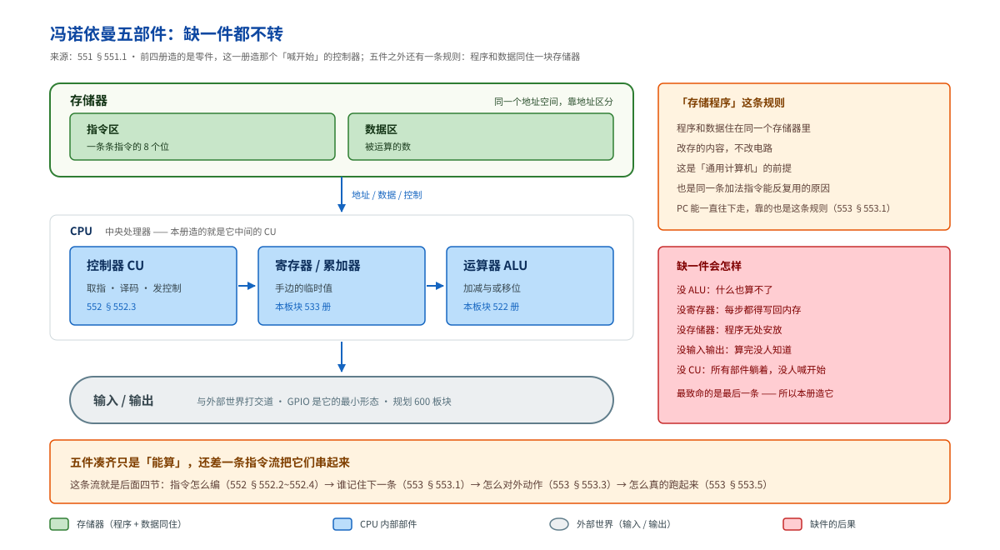

# 551 冯诺依曼五部件与数据通路

> **解决**：前面四个模块造的都是零件——门、加法器、寄存器、存储器。零件不会自己动。这一册先回答"一台计算机由哪五件东西组成、少一件会怎样"，再回答一条比五件东西更重要的规则：**程序和数据为什么住在同一个存储器里**。  
> **范围**：五部件及其分工 · 存储程序规则 · 冯诺依曼瓶颈 · 哈佛结构对比 · 五部件在本板块的落点。  
> **口径**：以 8 位机的最小形态讲；只讲结构与分工，不展开流水线、乱序、多级缓存（归「002 计算机体系结构」）。  
> **更新**：2026-11-23  
> **本册导读** ── 必会三点：① 五部件是运算器、寄存器、存储器、控制器、输入输出 ② "存储程序"意味着改内容不改电路 ③ 指令和数据共用一条通路，就有了冯诺依曼瓶颈 ｜ 跟做时长：约 30 分钟（读图 + 做一次部件归位练习） ｜ 前置：542（存储器阵列）；建议已读完 511~533。  
> **标记**：★ = 必会节；○ = 拓展节。

## 目录

| 节 | 内容 |
|---|---|
| 551.1 | 五部件：一台机器缺哪件都不转 ★ |
| 551.2 | 存储程序：比五个部件更重要的一条规则 ★ |
| 551.3 | 冯诺依曼瓶颈：共用一条通路的代价 ○ |
| 551.4 | 哈佛结构：MCU 为什么常走另一条路 ○ |
| 551.5 | 五部件在本板块的落点 ★ |
| 551.6 | 坑表 |
| 551.7 | 检查清单（自测 6 题 + 动手任务 2 件） |

---

## 551.1 五部件：一台机器缺哪件都不转 ★

**冯诺依曼模型把计算机拆成五件东西**，每件负责一件不能替代的事。



| # | 部件 | 干什么 | 一句话判据 |
|---|---|---|---|
| 1 | 运算器（ALU） | 加减与或移位 | 谁在改变数值 |
| 2 | 寄存器 / 累加器 | 手边的临时值 | 谁在"握着"当前的操作数 |
| 3 | 存储器 | 存指令，也存数据 | 谁在按地址存取 |
| 4 | 控制器（CU） | 取指、译码、发控制信号 | 谁在决定"下一步做什么" |
| 5 | 输入 / 输出 | 与外部世界交换 | 谁在跟芯片之外打交道 |

**逐件看"缺了会怎样"**，比背五个名词有用：

| 缺哪件 | 后果 | 为什么不能替代 |
|---|---|---|
| 缺 ALU | 什么都算不了 | 移位、比较、加减最后都归到 ALU 的运算路 |
| 缺寄存器 | 每步结果都要写回存储器 | 存储器一拍只能读一个值，做两个数的运算就得跑两趟，速度掉一个数量级 |
| 缺存储器 | 程序无处安放，每次换任务都要改电路 | 没有"存起来"这件事，就没有"通用计算机" |
| 缺控制器 | 所有部件都躺着，没人喊开始 | ALU 不会自己去总线上取数，寄存器的 we 也不会自己拉高 |
| 缺 I/O | 算完的结果出不去，外部信号进不来 | 一台只跟自己玩的机器没有用途 |

**最容易被低估的是控制器**：前四件从 511 到 542 都造出来了，每一件都能单独演示；只有 CU 是"什么都不生产、只管发号施令"的那一个。**它不改变数据，它只改变别的部件"准不准动"**——这正是 541 §541.2 里 CS / OE / WE 那套"点名与许可"的放大版。

**五件东西的关系可以压成一句话**：寄存器握数据，ALU 算数据，存储器存数据，CU 决定数据在这一拍往哪走，I/O 让数据进出这个闭环。

## 551.2 存储程序：比五个部件更重要的一条规则 ★

**冯诺依曼模型的核心不是"分成五件"，而是这五件按一条规则组织**：

> **程序和数据存在同一个存储器里，用同一套地址访问。**

**这条规则带来的能力**：想换一台机器干的事，**不需要改电路，只需要改存储器里的内容**。计算器换成计算器，是换芯片；计算机能算账也能放电影，是换程序。**通用计算机的"通用"二字，全部来自这一条**。

**它在硬件上意味着什么**：存储器里存的既可能是 `01000001`（一条加法指令），也可能是 `01000001`（数值 65）。**同一串位，两种身份，区别只在于这一拍它被送到 CU 还是送到 ALU**。

**这条规则的历史分量**：在它之前，计算设备（比如差分机、插线板式计算机）要"编程"就得重新接线。**把程序变成数据，才让"软件"这个东西存在**——今天你说"装个软件"，本质是往存储器里写一串位。

**它的直接代价**：既然指令和数据住在一起、走同一条总线，那取指令和取数据就要**排队**。这个代价就是下一节的冯诺依曼瓶颈。

## 551.3 冯诺依曼瓶颈：共用一条通路的代价 ○

**指令和数据共用一条通路，就必须分时使用**：这一拍取指令，就不能同时读数据。

```text
        ┌──────────────┐
        │   存储器      │  指令与数据混住
        └──────┬───────┘
               │  ← 一条通路，两种货
        ┌──────┴───────┐
        │  CU  /  ALU   │
        └──────────────┘
```

**后果是性能被这条通路卡住**：不管 CPU 算得多快，每拍只能从存储器搬一样东西进来。**这就是"冯诺依曼瓶颈"**——CPU 的处理能力与存储器的供给能力之间那道固定的窄口。

**工程上的三种缓解手段**（都只是缓解，不是消除）：

| 手段 | 做法 | 效果 |
|---|---|---|
| 缓存（Cache） | 在 CPU 旁放一小块快存储器，装最近用过的数据 | 大部分访问命中缓存，不用走窄口 |
| 预取 | 提前把下一条指令搬进来 | 把等待藏在计算背后 |
| 哈佛结构 | 指令和数据各走一条通路 | 从结构上绕开窄口（下节） |

**本库的边界**：只需要建立"共用一条通路 → 有瓶颈 → 有缓解手段"这条因果链。缓存一致性、预取策略、流水线冒险，都属于「002 计算机体系结构」与数字设计的范畴。

## 551.4 哈佛结构：MCU 为什么常走另一条路 ○

**哈佛结构把指令存储器和数据存储器分开**，各自有独立的地址空间和通路。**取指令和读数据可以同时发生**，窄口从结构上消失。

| 维度 | 冯诺依曼结构 | 哈佛结构 |
|---|---|---|
| 存储器 | 指令与数据合一 | 指令与数据分开 |
| 通路 | 一条，分时使用 | 两条，可并行 |
| 瓶颈 | 有（冯诺依曼瓶颈） | 结构上没有 |
| 灵活性 | 可以把数据当指令执行（自修改代码） | 一般不允许，安全性更好 |
| 典型场合 | 通用 CPU（PC、服务器） | MCU、DSP（多数嵌入式芯片） |

**为什么 MCU 偏爱哈佛结构**：单片机不用跑操作系统、不需要"把数据当指令执行"这种灵活性，但对**确定性**和**成本**敏感。分开两条通路，取指和数据访问互不干扰，时序好算，中断响应也更可预测。

**"51 单片机是哈佛结构"这件事的实际意义**：它的程序存储器（Flash）和数据存储器（RAM）是两套地址空间，`MOVC`（读程序存储器）和 `MOVX`（读外部数据）是不同指令——**你在 PC 上习惯的"指针可以指向任何地方"，在 51 上不成立**。这是从 PC 转到 MCU 时最容易踩的认知坑。

**本板块造的这台机器是冯诺依曼式的**（553 的 `cpu.c` 里指令和数据都在 `dmem` 与程序数组里共用一套思路），**因为它的目的是让结构清楚，不是追求性能**。真实 MCU 请按哈佛结构理解。

## 551.5 五部件在本板块的落点 ★

**这张表是本模块的目录**：五件东西分别在哪一册被造出来。

| 部件 | 在哪一册造的 | 关键机制 |
|---|---|---|
| 运算器 ALU | 521、522 | 半加 → 全加 → 进位链；8 条运算路 + 3 位选码 |
| 寄存器 | 531、532、533 | 反馈 → 边沿触发 → 并排共用时钟 |
| 存储器 | 541、542 | 地址分段与片选、时序、行列阵列与读写不对称 |
| 控制器 CU | 552、553 | 指令位域、opcode 译码、PC 推进 |
| 输入输出 | 552 §552.4 的 dev 位、553 §553.3 | dev 位区分内部内存与外部 GPIO |

**读法建议**：如果只想"看懂 CPU 怎么跑程序"，551 → 552 → 553 三册连读即可，前四个模块的内容当作已有零件。**553 结尾的 `cpu.c` 会把五件东西全部串起来跑一遍**，那是本板块的收口。

**五件之外还有一件"胶水"**：时钟（532 §532.4）。它不在五部件之列，但所有部件的动作都由它统一节拍。**没有统一时钟，五件东西各走各的，接起来也不成机器**。

## 551.6 坑表

| # | 现象 | 原因 | 解法 |
|---|---|---|---|
| 1 | 以为控制器就是 CPU | CU 只是 CPU 里负责发信号的一块 | CPU = 运算器 + 寄存器 + 控制器（§551.1） |
| 2 | 认为"程序和数据是两种东西" | 都是一串位，区别只在被送到哪 | 同一串位可以是指令也可以是数值（§551.2） |
| 3 | 觉得冯诺依曼瓶颈是老问题、已经解决 | 缓存只是缓解，窄口仍在 | 瓶颈是结构性的，只能绕不能消（§551.3） |
| 4 | 在 MCU 上按 PC 的地址模型写代码 | MCU 多是哈佛结构，两套地址空间 | 查芯片手册的存储器映射（§551.4） |
| 5 | 五件东西接起来了但不跑 | 缺统一时钟，或 CU 没发出第一个信号 | 补时钟，确认复位后 CU 从取指开始（§551.5） |
| 6 | 以为五部件必须按顺序执行 | 现代 CPU 会并行、乱序 | 本板块讲的是最小模型，真实 CPU 归体系结构（§551.3） |

## 551.7 检查清单（自测 6 题 + 动手任务 2 件）

**自测**：

| # | 问题 | 自测标准 |
|---|---|---|
| 1 | 冯诺依曼五部件是哪五个 | 运算器、寄存器、存储器、控制器、输入输出（§551.1） |
| 2 | 五件里哪一件"不生产数据" | 控制器，它只发许可与选择信号（§551.1） |
| 3 | "存储程序"规则的内容与意义 | 程序和数据同住一个存储器，改内容即可改任务（§551.2） |
| 4 | 冯诺依曼瓶颈的成因 | 指令与数据共用一条通路，必须分时使用（§551.3） |
| 5 | 哈佛结构为什么能绕开瓶颈 | 指令与数据各有一条独立通路，可并行（§551.4） |
| 6 | 五部件之外还缺什么才成机器 | 统一时钟（与复位）（§551.5） |

**动手任务**：

1. **部件归位练习**：在纸上写下 511~542 学过的九个器件（门、半加器、全加器、ALU、SR 锁存器、D 触发器、寄存器、译码器、存储器阵列），逐个标出它属于五部件中的哪一个。**必有器件无法唯一归位**——写清它跨了哪两件。
2. **判断结构**：查一颗你手边能查到的 MCU（如 STM32F103 或 51 系列）的存储器映射，判断它是冯诺依曼还是哈佛结构，并给出你依据的那一页手册内容。

> 下一篇：《552 指令编码：操作码、设备位与地址》——五件东西都在了，下一册给它们编一套"命令语言"。
